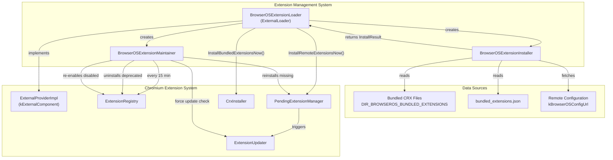
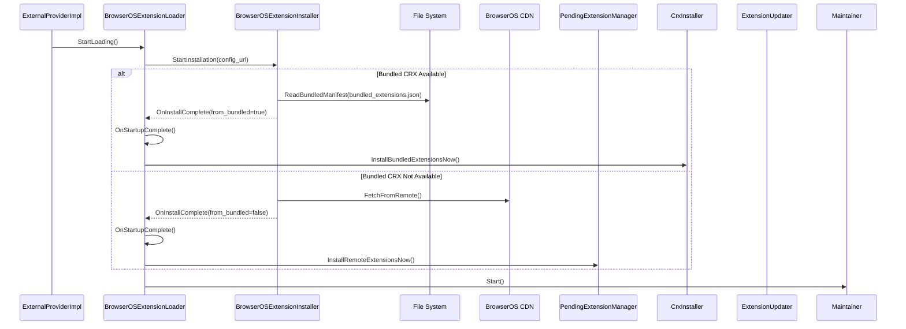

<!-- source: DeepWiki mcp.deepwiki.com · repo browseros-ai/BrowserOS · page 6 Extension System · fetched 2026-10-29 -->

# Extension System

Relevant source files

The following files were used as context for generating this wiki page:

- [packages/browseros/chromium_patches/chrome/browser/about_flags.cc](packages/browseros/chromium_patches/chrome/browser/about_flags.cc)
- [packages/browseros/chromium_patches/chrome/browser/browser_features.cc](packages/browseros/chromium_patches/chrome/browser/browser_features.cc)
- [packages/browseros/chromium_patches/chrome/browser/browser_features.h](packages/browseros/chromium_patches/chrome/browser/browser_features.h)
- [packages/browseros/chromium_patches/chrome/browser/browseros/core/browseros_constants.h](packages/browseros/chromium_patches/chrome/browser/browseros/core/browseros_constants.h)
- [packages/browseros/chromium_patches/chrome/browser/browseros/extensions/browseros_extension_installer.cc](packages/browseros/chromium_patches/chrome/browser/browseros/extensions/browseros_extension_installer.cc)
- [packages/browseros/chromium_patches/chrome/browser/browseros/extensions/browseros_extension_loader.cc](packages/browseros/chromium_patches/chrome/browser/browseros/extensions/browseros_extension_loader.cc)
- [packages/browseros/chromium_patches/chrome/browser/browseros/extensions/browseros_extension_loader.h](packages/browseros/chromium_patches/chrome/browser/browseros/extensions/browseros_extension_loader.h)
- [packages/browseros/chromium_patches/chrome/browser/browseros/extensions/browseros_extension_maintainer.cc](packages/browseros/chromium_patches/chrome/browser/browseros/extensions/browseros_extension_maintainer.cc)
- [packages/browseros/chromium_patches/chrome/browser/extensions/BUILD.gn](packages/browseros/chromium_patches/chrome/browser/extensions/BUILD.gn)
- [packages/browseros/chromium_patches/chrome/browser/extensions/api/side_panel/side_panel_service.cc](packages/browseros/chromium_patches/chrome/browser/extensions/api/side_panel/side_panel_service.cc)
- [packages/browseros/chromium_patches/chrome/browser/extensions/chrome_extension_registrar_delegate.cc](packages/browseros/chromium_patches/chrome/browser/extensions/chrome_extension_registrar_delegate.cc)
- [packages/browseros/chromium_patches/chrome/browser/extensions/extension_context_menu_model.cc](packages/browseros/chromium_patches/chrome/browser/extensions/extension_context_menu_model.cc)
- [packages/browseros/chromium_patches/chrome/browser/extensions/extension_management.cc](packages/browseros/chromium_patches/chrome/browser/extensions/extension_management.cc)
- [packages/browseros/chromium_patches/chrome/browser/extensions/external_provider_impl.cc](packages/browseros/chromium_patches/chrome/browser/extensions/external_provider_impl.cc)
- [packages/browseros/chromium_patches/chrome/browser/extensions/updater/extension_updater.cc](packages/browseros/chromium_patches/chrome/browser/extensions/updater/extension_updater.cc)
- [packages/browseros/chromium_patches/chrome/browser/extensions/updater/extension_updater.h](packages/browseros/chromium_patches/chrome/browser/extensions/updater/extension_updater.h)
- [packages/browseros/chromium_patches/chrome/browser/flag_descriptions.h](packages/browseros/chromium_patches/chrome/browser/flag_descriptions.h)
- [packages/browseros/chromium_patches/chrome/browser/global_keyboard_shortcuts_mac.mm](packages/browseros/chromium_patches/chrome/browser/global_keyboard_shortcuts_mac.mm)
- [packages/browseros/chromium_patches/chrome/browser/ui/accelerator_table.cc](packages/browseros/chromium_patches/chrome/browser/ui/accelerator_table.cc)
- [packages/browseros/chromium_patches/chrome/browser/ui/browser_actions.cc](packages/browseros/chromium_patches/chrome/browser/ui/browser_actions.cc)
- [packages/browseros/chromium_patches/chrome/browser/ui/browser_command_controller.cc](packages/browseros/chromium_patches/chrome/browser/ui/browser_command_controller.cc)
- [packages/browseros/chromium_patches/chrome/browser/ui/browser_ui_prefs.cc](packages/browseros/chromium_patches/chrome/browser/ui/browser_ui_prefs.cc)
- [packages/browseros/chromium_patches/chrome/browser/ui/extensions/settings_overridden_params_providers.cc](packages/browseros/chromium_patches/chrome/browser/ui/extensions/settings_overridden_params_providers.cc)
- [packages/browseros/chromium_patches/chrome/browser/ui/toolbar/toolbar_actions_model.cc](packages/browseros/chromium_patches/chrome/browser/ui/toolbar/toolbar_actions_model.cc)
- [packages/browseros/chromium_patches/chrome/browser/ui/views/side_panel/BUILD.gn](packages/browseros/chromium_patches/chrome/browser/ui/views/side_panel/BUILD.gn)
- [packages/browseros/chromium_patches/chrome/browser/ui/views/side_panel/extensions/extension_side_panel_manager.cc](packages/browseros/chromium_patches/chrome/browser/ui/views/side_panel/extensions/extension_side_panel_manager.cc)

The Extension System manages privileged BrowserOS extensions that are bundled with the browser and provide core functionality. These extensions receive elevated privileges, cannot be disabled by users, and are automatically installed and maintained throughout the browser's lifecycle.

For information about specific bundled extensions and their roles, see [BrowserOS Extensions](#6.2). For extension lifecycle details including updates, see [Extension Lifecycle](#6.3).

---

## Purpose and Scope

This document describes the technical architecture and implementation of BrowserOS's privileged extension system, which differs from standard Chrome extension management in several key ways:

- **Privileged Extensions**: BrowserOS extensions run with elevated permissions and cannot be disabled or uninstalled by users. [packages/browseros/chromium_patches/chrome/browser/extensions/chrome_extension_registrar_delegate.cc:332-341]()
- **Automatic Installation**: Extensions install from bundled CRX files or remote configuration without user interaction. [packages/browseros/chromium_patches/chrome/browser/browseros/extensions/browseros_extension_installer.cc:71-84]()
- **Periodic Maintenance**: A background maintenance system ensures extensions remain installed, enabled, and up-to-date. [packages/browseros/chromium_patches/chrome/browser/browseros/extensions/browseros_extension_maintainer.cc:44-45]()
- **URL Routing**: Virtual `chrome://browseros/*` URLs map to specific extension pages for seamless branded navigation. [packages/browseros/chromium_patches/chrome/browser/browseros/core/browseros_constants.h:136-141]()

This system is separate from standard Chrome Web Store extensions, which users can install normally.

---

## Architecture Overview

The extension system consists of three primary components that work together to manage the complete lifecycle of BrowserOS extensions:

### Component Interaction Diagram

**Sources**: [packages/browseros/chromium_patches/chrome/browser/browseros/extensions/browseros_extension_loader.h:39-88](), [packages/browseros/chromium_patches/chrome/browser/browseros/extensions/browseros_extension_installer.cc:62-84](), [packages/browseros/chromium_patches/chrome/browser/browseros/extensions/browseros_extension_maintainer.cc:66-91]()

---

## Core Components

### BrowserOSExtensionLoader
The `BrowserOSExtensionLoader` class extends Chromium's `ExternalLoader` and orchestrates the entire extension management lifecycle. It is registered as an external provider in `ExternalProviderImpl`.

**Key responsibilities**:
- Coordinates initial installation via `BrowserOSExtensionInstaller`. [packages/browseros/chromium_patches/chrome/browser/browseros/extensions/browseros_extension_loader.cc:58-61]()
- Initiates immediate installation after startup using either bundled CRX files or remote configuration. [packages/browseros/chromium_patches/chrome/browser/browseros/extensions/browseros_extension_loader.cc:143-153]()
- Creates and starts the `BrowserOSExtensionMaintainer` for periodic upkeep. [packages/browseros/chromium_patches/chrome/browser/browseros/extensions/browseros_extension_loader.cc:156]()

For details, see [Extension Architecture](#6.1).

### BrowserOSExtensionInstaller
The `BrowserOSExtensionInstaller` handles the initial installation logic with a fallback strategy:
1. **Bundled CRX (Preferred)**: Attempts to load extensions from `DIR_BROWSEROS_BUNDLED_EXTENSIONS` using `bundled_extensions.json`. [packages/browseros/chromium_patches/chrome/browser/browseros/extensions/browseros_extension_installer.cc:86-110]()
2. **Remote Configuration (Fallback)**: Fetches configuration from CDN if bundled files are unavailable. [packages/browseros/chromium_patches/chrome/browser/browseros/extensions/browseros_extension_installer.cc:198-202]()

For details, see [Extension Lifecycle](#6.3).

### BrowserOSExtensionMaintainer
The `BrowserOSExtensionMaintainer` runs periodic maintenance cycles every 15 minutes to ensure extensions remain in the correct state. [packages/browseros/chromium_patches/chrome/browser/browseros/extensions/browseros_extension_maintainer.cc:44-45]()

| Maintenance Task | Implementation | Purpose |
|-----------------|----------------|---------|
| **Uninstall Inactive** | `UninstallInactiveProductExtensions()` | Removes extensions not belonging to current product variant [packages/browseros/chromium_patches/chrome/browser/browseros/extensions/browseros_extension_maintainer.cc:186]() |
| **Reinstall Missing** | `ReinstallMissingExtensions()` | Restores accidentally uninstalled extensions [packages/browseros/chromium_patches/chrome/browser/browseros/extensions/browseros_extension_maintainer.cc:188]() |
| **Re-enable Disabled** | `ReenableDisabledExtensions()` | Re-enables extensions disabled by user or error [packages/browseros/chromium_patches/chrome/browser/browseros/extensions/browseros_extension_maintainer.cc:189]() |
| **Force Update Check** | `ForceUpdateCheck()` | Triggers update check for all BrowserOS extensions [packages/browseros/chromium_patches/chrome/browser/browseros/extensions/browseros_extension_maintainer.cc:190]() |

---

## Extension Installation Flow

The installation process follows different paths depending on whether bundled CRX files are available:

### Sequence: Startup to Installation

**Sources**: [packages/browseros/chromium_patches/chrome/browser/browseros/extensions/browseros_extension_loader.cc:52-97](), [packages/browseros/chromium_patches/chrome/browser/browseros/extensions/browseros_extension_installer.cc:71-110]()

---

## Extension Registry and Constants

BrowserOS extensions are identified by hardcoded IDs used for privilege verification and UI integration.

| Extension | ID Constant | Role |
|-----------|-------------|------|
| **Agent** | `kAgentExtensionId` | Main AI assistant interface [packages/browseros/chromium_patches/chrome/browser/browseros/core/browseros_constants.h:35]() |
| **Bug Reporter** | `kBugReporterExtensionId` | Feedback and diagnostic tool [packages/browseros/chromium_patches/chrome/browser/browseros/core/browseros_constants.h:37]() |
| **Browser Claw** | `kBrowserClawExtensionId` | Alternative product interface [packages/browseros/chromium_patches/chrome/browser/browseros/core/browseros_constants.h:40]() |

For details, see [BrowserOS Extensions](#6.2).

---

## Extension Privileges

BrowserOS extensions receive several elevated privileges that distinguish them from standard Chrome extensions:

### Non-Disableable
Extensions cannot be disabled by users. The system explicitly blocks disabling for active BrowserOS extension IDs in `ChromeExtensionRegistrarDelegate::CanDisableExtension`. [packages/browseros/chromium_patches/chrome/browser/extensions/chrome_extension_registrar_delegate.cc:332-341]()

### Force-Pinned
Registered BrowserOS extensions marked as pinned (e.g., Bug Reporter) are automatically added to the force-pinned list, preventing users from unpinning them from the toolbar. [packages/browseros/chromium_patches/chrome/browser/ui/toolbar/toolbar_actions_model.cc:18-20]()

### Persistent Storage
When an extension is uninstalled (e.g., during a configuration swap), its local storage is preserved to prevent data loss. [packages/browseros/chromium_patches/chrome/browser/extensions/chrome_extension_registrar_delegate.cc:257-264]()

### External Component Location
All BrowserOS extensions are installed with `ManifestLocation::kExternalComponent`, allowing them to bypass certain security restrictions applied to user-installed extensions. [packages/browseros/chromium_patches/chrome/browser/browseros/extensions/browseros_extension_loader.cc:200]()

For details, see [Extension Privileges](#6.4).

---

## URL Routing System

BrowserOS implements a virtual URL system that maps `chrome://browseros/*` URLs to specific extension pages. This allows for branded URLs like `chrome://browseros/settings` instead of long `chrome-extension://...` strings.

### URL Mapping Table
| Virtual Path | Extension ID | Extension Page | Fragment |
|--------------|--------------|----------------|----------|
| `/settings` | `kAgentExtensionId` | `app.html` | `/settings` |
| `/mcp` | `kAgentExtensionId` | `app.html` | `/mcp` |
| `/onboarding` | `kAgentExtensionId` | `app.html` | `/onboarding` |
| `/claw` | `kBrowserClawExtensionId` | `newtab.html` | (none) |

**Sources**: [packages/browseros/chromium_patches/chrome/browser/browseros/core/browseros_constants.h:136-141]()

For details, see [URL Routing](#6.5).

**Sources**:
- [packages/browseros/chromium_patches/chrome/browser/browseros/extensions/browseros_extension_loader.cc:34-157]()
- [packages/browseros/chromium_patches/chrome/browser/browseros/extensions/browseros_extension_installer.cc:71-196]()
- [packages/browseros/chromium_patches/chrome/browser/browseros/extensions/browseros_extension_maintainer.cc:183-192]()
- [packages/browseros/chromium_patches/chrome/browser/extensions/chrome_extension_registrar_delegate.cc:257-264]()
- [packages/browseros/chromium_patches/chrome/browser/extensions/chrome_extension_registrar_delegate.cc:332-341]()
- [packages/browseros/chromium_patches/chrome/browser/browseros/core/browseros_constants.h:35-171]()
- [packages/browseros/chromium_patches/chrome/browser/ui/toolbar/toolbar_actions_model.cc:18-20]()

---

