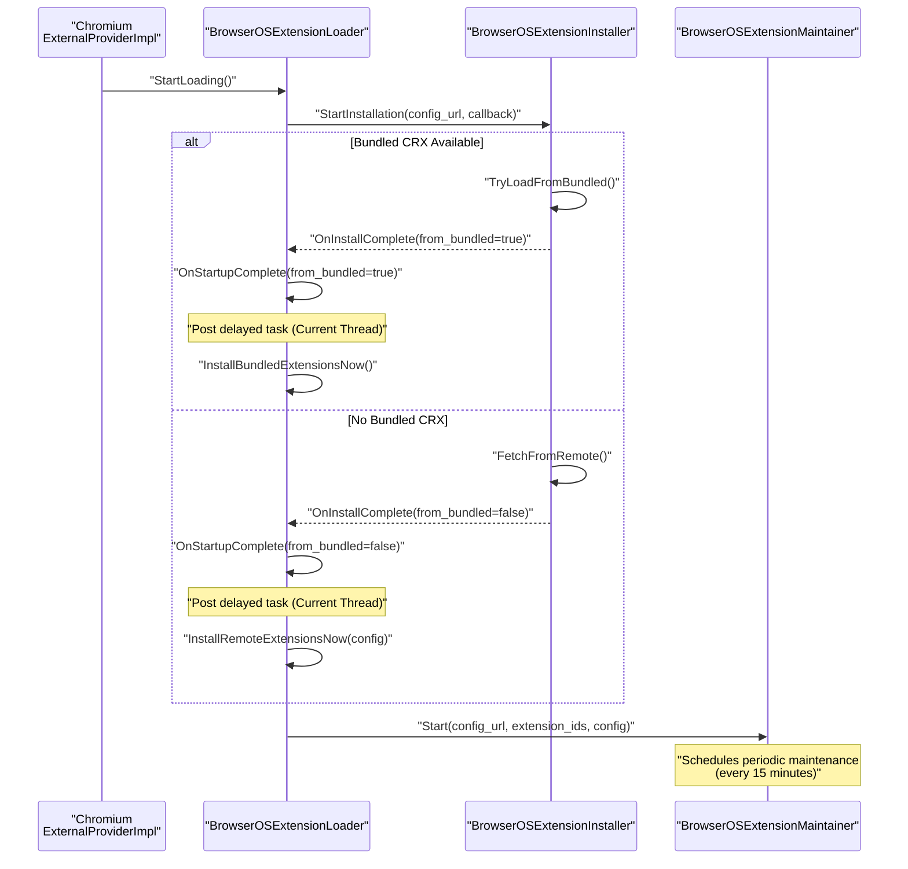
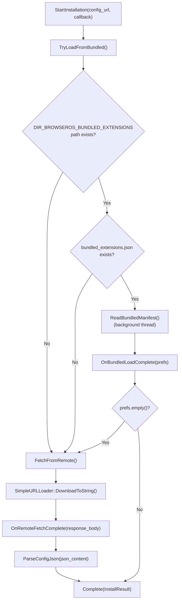
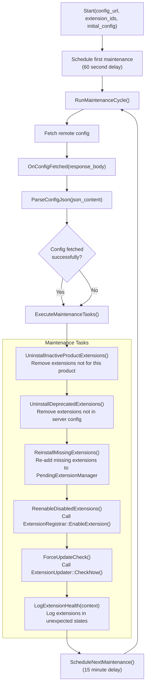

<!-- source: DeepWiki mcp.deepwiki.com · repo browseros-ai/BrowserOS · page 6.1 Extension Architecture · fetched 2026-10-29 -->

# Extension Architecture

<details>
<summary>Relevant source files</summary>

The following files were used as context for generating this wiki page:

- [packages/browseros/chromium_patches/chrome/browser/about_flags.cc](packages/browseros/chromium_patches/chrome/browser/about_flags.cc)
- [packages/browseros/chromium_patches/chrome/browser/browser_features.cc](packages/browseros/chromium_patches/chrome/browser/browser_features.cc)
- [packages/browseros/chromium_patches/chrome/browser/browser_features.h](packages/browseros/chromium_patches/chrome/browser/browser_features.h)
- [packages/browseros/chromium_patches/chrome/browser/browseros/core/browseros_constants.h](packages/browseros/chromium_patches/chrome/browser/browseros/core/browseros_constants.h)
- [packages/browseros/chromium_patches/chrome/browser/browseros/extensions/browseros_extension_installer.cc](packages/browseros/chromium_patches/chrome/browser/browseros/extensions/browseros_extension_installer.cc)
- [packages/browseros/chromium_patches/chrome/browser/browseros/extensions/browseros_extension_loader.cc](packages/browseros/chromium_patches/chrome/browser/browseros/extensions/browseros_extension_loader.cc)
- [packages/browseros/chromium_patches/chrome/browser/browseros/extensions/browseros_extension_loader.h](packages/browseros/chromium_patches/chrome/browser/browseros/extensions/browseros_extension_loader.h)
- [packages/browseros/chromium_patches/chrome/browser/browseros/extensions/browseros_extension_maintainer.cc](packages/browseros/chromium_patches/chrome/browser/browseros/extensions/browseros_extension_maintainer.cc)
- [packages/browseros/chromium_patches/chrome/browser/extensions/external_provider_impl.cc](packages/browseros/chromium_patches/chrome/browser/extensions/external_provider_impl.cc)
- [packages/browseros/chromium_patches/chrome/browser/extensions/updater/extension_updater.cc](packages/browseros/chromium_patches/chrome/browser/extensions/updater/extension_updater.cc)
- [packages/browseros/chromium_patches/chrome/browser/extensions/updater/extension_updater.h](packages/browseros/chromium_patches/chrome/browser/extensions/updater/extension_updater.h)
- [packages/browseros/chromium_patches/chrome/browser/flag_descriptions.h](packages/browseros/chromium_patches/chrome/browser/flag_descriptions.h)

</details>


BrowserOS uses a custom extension management system to install and maintain privileged extensions. The system consists of three primary components: the **Extension Loader**, which orchestrates the overall process; the **Extension Installer**, which handles initial installation from bundled CRX files or remote configuration; and the **Extension Maintainer**, which performs periodic maintenance tasks to ensure extensions remain installed and up-to-date.

This page documents the architecture and implementation of these components. For information about specific bundled extensions, see page 6.2. For extension lifecycle details, see page 6.3. For extension privileges and URL routing, see pages 6.4 and 6.5.

---

## Component Overview

The extension management system consists of three C++ classes that work together to handle the complete lifecycle of BrowserOS extensions. It integrates with Chromium's `ExternalProviderImpl` to inject these extensions into the browser profile [packages/browseros/chromium_patches/chrome/browser/extensions/external_provider_impl.cc:922-952]().

**Component Architecture**

```mermaid
graph TB
    subgraph "Chromium Extension System"
        ExternalProviderImpl["ExternalProviderImpl<br/>(Chromium)"]
        ExternalLoader["ExternalLoader<br/>(base class)"]
        ExtensionUpdater["ExtensionUpdater"]
        PendingExtensionManager["PendingExtensionManager"]
    end
    
    subgraph "BrowserOS Extension Management"
        Loader["BrowserOSExtensionLoader<br/>Orchestrates installation and maintenance"]
        Installer["BrowserOSExtensionInstaller<br/>Handles initial installation"]
        Maintainer["BrowserOSExtensionMaintainer<br/>Periodic maintenance tasks"]
    end
    
    subgraph "Extension Sources"
        BundledCRX["Bundled CRX Files<br/>DIR_BROWSEROS_BUNDLED_EXTENSIONS"]
        RemoteConfig["Remote Configuration<br/>cdn.browseros.com/extensions"]
    end
    
    subgraph "Extension Definitions"
        Constants["browseros_constants.h<br/>Extension IDs and URLs"]
    end
    
    ExternalLoader <|-- Loader
    ExternalProviderImpl -->|"uses"| Loader
    
    Loader -->|"creates and uses"| Installer
    Loader -->|"creates and uses"| Maintainer
    
    Installer -->|"reads from"| BundledCRX
    Installer -->|"fetches from"| RemoteConfig
    
    Maintainer -->|"fetches from"| RemoteConfig
    Maintainer -->|"uses"| ExtensionUpdater
    Maintainer -->|"uses"| PendingExtensionManager
    
    Loader -->|"reads"| Constants
    Installer -->|"reads"| Constants
    Maintainer -->|"reads"| Constants
```

**Component Responsibilities**

| Component | Primary Responsibilities | Key Files |
|-----------|-------------------------|-----------|
| `BrowserOSExtensionLoader` | Orchestrates installation flow; inherits from `ExternalLoader`; manages startup sequence | [packages/browseros/chromium_patches/chrome/browser/browseros/extensions/browseros_extension_loader.h:39-88](), [packages/browseros/chromium_patches/chrome/browser/browseros/extensions/browseros_extension_loader.cc:40-68]() |
| `BrowserOSExtensionInstaller` | Attempts bundled CRX installation first; falls back to remote config; parses JSON configurations | [packages/browseros/chromium_patches/chrome/browser/browseros/extensions/browseros_extension_installer.cc:62-84]() |
| `BrowserOSExtensionMaintainer` | Runs every 15 minutes; reinstalls missing extensions; re-enables disabled extensions; uninstalls deprecated extensions | [packages/browseros/chromium_patches/chrome/browser/browseros/extensions/browseros_extension_maintainer.cc:66-87]() |

**Sources:**
- [packages/browseros/chromium_patches/chrome/browser/browseros/extensions/browseros_extension_loader.h:39-88]()
- [packages/browseros/chromium_patches/chrome/browser/browseros/extensions/browseros_extension_loader.cc:40-68]()
- [packages/browseros/chromium_patches/chrome/browser/browseros/extensions/browseros_extension_installer.cc:62-84]()
- [packages/browseros/chromium_patches/chrome/browser/browseros/extensions/browseros_extension_maintainer.cc:66-87]()
- [packages/browseros/chromium_patches/chrome/browser/extensions/external_provider_impl.cc:922-952]()

---

## Extension Loader

`BrowserOSExtensionLoader` inherits from Chromium's `extensions::ExternalLoader` base class and serves as the entry point for BrowserOS extension management. It implements the startup sequence and delegates to the installer and maintainer components [packages/browseros/chromium_patches/chrome/browser/browseros/extensions/browseros_extension_loader.cc:52-61]().

**Extension Loader Class Structure**

```mermaid
graph TB
    ExternalLoader["extensions::ExternalLoader<br/>(Chromium base class)"]
    BrowserOSExtensionLoader["BrowserOSExtensionLoader"]
    
    subgraph "Key Methods"
        StartLoading["StartLoading()<br/>Called by Chromium on startup"]
        OnInstallComplete["OnInstallComplete(InstallResult)<br/>Receives installer results"]
        OnStartupComplete["OnStartupComplete(bool from_bundled)<br/>Convergence point for both paths"]
        InstallRemoteExtensionsNow["InstallRemoteExtensionsNow(config)<br/>Force-installs from update URLs"]
        InstallBundledExtensionsNow["InstallBundledExtensionsNow()<br/>Force-installs from bundled CRX"]
        GetBaseCrxFilePath["GetBaseCrxFilePath()<br/>Returns bundled CRX directory"]
    end
    
    subgraph "State Management"
        config_url["config_url_: GURL<br/>Alpha or stable config"]
        bundled_crx_base_path["bundled_crx_base_path_: FilePath<br/>Bundled extensions directory"]
        extension_ids["extension_ids_: set<string><br/>Extension IDs to manage"]
        bundled_versions["bundled_versions_: map<string, string><br/>Version strings for bundled extensions"]
        installer["installer_: unique_ptr<Installer>"]
        maintainer["maintainer_: unique_ptr<Maintainer>"]
    end
    
    ExternalLoader <|-- BrowserOSExtensionLoader
    
    BrowserOSExtensionLoader --> StartLoading
    BrowserOSExtensionLoader --> OnInstallComplete
    BrowserOSExtensionLoader --> OnStartupComplete
    BrowserOSExtensionLoader --> InstallRemoteExtensionsNow
    BrowserOSExtensionLoader --> InstallBundledExtensionsNow
    BrowserOSExtensionLoader --> GetBaseCrxFilePath
    
    BrowserOSExtensionLoader --> config_url
    BrowserOSExtensionLoader --> bundled_crx_base_path
    BrowserOSExtensionLoader --> extension_ids
    BrowserOSExtensionLoader --> bundled_versions
    BrowserOSExtensionLoader --> installer
    BrowserOSExtensionLoader --> maintainer
```

**Startup Sequence**

The loader implements a two-phase startup process that attempts bundled installation first, then falls back to remote configuration [packages/browseros/chromium_patches/chrome/browser/browseros/extensions/browseros_extension_loader.cc:136-157]():



**Configuration URL Selection**

The loader selects between alpha and stable configuration URLs based on the `kBrowserOsAlphaFeatures` feature flag [packages/browseros/chromium_patches/chrome/browser/browseros/extensions/browseros_extension_loader.cc:36-39]():

- **Stable**: `kBrowserOSConfigUrl` [packages/browseros/chromium_patches/chrome/browser/browseros/core/browseros_constants.h:30-31]()
- **Alpha**: `kBrowserOSAlphaConfigUrl` [packages/browseros/chromium_patches/chrome/browser/browseros/core/browseros_constants.h:32-33]()

The `kBrowserOsAlphaFeatures` flag can be enabled via `chrome://flags` [packages/browseros/chromium_patches/chrome/browser/about_flags.cc:10-14](), and its description is defined in `flag_descriptions.h` [packages/browseros/chromium_patches/chrome/browser/flag_descriptions.h:10-13]().

**Fallback Logic**

If both bundled and remote installation fail, the loader attempts to reconstruct preferences from already-installed extensions via `ReconstructPrefsFromInstalledExtensions()` [packages/browseros/chromium_patches/chrome/browser/browseros/extensions/browseros_extension_loader.cc:99-130](). This prevents the system from accidentally uninstalling critical extensions due to network or filesystem errors.

**Sources:**
- [packages/browseros/chromium_patches/chrome/browser/browseros/extensions/browseros_extension_loader.h:39-88]()
- [packages/browseros/chromium_patches/chrome/browser/browseros/extensions/browseros_extension_loader.cc:36-157]()
- [packages/browseros/chromium_patches/chrome/browser/browser_features.cc:9-14]()
- [packages/browseros/chromium_patches/chrome/browser/browser_features.h:9-10]()
- [packages/browseros/chromium_patches/chrome/browser/about_flags.cc:10-14]()
- [packages/browseros/chromium_patches/chrome/browser/flag_descriptions.h:10-13]()
- [packages/browseros/chromium_patches/chrome/browser/browseros/core/browseros_constants.h:30-33]()

---

## Extension Installer

`BrowserOSExtensionInstaller` handles the initial installation attempt at browser startup. It implements a fallback strategy: first attempting to load from bundled CRX files (for offline/fast installation), then falling back to remote configuration if bundled files are unavailable [packages/browseros/chromium_patches/chrome/browser/browseros/extensions/browseros_extension_installer.cc:79-84]().

**Installation Flow**



**Bundled Extension Loading**

When loading from bundled CRX files, the installer reads a `bundled_extensions.json` manifest located in the `DIR_BROWSEROS_BUNDLED_EXTENSIONS` directory [packages/browseros/chromium_patches/chrome/browser/browseros/extensions/browseros_extension_installer.cc:87-96]().

The installer validates that each referenced CRX file exists and that the extension ID is registered via `IsActiveBrowserOSExtension()` [packages/browseros/chromium_patches/chrome/browser/browseros/extensions/browseros_extension_installer.cc:137-169]().

**Remote Configuration Format**

When fetching from remote configuration, the installer expects a JSON structure with an `extensions` key [packages/browseros/chromium_patches/chrome/browser/browseros/extensions/browseros_extension_installer.cc:259-268](). It uses `network::SimpleURLLoader` to fetch this config with a specific traffic annotation [packages/browseros/chromium_patches/chrome/browser/browseros/extensions/browseros_extension_installer.cc:37-53]().

**Sources:**
- [packages/browseros/chromium_patches/chrome/browser/browseros/extensions/browseros_extension_installer.cc:71-196]()
- [packages/browseros/chromium_patches/chrome/browser/browseros/extensions/browseros_extension_installer.cc:259-268]()
- [packages/browseros/chromium_patches/chrome/browser/browseros/extensions/browseros_extension_installer.cc:37-53]()

---

## Extension Maintainer

`BrowserOSExtensionMaintainer` runs periodic maintenance tasks to ensure BrowserOS extensions remain installed, enabled, and up-to-date. It operates on a 15-minute timer after an initial 60-second delay [packages/browseros/chromium_patches/chrome/browser/browseros/extensions/browseros_extension_maintainer.cc:44-45]().

**Maintenance Cycle**



**Maintenance Task Details**

| Task | Implementation | Purpose |
|------|----------------|---------|
| **UninstallInactiveProductExtensions** | Checks if installed extensions belong to the current `BrowserOSExtensionProduct` [packages/browseros/chromium_patches/chrome/browser/browseros/extensions/browseros_extension_maintainer.cc:195-223]() | Remove extensions from other product variants (e.g. BrowserClaw) |
| **UninstallDeprecatedExtensions** | Compares installed BrowserOS extensions against server config; uninstalls any not present [packages/browseros/chromium_patches/chrome/browser/browseros/extensions/browseros_extension_maintainer.cc:225-251]() | Clean up old extensions removed from configuration |
| **ReinstallMissingExtensions** | Checks registry for each extension ID; adds missing extensions to `PendingExtensionManager` [packages/browseros/chromium_patches/chrome/browser/browseros/extensions/browseros_extension_maintainer.cc:253-299]() | Recover from accidental uninstallation |
| **ReenableDisabledExtensions** | Checks `registry->disabled_extensions()`; calls `ExtensionRegistrar::EnableExtension()` [packages/browseros/chromium_patches/chrome/browser/browseros/extensions/browseros_extension_maintainer.cc:301-337]() | Prevent users from disabling critical extensions |
| **ForceUpdateCheck** | Calls `ExtensionUpdater::CheckNow()` for all BrowserOS extension IDs [packages/browseros/chromium_patches/chrome/browser/browseros/extensions/browseros_extension_maintainer.cc:339-358]() | Trigger update checks for extensions |

**Sources:**
- [packages/browseros/chromium_patches/chrome/browser/browseros/extensions/browseros_extension_maintainer.cc:44-45]()
- [packages/browseros/chromium_patches/chrome/browser/browseros/extensions/browseros_extension_maintainer.cc:183-438]()

---

## Integration with Chromium Extension System

BrowserOS extensions are treated as privileged components within the Chromium infrastructure.

**Immediate Installation via ExtensionUpdater**

The `ExtensionUpdater` is extended with `InstallPendingNow`, which allows BrowserOS to force-install pending extensions immediately without waiting for the standard background update timer [packages/browseros/chromium_patches/chrome/browser/extensions/updater/extension_updater.cc:9-101]().

**Privileged External Provider**

BrowserOS injects a custom `ExternalProviderImpl` into the provider list. This provider uses `ManifestLocation::kExternalComponent` for both bundled and remote installs, granting higher privilege levels [packages/browseros/chromium_patches/chrome/browser/extensions/external_provider_impl.cc:940-951]().

**Virtual URL Mapping**

The system supports mapping virtual paths to specific extension pages. For example, `chrome://browseros/settings` is mapped to the Agent extension's `app.html` with a `/settings` hash [packages/browseros/chromium_patches/chrome/browser/browseros/core/browseros_constants.h:136-141](). This is managed via `GetBrowserOSExtensionURL` and `GetBrowserOSVirtualURL` [packages/browseros/chromium_patches/chrome/browser/browseros/core/browseros_constants.h:156-215]().

**Sources:**
- [packages/browseros/chromium_patches/chrome/browser/extensions/updater/extension_updater.cc:9-101]()
- [packages/browseros/chromium_patches/chrome/browser/browseros/core/browseros_constants.h:70-215]()
- [packages/browseros/chromium_patches/chrome/browser/extensions/external_provider_impl.cc:922-952]()

---

