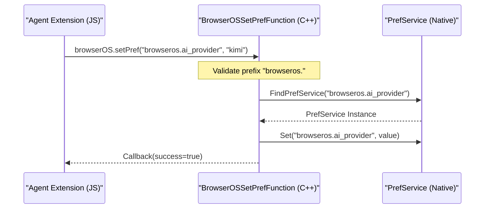
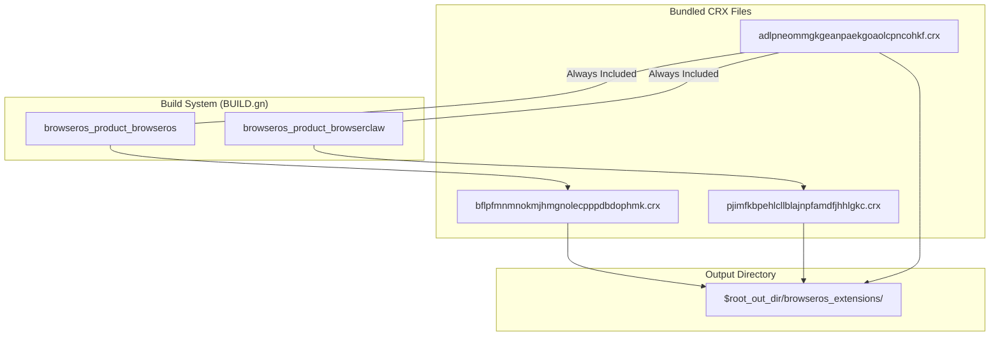

<!-- source: DeepWiki mcp.deepwiki.com · repo browseros-ai/BrowserOS · page 6.2 BrowserOS Extensions · fetched 2026-10-29 -->

# BrowserOS Extensions

Relevant source files

The following files were used as context for generating this wiki page:

- [packages/browseros/bos_build/steps/patches/product_payload_manifest_test.py](packages/browseros/bos_build/steps/patches/product_payload_manifest_test.py)
- [packages/browseros/chromium_patches/chrome/browser/browseros/bundled_extensions/BUILD.gn](packages/browseros/chromium_patches/chrome/browser/browseros/bundled_extensions/BUILD.gn)
- [packages/browseros/chromium_patches/chrome/browser/extensions/api/browser_os/browser_os_api.cc](packages/browseros/chromium_patches/chrome/browser/extensions/api/browser_os/browser_os_api.cc)
- [packages/browseros/chromium_patches/chrome/browser/extensions/api/browser_os/browser_os_api.h](packages/browseros/chromium_patches/chrome/browser/extensions/api/browser_os/browser_os_api.h)
- [packages/browseros/chromium_patches/chrome/browser/extensions/api/browser_os/browser_os_api_helpers.cc](packages/browseros/chromium_patches/chrome/browser/extensions/api/browser_os/browser_os_api_helpers.cc)
- [packages/browseros/chromium_patches/chrome/browser/extensions/api/browser_os/browser_os_api_helpers.h](packages/browseros/chromium_patches/chrome/browser/extensions/api/browser_os/browser_os_api_helpers.h)
- [packages/browseros/chromium_patches/chrome/browser/extensions/api/browser_os/browser_os_api_utils.cc](packages/browseros/chromium_patches/chrome/browser/extensions/api/browser_os/browser_os_api_utils.cc)
- [packages/browseros/chromium_patches/chrome/browser/extensions/api/browser_os/browser_os_api_utils.h](packages/browseros/chromium_patches/chrome/browser/extensions/api/browser_os/browser_os_api_utils.h)
- [packages/browseros/chromium_patches/chrome/browser/extensions/chrome_extensions_browser_api_provider.cc](packages/browseros/chromium_patches/chrome/browser/extensions/chrome_extensions_browser_api_provider.cc)
- [packages/browseros/chromium_patches/chrome/common/BUILD.gn](packages/browseros/chromium_patches/chrome/common/BUILD.gn)
- [packages/browseros/chromium_patches/chrome/common/chrome_constants.cc](packages/browseros/chromium_patches/chrome/common/chrome_constants.cc)
- [packages/browseros/chromium_patches/chrome/common/extensions/api/browser_os.idl](packages/browseros/chromium_patches/chrome/common/extensions/api/browser_os.idl)
- [packages/browseros/chromium_patches/chrome/installer/mini_installer/chrome.release](packages/browseros/chromium_patches/chrome/installer/mini_installer/chrome.release)
- [packages/browseros/chromium_patches/extensions/browser/extension_function_histogram_value.h](packages/browseros/chromium_patches/extensions/browser/extension_function_histogram_value.h)
- [packages/browseros/chromium_patches/tools/metrics/histograms/metadata/extensions/enums.xml](packages/browseros/chromium_patches/tools/metrics/histograms/metadata/extensions/enums.xml)
- [updates/extensions/bundled-manifest.xml](updates/extensions/bundled-manifest.xml)

## Purpose and Scope

This document describes the bundled BrowserOS extensions that ship with the browser. These extensions are installed automatically, cannot be disabled by users, and provide core functionality for AI integration, browser control, and diagnostics. BrowserOS includes three privileged extensions that form the foundation of its AI-native capabilities, supported by a custom `browserOS` C++ API.

For the broader extension system architecture, see [6.1 Extension Architecture](). For details on their special privileges, see [6.4 Extension Privileges](). For information about how these extensions are loaded and maintained, see [6.3 Extension Lifecycle]().

## Bundled Extensions Overview

BrowserOS ships with three core extensions that are automatically installed and maintained. These extensions are defined in the build system and managed by the extension loader system.

| Extension | Extension ID | Role |
|-----------|-------------|------|
| **Agent** | `bflpfmnmnokmjhmgnolecpppdbdophmk` | AI assistant interface, chat mode, agent mode |
| **Bug Reporter** | `adlpneommgkgeanpaekgoaolcpncohkf` | In-browser bug reporting and diagnostics |
| **BrowserClaw** | `pjimfkbpehlcllblajnpfamdfjhhlgkc` | Specialized agent for the BrowserClaw product variant |

**Bundled Extension Registry**
The browser defines which extensions to bundle during the build process. On macOS, these are placed in the framework bundle's `Resources/browseros_extensions/` directory [packages/browseros/chromium_patches/chrome/browser/browseros/bundled_extensions/BUILD.gn:44-47](). The initial versions are defined in a `bundled_extensions.json` manifest [packages/browseros/chromium_patches/chrome/browser/browseros/bundled_extensions/BUILD.gn:22-25]().

Sources: [packages/browseros/chromium_patches/chrome/browser/browseros/bundled_extensions/BUILD.gn:22-47](), [updates/extensions/bundled-manifest.xml:3-11]()

---

## The `browserOS` Extension API

BrowserOS implements a custom C++ API namespace `browserOS` to provide privileged extensions with system-level access that standard Chromium extensions do not possess. This API is defined via IDL [packages/browseros/chromium_patches/chrome/common/extensions/api/browser_os.idl:12-144]() and implemented in the browser process [packages/browseros/chromium_patches/chrome/browser/extensions/api/browser_os/browser_os_api.cc:85-341]().

### Key API Functions

| Function | Implementation Class | Purpose |
|----------|----------------------|---------|
| `getPref` / `setPref` | `BrowserOSGetPrefFunction` / `BrowserOSSetPrefFunction` | Access and modify `browseros.*` preferences [packages/browseros/chromium_patches/chrome/browser/extensions/api/browser_os/browser_os_api.cc:85-132](). |
| `choosePath` | `BrowserOSChoosePathFunction` | Opens native OS file/folder picker [packages/browseros/chromium_patches/chrome/browser/extensions/api/browser_os/browser_os_api.cc:201-228](). |
| `showToast` | `BrowserOSShowToastFunction` | Displays transient native UI notifications [packages/browseros/chromium_patches/chrome/browser/extensions/api/browser_os/browser_os_api.h:104-114](). |
| `logMetric` | `BrowserOSLogMetricFunction` | Logs events to the `BrowserOSMetrics` system [packages/browseros/chromium_patches/chrome/browser/extensions/api/browser_os/browser_os_api.cc:134-160](). |

### Implementation Flow: Preference Access
The API enforces security by only allowing extensions to modify preferences prefixed with `browseros.` [packages/browseros/chromium_patches/chrome/browser/extensions/api/browser_os/browser_os_api.cc:118-120]().

**Data Flow: Extension Preference Management**

Sources: [packages/browseros/chromium_patches/chrome/browser/extensions/api/browser_os/browser_os_api.cc:112-132](), [packages/browseros/chromium_patches/chrome/common/extensions/api/browser_os.idl:75-92]()

---

## Agent V2: The AI Assistant Interface

The **Agent** extension (`bflpfmnmnokmjhmgnolecpppdbdophmk`) is the primary user interface for BrowserOS AI capabilities. It manifests as a contextual side panel and handles the logic for the "Agent Mode" automation.

### Implementation Details
*   **Automation Bridge:** The agent uses the custom `browserOS` API to interact with the underlying browser state and filesystem (via `choosePath`) [packages/browseros/chromium_patches/chrome/common/extensions/api/browser_os.idl:113-123]().
*   **Metrics Tracking:** The agent logs UI interactions through `browserOS.logMetric`, which prefixes events with `extension.` to distinguish them from native browser events [packages/browseros/chromium_patches/chrome/browser/extensions/api/browser_os/browser_os_api.cc:141-142]().
*   **Version Awareness:** The agent can query both the Chromium base version and the specific BrowserOS build version to ensure compatibility [packages/browseros/chromium_patches/chrome/browser/extensions/api/browser_os/browser_os_api.cc:162-175]().

Sources: [packages/browseros/chromium_patches/chrome/browser/extensions/api/browser_os/browser_os_api.cc:134-175](), [packages/browseros/chromium_patches/chrome/common/extensions/api/browser_os.idl:94-111]()

---

## Bug Reporter and Product Variants

### Bug Reporter
The **Bug Reporter** (`adlpneommgkgeanpaekgoaolcpncohkf`) is a specialized diagnostic tool bundled in all versions of the browser [packages/browseros/chromium_patches/chrome/browser/browseros/bundled_extensions/BUILD.gn:24-25](). It is designed to capture diagnostic information and report it to the BrowserOS team.

### Product-Specific Bundling
BrowserOS uses build flags to determine which additional extensions to bundle based on the target product:
*   **BrowserOS:** Bundles the `Agent` extension [packages/browseros/chromium_patches/chrome/browser/browseros/bundled_extensions/BUILD.gn:27-30]().
*   **BrowserClaw:** Bundles the `BrowserClaw` extension [packages/browseros/chromium_patches/chrome/browser/browseros/bundled_extensions/BUILD.gn:32-35]().

**Entity Mapping: Build to Extension**

Sources: [packages/browseros/chromium_patches/chrome/browser/browseros/bundled_extensions/BUILD.gn:22-41](), [updates/extensions/bundled-manifest.xml:1-12]()

---

## Extension Persistence and Monitoring

To maintain the integrity of the AI experience, BrowserOS tracks extension usage via custom histogram values.

*   **Histogram Tracking:** Every custom `browserOS` API call is logged in the `HistogramValue` enum to monitor extension health and performance [packages/browseros/chromium_patches/extensions/browser/extension_function_histogram_value.h:23-36]().
*   **Metric Enums:** The `enums.xml` file maps these values (e.g., `BROWSER_OS_CHOOSEPATH` at index 1986) for analysis in telemetry dashboards [packages/browseros/chromium_patches/tools/metrics/histograms/metadata/extensions/enums.xml:22-35]().

Sources: [packages/browseros/chromium_patches/extensions/browser/extension_function_histogram_value.h:9-36](), [packages/browseros/chromium_patches/tools/metrics/histograms/metadata/extensions/enums.xml:9-35]()

---

