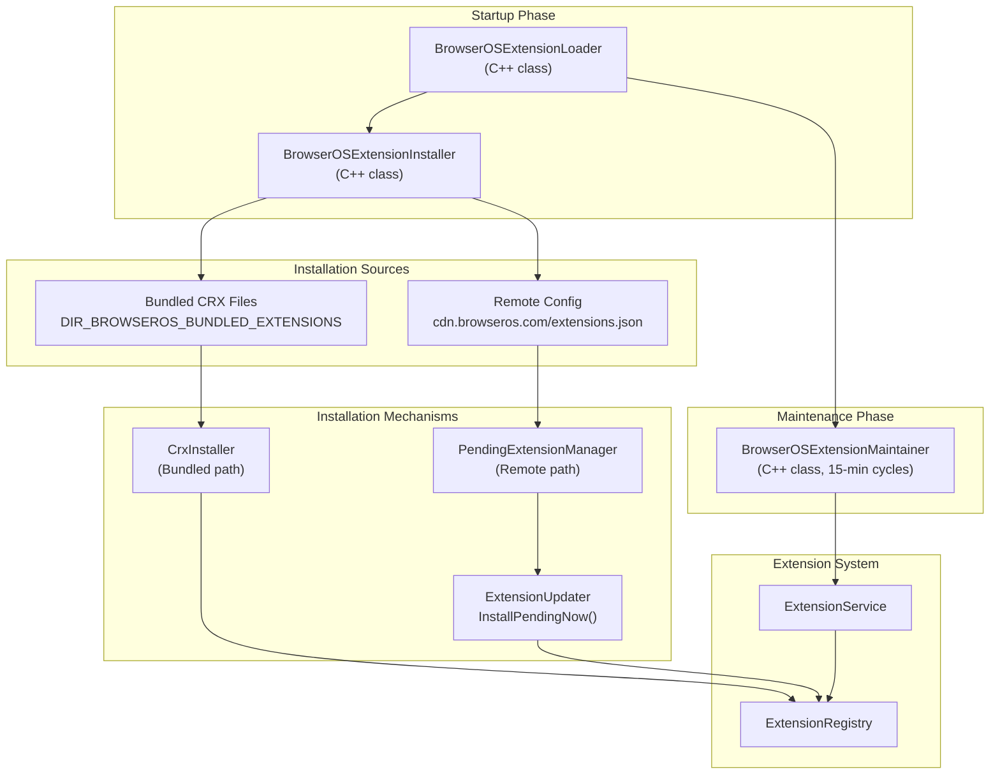
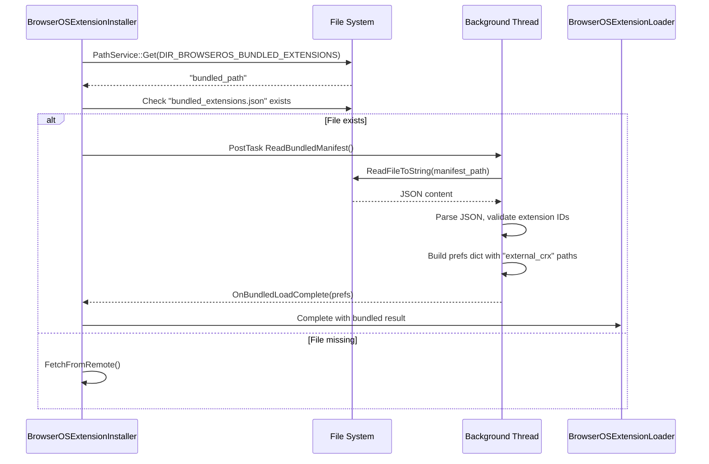
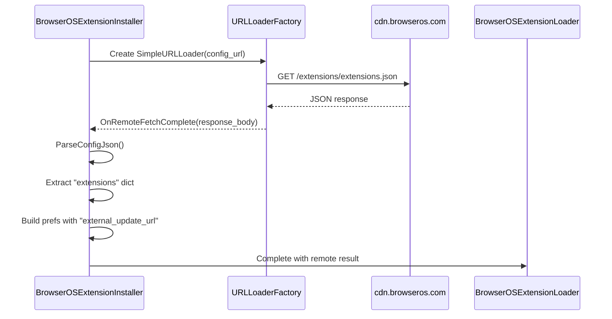
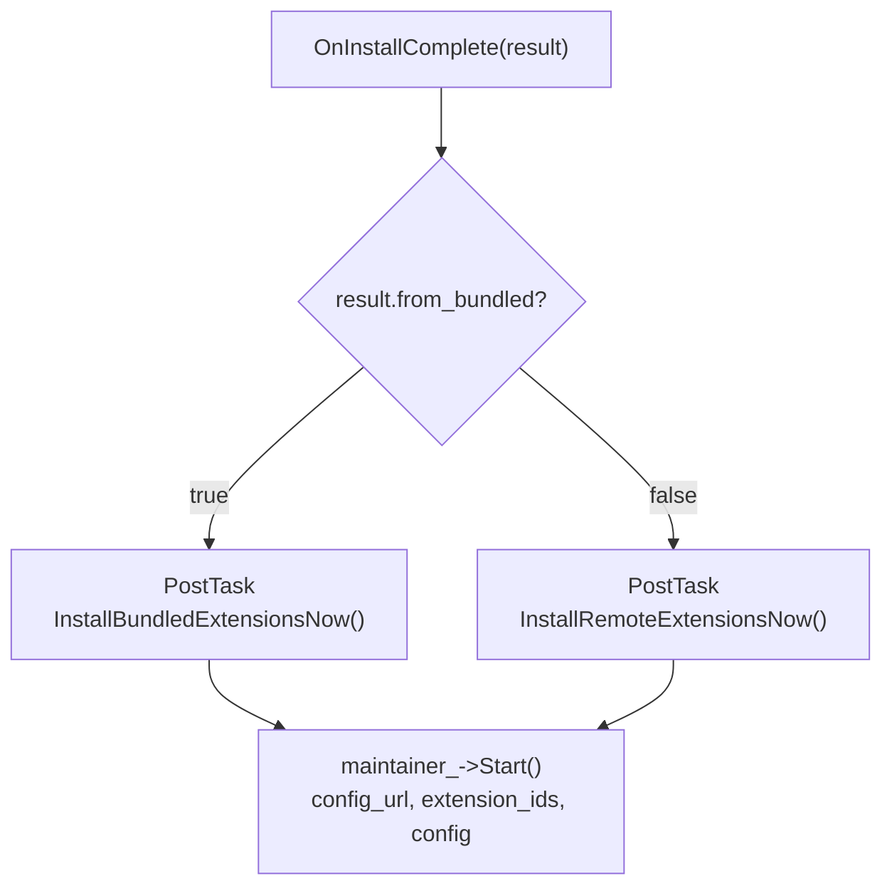
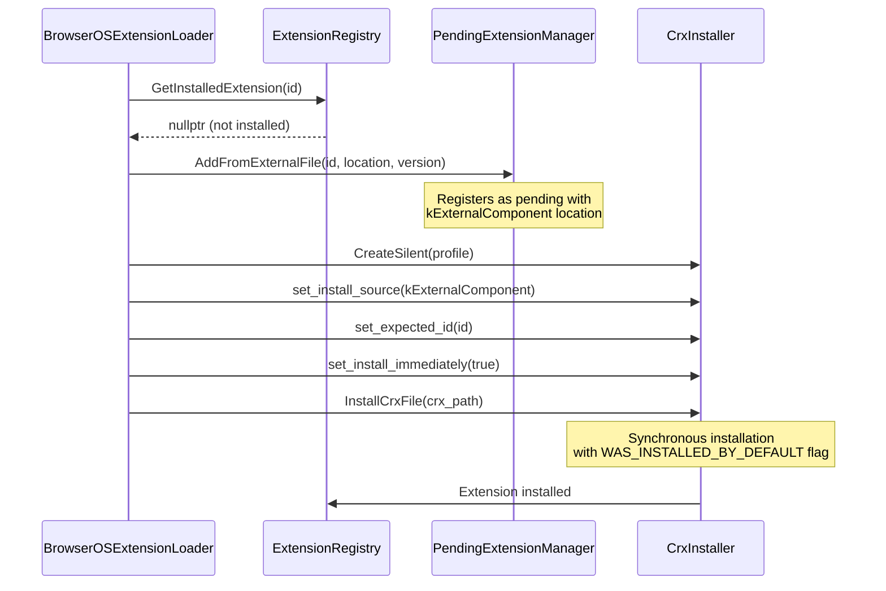
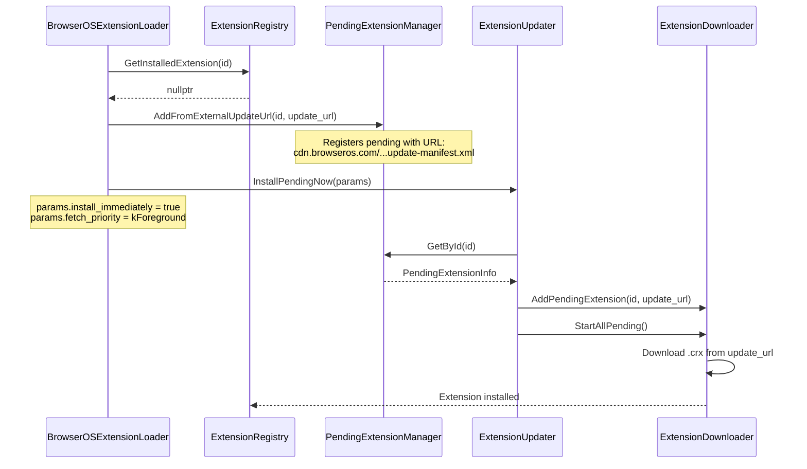

<!-- source: DeepWiki mcp.deepwiki.com · repo browseros-ai/BrowserOS · page 6.3 Extension Lifecycle · fetched 2026-10-29 -->

# Extension Lifecycle

Relevant source files

The following files were used as context for generating this wiki page:

- [packages/browseros/chromium_patches/chrome/browser/about_flags.cc](packages/browseros/chromium_patches/chrome/browser/about_flags.cc)
- [packages/browseros/chromium_patches/chrome/browser/browser_features.cc](packages/browseros/chromium_patches/chrome/browser/browser_features.cc)
- [packages/browseros/chromium_patches/chrome/browser/browser_features.h](packages/browseros/chromium_patches/chrome/browser/browser_features.h)
- [packages/browseros/chromium_patches/chrome/browser/browseros/core/browseros_constants.h](packages/browseros/chromium_patches/chrome/browser/browseros/core/browseros_constants.h)
- [packages/browseros/chromium_patches/chrome/browser/browseros/extensions/browseros_extension_installer.cc](packages/browseros/chromium_patches/chrome/browser/browseros/extensions/browseros_extension_installer.cc)
- [packages/browseros/chromium_patches/chrome/browser/browseros/extensions/browseros_extension_loader.cc](packages/browseros/chromium_patches/chrome/browser/browseros/extensions/browseros_extension_loader.cc)
- [packages/browseros/chromium_patches/chrome/browser/browseros/extensions/browseros_extension_loader.h](packages/browseros/chromium_patches/chrome/browser/browseros/extensions/browseros_extension_loader.h)
- [packages/browseros/chromium_patches/chrome/browser/browseros/extensions/browseros_extension_maintainer.cc](packages/browseros/chromium_patches/chrome/browser/browseros/extensions/browseros_extension_maintainer.cc)
- [packages/browseros/chromium_patches/chrome/browser/extensions/external_provider_impl.cc](packages/browseros/chromium_patches/chrome/browser/extensions/external_provider_impl.cc)
- [packages/browseros/chromium_patches/chrome/browser/extensions/updater/extension_updater.cc](packages/browseros/chromium_patches/chrome/browser/extensions/updater/extension_updater.cc)
- [packages/browseros/chromium_patches/chrome/browser/extensions/updater/extension_updater.h](packages/browseros/chromium_patches/chrome/browser/extensions/updater/extension_updater.h)
- [packages/browseros/chromium_patches/chrome/browser/flag_descriptions.h](packages/browseros/chromium_patches/chrome/browser/flag_descriptions.h)

This document describes the lifecycle of BrowserOS extensions from initial installation through ongoing maintenance. BrowserOS extensions are privileged, force-installed extensions that provide core functionality such as the AI agent interface, controller, and bug reporter.

For information about the privilege model that governs these extensions, see [6.4 Extension Privileges](). For details on URL routing to extension pages, see [6.5 URL Routing]().

---

## Overview

BrowserOS extensions follow a managed lifecycle with three distinct phases:

1.  **Installation**: Extensions are loaded from bundled CRX files (preferred) or remote configuration (fallback).
2.  **Immediate Installation**: Extensions are installed into the browser using platform-specific mechanisms.
3.  **Maintenance**: Periodic tasks ensure extensions remain installed, enabled, and up-to-date.

The system is designed to prioritize local bundled extensions for fast first-run installation while maintaining the ability to update and recover from configuration changes via remote sources.

---

## System Architecture

The extension lifecycle is managed by three primary components that work together:

**Extension Lifecycle Components**

**Sources:**
*   [packages/browseros/chromium_patches/chrome/browser/browseros/extensions/browseros_extension_loader.h:32-39]()
*   [packages/browseros/chromium_patches/chrome/browser/browseros/extensions/browseros_extension_installer.cc:62-67]()
*   [packages/browseros/chromium_patches/chrome/browser/browseros/extensions/browseros_extension_maintainer.cc:66-67]()

---

## Phase 1: Installation Source Resolution

The `BrowserOSExtensionInstaller` determines whether to install from bundled CRX files or remote configuration [packages/browseros/chromium_patches/chrome/browser/browseros/extensions/browseros_extension_installer.cc:71-84]().

### Bundled Installation Path

The installer first attempts to load from bundled CRX files located in the `DIR_BROWSEROS_BUNDLED_EXTENSIONS` directory [packages/browseros/chromium_patches/chrome/browser/browseros/extensions/browseros_extension_installer.cc:86-92]().

**Bundled Installation Flow**

**Sources:**
*   [packages/browseros/chromium_patches/chrome/browser/browseros/extensions/browseros_extension_installer.cc:86-111]()
*   [packages/browseros/chromium_patches/chrome/browser/browseros/extensions/browseros_extension_installer.cc:114-172]()

The bundled manifest (`bundled_extensions.json`) has the following structure [packages/browseros/chromium_patches/chrome/browser/browseros/extensions/browseros_extension_installer.cc:94-96]():

| Field | Description |
| :--- | :--- |
| `external_crx` | Relative path to .crx file (e.g., `"bflpfmnmnokmjhmgnolecpppdbdophmk.crx"`) |
| `external_version` | Version string (e.g., `"1.2.3"`) |

Only extensions with IDs registered in the BrowserOS core system are loaded [packages/browseros/chromium_patches/chrome/browser/browseros/extensions/browseros_extension_installer.cc:137-141](). Unknown extension IDs are skipped with a warning.

### Remote Configuration Path

If bundled files are unavailable, the installer fetches configuration from a remote URL [packages/browseros/chromium_patches/chrome/browser/browseros/extensions/browseros_extension_installer.cc:198-226]().

**Remote Configuration Flow**

**Sources:**
*   [packages/browseros/chromium_patches/chrome/browser/browseros/extensions/browseros_extension_installer.cc:198-226]()
*   [packages/browseros/chromium_patches/chrome/browser/browseros/extensions/browseros_extension_installer.cc:228-290]()

The config URL defaults to standard production or alpha endpoints depending on the `kBrowserOsAlphaFeatures` feature flag [packages/browseros/chromium_patches/chrome/browser/browseros/extensions/browseros_extension_loader.cc:36-39](). This can be overridden via the `--browseros-extensions-url` command-line switch [packages/browseros/chromium_patches/chrome/browser/extensions/external_provider_impl.cc:25-35]().

---

## Phase 2: Immediate Installation

After the installer determines the source, the `BrowserOSExtensionLoader` performs immediate installation using different mechanisms based on the source.

### Convergence Point

Both installation paths converge at `OnInstallComplete()`, which triggers `OnStartupComplete()` [packages/browseros/chromium_patches/chrome/browser/browseros/extensions/browseros_extension_loader.cc:63-97]().

**Installation Path Routing**

**Sources:**
*   [packages/browseros/chromium_patches/chrome/browser/browseros/extensions/browseros_extension_loader.cc:63-97]()
*   [packages/browseros/chromium_patches/chrome/browser/browseros/extensions/browseros_extension_loader.cc:136-157]()

### Bundled Extension Installation

For bundled extensions, the loader uses `CrxInstaller` to directly install from `.crx` files found at the `bundled_crx_base_path_` [packages/browseros/chromium_patches/chrome/browser/browseros/extensions/browseros_extension_loader.cc:207-229]().

**Bundled Installation Mechanism**

**Sources:**
*   [packages/browseros/chromium_patches/chrome/browser/browseros/extensions/browseros_extension_loader.cc:207-229]()

### Remote Extension Installation

For remote extensions, the loader uses the `PendingExtensionManager` combined with `ExtensionUpdater::InstallPendingNow()` [packages/browseros/chromium_patches/chrome/browser/browseros/extensions/browseros_extension_loader.cc:159-205]().

**Remote Installation Mechanism**

The `InstallPendingNow()` method was added to `ExtensionUpdater` specifically to force-install extensions that have been registered as pending but haven't been downloaded yet [packages/browseros/chromium_patches/chrome/browser/extensions/updater/extension_updater.cc:9-101]().

**Sources:**
*   [packages/browseros/chromium_patches/chrome/browser/browseros/extensions/browseros_extension_loader.cc:159-205]()
*   [packages/browseros/chromium_patches/chrome/browser/extensions/updater/extension_updater.cc:9-101]()

---

## Phase 3: Periodic Maintenance

The `BrowserOSExtensionMaintainer` runs periodic tasks to ensure extension health.

### Maintenance Schedule

*   **Initial delay**: 60 seconds (`kInitialMaintenanceDelay`) [packages/browseros/chromium_patches/chrome/browser/browseros/extensions/browseros_extension_maintainer.cc:45-45]().
*   **Interval**: 15 minutes (`kMaintenanceInterval`) [packages/browseros/chromium_patches/chrome/browser/browseros/extensions/browseros_extension_maintainer.cc:44-44]().

**Sources:**
*   [packages/browseros/chromium_patches/chrome/browser/browseros/extensions/browseros_extension_maintainer.cc:44-45]()
*   [packages/browseros/chromium_patches/chrome/browser/browseros/extensions/browseros_extension_maintainer.cc:87-92]()

### Maintenance Tasks

Each maintenance cycle performs multiple tasks via `ExecuteMaintenanceTasks()` [packages/browseros/chromium_patches/chrome/browser/browseros/extensions/browseros_extension_maintainer.cc:183-192]():

1.  **Uninstall Inactive Product**: Removes extensions not belonging to the current product (e.g., BrowserOS vs BrowserClaw) [packages/browseros/chromium_patches/chrome/browser/browseros/extensions/browseros_extension_maintainer.cc:186-186]().
2.  **Uninstall Deprecated**: Removes extensions no longer in the server config [packages/browseros/chromium_patches/chrome/browser/browseros/extensions/browseros_extension_maintainer.cc:187-187]().
3.  **Reinstall Missing**: Re-adds extensions that were uninstalled by the user [packages/browseros/chromium_patches/chrome/browser/browseros/extensions/browseros_extension_maintainer.cc:188-188]().
4.  **Re-enable Disabled**: Force-enables extensions that were disabled [packages/browseros/chromium_patches/chrome/browser/browseros/extensions/browseros_extension_maintainer.cc:189-189]().
5.  **Update Check**: Triggers a check for newer versions via `ForceUpdateCheck()` [packages/browseros/chromium_patches/chrome/browser/browseros/extensions/browseros_extension_maintainer.cc:190-190]().

**Sources:**
*   [packages/browseros/chromium_patches/chrome/browser/browseros/extensions/browseros_extension_maintainer.cc:183-192]()

---

## Persistence and Data Integrity

BrowserOS extensions have special handling to ensure data persistence even during re-installation cycles.

### Catalog Registration
Extensions are defined in `browseros_constants.h`, which categorizes them by product (`kBrowserOS`, `kBrowserClaw`, or `kAll`) [packages/browseros/chromium_patches/chrome/browser/browseros/core/browseros_constants.h:57-75](). This catalog is used to determine which extensions should be active and managed [packages/browseros/chromium_patches/chrome/browser/browseros/core/browseros_constants.h:109-124]().

### Privileged Location
All BrowserOS extensions are installed using the `kExternalComponent` location [packages/browseros/chromium_patches/chrome/browser/extensions/external_provider_impl.cc:42-46](). This location is typically reserved for built-in components, giving them higher privilege and preventing them from being easily disabled or removed by standard user actions.

**Sources:**
*   [packages/browseros/chromium_patches/chrome/browser/browseros/core/browseros_constants.h:57-124]()
*   [packages/browseros/chromium_patches/chrome/browser/extensions/external_provider_impl.cc:42-51]()

---

