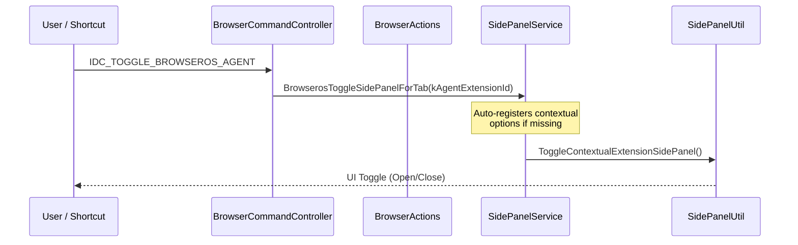

<!-- source: DeepWiki mcp.deepwiki.com · repo browseros-ai/BrowserOS · page 6.4 Extension Privileges · fetched 2026-10-29 -->

# Extension Privileges

Relevant source files

The following files were used as context for generating this wiki page:

- [packages/browseros/chromium_patches/chrome/browser/extensions/BUILD.gn](packages/browseros/chromium_patches/chrome/browser/extensions/BUILD.gn)
- [packages/browseros/chromium_patches/chrome/browser/extensions/api/side_panel/side_panel_service.cc](packages/browseros/chromium_patches/chrome/browser/extensions/api/side_panel/side_panel_service.cc)
- [packages/browseros/chromium_patches/chrome/browser/extensions/chrome_extension_registrar_delegate.cc](packages/browseros/chromium_patches/chrome/browser/extensions/chrome_extension_registrar_delegate.cc)
- [packages/browseros/chromium_patches/chrome/browser/extensions/extension_context_menu_model.cc](packages/browseros/chromium_patches/chrome/browser/extensions/extension_context_menu_model.cc)
- [packages/browseros/chromium_patches/chrome/browser/extensions/extension_management.cc](packages/browseros/chromium_patches/chrome/browser/extensions/extension_management.cc)
- [packages/browseros/chromium_patches/chrome/browser/global_keyboard_shortcuts_mac.mm](packages/browseros/chromium_patches/chrome/browser/global_keyboard_shortcuts_mac.mm)
- [packages/browseros/chromium_patches/chrome/browser/ui/accelerator_table.cc](packages/browseros/chromium_patches/chrome/browser/ui/accelerator_table.cc)
- [packages/browseros/chromium_patches/chrome/browser/ui/browser_actions.cc](packages/browseros/chromium_patches/chrome/browser/ui/browser_actions.cc)
- [packages/browseros/chromium_patches/chrome/browser/ui/browser_command_controller.cc](packages/browseros/chromium_patches/chrome/browser/ui/browser_command_controller.cc)
- [packages/browseros/chromium_patches/chrome/browser/ui/browser_ui_prefs.cc](packages/browseros/chromium_patches/chrome/browser/ui/browser_ui_prefs.cc)
- [packages/browseros/chromium_patches/chrome/browser/ui/extensions/settings_overridden_params_providers.cc](packages/browseros/chromium_patches/chrome/browser/ui/extensions/settings_overridden_params_providers.cc)
- [packages/browseros/chromium_patches/chrome/browser/ui/toolbar/toolbar_actions_model.cc](packages/browseros/chromium_patches/chrome/browser/ui/toolbar/toolbar_actions_model.cc)
- [packages/browseros/chromium_patches/chrome/browser/ui/views/side_panel/BUILD.gn](packages/browseros/chromium_patches/chrome/browser/ui/views/side_panel/BUILD.gn)
- [packages/browseros/chromium_patches/chrome/browser/ui/views/side_panel/extensions/extension_side_panel_manager.cc](packages/browseros/chromium_patches/chrome/browser/ui/views/side_panel/extensions/extension_side_panel_manager.cc)

This document describes the special privileges granted to BrowserOS extensions, which distinguish them from regular Chrome extensions. BrowserOS extensions cannot be disabled or uninstalled by users, are force-pinned to the toolbar, and control Chrome URL overrides. This privileged status ensures that core BrowserOS functionality remains available and provides a seamless user experience.

For information about the extension architecture and lifecycle, see [6.1 Extension Architecture](). For details on bundled extensions and their roles, see [6.2 BrowserOS Extensions](). For URL routing implementation, see [6.5 URL Routing]().

## Privilege Overview

BrowserOS extensions receive the following privileges that regular Chrome extensions do not have:

| Privilege | Description | Implementation |
|-----------|-------------|----------------|
| **Force-Pinned** | Always visible in toolbar, cannot be unpinned | `ExtensionManagement::GetForcePinnedList()` |
| **Non-Disableable** | Users cannot disable the extension | `ChromeExtensionRegistrarDelegate::CanDisableExtension()` |
| **Non-Uninstallable** | Uninstall option hidden from context menu | `ExtensionContextMenuModel::InitMenuWithFeature()` |
| **URL Override Control** | Only BrowserOS extensions can override `chrome://` URLs | `ExtensionWebUIOverrideRegistrar::OnExtensionLoaded()` |
| **Virtual URL Display** | `chrome-extension://` URLs are rewritten to `chrome://browseros/*` in Omnibox | `ChromeOmniboxClient::GetNavigationEntryURL()` |
| **Private Network Access** | Extension service workers can access localhost/private networks | `ShouldOverrideLocalNetworkAccessRequestPolicy()` |
| **No Override Dialogs** | Suppresses settings override warning dialogs | `GetNtpOverriddenParams()` |
| **Native Actions** | Native toolbar actions with keyboard shortcuts | `BrowserActions::InitializeSidePanelActions()` |
| **Privileged APIs** | Access to `browserOS.*` API for system/browser control | `browser_os_api.cc` |

## Extension Identification

BrowserOS extensions are identified using helper functions defined in the browser core. These helpers allow the browser to distinguish between standard user-installed extensions and privileged BrowserOS components.

**Diagram: Identification Logic to Code Entities**

```mermaid
graph TB
    subgraph "BrowserOS Extension Identification"
        IsActiveBrowserOSExtension["browseros::IsActiveBrowserOSExtension(id)"]
        IsBrowserOSPinnedExtension["browseros::IsBrowserOSPinnedExtension(id)"]
        GetActiveBrowserOSExtensionIds["browseros::GetActiveBrowserOSExtensionIds()"]
    end
    
    subgraph "Extension IDs [browseros_constants.h]"
        Agent["kAgentExtensionId<br/>Main Agent UI"]
        ControllerExt["kControllerExtensionId<br/>Chrome API Bridge"]
        OtherExt["Other BrowserOS Extensions"]
    end
    
    subgraph "Privilege Checks [C++ Hooks]"
        ForcePinCheck["ExtensionManagement::GetForcePinnedList"]
        DisableCheck["ChromeExtensionRegistrarDelegate::CanDisableExtension"]
        UninstallCheck["ExtensionContextMenuModel::InitMenuWithFeature"]
        UpdateURLOverride["ExtensionManagement::GetEffectiveUpdateURL"]
        StoragePreservation["ChromeExtensionRegistrarDelegate::PostUninstallExtension"]
    end
    
    GetActiveBrowserOSExtensionIds --> Agent
    GetActiveBrowserOSExtensionIds --> ControllerExt
    GetActiveBrowserOSExtensionIds --> OtherExt
    
    IsActiveBrowserOSExtension --> DisableCheck
    IsActiveBrowserOSExtension --> UninstallCheck
    IsActiveBrowserOSExtension --> UpdateURLOverride
    
    IsBrowserOSPinnedExtension --> ForcePinCheck
    IsBrowserOSPinnedExtension --> Agent
```

**Sources:** [packages/browseros/chromium_patches/chrome/browser/extensions/extension_management.cc:48-53](), [packages/browseros/chromium_patches/chrome/browser/extensions/chrome_extension_registrar_delegate.cc:37-41](), [packages/browseros/chromium_patches/chrome/browser/ui/toolbar/toolbar_actions_model.cc:18-20]()

## Force-Pinned Toolbar Actions

BrowserOS extensions marked as pinned are automatically added to the force-pinned list, ensuring they always appear in the toolbar. This behavior is implemented in three key locations:

### Extension Management Force-Pinning

The `ExtensionManagement` class includes BrowserOS extensions in the force-pinned list:

[packages/browseros/chromium_patches/chrome/browser/extensions/extension_management.cc:690-698]() adds BrowserOS extensions to the force-pinned list by iterating through `browseros::GetActiveBrowserOSExtensionIds()` and checking `browseros::IsBrowserOSPinnedExtension()` for each ID.

**Sources:** [packages/browseros/chromium_patches/chrome/browser/extensions/extension_management.cc:690-698]()

### Toolbar Actions Model Integration

The `ToolbarActionsModel` enforces force-pinning at the UI level:

[packages/browseros/chromium_patches/chrome/browser/ui/toolbar/toolbar_actions_model.cc:18-20]() checks if an action is a BrowserOS pinned extension before consulting the standard extension management system. [packages/browseros/chromium_patches/chrome/browser/ui/toolbar/toolbar_actions_model.cc:29-35]() ensures BrowserOS extensions are added to the filtered pinned action IDs list during UI initialization.

**Sources:** [packages/browseros/chromium_patches/chrome/browser/ui/toolbar/toolbar_actions_model.cc:18-20](), [packages/browseros/chromium_patches/chrome/browser/ui/toolbar/toolbar_actions_model.cc:29-35]()

### Auto-Pinning on Extension Load

When a BrowserOS extension loads, it is automatically pinned to the toolbar via the side panel manager:

[packages/browseros/chromium_patches/chrome/browser/ui/views/side_panel/extensions/extension_side_panel_manager.cc:36-43]() auto-pins BrowserOS extensions by calling `PinnedToolbarActionsModel::UpdatePinnedState()` when `browseros::ShouldPinBrowserOSExtension()` returns true for the loading extension.

**Sources:** [packages/browseros/chromium_patches/chrome/browser/ui/views/side_panel/extensions/extension_side_panel_manager.cc:36-43]()

## Non-Disableable and Storage Preservation

BrowserOS extensions cannot be disabled by the user, and their `chrome.storage.local` data is preserved even if they are transiently uninstalled during update cycles. This ensures user configurations and agent memory are not lost.

### Non-Disableable
The `ChromeExtensionRegistrarDelegate::CanDisableExtension()` method explicitly prevents disabling BrowserOS extensions:

[packages/browseros/chromium_patches/chrome/browser/extensions/chrome_extension_registrar_delegate.cc:37-41]() logs a message and returns `false` if the extension ID corresponds to an active BrowserOS extension, effectively making it non-disableable.

### Storage Preservation
During uninstallation, BrowserOS extensions' data is not deleted:

[packages/browseros/chromium_patches/chrome/browser/extensions/chrome_extension_registrar_delegate.cc:21-28]() checks if an extension is a known BrowserOS extension. If it is, it skips calling `DataDeleter::StartDeleting()` and directly invokes the `subtask_done_callback`, preserving the extension's `chrome.storage.local` data. This is crucial for maintaining user configurations and agent memory across updates.

**Sources:** [packages/browseros/chromium_patches/chrome/browser/extensions/chrome_extension_registrar_delegate.cc:37-41](), [packages/browseros/chromium_patches/chrome/browser/extensions/chrome_extension_registrar_delegate.cc:21-28]()

## Privileged Side Panel Management

BrowserOS implements custom side panel logic to ensure the Agent UI is always accessible and correctly contextualized to the active tab.

**Diagram: Side Panel Toggle Flow**

### Contextual Auto-Registration
The `SidePanelService` includes a privileged method `BrowserosToggleSidePanelForTab` that handles the Agent's side panel lifecycle. [packages/browseros/chromium_patches/chrome/browser/extensions/api/side_panel/side_panel_service.cc:66-87]() automatically registers contextual (tab-specific) panel options if they don't exist, ensuring the Agent panel is tied to the current tab context rather than global state.

**Sources:** [packages/browseros/chromium_patches/chrome/browser/extensions/api/side_panel/side_panel_service.cc:22-107](), [packages/browseros/chromium_patches/chrome/browser/ui/browser_command_controller.cc:73-115]()

## Alpha Channel Update Routing

BrowserOS can dynamically route extension updates to an alpha channel based on feature flags. 

[packages/browseros/chromium_patches/chrome/browser/extensions/extension_management.cc:48-53]() overrides the `update_url` for BrowserOS extensions to `kBrowserOSAlphaUpdateUrl` if the `kBrowserOsAlphaFeatures` feature flag is enabled. This allows mid-session channel flips to apply on the next update check without reinstallation.

**Sources:** [packages/browseros/chromium_patches/chrome/browser/extensions/extension_management.cc:48-53]()

## Native Browser Actions & Shortcuts

BrowserOS provides native toolbar actions that integrate with extensions at runtime, avoiding stale references during extension updates.

### Agent Toolbar Action
[packages/browseros/chromium_patches/chrome/browser/ui/browser_actions.cc:67-141]() implements the Agent action ("Assistant") which:
1. Dynamically looks up the Agent extension from `ExtensionRegistry` using `browseros::kAgentExtensionId` [packages/browseros/chromium_patches/chrome/browser/ui/browser_actions.cc:83-86]().
2. Shows a `BROWSEROS_AGENT_INSTALLING_INFOBAR_DELEGATE` if the extension is missing or updating [packages/browseros/chromium_patches/chrome/browser/ui/browser_actions.cc:93-102]().
3. Calls `SidePanelService::BrowserosToggleSidePanelForTab()` to manage the UI state [packages/browseros/chromium_patches/chrome/browser/ui/browser_actions.cc:118-121]().

### Keyboard Shortcuts
Privileged actions are mapped to global keyboard shortcuts, enabled via the `kBrowserOsKeyboardShortcuts` feature flag.

| Shortcut (macOS) | Command | Action |
|------------------|---------|--------|
| `Cmd+Shift+K` | `IDC_SHOW_THIRD_PARTY_LLM_SIDE_PANEL` | Toggle LLM panel [packages/browseros/chromium_patches/chrome/browser/global_keyboard_shortcuts_mac.mm:18-20]() |
| `Cmd+Shift+L` | `IDC_CYCLE_THIRD_PARTY_LLM_PROVIDER` | Cycle LLM provider [packages/browseros/chromium_patches/chrome/browser/global_keyboard_shortcuts_mac.mm:21-23]() |
| `Alt+A` | `IDC_TOGGLE_BROWSEROS_AGENT` | Toggle Agent side panel [packages/browseros/chromium_patches/chrome/browser/global_keyboard_shortcuts_mac.mm:24-26]() |

Windows/Linux shortcuts use `EF_PLATFORM_ACCELERATOR` (Ctrl+Shift+K/L) and `Alt+A` [packages/browseros/chromium_patches/chrome/browser/ui/accelerator_table.cc:18-26]().

**Sources:** [packages/browseros/chromium_patches/chrome/browser/ui/browser_actions.cc:67-141](), [packages/browseros/chromium_patches/chrome/browser/global_keyboard_shortcuts_mac.mm:17-27](), [packages/browseros/chromium_patches/chrome/browser/ui/accelerator_table.cc:17-26](), [packages/browseros/chromium_patches/chrome/browser/ui/browser_command_controller.cc:73-115]()

## Implementation Summary

| Component | Key Symbol | Purpose |
|-----------|------------|---------|
| Extension Management | `ExtensionManagement::GetForcePinnedList()` | Adds BrowserOS extensions to force-pinned list |
| Extension Registrar Delegate | `ChromeExtensionRegistrarDelegate::CanDisableExtension()` | Prevents disabling BrowserOS extensions |
| Extension Registrar Delegate | `ChromeExtensionRegistrarDelegate::PostUninstallExtension()` | Preserves `chrome.storage.local` data for BrowserOS extensions |
| Context Menu | `ExtensionContextMenuModel::InitMenuWithFeature()` | Hides uninstall option for BrowserOS extensions |
| Side Panel | `BrowserosToggleSidePanelForTab` | Privileged side panel management for Agent |
| Command Controller | `IDC_TOGGLE_BROWSEROS_AGENT` | Native command to trigger extension UI |

**Sources:** [packages/browseros/chromium_patches/chrome/browser/extensions/extension_management.cc](), [packages/browseros/chromium_patches/chrome/browser/extensions/chrome_extension_registrar_delegate.cc](), [packages/browseros/chromium_patches/chrome/browser/extensions/extension_context_menu_model.cc:96-97](), [packages/browseros/chromium_patches/chrome/browser/ui/browser_actions.cc](), [packages/browseros/chromium_patches/chrome/browser/ui/browser_command_controller.cc]()

---

