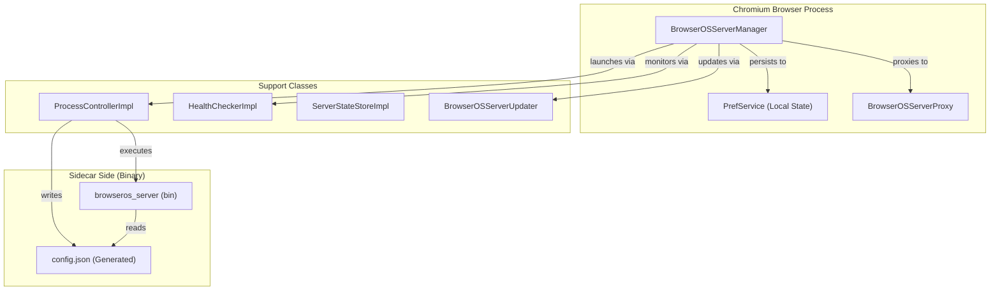
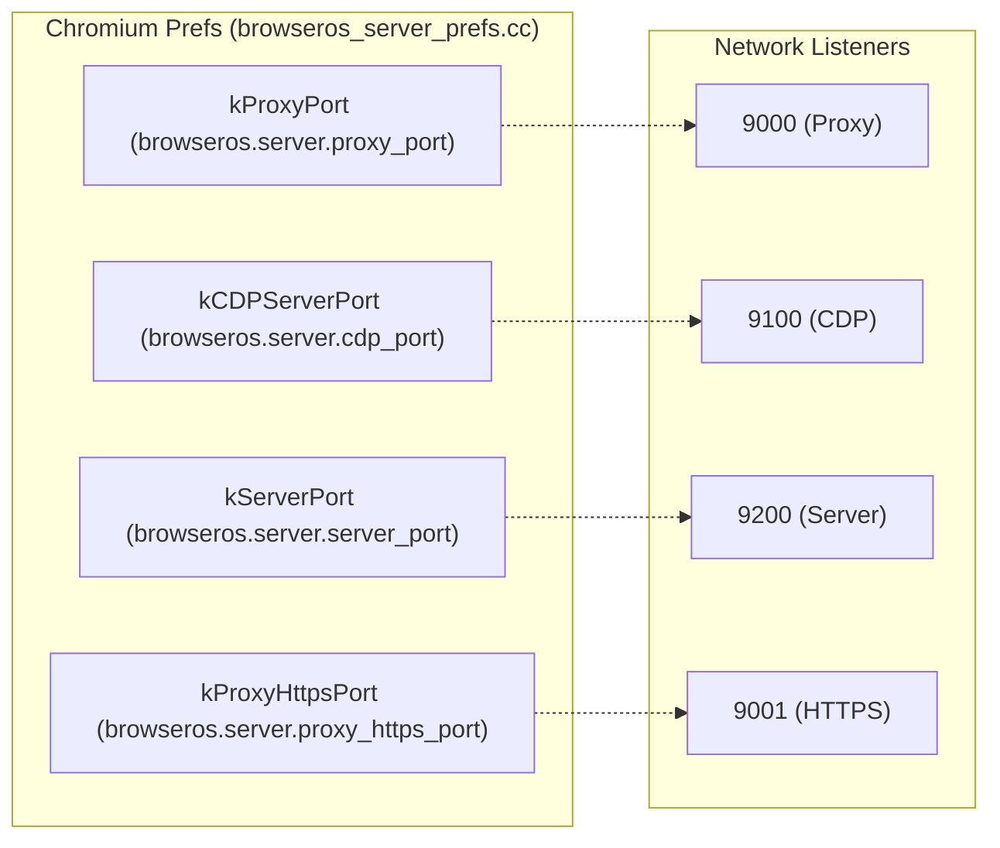

<!-- source: DeepWiki mcp.deepwiki.com · repo browseros-ai/BrowserOS · page 7 BrowserOS Server · fetched 2026-10-29 -->

# BrowserOS Server

Relevant source files

The following files were used as context for generating this wiki page:

- [packages/browseros/chromium_patches/chrome/browser/browseros/core/browseros_switches.h](packages/browseros/chromium_patches/chrome/browser/browseros/core/browseros_switches.h)
- [packages/browseros/chromium_patches/chrome/browser/browseros/server/BUILD.gn](packages/browseros/chromium_patches/chrome/browser/browseros/server/BUILD.gn)
- [packages/browseros/chromium_patches/chrome/browser/browseros/server/browseros_server_config.cc](packages/browseros/chromium_patches/chrome/browser/browseros/server/browseros_server_config.cc)
- [packages/browseros/chromium_patches/chrome/browser/browseros/server/browseros_server_config.h](packages/browseros/chromium_patches/chrome/browser/browseros/server/browseros_server_config.h)
- [packages/browseros/chromium_patches/chrome/browser/browseros/server/browseros_server_config_unittest.cc](packages/browseros/chromium_patches/chrome/browser/browseros/server/browseros_server_config_unittest.cc)
- [packages/browseros/chromium_patches/chrome/browser/browseros/server/browseros_server_constants.h](packages/browseros/chromium_patches/chrome/browser/browseros/server/browseros_server_constants.h)
- [packages/browseros/chromium_patches/chrome/browser/browseros/server/browseros_server_manager.cc](packages/browseros/chromium_patches/chrome/browser/browseros/server/browseros_server_manager.cc)
- [packages/browseros/chromium_patches/chrome/browser/browseros/server/browseros_server_manager.h](packages/browseros/chromium_patches/chrome/browser/browseros/server/browseros_server_manager.h)
- [packages/browseros/chromium_patches/chrome/browser/browseros/server/browseros_server_manager_unittest.cc](packages/browseros/chromium_patches/chrome/browser/browseros/server/browseros_server_manager_unittest.cc)
- [packages/browseros/chromium_patches/chrome/browser/browseros/server/browseros_server_prefs.cc](packages/browseros/chromium_patches/chrome/browser/browseros/server/browseros_server_prefs.cc)
- [packages/browseros/chromium_patches/chrome/browser/browseros/server/browseros_server_prefs.h](packages/browseros/chromium_patches/chrome/browser/browseros/server/browseros_server_prefs.h)
- [packages/browseros/chromium_patches/chrome/browser/browseros/server/browseros_server_updater.cc](packages/browseros/chromium_patches/chrome/browser/browseros/server/browseros_server_updater.cc)
- [packages/browseros/chromium_patches/chrome/browser/browseros/server/browseros_server_updater.h](packages/browseros/chromium_patches/chrome/browser/browseros/server/browseros_server_updater.h)
- [packages/browseros/chromium_patches/chrome/browser/browseros/server/process_controller_impl.cc](packages/browseros/chromium_patches/chrome/browser/browseros/server/process_controller_impl.cc)

The BrowserOS Server is a sidecar process that provides extended capabilities to the browser, including browser automation tools, app integrations, and MCP (Model Context Protocol) server functionality. It runs as a separate process managed by the Chromium browser, enabling hot-swappable updates without requiring a full browser restart.

This page covers the server's architecture, lifecycle management, port configuration, health monitoring, and update system. For information about the MCP server functionality and tools, see [MCP Server](#5). For details about DevTools Protocol extensions, see [DevTools Protocol Extensions](#8).

---

## Architecture Overview

The BrowserOS Server operates as a managed sidecar process orchestrated by the `BrowserOSServerManager` singleton. It supports multiple product flavors, such as `BrowserOS` and `BrowserClaw`, via a descriptor-based configuration system [chrome/browser/browseros/server/browseros_server_config.h:25-53]().

### System Mapping: Natural Language to Code Entities

**Sources:**
- [chrome/browser/browseros/server/browseros_server_manager.h:47-97]()
- [chrome/browser/browseros/server/process_controller_impl.cc:61-104]()
- [chrome/browser/browseros/server/browseros_server_config.cc:75-102]()

### Key Components

| Component | Type | Responsibility |
|-----------|------|----------------|
| `BrowserOSServerManager` | Singleton | Orchestrates server lifecycle, port management, and health checks [chrome/browser/browseros/server/browseros_server_manager.cc:149-152]() |
| `BrowserOSServerProxy` | Class | Stable MCP proxy forwarding requests to the ephemeral backend [chrome/browser/browseros/server/browseros_server_manager.h:144-144]() |
| `ProcessController` | Interface | Handles process launch, termination, and status checking [chrome/browser/browseros/server/process_controller.h:1-20]() |
| `HealthChecker` | Interface | Performs HTTP health checks and graceful shutdown requests [chrome/browser/browseros/server/health_checker.h:1-20]() |
| `ServerStateStore` | Interface | Persists PID and creation time for orphan recovery [chrome/browser/browseros/server/server_state_store.h:1-20]() |
| `BrowserOSServerUpdater` | Class | Manages OTA updates with Ed25519 signature verification [chrome/browser/browseros/server/browseros_server_updater.cc:11-45]() |
| `ManagedServerDescriptor` | Struct | Defines product-specific paths, URLs, and update behavior [chrome/browser/browseros/server/browseros_server_config.h:25-53]() |

For more details on the process model, see [Server Architecture](#7.1).

---

## Port Configuration

The BrowserOS Server uses a **stable/ephemeral port pattern** to enable zero-downtime updates. The proxy port remains constant while backend ports can shift during restarts.

### Code Entity Port Mapping

**Sources:**
- [chrome/browser/browseros/server/browseros_server_prefs.h:21-31]()
- [chrome/browser/browseros/server/browseros_server_prefs.cc:18-36]()

### Port Types

| Port Preference | Purpose | Default (BrowserOS) |
|------|---------|---------|
| `kCDPServerPort` | Chrome DevTools Protocol WebSocket server | 9100 [chrome/browser/browseros/server/browseros_server_prefs.h:28-28]() |
| `kProxyPort` | Stable MCP proxy that forwards to backend | 9000 [chrome/browser/browseros/server/browseros_server_prefs.h:29-29]() |
| `kProxyHttpsPort` | Stable HTTPS proxy for secure MCP access | 9001 [chrome/browser/browseros/server/browseros_server_prefs.h:30-30]() |
| `kServerPort` | Ephemeral backend sidecar server port | 9200 [chrome/browser/browseros/server/browseros_server_prefs.h:31-31]() |

Ports can be overridden via command-line switches like `--browseros-proxy-port` or `--browseros-server-port` [chrome/browser/browseros/core/browseros_switches.h:22-23]().

For details on port resolution and overrides, see [Port Configuration](#7.3).

---

## Lifecycle Management

Lifecycle management covers the startup, shutdown, and restart mechanisms of the sidecar process.

- **Startup:** The manager uses a file-based lock `server.lock` to ensure only one server instance runs per execution directory [chrome/browser/browseros/server/browseros_server_manager.cc:177-184]().
- **Shutdown:** The manager terminates the process using `SIGKILL` (POSIX) or `TerminateProcess` (Windows) [chrome/browser/browseros/server/process_controller_impl.cc:111-137]().
- **Orphan Recovery:** It validates existing processes using PID and creation time to recover from previous crashes without starting duplicates [chrome/browser/browseros/server/browseros_server_manager.cc:200-204]().
- **Hot-Swap:** During updates, the server performs a hot-swap where the `BrowserOSServerProxy` maintains a stable connection while the backend is replaced [chrome/browser/browseros/server/browseros_server_manager.cc:95-95]().

For more details, see [Lifecycle Management](#7.2) and [Orphan Process Recovery](#7.5).

---

## Health Monitoring

The server employs **dual monitoring** to detect failures and ensure high availability.

- **HTTP Health Check:** Periodically pings the health endpoint (default `/system/health`) every 30 seconds [chrome/browser/browseros/server/browseros_server_manager.cc:67-67](). Consecutive failures trigger a restart [chrome/browser/browseros/server/browseros_server_manager.cc:72-72]().
- **Process Check:** Polls the OS process status every 5 seconds to detect immediate crashes [chrome/browser/browseros/server/browseros_server_manager.cc:68-68]().

For details on auto-restart logic, see [Health Monitoring](#7.4).

---

## OTA Update System

The BrowserOS Server includes an automatic update system (Over-The-Air) managed by `BrowserOSServerUpdater`.

- **Appcast Feeds:** Periodically checks XML feeds for new versions [chrome/browser/browseros/server/browseros_server_updater.cc:52-74]().
- **Verification:** Downloads are verified using **Ed25519 signatures** against a public key [chrome/browser/browseros/server/browseros_server_updater.cc:124-177]().
- **Hot-Swap:** Updates trigger a managed restart through `RestartServerForUpdate` [chrome/browser/browseros/server/browseros_server_manager.cc:95-95]().

For the full update architecture, see [Update Architecture](#9.1).

---

## Code Organization

The server logic is organized within `chrome/browser/browseros/server/` for the Chromium-side management.

| File | Purpose |
|------|---------|
| `browseros_server_manager.cc` | Main orchestration and lifecycle logic [chrome/browser/browseros/server/browseros_server_manager.cc:1-1112]() |
| `browseros_server_updater.cc` | OTA update implementation and verification [chrome/browser/browseros/server/browseros_server_updater.cc:1-1096]() |
| `process_controller_impl.cc` | Platform-specific process management (Launch/Terminate) [chrome/browser/browseros/server/process_controller_impl.cc:1-167]() |
| `browseros_server_config.cc` | Descriptor-based configuration and JSON generation [chrome/browser/browseros/server/browseros_server_config.cc:1-178]() |
| `browseros_server_prefs.cc` | Preference registration and port defaults [chrome/browser/browseros/server/browseros_server_prefs.cc:1-49]() |

**Sources:**
- [chrome/browser/browseros/server/BUILD.gn:43-71]()
- [chrome/browser/browseros/server/browseros_server_manager.h:47-171]()
- [chrome/browser/browseros/server/browseros_server_config.h:25-149]()

---

