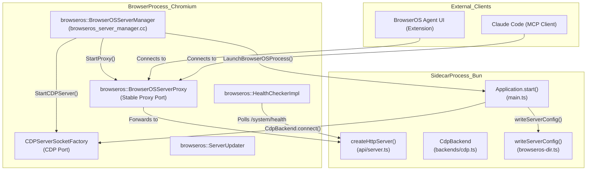
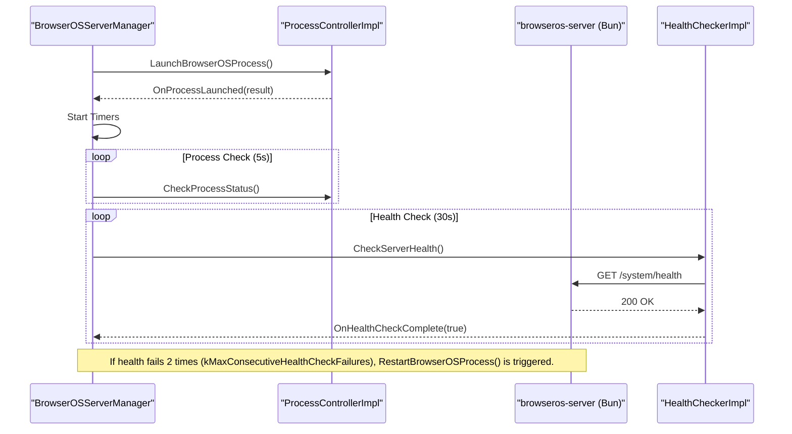

<!-- source: DeepWiki mcp.deepwiki.com · repo browseros-ai/BrowserOS · page 7.1 Server Architecture · fetched 2026-10-29 -->

# Server Architecture

Relevant source files

The following files were used as context for generating this wiki page:

- [packages/browseros-agent/apps/server/src/config.ts](packages/browseros-agent/apps/server/src/config.ts)
- [packages/browseros-agent/apps/server/src/env.ts](packages/browseros-agent/apps/server/src/env.ts)
- [packages/browseros-agent/apps/server/src/lib/browseros-dir.ts](packages/browseros-agent/apps/server/src/lib/browseros-dir.ts)
- [packages/browseros-agent/apps/server/src/main.ts](packages/browseros-agent/apps/server/src/main.ts)
- [packages/browseros-agent/apps/server/tests/browseros-dir.test.ts](packages/browseros-agent/apps/server/tests/browseros-dir.test.ts)
- [packages/browseros-agent/apps/server/tests/build.test.ts](packages/browseros-agent/apps/server/tests/build.test.ts)
- [packages/browseros-agent/apps/server/tests/config.test.ts](packages/browseros-agent/apps/server/tests/config.test.ts)
- [packages/browseros-agent/apps/server/tests/main.test.ts](packages/browseros-agent/apps/server/tests/main.test.ts)
- [packages/browseros-agent/packages/shared/src/constants/paths.ts](packages/browseros-agent/packages/shared/src/constants/paths.ts)
- [packages/browseros-agent/packages/shared/src/constants/urls.ts](packages/browseros-agent/packages/shared/src/constants/urls.ts)
- [packages/browseros-agent/packages/shared/src/schemas/llm.ts](packages/browseros-agent/packages/shared/src/schemas/llm.ts)
- [packages/browseros/chromium_patches/chrome/browser/browseros/core/browseros_switches.h](packages/browseros/chromium_patches/chrome/browser/browseros/core/browseros_switches.h)
- [packages/browseros/chromium_patches/chrome/browser/browseros/server/BUILD.gn](packages/browseros/chromium_patches/chrome/browser/browseros/server/BUILD.gn)
- [packages/browseros/chromium_patches/chrome/browser/browseros/server/browseros_server_config.cc](packages/browseros/chromium_patches/chrome/browser/browseros/server/browseros_server_config.cc)
- [packages/browseros/chromium_patches/chrome/browser/browseros/server/browseros_server_config.h](packages/browseros/chromium_patches/chrome/browser/browseros/server/browseros_server_config.h)
- [packages/browseros/chromium_patches/chrome/browser/browseros/server/browseros_server_config_unittest.cc](packages/browseros/chromium_patches/chrome/browser/browseros/server/browseros_server_config_unittest.cc)
- [packages/browseros/chromium_patches/chrome/browser/browseros/server/browseros_server_constants.h](packages/browseros/chromium_patches/chrome/browser/browseros/server/browseros_server_constants.h)
- [packages/browseros/chromium_patches/chrome/browser/browseros/server/browseros_server_manager.cc](packages/browseros/chromium_patches/chrome/browser/browseros/server/browseros_server_manager.cc)
- [packages/browseros/chromium_patches/chrome/browser/browseros/server/browseros_server_manager.h](packages/browseros/chromium_patches/chrome/browser/browseros/server/browseros_server_manager.h)
- [packages/browseros/chromium_patches/chrome/browser/browseros/server/browseros_server_manager_unittest.cc](packages/browseros/chromium_patches/chrome/browser/browseros/server/browseros_server_manager_unittest.cc)
- [packages/browseros/chromium_patches/chrome/browser/browseros/server/browseros_server_prefs.cc](packages/browseros/chromium_patches/chrome/browser/browseros/server/browseros_server_prefs.cc)
- [packages/browseros/chromium_patches/chrome/browser/browseros/server/browseros_server_prefs.h](packages/browseros/chromium_patches/chrome/browser/browseros/server/browseros_server_prefs.h)
- [packages/browseros/chromium_patches/chrome/browser/browseros/server/browseros_server_updater.cc](packages/browseros/chromium_patches/chrome/browser/browseros/server/browseros_server_updater.cc)
- [packages/browseros/chromium_patches/chrome/browser/browseros/server/browseros_server_updater.h](packages/browseros/chromium_patches/chrome/browser/browseros/server/browseros_server_updater.h)
- [packages/browseros/chromium_patches/chrome/browser/browseros/server/process_controller_impl.cc](packages/browseros/chromium_patches/chrome/browser/browseros/server/process_controller_impl.cc)

This document describes the architecture of the BrowserOS server component—a sidecar process model that runs alongside the Chromium browser to provide AI-native capabilities. It covers the server's purpose, its constituent services, the port strategy (stable proxy vs. ephemeral backend), and the lifecycle management handled by the browser process.

## Overview

The BrowserOS server (`browseros-server`) is a separate binary process built with Bun that runs as a sidecar to the main browser process. It is managed by the `BrowserOSServerManager` singleton within the Chromium source tree.

The architecture uses a **Stable Proxy** model where external clients connect to a fixed port, while the internal backend services use ephemeral or auto-resolved ports to avoid system conflicts.

| Component | Role | Implementation |
|-----------|------|----------------|
| **BrowserOSServerManager** | Lifecycle & Process Controller | C++ (Chromium) [chrome/browser/browseros/server/browseros_server_manager.h:47-50]() |
| **browseros-agent/apps/server** | Sidecar Backend (MCP/Agent API) | TypeScript/Bun [packages/browseros-agent/apps/server/src/main.ts:39-40]() |
| **BrowserOSServerProxy** | Stable endpoint for external tools | C++ (Chromium) [chrome/browser/browseros/server/browseros_server_manager.h:144-144]() |
| **CDPServerSocketFactory** | Browser Automation Interface | C++ (Chromium) [chrome/browser/browseros/server/browseros_server_manager.cc:111-142]() |

**Sources:** [chrome/browser/browseros/server/browseros_server_manager.h:47-50](), [packages/browseros-agent/apps/server/src/main.ts:39-40](), [chrome/browser/browseros/server/browseros_server_manager.cc:111-142]()

## Process Model and Communication

The following diagram bridges the "Natural Language Space" of system components to the "Code Entity Space" by mapping them to specific classes and file paths.

**Diagram: System Entity Mapping and Data Flow**

The `BrowserOSServerManager` coordinates the startup of three distinct network listeners. The `BrowserOSServerProxy` provides a stable entry point for external tools, while the Bun-based `Application` sidecar handles AI logic and tool execution. The `CdpBackend` in the sidecar connects back to the Chromium DevTools Protocol server exposed by `CDPServerSocketFactory`.

**Sources:** [chrome/browser/browseros/server/browseros_server_manager.cc:121-137](), [packages/browseros-agent/apps/server/src/main.ts:62-86](), [chrome/browser/browseros/server/browseros_server_manager.h:114-117](), [packages/browseros-agent/apps/server/src/main.ts:92-100]()

## Port Strategy: Stable Proxy vs. Ephemeral Backend

BrowserOS implements a port resolution strategy that prioritizes stability for external integrations (MCP clients) while allowing flexibility for internal components to avoid port collisions.

### Port Definitions
BrowserOS manages three primary ports defined in the `ServerPorts` struct:
1.  **CDP Port (`cdp`)**: Default `9100` (or `9110` for BrowserClaw). Used for the Chromium DevTools Protocol server.
2.  **Server Port (`server`)**: Default `9200` (or `9210` for BrowserClaw). The main HTTP port for the Bun-based sidecar server.
3.  **Proxy Port (`proxy`)**: Default `9000` (or `9010` for BrowserClaw). The stable MCP proxy port bound by Chromium that external clients connect to.

**Sources:** [chrome/browser/browseros/server/browseros_server_config.h:68-80](), [chrome/browser/browseros/server/browseros_server_prefs.h:21-31]()

### Resolution Logic
Ports are resolved with the following precedence:
1.  **Command-Line Overrides**: Flags like `kCDPPort` (`browseros-cdp-port`) or `kServerPort` (`browseros-server-port`).
2.  **Preferences**: Values stored in Chromium's Local State (e.g., `kCDPServerPort`, `kServerPort`).
3.  **Auto-Discovery**: If a port is in use, the manager attempts to find an available one using `FindAvailableServerPort`.

The Bun sidecar receives its final configuration via a JSON sidecar file passed with the `--config` flag, which is parsed by `loadServerConfig`.

**Sources:** [chrome/browser/browseros/core/browseros_switches.h:21-23](), [chrome/browser/browseros/server/browseros_server_manager.cc:111-113](), [packages/browseros-agent/apps/server/src/config.ts:38-54]()

## Lifecycle and Health Monitoring

The server lifecycle is tightly coupled to the browser process. The `BrowserOSServerManager` uses a dual-monitoring approach:
-   **Process Monitoring**: Checks if the process is still alive every 5 seconds (`kProcessCheckInterval`).
-   **Health Monitoring**: Performs an HTTP check every 30 seconds (`kHealthCheckInterval`) via the `HealthChecker`.

**Diagram: Sidecar Lifecycle and Health Check Sequence**

If the sidecar process exits with a non-zero code, or fails health checks, the manager attempts a restart. However, if the server exits with `kExitCodePortConflict` (2), the manager will attempt to advance the port before restarting.

**Sources:** [chrome/browser/browseros/server/browseros_server_manager.cc:67-75](), [chrome/browser/browseros/server/browseros_server_manager.h:163-164](), [packages/browseros-agent/apps/server/src/main.ts:134-135]()

## Orphan Process Recovery

To prevent "zombie" server processes after a browser crash, BrowserOS implements an orphan recovery mechanism in `RecoverFromOrphan()`.

1.  The manager attempts to `AcquireLock()` on `server.lock` in the execution directory.
2.  If the lock is held, it reads the PID and creation time of the existing process from the `ServerStateStore`.
3.  It validates the PID and creation time against the OS.
4.  If valid, it adopts the existing process instead of launching a new one.

**Sources:** [chrome/browser/browseros/server/browseros_server_manager.cc:177-185](), [chrome/browser/browseros/server/browseros_server_manager.h:103-104](), [packages/browseros-agent/apps/server/src/main.ts:156-157]()

## Data Directory Structure

The server maintains state in a specific directory structure, typically under `~/.browseros` (or `~/.browseros-dev` in development).

| Path | Purpose |
|------|---------|
| `db/browseros.sqlite` | Durable SQLite database for server state. |
| `sessions/` | Temporary session data, cleaned after 7 days. |
| `tool-output/` | Sandboxed directory for agent-generated files (mode `0700`). |
| `server-config.json` | Discovery file for auto-connecting clients. |

**Sources:** [packages/browseros-agent/apps/server/src/lib/browseros-dir.ts:21-31](), [packages/browseros-agent/apps/server/src/lib/browseros-dir.ts:88-90](), [packages/browseros-agent/apps/server/src/lib/browseros-dir.ts:116-144]()

---

