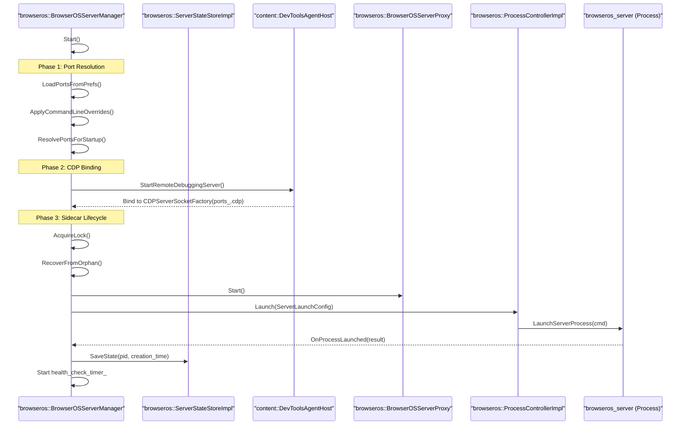
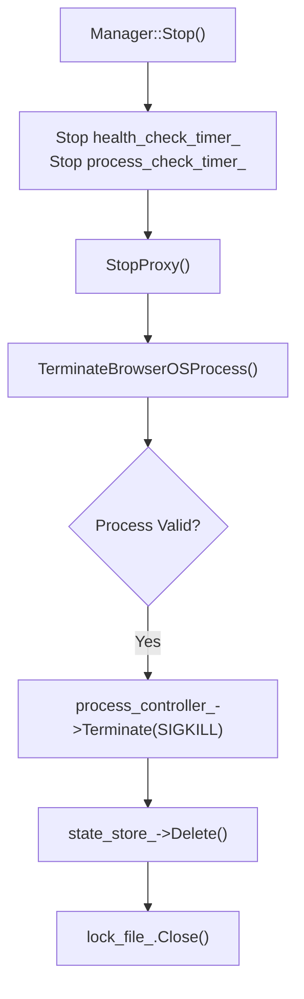

<!-- source: DeepWiki mcp.deepwiki.com · repo browseros-ai/BrowserOS · page 7.2 Lifecycle Management · fetched 2026-10-29 -->

# Lifecycle Management

<details>
<summary>Relevant source files</summary>

The following files were used as context for generating this wiki page:

- [packages/browseros/chromium_patches/chrome/browser/browseros/core/browseros_switches.h](packages/browseros/chromium_patches/chrome/browser/browseros/core/browseros_switches.h)
- [packages/browseros/chromium_patches/chrome/browser/browseros/server/BUILD.gn](packages/browseros/chromium_patches/chrome/browser/browseros/server/BUILD.gn)
- [packages/browseros/chromium_patches/chrome/browser/browseros/server/browseros_server_config.cc](packages/browseros/chromium_patches/chrome/browser/browseros/server/browseros_server_config.cc)
- [packages/browseros/chromium_patches/chrome/browser/browseros/server/browseros_server_config.h](packages/browseros/chromium_patches/chrome/browser/browseros/server/browseros_server_config.h)
- [packages/browseros/chromium_patches/chrome/browser/browseros/server/browseros_server_config_unittest.cc](packages/browseros/chromium_patches/chrome/browser/browseros/server/browseros_server_config_unittest.cc)
- [packages/browseros/chromium_patches/chrome/browser/browseros/server/browseros_server_constants.h](packages/browseros/chromium_patches/chrome/browser/browseros/server/browseros_server_constants.h)
- [packages/browseros/chromium_patches/chrome/browser/browseros/server/browseros_server_manager.cc](packages/browseros/chromium_patches/chrome/browser/browseros/server/browseros_server_manager.cc)
- [packages/browseros/chromium_patches/chrome/browser/browseros/server/browseros_server_manager.h](packages/browseros/chromium_patches/chrome/browser/browseros/server/browseros_server_manager.h)
- [packages/browseros/chromium_patches/chrome/browser/browseros/server/browseros_server_manager_unittest.cc](packages/browseros/chromium_patches/chrome/browser/browseros/server/browseros_server_manager_unittest.cc)
- [packages/browseros/chromium_patches/chrome/browser/browseros/server/browseros_server_prefs.cc](packages/browseros/chromium_patches/chrome/browser/browseros/server/browseros_server_prefs.cc)
- [packages/browseros/chromium_patches/chrome/browser/browseros/server/browseros_server_prefs.h](packages/browseros/chromium_patches/chrome/browser/browseros/server/browseros_server_prefs.h)
- [packages/browseros/chromium_patches/chrome/browser/browseros/server/browseros_server_updater.cc](packages/browseros/chromium_patches/chrome/browser/browseros/server/browseros_server_updater.cc)
- [packages/browseros/chromium_patches/chrome/browser/browseros/server/browseros_server_updater.h](packages/browseros/chromium_patches/chrome/browser/browseros/server/browseros_server_updater.h)
- [packages/browseros/chromium_patches/chrome/browser/browseros/server/process_controller_impl.cc](packages/browseros/chromium_patches/chrome/browser/browseros/server/process_controller_impl.cc)

</details>


This page documents the lifecycle management of the BrowserOS Server sidecar process, covering startup, shutdown, restart, and hot-swap update mechanisms. BrowserOS employs a multi-process architecture where the sidecar (Server) is managed by the Browser (Chromium fork) to ensure high availability and isolation.

## Lifecycle States

The `BrowserOSServerManager` in the browser process maintains several flags to track the sidecar's state:

| State Flag | Purpose | Set By |
|------------|---------|--------|
| `is_running_` | Server process is currently running | `OnProcessLaunched()` [chrome/browser/browseros/server/browseros_server_manager.cc:630-631]() |
| `is_restarting_` | Restart operation in progress | `RestartBrowserOSProcess()` [chrome/browser/browseros/server/browseros_server_manager.cc:792-793]() |
| `is_updating_` | OTA update in progress | `RestartServerForUpdate()` [chrome/browser/browseros/server/browseros_server_manager.cc:904-905]() |

Sources: [chrome/browser/browseros/server/browseros_server_manager.h:153-155]()

## Startup Sequence

The startup process follows a multi-phase approach to ensure port availability and process isolation.

### Startup Flow Diagram



Sources: [chrome/browser/browseros/server/browseros_server_manager.cc:414-458](), [chrome/browser/browseros/server/browseros_server_manager.cc:178-205](), [chrome/browser/browseros/server/browseros_server_manager.cc:500-514](), [chrome/browser/browseros/server/process_controller_impl.cc:61-104]()

### Phase 1: Port Resolution

Port resolution occurs **before** any server bindings to avoid race conditions:

1.  **Load Preferences**: Read saved port values from `PrefService` using keys like `kCDPServerPort` and `kProxyPort` [chrome/browser/browseros/server/browseros_server_prefs.cc:18-28]().
2.  **Apply CLI Overrides**: Check for command-line switches like `kCDPPort` (`--browseros-cdp-port`) or `kProxyPort` (`--browseros-proxy-port`) [chrome/browser/browseros/core/browseros_switches.h:21-23]().
3.  **Find Available Ports**: If ports are not explicitly defined, `FindAvailableServerPort` is called to search for free ports starting from defaults [chrome/browser/browseros/server/browseros_server_manager.cc:380-410]().

The proxy port (default 9000 or 9010) serves as the stable entry point for external MCP clients [chrome/browser/browseros/server/browseros_server_prefs.h:23-31]().

Sources: [chrome/browser/browseros/server/browseros_server_manager.cc:261-412](), [chrome/browser/browseros/server/browseros_server_prefs.cc:42-53]()

### Phase 2: CDP Server Binding

The Chrome DevTools Protocol server binds using a custom `CDPServerSocketFactory` which restricts listening to localhost (`127.0.0.1` or `::1`) [chrome/browser/browseros/server/browseros_server_manager.cc:112-143]():

```cpp
content::DevToolsAgentHost::StartRemoteDebuggingServer(
    std::make_unique<CDPServerSocketFactory>(ports_.cdp),
    base::FilePath(),
    base::FilePath());
```

Sources: [chrome/browser/browseros/server/browseros_server_manager.cc:500-514]()

### Phase 3: Sidecar Launch

The `ProcessControllerImpl` handles the actual execution of the server binary:

1.  **Path Resolution**: The manager checks for an OTA-updated binary and falls back to the bundled version if necessary [chrome/browser/browseros/server/process_controller_impl.cc:67-79]().
2.  **Config Generation**: A `config.json` is written to the execution directory containing port assignments and identity info [chrome/browser/browseros/server/process_controller_impl.cc:30-53]().
3.  **Execution**: The process is launched with the `--config` switch pointing to the generated JSON [chrome/browser/browseros/server/process_controller_impl.cc:99-102]().

Sources: [chrome/browser/browseros/server/process_controller_impl.cc:61-104](), [chrome/browser/browseros/server/browseros_server_config.cc:75-102]()

## Shutdown Sequence

### Graceful Shutdown Flow



Sources: [chrome/browser/browseros/server/browseros_server_manager.cc:460-490](), [chrome/browser/browseros/server/process_controller_impl.cc:106-138]()

### Shutdown Phases

**1. Browser-Side Trigger**
The browser manager stops all monitoring timers and the proxy server first [chrome/browser/browseros/server/browseros_server_manager.cc:465-472]().

**2. Process Termination**
BrowserOS currently uses a direct termination strategy via `SIGKILL` (POSIX) or `TerminateProcess` (Windows) to ensure the sidecar does not hang during browser exit [chrome/browser/browseros/server/process_controller_impl.cc:111-137]().

**3. Cleanup**
The browser manager deletes the persistent state file and releases the directory lock (`server.lock`) [chrome/browser/browseros/server/browseros_server_manager.cc:483-486]().

## Restart and Recovery

### Orphan Process Recovery
On startup, BrowserOS checks `ServerStateStore` for a previous PID. It validates the PID using `GetCreationTime` to ensure it's not a recycled PID from a different application. If a match is found, it kills the orphan before starting a new instance [chrome/browser/browseros/server/browseros_server_manager.cc:207-259]().

### Health Monitoring
The `HealthChecker` performs periodic HTTP GET requests to the server's health path (default `/system/health`) [chrome/browser/browseros/server/browseros_server_config.cc:25]().
- **Strike System**: A single failure triggers a warning; two consecutive failures (`kMaxConsecutiveHealthCheckFailures`) trigger a managed restart [chrome/browser/browseros/server/browseros_server_manager.cc:72-73](), [chrome/browser/browseros/server/browseros_server_manager.cc:660-692]().

### Startup Failure Protection
To prevent infinite loops, BrowserOS uses a 30-second `kStartupGracePeriod`. If the process crashes 3 times (`kMaxStartupFailures`) within this window, restarts are suspended [chrome/browser/browseros/server/browseros_server_manager.cc:70-71](), [chrome/browser/browseros/server/browseros_server_manager.cc:749-767]().

Sources: [chrome/browser/browseros/server/browseros_server_manager.cc:660-785](), [chrome/browser/browseros/server/process_controller_impl.cc:159-171]()

## Hot-Swap Updates

Hot-swap updates allow updating the Server component without a full browser restart.

1.  **Verification**: `BrowserOSServerUpdater` fetches an appcast, downloads a ZIP, and verifies the Ed25519 signature [chrome/browser/browseros/server/browseros_server_updater.cc:124-177]().
2.  **Readiness Check**: Before swapping, the manager may check the `/status` (or `readiness_path`) of the current server to ensure it is not in the middle of a critical task [chrome/browser/browseros/server/browseros_server_config.cc:32]().
3.  **Swap Logic**: 
    - The new version is prepared in a versioned subdirectory.
    - `RestartServerForUpdate` is called [chrome/browser/browseros/server/browseros_server_manager.cc:894-911]().
    - The old process is terminated, and the manager re-initializes using the new paths provided by the updater [chrome/browser/browseros/server/browseros_server_manager.cc:950-966]().

Sources: [chrome/browser/browseros/server/browseros_server_updater.cc:778-850](), [chrome/browser/browseros/server/browseros_server_manager.cc:894-966]()

---

