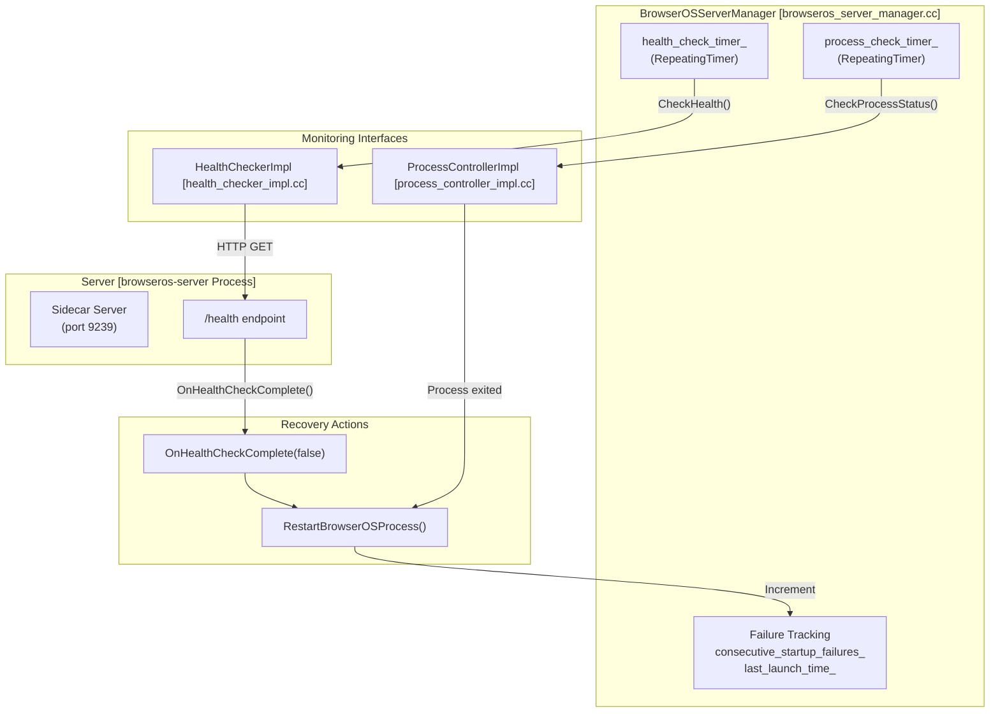
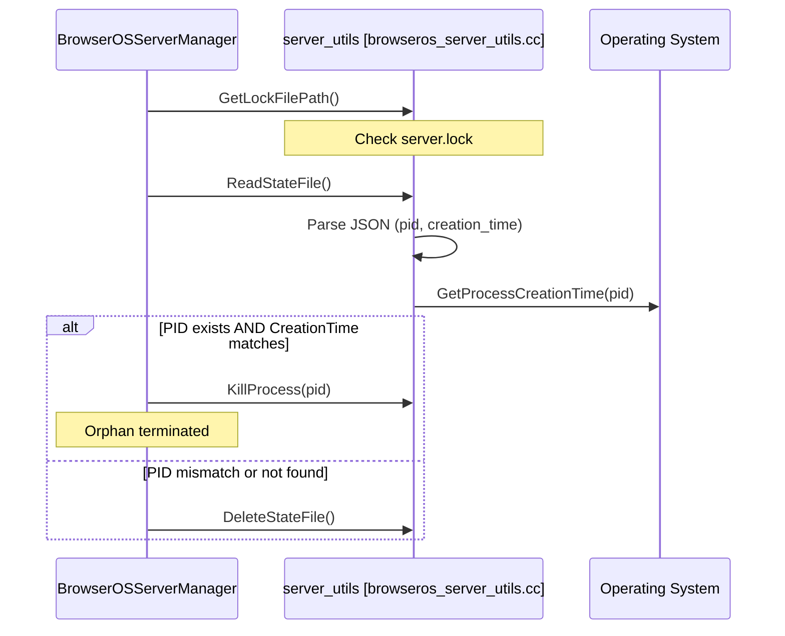

<!-- source: DeepWiki mcp.deepwiki.com · repo browseros-ai/BrowserOS · page 7.4 Health Monitoring · fetched 2026-10-29 -->

# Health Monitoring

Relevant source files

The following files were used as context for generating this wiki page:

- [packages/browseros/chromium_patches/chrome/browser/browseros/server/browseros_server_utils.cc](packages/browseros/chromium_patches/chrome/browser/browseros/server/browseros_server_utils.cc)
- [packages/browseros/chromium_patches/chrome/browser/browseros/server/browseros_server_utils.h](packages/browseros/chromium_patches/chrome/browser/browseros/server/browseros_server_utils.h)
- [packages/browseros/chromium_patches/chrome/browser/browseros/server/health_checker.h](packages/browseros/chromium_patches/chrome/browser/browseros/server/health_checker.h)
- [packages/browseros/chromium_patches/chrome/browser/browseros/server/health_checker_impl.cc](packages/browseros/chromium_patches/chrome/browser/browseros/server/health_checker_impl.cc)
- [packages/browseros/chromium_patches/chrome/browser/browseros/server/health_checker_impl.h](packages/browseros/chromium_patches/chrome/browser/browseros/server/health_checker_impl.h)
- [packages/browseros/chromium_patches/chrome/browser/browseros/server/test/mock_health_checker.h](packages/browseros/chromium_patches/chrome/browser/browseros/server/test/mock_health_checker.h)

This document describes the health monitoring system for the BrowserOS Server process. It covers how the browser detects server failures, performs health checks, and automatically recovers from crashes. For information about server lifecycle management, see [7.2 Lifecycle Management](). For information about server updates, see [9.4 Server OTA Updates]().

## Purpose and Scope

The `BrowserOSServerManager` class implements a comprehensive health monitoring system that ensures the sidecar server process remains operational. The system performs periodic health checks via HTTP endpoints, monitors process status at the OS level, tracks failure patterns, and automatically restarts the server when issues are detected.

## Health Check Architecture

The health monitoring system uses two independent monitoring mechanisms running on separate timers: HTTP endpoint health checks and process status checks. The implementation is abstracted via the `HealthChecker` and `ProcessController` interfaces to allow for robust testing and platform-specific logic.

Title: Health Monitoring Data Flow

**Sources:**
- [chrome/browser/browseros/server/browseros_server_manager.cc:70-74]()
- [chrome/browser/browseros/server/browseros_server_manager.h:50-160]()
- [chrome/browser/browseros/server/health_checker_impl.h:31-49]()
- [chrome/browser/browseros/server/process_controller_impl.h:18-45]()

## HTTP Health Endpoint Monitoring

The manager periodically sends HTTP GET requests to the server's health endpoint to verify the server is responding correctly. This is handled by the `HealthCheckerImpl` class.

### Health Check Implementation

| Component | Description |
|-----------|-------------|
| **Class** | `HealthCheckerImpl` [chrome/browser/browseros/server/health_checker_impl.h:31]() |
| **Interval** | 30 seconds (`kHealthCheckInterval`) [chrome/browser/browseros/server/browseros_server_manager.cc:70]() |
| **Method** | `CheckHealth(int port, const std::string& path, callback)` [chrome/browser/browseros/server/health_checker_impl.cc:36]() |
| **Endpoint** | `http://127.0.0.1:{port}{path}` [chrome/browser/browseros/server/health_checker_impl.cc:40]() |
| **Timeout** | 15 seconds (`kHealthCheckTimeout`) [chrome/browser/browseros/server/health_checker_impl.cc:28]() |
| **Traffic Tag** | `browseros_health_check` [chrome/browser/browseros/server/health_checker_impl.cc:43-58]() |

The health check process:
1. `BrowserOSServerManager` triggers `CheckHealth()` via its `health_check_timer_`.
2. `HealthCheckerImpl` creates a `network::SimpleURLLoader` targeting the health endpoint [chrome/browser/browseros/server/health_checker_impl.cc:65-67]().
3. The request is sent using the system's `URLLoaderFactory` [chrome/browser/browseros/server/health_checker_impl.cc:69-76]().
4. If the request returns a non-200 status, `OnRequestComplete` logs the failure and returns `false` to the callback [chrome/browser/browseros/server/health_checker_impl.cc:79-97]().

**Sources:**
- [chrome/browser/browseros/server/health_checker_impl.cc:28-97]()
- [chrome/browser/browseros/server/health_checker_impl.h:31-49]()
- [chrome/browser/browseros/server/browseros_server_manager.cc:70-74]()

## Process Status Monitoring

In addition to HTTP health checks, the manager monitors the server process status directly to detect crashes immediately using `ProcessControllerImpl`.

### Process Check Implementation

| Component | Description |
|-----------|-------------|
| **Class** | `ProcessControllerImpl` [chrome/browser/browseros/server/process_controller_impl.h:23]() |
| **Interval** | 5 seconds (`kProcessCheckInterval`) [chrome/browser/browseros/server/browseros_server_manager.cc:71]() |
| **Method** | `IsProcessRunning(base::ProcessId pid)` |
| **Utility** | `browseros::server_utils::ProcessExists` [chrome/browser/browseros/server/browseros_server_utils.h:87]() |

The process monitoring flow utilizes platform-specific utilities. On macOS, it uses `libproc.h` and `proc_pidinfo`, while on Linux it uses `/proc` and on Windows it uses `OpenProcess` to verify the PID is still active [chrome/browser/browseros/server/browseros_server_utils.cc:38-58]().

**Sources:**
- [chrome/browser/browseros/server/browseros_server_manager.cc:71-71]()
- [chrome/browser/browseros/server/browseros_server_utils.cc:38-58]()
- [chrome/browser/browseros/server/browseros_server_utils.h:87-87]()

## Orphan Process Recovery

A critical part of health monitoring is detecting "orphan" processes—server instances left behind by a previous browser crash. This is managed through a lock and state file mechanism.

### State Validation Logic

The system maintains a `server.state` file and a `server.lock` file in the `.browseros` execution directory [chrome/browser/browseros/server/browseros_server_utils.cc:67-70]().

Title: Orphan Process Recovery Sequence

The `ServerState` struct stores the `pid` and `creation_time` in milliseconds [chrome/browser/browseros/server/browseros_server_utils.h:64-67](). The system uses this validation to ensure BrowserOS doesn't accidentally kill a different process that happened to reuse the same PID.

**Sources:**
- [chrome/browser/browseros/server/browseros_server_utils.cc:67-70]()
- [chrome/browser/browseros/server/browseros_server_utils.h:64-76]()
- [chrome/browser/browseros/server/browseros_server_utils.h:84-91]()

## Port Health and Availability

Before launching or restarting, the system validates that the required ports are available. `FindAvailablePort` scans for open ports starting from the configured base values [chrome/browser/browseros/server/browseros_server_utils.cc:78-110]().

### Port Probe Logic
- **`IsPortAvailable`**: Attempts to bind a `TCPSocket` to both IPv4 and IPv6 localhost [chrome/browser/browseros/server/browseros_server_utils.cc:112-168]().
- **`allow_reuse`**: When set to true, it uses `net::TCPServerSocket` which sets `SO_REUSEADDR`, allowing bind to succeed even when the port is in `TIME_WAIT` (common after a server crash) [chrome/browser/browseros/server/browseros_server_utils.cc:125-134]().

**Sources:**
- [chrome/browser/browseros/server/browseros_server_utils.cc:78-168]()
- [chrome/browser/browseros/server/browseros_server_utils.h:32-38]()

## Crash Recovery and Failure Thresholds

The manager tracks consecutive failures to prevent infinite restart loops that could consume system resources.

| Parameter | Value | Description |
|-----------|-------|-------------|
| `kStartupGracePeriod` | 30 seconds | Time allowed for the server to become healthy after launch [chrome/browser/browseros/server/browseros_server_manager.cc:73](). |
| `kMaxStartupFailures` | 3 | Maximum number of consecutive failures before stopping restart attempts [chrome/browser/browseros/server/browseros_server_manager.cc:74](). |

If `consecutive_startup_failures_` exceeds `kMaxStartupFailures`, the manager stops attempting to restart and logs a critical error. This counter is reset upon a successful health check.

**Sources:**
- [chrome/browser/browseros/server/browseros_server_manager.cc:73-74]()
- [chrome/browser/browseros/server/browseros_server_manager.h:150-160]()

---

