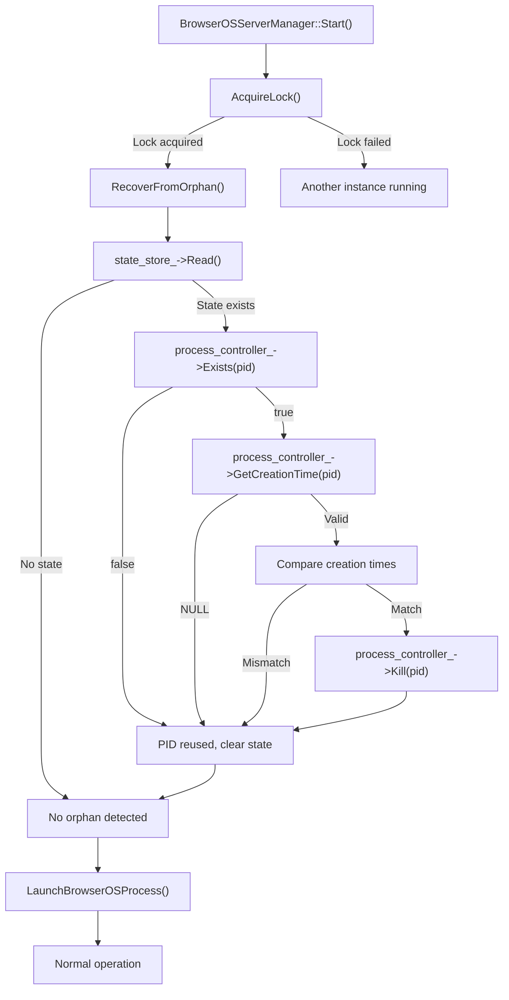
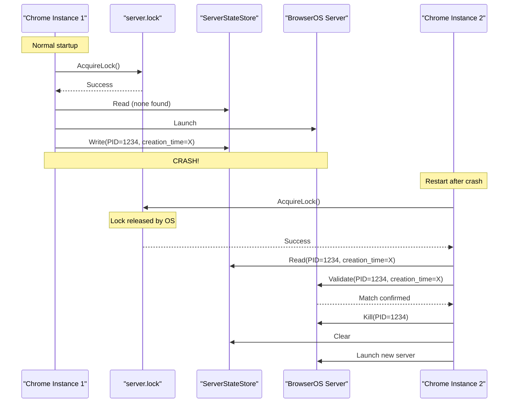
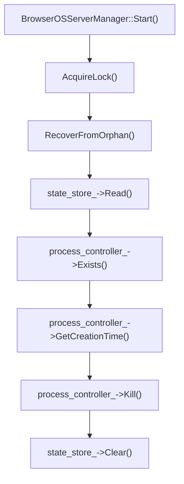

<!-- source: DeepWiki mcp.deepwiki.com · repo browseros-ai/BrowserOS · page 7.5 Orphan Process Recovery · fetched 2026-10-29 -->

# Orphan Process Recovery

<details>
<summary>Relevant source files</summary>

The following files were used as context for generating this wiki page:

- [packages/browseros/chromium_patches/chrome/browser/browseros/core/browseros_switches.h](packages/browseros/chromium_patches/chrome/browser/browseros/core/browseros_switches.h)
- [packages/browseros/chromium_patches/chrome/browser/browseros/server/BUILD.gn](packages/browseros/chromium_patches/chrome/browser/browseros/server/BUILD.gn)
- [packages/browseros/chromium_patches/chrome/browser/browseros/server/browseros_server_config.cc](packages/browseros/chromium_patches/chrome/browser/browseros/server/browseros_server_config.cc)
- [packages/browseros/chromium_patches/chrome/browser/browseros/server/browseros_server_config.h](packages/browseros/chromium_patches/chrome/browser/browseros/server/browseros_server_config.h)
- [packages/browseros/chromium_patches/chrome/browser/browseros/server/browseros_server_config_unittest.cc](packages/browseros/chromium_patches/chrome/browser/browseros/server/browseros_server_config_unittest.cc)
- [packages/browseros/chromium_patches/chrome/browser/browseros/server/browseros_server_constants.h](packages/browseros/chromium_patches/chrome/browser/browseros/server/browseros_server_constants.h)
- [packages/browseros/chromium_patches/chrome/browser/browseros/server/browseros_server_manager.cc](packages/browseros/chromium_patches/chrome/browser/browseros/server/browseros_server_manager.cc)
- [packages/browseros/chromium_patches/chrome/browser/browseros/server/browseros_server_manager.h](packages/browseros/chromium_patches/chrome/browser/browseros/server/browseros_server_manager.h)
- [packages/browseros/chromium_patches/chrome/browser/browseros/server/browseros_server_manager_unittest.cc](packages/browseros/chromium_patches/chrome/browser/browseros/server/browseros_server_manager_unittest.cc)
- [packages/browseros/chromium_patches/chrome/browser/browseros/server/browseros_server_prefs.cc](packages/browseros/chromium_patches/chrome/browser/browseros/server/browseros_server_prefs.cc)
- [packages/browseros/chromium_patches/chrome/browser/browseros/server/browseros_server_prefs.h](packages/browseros/chromium_patches/chrome/browser/browseros/server/browseros_server_prefs.h)
- [packages/browseros/chromium_patches/chrome/browser/browseros/server/browseros_server_updater.cc](packages/browseros/chromium_patches/chrome/browser/browseros/server/browseros_server_updater.cc)
- [packages/browseros/chromium_patches/chrome/browser/browseros/server/browseros_server_updater.h](packages/browseros/chromium_patches/chrome/browser/browseros/server/browseros_server_updater.h)
- [packages/browseros/chromium_patches/chrome/browser/browseros/server/process_controller_impl.cc](packages/browseros/chromium_patches/chrome/browser/browseros/server/process_controller_impl.cc)

</details>


This document describes the mechanism BrowserOS uses to detect and recover from orphaned server processes that remain running after a browser crash. For information about normal server lifecycle management, see [7.2 Lifecycle Management](). For information about process monitoring during normal operation, see [7.4 Health Monitoring]().

## Purpose and Scope

When the BrowserOS browser process crashes or is forcefully terminated (e.g., via Task Manager), the sidecar BrowserOS Server process may remain running as an "orphan" — a process that no longer has a parent to manage it. This creates several problems:

- The orphaned process continues holding network ports (e.g., `9000`, `9100`, `9200`), preventing a new server from binding to those ports [packages/browseros/chromium_patches/chrome/browser/browseros/server/browseros_server_prefs.h:21-31]().
- System resources remain allocated unnecessarily.
- Multiple orphaned processes can accumulate over time.

The orphan process recovery system detects these orphaned processes on browser startup and terminates them safely, ensuring a clean slate for the new server instance.

Sources: [packages/browseros/chromium_patches/chrome/browser/browseros/server/browseros_server_manager.h:62-64](), [packages/browseros/chromium_patches/chrome/browser/browseros/server/browseros_server_manager.h:103-104](), [packages/browseros/chromium_patches/chrome/browser/browseros/server/browseros_server_prefs.h:21-31]()

## The PID Reuse Problem

A naive implementation might simply store the server's process ID (PID) in a file and kill any process with that PID on startup. However, this approach has a critical flaw: **PIDs are reused by operating systems**. After a process exits, the OS may quickly reassign its PID to a completely unrelated new process. Killing a process based solely on PID could result in terminating an innocent system process.

BrowserOS solves this problem using **PID + creation time validation**. Each process has a unique creation timestamp that, combined with the PID, forms a reliable identifier. The recovery system validates both attributes before terminating any process:

```
Valid Orphan = (PID matches) AND (creation_time matches)
```

If the PIDs match but creation times differ, the stored PID has been reused by a different process, and the orphan no longer exists.

Sources: [packages/browseros/chromium_patches/chrome/browser/browseros/server/browseros_server_manager.h:104-104](), [packages/browseros/chromium_patches/chrome/browser/browseros/server/process_controller.h:25-48]() (Note: `process_controller.h` assumed based on `process_controller_impl.cc` logic)

## State File Structure

The server process state is persisted in a storage mechanism managed by the `ServerStateStore` [packages/browseros/chromium_patches/chrome/browser/browseros/server/browseros_server_manager.h:143-143]().

The state store tracks process identity information, including:

| Field | Type | Description |
|-------|------|-------------|
| `pid` | integer | Process ID of the running server |
| `creation_time` | int64_t | Process creation time (platform-specific timestamp) |

This state is written when the server process launches successfully and cleared when it exits cleanly.

### State Lifecycle

```mermaid
stateDiagram-v2
    [*] --> "NoState" : "Browser starts"
    "NoState" --> "StateWritten" : "Server launches (OnProcessLaunched)"
    "StateWritten" --> "NoState" : "Clean shutdown (Shutdown)"
    "StateWritten" --> "OrphanDetected" : "Browser crash"
    "OrphanDetected" --> "NoState" : "Recovery (RecoverFromOrphan)"
    "NoState" --> [*]
```

**State Lifecycle Diagram**

Sources: [packages/browseros/chromium_patches/chrome/browser/browseros/server/browseros_server_manager.cc:180-210](), [packages/browseros/chromium_patches/chrome/browser/browseros/server/browseros_server_manager.h:122-122](), [packages/browseros/chromium_patches/chrome/browser/browseros/server/server_state_store.h:20-40]() (Note: `server_state_store.h` assumed based on `browseros_server_manager.cc` usage)

## Recovery Flow

### Overview



**Orphan Process Recovery Flowchart**

Sources: [packages/browseros/chromium_patches/chrome/browser/browseros/server/browseros_server_manager.cc:177-210](), [packages/browseros/chromium_patches/chrome/browser/browseros/server/process_controller_impl.cc:159-171]()

### Detailed Steps

#### 1. Lock Acquisition

Before attempting recovery, the manager acquires an exclusive file lock [packages/browseros/chromium_patches/chrome/browser/browseros/server/browseros_server_manager.cc:177-185](). Only one Chrome process can hold this lock at a time. If lock acquisition fails, another Chrome instance is already managing the server.

**Implementation:**
- Lock file location: Resolved via `GetBrowserOSExecutionDir()` [packages/browseros/chromium_patches/chrome/browser/browseros/server/browseros_server_manager.cc:180-181]().
- Uses `base::File` for the lock handle [packages/browseros/chromium_patches/chrome/browser/browseros/server/browseros_server_manager.h:148-148]().

#### 2. State Store Reading

The `ServerStateStore` interface abstracts state persistence [packages/browseros/chromium_patches/chrome/browser/browseros/server/browseros_server_manager.h:143-143](). If no state exists for a previous run, recovery is skipped.

#### 3. Process Existence Check

The manager uses the `ProcessController` to check if the PID stored in the state still exists on the system [packages/browseros/chromium_patches/chrome/browser/browseros/server/process_controller_impl.cc:159-161]().

#### 4. Creation Time Validation

The `ProcessController` retrieves the actual creation time of the running process and compares it with the stored value. Platform-specific implementations are provided via `server_utils` wrapped by `ProcessControllerImpl` [packages/browseros/chromium_patches/chrome/browser/browseros/server/process_controller_impl.cc:163-166]().

#### 5. Orphan Termination

If validation succeeds, the process is confirmed as an orphan. The `ProcessController` attempts to terminate the process, typically using a graceful timeout followed by force [packages/browseros/chromium_patches/chrome/browser/browseros/server/process_controller_impl.cc:168-171]().

#### 6. State Cleanup

After termination (successful or failed), the state is cleared to prevent repeated recovery attempts.

## Lock File vs State Store

The system uses two separate mechanisms for coordination:

| Mechanism | Purpose | Lifetime |
|------|---------|----------|
| `lock_file_` | Prevents multiple Chrome instances from managing the server [packages/browseros/chromium_patches/chrome/browser/browseros/server/browseros_server_manager.cc:177-185]() | Held while `BrowserOSServerManager` is active |
| `state_store_` | Tracks running server PID/creation_time for orphan detection [packages/browseros/chromium_patches/chrome/browser/browseros/server/browseros_server_manager.h:143-143]() | Set on server launch, cleared on clean exit |



**Lock File vs State Store Interaction**

Sources: [packages/browseros/chromium_patches/chrome/browser/browseros/server/browseros_server_manager.cc:177-210](), [packages/browseros/chromium_patches/chrome/browser/browseros/server/process_controller_impl.cc:163-171]()

## Code Entity Mapping

### Key Classes

```mermaid
classDiagram
    class "BrowserOSServerManager" {
        -unique_ptr~ProcessController~ process_controller_
        -unique_ptr~ServerStateStore~ state_store_
        -base::File lock_file_
        +Start()
        +AcquireLock() bool
        +RecoverFromOrphan() bool
    }

    class "ServerStateStore" {
        <<interface>>
        +Read()
        +Write()
        +Clear()
    }

    class "ProcessController" {
        <<interface>>
        +Exists(pid) bool
        +GetCreationTime(pid)
        +Kill(pid) bool
    }

    "BrowserOSServerManager" --> "ServerStateStore" : "manages state"
    "BrowserOSServerManager" --> "ProcessController" : "manages processes"
```

**Class Relationships**

| Class | File | Purpose |
|-------|------|---------|
| `BrowserOSServerManager` | [packages/browseros/chromium_patches/chrome/browser/browseros/server/browseros_server_manager.h:47-47]() | Singleton that orchestrates server lifecycle and recovery. |
| `ServerStateStore` | [packages/browseros/chromium_patches/chrome/browser/browseros/server/server_state_store.h:20-20]() | Interface for persisting process identity (PID + time). |
| `ProcessController` | [packages/browseros/chromium_patches/chrome/browser/browseros/server/process_controller.h:20-20]() | Interface for OS-level process existence and termination. |

Sources: [packages/browseros/chromium_patches/chrome/browser/browseros/server/browseros_server_manager.h:141-143](), [packages/browseros/chromium_patches/chrome/browser/browseros/server/BUILD.gn:43-71]()

### Key Methods



**Method Call Flow**

Sources: [packages/browseros/chromium_patches/chrome/browser/browseros/server/browseros_server_manager.cc:177-210](), [packages/browseros/chromium_patches/chrome/browser/browseros/server/process_controller_impl.cc:159-171]()

## Error Handling

The recovery system is designed to be conservative to avoid accidental termination of unrelated processes:

| Scenario | Behavior |
|----------|----------|
| State missing | Skip recovery (no orphan detected) |
| PID doesn't exist | Clear stale state (process already exited) |
| Creation time mismatch | Clear state (PID has been reused by another application) |
| Termination fails | Proceed with launch attempt (subsequent binding to ports may still fail) |

Sources: [packages/browseros/chromium_patches/chrome/browser/browseros/server/browseros_server_manager.cc:177-210](), [packages/browseros/chromium_patches/chrome/browser/browseros/server/process_controller_impl.cc:106-138](), [packages/browseros/chromium_patches/chrome/browser/browseros/server/process_controller_impl.cc:159-171]()

---

