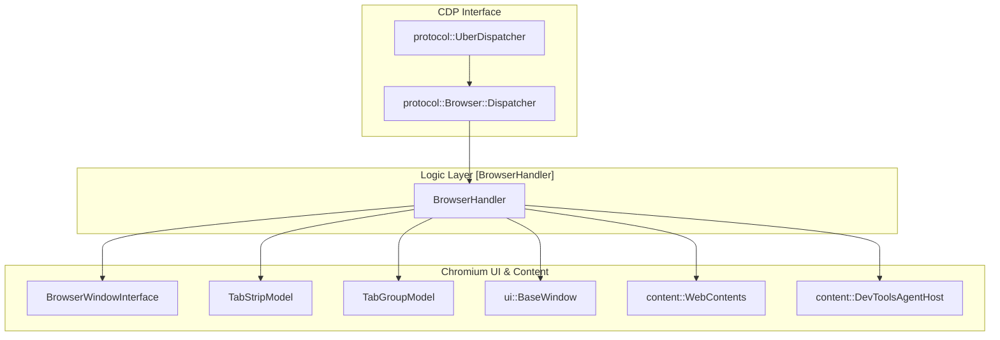
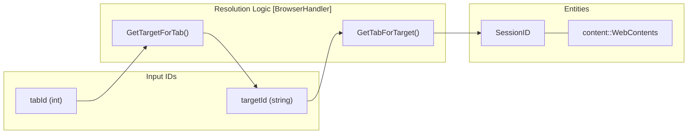

<!-- source: DeepWiki mcp.deepwiki.com · repo browseros-ai/BrowserOS · page 8.1 Browser Domain · fetched 2026-10-29 -->

# Browser Domain

Relevant source files

The following files were used as context for generating this wiki page:

- [packages/browseros/chromium_patches/chrome/browser/devtools/BUILD.gn](packages/browseros/chromium_patches/chrome/browser/devtools/BUILD.gn)
- [packages/browseros/chromium_patches/chrome/browser/devtools/chrome_devtools_session.cc](packages/browseros/chromium_patches/chrome/browser/devtools/chrome_devtools_session.cc)
- [packages/browseros/chromium_patches/chrome/browser/devtools/chrome_devtools_session.h](packages/browseros/chromium_patches/chrome/browser/devtools/chrome_devtools_session.h)
- [packages/browseros/chromium_patches/chrome/browser/devtools/inspector_protocol_config.json](packages/browseros/chromium_patches/chrome/browser/devtools/inspector_protocol_config.json)
- [packages/browseros/chromium_patches/chrome/browser/devtools/protocol/bookmarks_handler.cc](packages/browseros/chromium_patches/chrome/browser/devtools/protocol/bookmarks_handler.cc)
- [packages/browseros/chromium_patches/chrome/browser/devtools/protocol/bookmarks_handler.h](packages/browseros/chromium_patches/chrome/browser/devtools/protocol/bookmarks_handler.h)
- [packages/browseros/chromium_patches/chrome/browser/devtools/protocol/browser_handler.cc](packages/browseros/chromium_patches/chrome/browser/devtools/protocol/browser_handler.cc)
- [packages/browseros/chromium_patches/chrome/browser/devtools/protocol/browser_handler.h](packages/browseros/chromium_patches/chrome/browser/devtools/protocol/browser_handler.h)
- [packages/browseros/chromium_patches/chrome/browser/devtools/protocol/browser_handler_android.cc](packages/browseros/chromium_patches/chrome/browser/devtools/protocol/browser_handler_android.cc)
- [packages/browseros/chromium_patches/chrome/browser/devtools/protocol/browser_handler_android.h](packages/browseros/chromium_patches/chrome/browser/devtools/protocol/browser_handler_android.h)
- [packages/browseros/chromium_patches/chrome/browser/devtools/protocol/devtools_protocol_browsertest.cc](packages/browseros/chromium_patches/chrome/browser/devtools/protocol/devtools_protocol_browsertest.cc)
- [packages/browseros/chromium_patches/chrome/browser/devtools/protocol/history_handler.cc](packages/browseros/chromium_patches/chrome/browser/devtools/protocol/history_handler.cc)
- [packages/browseros/chromium_patches/third_party/blink/public/devtools_protocol/domains/Browser.pdl](packages/browseros/chromium_patches/third_party/blink/public/devtools_protocol/domains/Browser.pdl)

The Browser Domain is a custom Chrome DevTools Protocol (CDP) domain that provides comprehensive window, tab, and tab group management capabilities for browser automation. This domain extends standard Chromium CDP with high-level APIs for creating, querying, and manipulating browser windows and tabs.

For information about related domains, see **8.4 Bookmarks API** and **8.5 History API**.

## Protocol Definition

The Browser domain is defined in the Protocol Definition Language (PDL) and implemented by the `BrowserHandler` class. The domain provides three categories of functionality: window management, tab management, and tab group management.

**Sources:** [packages/browseros/chromium_patches/third_party/blink/public/devtools_protocol/domains/Browser.pdl:6-247](), [packages/browseros/chromium_patches/chrome/browser/devtools/protocol/browser_handler.h:20-143]()

### Core Type Definitions

The domain defines several core types for representing browser entities:

| Type | Description | Key Fields |
|------|-------------|------------|
| `WindowID` | Integer identifier for browser windows | Unique within session |
| `TabID` | Integer identifier for tabs | Persistent across moves |
| `TabGroupID` | String token representing a tab group | Serialized `TabGroupId` |
| `WindowType` | Enum of window types | `normal`, `popup`, `app`, `devtools`, `app_popup`, `picture_in_picture` |
| `WindowInfo` | Complete window state | `windowId`, `windowType`, `bounds`, `isActive`, `isVisible`, `tabCount`, `activeTabId` |
| `TabInfo` | Complete tab state | `tabId`, `targetId`, `url`, `title`, `isActive`, `isLoading`, `isPinned`, `isHidden`, `windowId`, `index`, `groupId` |
| `TabGroupInfo` | Tab group metadata | `groupId`, `windowId`, `title`, `color`, `collapsed`, `tabIds` |

**Sources:** [packages/browseros/chromium_patches/third_party/blink/public/devtools_protocol/domains/Browser.pdl:8-64]()

## Architecture

The `BrowserHandler` class bridges the CDP protocol layer with Chromium's browser UI components. It interacts with `BrowserWindowInterface` for window operations and `TabStripModel` for tab operations.

Title: "Browser Domain Implementation Flow"

**Sources:** [packages/browseros/chromium_patches/chrome/browser/devtools/protocol/browser_handler.h:20-143](), [packages/browseros/chromium_patches/chrome/browser/devtools/protocol/browser_handler.cc:54-182]()

## Identifier Resolution

The Browser domain supports two types of tab identifiers that can be used interchangeably in commands: `targetId` (the DevTools agent host ID) and `tabId` (the session-based integer ID).

Title: "Identifier Mapping Logic"

**Sources:** [packages/browseros/chromium_patches/chrome/browser/devtools/protocol/browser_handler.cc:190-210](), [packages/browseros/chromium_patches/third_party/blink/public/devtools_protocol/domains/Browser.pdl:522-542]()

### Conversion Commands

Two bidirectional commands enable converting between identifier types:
* `getTabForTarget`: Convert CDP `targetId` → BrowserOS `tabId` and `windowId`.
* `getTargetForTab`: Convert BrowserOS `tabId` → CDP `targetId` and `windowId`.

**Sources:** [packages/browseros/chromium_patches/chrome/browser/devtools/protocol/browser_handler.cc:245-310](), [packages/browseros/chromium_patches/chrome/browser/devtools/protocol/browser_handler.h:27-34]()

## Window Management

The domain provides comprehensive window lifecycle and state management. Note that as of the current implementation, "hidden" windows and tabs are no longer supported and will return errors to prevent inconsistent browser states.

### Window Operations Table

| Command | Implementation Mechanism |
|---------|-------------------------|
| `getWindows` | Iterates via `ForEachCurrentBrowserWindowInterfaceOrderedByActivation` |
| `getActiveWindow` | Uses `GetLastActiveBrowserWindowInterfaceWithAnyProfile` |
| `createWindow` | Rejects `hidden: true` with `kHiddenWindowsRetired` |
| `closeWindow` | Calls `bwi->Close()` |
| `activateWindow` | Calls `bwi->GetWindow()->Activate()` |
| `setWindowVisibility` | Rejects `visible: false` with `kHiddenWindowsRetired` |

**Sources:** [packages/browseros/chromium_patches/chrome/browser/devtools/protocol/browser_handler.cc:42-45](), [packages/browseros/chromium_patches/chrome/browser/devtools/protocol/browser_handler.cc:383-480](), [packages/browseros/chromium_patches/chrome/browser/devtools/protocol/browser_handler.h:43-63]()

## Tab Management

Tabs are managed through the `TabStripModel` of their respective windows.

### Tab Operations

The implementation provides standard operations such as `createTab`, `closeTab`, `activateTab`, `moveTab`, and `duplicateTab`.

*   **Identifier Support:** Most commands accept an optional `targetId` or `tabId`. The helper `ResolveTabIdentifier` is used to locate the `WebContents` and `TabStripModel`.
*   **Cross-Window Moves:** `moveTab` supports moving a tab to a different `windowId`. It handles the transition between `TabStripModel` instances.
*   **Pinned State:** `pinTab` and `unpinTab` toggle the pinned status via `TabStripModel::SetTabPinned`.
*   **Retired Features:** `showTab` now rejects calls as hidden tabs are no longer supported.

**Sources:** [packages/browseros/chromium_patches/chrome/browser/devtools/protocol/browser_handler.cc:190-210](), [packages/browseros/chromium_patches/chrome/browser/devtools/protocol/browser_handler.cc:630-900](), [packages/browseros/chromium_patches/chrome/browser/devtools/protocol/browser_handler.h:66-114]()

## Tab Group Management

Tab groups allow organizing tabs within a window. Groups are identified by a serialized `TabGroupId` (a string representation of a token).

### Group Operations

*   **Creation:** `createTabGroup` takes an array of `tabIds` and an optional title. It uses `TabStripModel::AddToNewGroup`.
*   **Modification:** `updateTabGroup` allows changing the `title`, `color` (e.g., "blue", "red", "green", "pink", "purple", "cyan", "orange"), and `collapsed` state.
*   **Movement:** `moveTabGroup` can move an entire group to a different window or a new index within the current window.

**Sources:** [packages/browseros/chromium_patches/chrome/browser/devtools/protocol/browser_handler.cc:920-1180](), [packages/browseros/chromium_patches/chrome/browser/devtools/protocol/browser_handler.h:117-142]()

## Platform Specifics (Android)

Android has a specialized implementation in `BrowserHandlerAndroid`. Due to the nature of Android's UI, many window and tab management commands are currently stubs returning `MethodNotFound`. However, identifier resolution (`getTabForTarget` and `getTargetForTab`) is fully implemented by iterating through `TabModelList::models()`.

**Sources:** [packages/browseros/chromium_patches/chrome/browser/devtools/protocol/browser_handler_android.cc:17-68](), [packages/browseros/chromium_patches/chrome/browser/devtools/protocol/browser_handler_android.cc:80-202]()

## Protocol Configuration

The domain and its supported methods are registered in the `inspector_protocol_config.json`. The `Browser` domain is configured to include all custom management commands.

**Sources:** [packages/browseros/chromium_patches/chrome/browser/devtools/inspector_protocol_config.json:8-12]()

---

