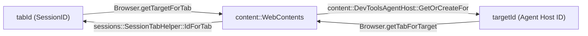
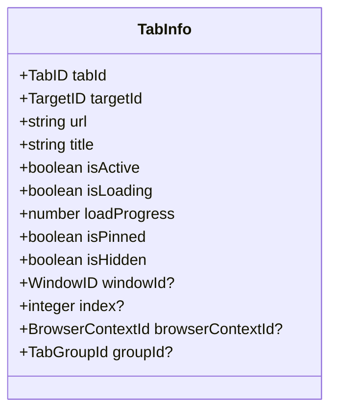
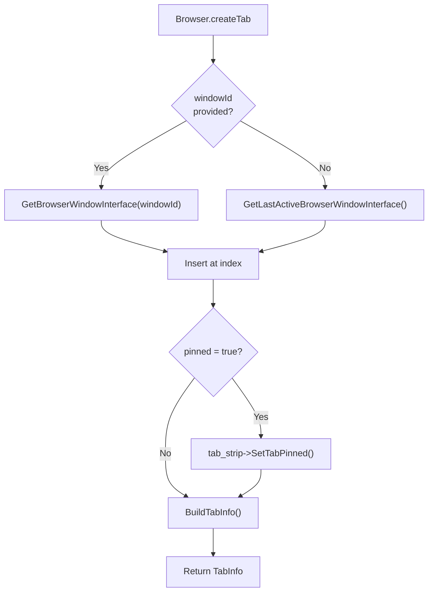
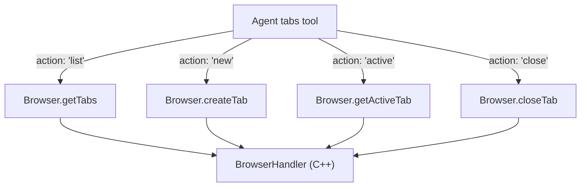

<!-- source: DeepWiki mcp.deepwiki.com · repo browseros-ai/BrowserOS · page 8.2 Tab Management API · fetched 2026-10-29 -->

# Tab Management API

Relevant source files

The following files were used as context for generating this wiki page:

- [packages/browseros-agent/crates/browseros-mcp/Cargo.toml](packages/browseros-agent/crates/browseros-mcp/Cargo.toml)
- [packages/browseros-agent/crates/browseros-mcp/src/framework.rs](packages/browseros-agent/crates/browseros-mcp/src/framework.rs)
- [packages/browseros-agent/crates/browseros-mcp/src/service.rs](packages/browseros-agent/crates/browseros-mcp/src/service.rs)
- [packages/browseros-agent/crates/browseros-mcp/src/tests.rs](packages/browseros-agent/crates/browseros-mcp/src/tests.rs)
- [packages/browseros-agent/crates/browseros-mcp/src/tools/history.rs](packages/browseros-agent/crates/browseros-mcp/src/tools/history.rs)
- [packages/browseros-agent/crates/browseros-mcp/src/tools/mod.rs](packages/browseros-agent/crates/browseros-mcp/src/tools/mod.rs)
- [packages/browseros-agent/crates/browseros-mcp/src/tools/run.rs](packages/browseros-agent/crates/browseros-mcp/src/tools/run.rs)
- [packages/browseros-agent/crates/browseros-mcp/src/tools/tabs.rs](packages/browseros-agent/crates/browseros-mcp/src/tools/tabs.rs)
- [packages/browseros-agent/crates/browseros-mcp/src/tools/windows.rs](packages/browseros-agent/crates/browseros-mcp/src/tools/windows.rs)
- [packages/browseros-agent/packages/browser-mcp/src/tools/history.test.ts](packages/browseros-agent/packages/browser-mcp/src/tools/history.test.ts)
- [packages/browseros-agent/packages/browser-mcp/src/tools/history.ts](packages/browseros-agent/packages/browser-mcp/src/tools/history.ts)
- [packages/browseros-agent/packages/browser-mcp/src/tools/registry.ts](packages/browseros-agent/packages/browser-mcp/src/tools/registry.ts)
- [packages/browseros-agent/packages/browser-mcp/src/tools/structured-contract.test.ts](packages/browseros-agent/packages/browser-mcp/src/tools/structured-contract.test.ts)
- [packages/browseros/chromium_patches/chrome/browser/devtools/BUILD.gn](packages/browseros/chromium_patches/chrome/browser/devtools/BUILD.gn)
- [packages/browseros/chromium_patches/chrome/browser/devtools/chrome_devtools_session.cc](packages/browseros/chromium_patches/chrome/browser/devtools/chrome_devtools_session.cc)
- [packages/browseros/chromium_patches/chrome/browser/devtools/chrome_devtools_session.h](packages/browseros/chromium_patches/chrome/browser/devtools/chrome_devtools_session.h)
- [packages/browseros/chromium_patches/chrome/browser/devtools/inspector_protocol_config.json](packages/browseros/chromium_patches/chrome/browser/devtools/inspector_protocol_config.json)
- [packages/browseros/chromium_patches/chrome/browser/devtools/protocol/bookmarks_handler.cc](packages/browseros/chromium_patches/chrome/browser/devtools/protocol/bookmarks_handler.cc)
- [packages/browseros/chromium_patches/chrome/browser/devtools/protocol/bookmarks_handler.h](packages/browseros/chromium_patches/chrome/browser/devtools/protocol/bookmarks_handler.h)
- [packages/browseros/chromium_patches/chrome/browser/devtools/protocol/browser_handler.cc](packages/browseros/chromium_patches/chrome/browser/devtools/protocol/browser_handler.cc)
- [packages/browseros/chromium_patches/chrome/browser/devtools/protocol/browser_handler.h](packages/browseros/chromium_patches/chrome/browser/devtools/protocol/browser_handler.h)
- [packages/browseros/chromium_patches/chrome/browser/devtools/protocol/browser_handler_android.cc](packages/browseros/chromium_patches/chrome/browser/devtools/protocol/browser_handler_android.cc)
- [packages/browseros/chromium_patches/chrome/browser/devtools/protocol/browser_handler_android.h](packages/browseros/chromium_patches/chrome/browser/devtools/protocol/browser_handler_android.h)
- [packages/browseros/chromium_patches/chrome/browser/devtools/protocol/devtools_protocol_browsertest.cc](packages/browseros/chromium_patches/chrome/browser/devtools/protocol/devtools_protocol_browsertest.cc)
- [packages/browseros/chromium_patches/chrome/browser/devtools/protocol/history_handler.cc](packages/browseros/chromium_patches/chrome/browser/devtools/protocol/history_handler.cc)
- [packages/browseros/chromium_patches/third_party/blink/public/devtools_protocol/domains/Browser.pdl](packages/browseros/chromium_patches/third_party/blink/public/devtools_protocol/domains/Browser.pdl)

The Tab Management API is a custom Chrome DevTools Protocol (CDP) domain extension that provides programmatic control over browser tabs. This API enables external tools and the BrowserOS Agent to create, query, modify, and close tabs across all browser windows.

For window-level operations, see [Window Management API](#8.3). For tab group operations, see the Tab Group Management section below. For the broader Browser domain overview, see [Browser Domain](#8.1).

---

## Tab Identification

BrowserOS tabs can be identified using two different ID schemes, which are interchangeable in most commands:

| Identifier Type | Description | Source | Example |
|-----------------|-------------|--------|---------|
| **`tabId`** | Integer-based SessionID assigned when tab is created | `sessions::SessionTabHelper::IdForTab()` | `12345` |
| **`targetId`** | String-based DevTools agent host ID | `content::DevToolsAgentHost::GetId()` | `"F4B5C6D7-8A9B-0C1D-2E3F-4A5B6C7D8E9F"` |

Most tab commands in `BrowserHandler` accept either identifier through optional `targetId` or `tabId` parameters. Exactly one must be provided, not both.

**Sources:** [packages/browseros/chromium_patches/third_party/blink/public/devtools_protocol/domains/Browser.pdl:9-10](), [packages/browseros/chromium_patches/third_party/blink/public/devtools_protocol/domains/Browser.pdl:104-105](), [packages/browseros/chromium_patches/chrome/browser/devtools/protocol/browser_handler.cc:145-182]()

### Conversion Between ID Types

The `BrowserHandler` provides specific commands to translate between these identifiers, facilitating integration between tab-based automation and target-based DevTools operations.

**ID Conversion Logic Flow**

**ID Conversion Commands:**

- **`Browser.getTabForTarget`**: Maps a CDP `targetId` to a Browser `tabId` and `windowId`. [packages/browseros/chromium_patches/chrome/browser/devtools/protocol/browser_handler.h:27-30]()
- **`Browser.getTargetForTab`**: Maps a Browser `tabId` to a CDP `targetId` and `windowId`. [packages/browseros/chromium_patches/chrome/browser/devtools/protocol/browser_handler.h:31-34]()

**Sources:** [packages/browseros/chromium_patches/chrome/browser/devtools/protocol/browser_handler.h:27-34](), [packages/browseros/chromium_patches/third_party/blink/public/devtools_protocol/domains/Browser.pdl:522-527]()

---

## Tab Information Structure

The `TabInfo` object returned by query commands contains metadata about the tab's state, location, and loading progress.

**TabInfo Entity Definition**

| Field | Type | Description |
|-------|------|-------------|
| `tabId` | integer | Unique tab identifier within browser session |
| `targetId` | string | DevTools agent host ID for CDP targeting |
| `url` | string | Currently displayed URL (`WebContents::GetVisibleURL()`) |
| `title` | string | Page title (`WebContents::GetTitle()`) |
| `isActive` | boolean | Whether this is the active tab in its window |
| `isLoading` | boolean | Page loading state |
| `loadProgress` | number | Loading progress 0.0-1.0 |
| `isPinned` | boolean | Whether tab is pinned |
| `isHidden` | boolean | Whether tab is hidden (Deprecated in recent builds) |
| `windowId` | integer (optional) | Parent window ID |
| `index` | integer (optional) | Position in tab strip |
| `browserContextId` | string (optional) | Profile identifier |
| `groupId` | string (optional) | Tab group ID if grouped |

**Sources:** [packages/browseros/chromium_patches/third_party/blink/public/devtools_protocol/domains/Browser.pdl:37-51](), [packages/browseros/chromium_patches/chrome/browser/devtools/protocol/browser_handler.cc:145-182]()

---

## Query Commands

### Get All Tabs

**`Browser.getTabs(windowId?, includeHidden?)`**

Returns an array of all tabs. Can be filtered to a specific window. Note that "Hidden tabs" support is currently retired in the core handler.

**Parameters:**
- `windowId` (optional) - Limit results to specific window.
- `includeHidden` (optional) - Legacy parameter, now retired. [packages/browseros/chromium_patches/chrome/browser/devtools/protocol/browser_handler.cc:44-45]()

**Returns:** Array of `TabInfo` objects.

**Sources:** [packages/browseros/chromium_patches/chrome/browser/devtools/protocol/browser_handler.h:66-70](), [packages/browseros/chromium_patches/third_party/blink/public/devtools_protocol/domains/Browser.pdl:107-114]()

### Get Active Tab

**`Browser.getActiveTab(windowId?)`**

Returns the currently active tab in the specified window or the last active window.

**Parameters:**
- `windowId` (optional) - Target window ID.

**Returns:** `TabInfo` object or null.

**Sources:** [packages/browseros/chromium_patches/chrome/browser/devtools/protocol/browser_handler.h:71-73](), [packages/browseros/chromium_patches/third_party/blink/public/devtools_protocol/domains/Browser.pdl:116-121]()

---

## Tab Creation and Closing

### Create Tab

**`Browser.createTab(url?, windowId?, index?, background?, pinned?, browserContextId?)`**

Creates a new tab with flexible placement and profile options.

**Tab Creation Data Flow**

**Parameters:**
- `url` (optional) - Initial URL to navigate to.
- `windowId` (optional) - Target window. If omitted, uses last active window.
- `index` (optional) - Position in tab strip.
- `background` (optional, default false) - Create in background (don't activate).
- `pinned` (optional, default false) - Create as pinned tab.
- `browserContextId` (optional) - Profile to use.

**Sources:** [packages/browseros/chromium_patches/chrome/browser/devtools/protocol/browser_handler.h:78-85](), [packages/browseros/chromium_patches/third_party/blink/public/devtools_protocol/domains/Browser.pdl:129-138]()

### Close Tab

**`Browser.closeTab(targetId?, tabId?)`**

Closes a tab by ID. This uses `ResolveTabIdentifier` internally to find the `WebContents` and associated `BrowserWindowInterface`.

**Sources:** [packages/browseros/chromium_patches/chrome/browser/devtools/protocol/browser_handler.h:86-87](), [packages/browseros/chromium_patches/third_party/blink/public/devtools_protocol/domains/Browser.pdl:140-144](), [packages/browseros/chromium_patches/chrome/browser/devtools/protocol/browser_handler.cc:190-191]()

---

## Tab Movement and Modification

### Move Tab

**`Browser.moveTab(targetId?, tabId?, windowId?, index?)`**

Moves a tab within the same window or to a different window. If `windowId` is provided, the tab is detached from its current `TabStripModel` and inserted into the target window's strip.

**Sources:** [packages/browseros/chromium_patches/chrome/browser/devtools/protocol/browser_handler.h:90-95](), [packages/browseros/chromium_patches/third_party/blink/public/devtools_protocol/domains/Browser.pdl:150-158]()

### Pin/Unpin Tab

**`Browser.pinTab`** and **`Browser.unpinTab`** allow toggling the pinned state of a tab. Pinned tabs are locked to the start of the tab strip.

**Sources:** [packages/browseros/chromium_patches/chrome/browser/devtools/protocol/browser_handler.h:100-107](), [packages/browseros/chromium_patches/third_party/blink/public/devtools_protocol/domains/Browser.pdl:166-179]()

---

## Tab Group Management

Tab groups allow organizing multiple tabs with a shared label and color. BrowserOS extends CDP to support programmatic group manipulation.

### Commands Summary

| Command | Description |
|---------|-------------|
| `Browser.getTabGroups` | List all tab groups (optionally filtered by window). |
| `Browser.createTabGroup` | Create a new group from tab IDs. |
| `Browser.updateTabGroup` | Modify group title, color, or collapsed state. |
| `Browser.closeTabGroup` | Close all tabs in a group. |
| `Browser.addTabsToGroup` | Add tabs to an existing group. |
| `Browser.removeTabsFromGroup` | Ungroup tabs (tabs remain open). |
| `Browser.moveTabGroup` | Move group to different window or position. |

**Sources:** [packages/browseros/chromium_patches/chrome/browser/devtools/protocol/browser_handler.h:117-142](), [packages/browseros/chromium_patches/third_party/blink/public/devtools_protocol/domains/Browser.pdl:193-242](), [packages/browseros/chromium_patches/chrome/browser/devtools/protocol/browser_handler.cc:141-143]()

---

## Agent-Side Tooling

The BrowserOS Agent provides higher-level abstractions over these CDP commands through the MCP (Model Context Protocol) tool catalog.

### `tabs` Tool

The `tabs` tool in the agent handles actions like `list`, `active`, `new`, and `close`. It translates agent-side requests into the CDP calls documented above.

**Agent to CDP Mapping**

**Sources:** [packages/browseros-agent/packages/browser-mcp/src/tools/structured-contract.test.ts:208-211](), [packages/browseros-agent/crates/browseros-mcp/src/service.rs:26-51]()

---

## Platform Availability

The Tab Management API has different implementations across platforms:

| Platform | Implementation | Status |
|----------|----------------|--------|
| **macOS** | `BrowserHandler` | ✅ Fully supported |
| **Windows/Linux** | `BrowserHandler` | ✅ Fully supported |
| **Android** | `BrowserHandlerAndroid` | ❌ Partial (Most return `MethodNotFound`) |

**Android implementation details:**
- `GetTabForTarget` and `GetTargetForTab` are implemented using `TabModelList` and `TabAndroid`. [packages/browseros/chromium_patches/chrome/browser/devtools/protocol/browser_handler_android.cc:17-68]()
- Most window and tab management commands return `Response::MethodNotFound(kNotImplemented)`. [packages/browseros/chromium_patches/chrome/browser/devtools/protocol/browser_handler_android.cc:78-203]()

**Sources:** [packages/browseros/chromium_patches/chrome/browser/devtools/protocol/browser_handler_android.cc:17-203](), [packages/browseros/chromium_patches/chrome/browser/devtools/protocol/browser_handler_android.h:5-124]()

---

