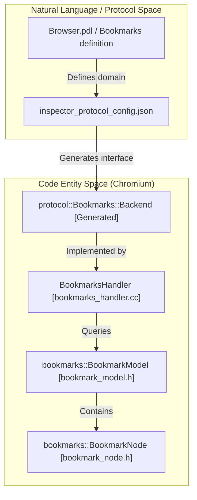
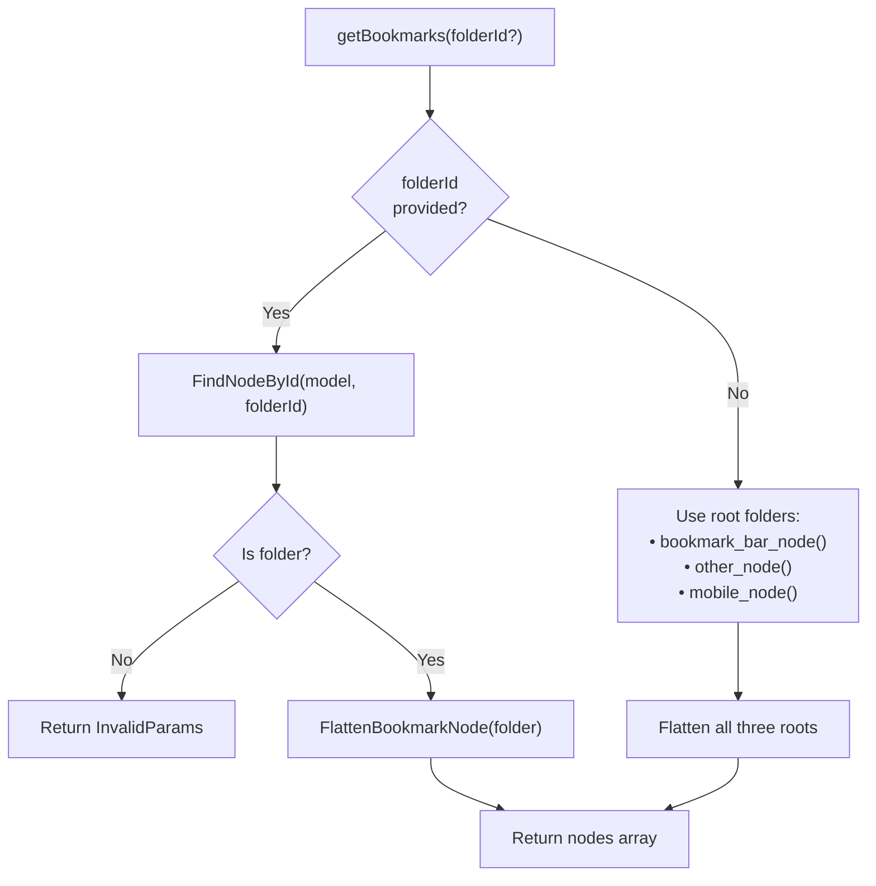
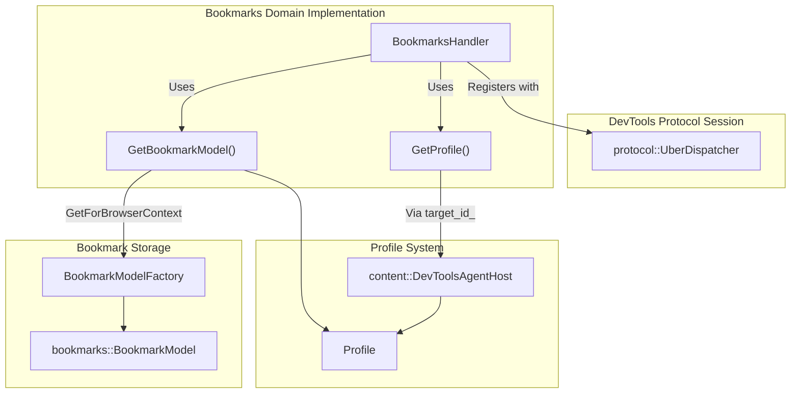
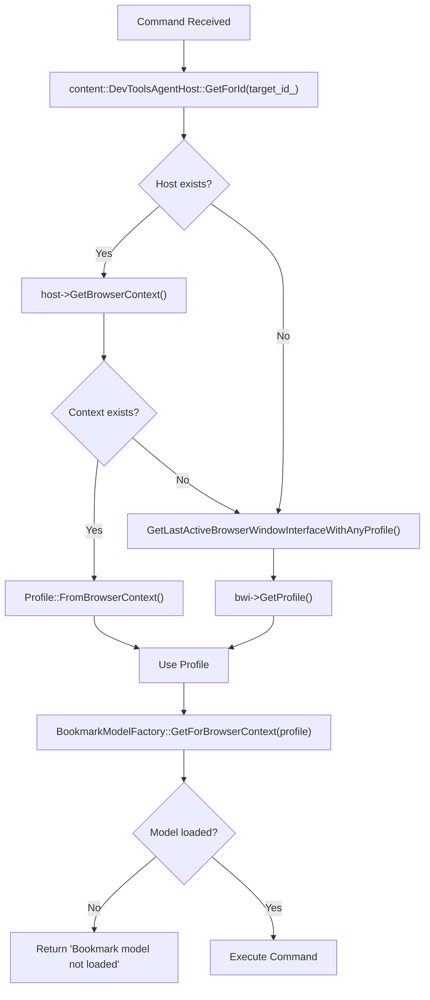

<!-- source: DeepWiki mcp.deepwiki.com · repo browseros-ai/BrowserOS · page 8.4 Bookmarks API · fetched 2026-10-29 -->

# Bookmarks API

<details>
<summary>Relevant source files</summary>

The following files were used as context for generating this wiki page:

- [packages/browseros/chromium_patches/chrome/browser/devtools/BUILD.gn](packages/browseros/chromium_patches/chrome/browser/devtools/BUILD.gn)
- [packages/browseros/chromium_patches/chrome/browser/devtools/chrome_devtools_session.cc](packages/browseros/chromium_patches/chrome/browser/devtools/chrome_devtools_session.cc)
- [packages/browseros/chromium_patches/chrome/browser/devtools/chrome_devtools_session.h](packages/browseros/chromium_patches/chrome/browser/devtools/chrome_devtools_session.h)
- [packages/browseros/chromium_patches/chrome/browser/devtools/inspector_protocol_config.json](packages/browseros/chromium_patches/chrome/browser/devtools/inspector_protocol_config.json)
- [packages/browseros/chromium_patches/chrome/browser/devtools/protocol/bookmarks_handler.cc](packages/browseros/chromium_patches/chrome/browser/devtools/protocol/bookmarks_handler.cc)
- [packages/browseros/chromium_patches/chrome/browser/devtools/protocol/bookmarks_handler.h](packages/browseros/chromium_patches/chrome/browser/devtools/protocol/bookmarks_handler.h)
- [packages/browseros/chromium_patches/chrome/browser/devtools/protocol/browser_handler.cc](packages/browseros/chromium_patches/chrome/browser/devtools/protocol/browser_handler.cc)
- [packages/browseros/chromium_patches/chrome/browser/devtools/protocol/browser_handler.h](packages/browseros/chromium_patches/chrome/browser/devtools/protocol/browser_handler.h)
- [packages/browseros/chromium_patches/chrome/browser/devtools/protocol/browser_handler_android.cc](packages/browseros/chromium_patches/chrome/browser/devtools/protocol/browser_handler_android.cc)
- [packages/browseros/chromium_patches/chrome/browser/devtools/protocol/browser_handler_android.h](packages/browseros/chromium_patches/chrome/browser/devtools/protocol/browser_handler_android.h)
- [packages/browseros/chromium_patches/chrome/browser/devtools/protocol/devtools_protocol_browsertest.cc](packages/browseros/chromium_patches/chrome/browser/devtools/protocol/devtools_protocol_browsertest.cc)
- [packages/browseros/chromium_patches/chrome/browser/devtools/protocol/history_handler.cc](packages/browseros/chromium_patches/chrome/browser/devtools/protocol/history_handler.cc)
- [packages/browseros/chromium_patches/third_party/blink/public/devtools_protocol/domains/Browser.pdl](packages/browseros/chromium_patches/third_party/blink/public/devtools_protocol/domains/Browser.pdl)

</details>


The Bookmarks API is a custom Chrome DevTools Protocol (CDP) domain that exposes Chromium's bookmark management system for programmatic access. This API allows external automation tools, AI agents, and MCP clients to query, create, modify, and delete bookmarks without requiring Chrome Extension APIs. For browser automation features like tab and window management, see [Tab Management API](8.2). For browsing history operations, see [History API](8.5).

**Sources:** [packages/browseros/chromium_patches/chrome/browser/devtools/protocol/bookmarks_handler.h:1-25](), [packages/browseros/chromium_patches/chrome/browser/devtools/protocol/bookmarks_handler.cc:1-304]()

---

## Protocol Definition

The Bookmarks domain is defined as an experimental CDP domain and integrated into BrowserOS's DevTools protocol configuration. The domain provides synchronous operations for bookmark management, with all commands returning results immediately.

### CDP to Code Entity Mapping
The following diagram illustrates how the protocol definitions in `.pdl` files map to the implementation classes in the C++ codebase.

**Title: Protocol to Implementation Mapping**


**Sources:** [packages/browseros/chromium_patches/chrome/browser/devtools/inspector_protocol_config.json:14-17](), [packages/browseros/chromium_patches/chrome/browser/devtools/BUILD.gn:9-12]()

---

## Data Model

### BookmarkNode Type

The `BookmarkNode` type represents both bookmark URLs and bookmark folders in a hierarchical structure.

| Field | Type | Description |
|-------|------|-------------|
| `id` | `string` | String representation of the node's int64 ID |
| `title` | `string` | User-visible title of the bookmark or folder |
| `type` | `BookmarkNodeType` | Either `"Folder"` or `"Url"` |
| `dateAdded` | `number` | Unix timestamp in milliseconds when created |
| `parentId` | `string?` | ID of parent folder (omitted for root nodes) |
| `index` | `integer?` | Position within parent's children array |
| `url` | `string?` | URL spec (only present for URL bookmarks) |
| `dateLastUsed` | `number?` | Unix timestamp in milliseconds of last use |

**Sources:** [packages/browseros/chromium_patches/chrome/browser/devtools/protocol/bookmarks_handler.cc:35-67]()

---

## Command Reference

### getBookmarks

Retrieves all bookmarks in the bookmark tree, optionally filtered to a specific folder. Returns a flattened array of all descendant nodes.

**Parameters:**
- `folderId` (optional `string`): If specified, only returns bookmarks within this folder and its descendants

**Returns:**
- `nodes` (`Array<BookmarkNode>`): Flattened list of bookmarks

**Implementation Details:**

**Title: getBookmarks Execution Flow**


The `FlattenBookmarkNode` helper recursively traverses the bookmark tree in depth-first order, converting each `BookmarkNode` to the protocol type via `BuildBookmarkNode`.

**Sources:** [packages/browseros/chromium_patches/chrome/browser/devtools/protocol/bookmarks_handler.cc:115-144](), [packages/browseros/chromium_patches/chrome/browser/devtools/protocol/bookmarks_handler.cc:69-78]()

---

### searchBookmarks

Searches bookmarks by text query, matching against both titles and URLs. Uses Chromium's built-in bookmark search with query parsing.

**Parameters:**
- `query` (`string`): Search text (supports query parser syntax)
- `maxResults` (optional `integer`): Maximum number of results to return (default: 100)

**Returns:**
- `results` (`Array<BookmarkNode>`): Matching bookmarks ordered by relevance

**Implementation:**

The command uses `BookmarkModel::GetBookmarksMatching()` with `query_parser::MatchingAlgorithm::DEFAULT`, which provides tokenized query parsing and relevance scoring.

**Sources:** [packages/browseros/chromium_patches/chrome/browser/devtools/protocol/bookmarks_handler.cc:146-175]()

---

### createBookmark

Creates a new bookmark (URL) or folder at the specified location.

**Parameters:**
- `title` (`string`): Display title for the bookmark or folder
- `url` (optional `string`): URL to bookmark (omit to create a folder)
- `parentId` (optional `string`): Parent folder ID (defaults to bookmark bar)
- `index` (optional `integer`): Position in parent's children (defaults to end)

**Returns:**
- `node` (`BookmarkNode`): The newly created bookmark or folder

**Sources:** [packages/browseros/chromium_patches/chrome/browser/devtools/protocol/bookmarks_handler.cc:177-222]()

---

### updateBookmark

Updates the title and/or URL of an existing bookmark.

**Parameters:**
- `id` (`string`): ID of the bookmark to update
- `title` (optional `string`): New title
- `url` (optional `string`): New URL (only valid for URL bookmarks)

**Returns:**
- `node` (`BookmarkNode`): The updated bookmark

**Sources:** [packages/browseros/chromium_patches/chrome/browser/devtools/protocol/bookmarks_handler.cc:224-258]()

---

### moveBookmark

Moves a bookmark or folder to a new parent and/or position.

**Parameters:**
- `id` (`string`): ID of the bookmark to move
- `parentId` (optional `string`): New parent folder (defaults to current parent)
- `index` (optional `integer`): New position in parent (defaults to end)

**Returns:**
- `node` (`BookmarkNode`): The moved bookmark with updated parent/index

**Sources:** [packages/browseros/chromium_patches/chrome/browser/devtools/protocol/bookmarks_handler.cc:260-294]()

---

### removeBookmark

Permanently deletes a bookmark or folder (including all descendants if folder).

**Parameters:**
- `id` (`string`): ID of the bookmark to delete

**Sources:** [packages/browseros/chromium_patches/chrome/browser/devtools/protocol/bookmarks_handler.cc:296-304]()

---

## Architecture and Integration

### Component Integration

**Title: Bookmarks System Architecture**


**Sources:** [packages/browseros/chromium_patches/chrome/browser/devtools/protocol/bookmarks_handler.cc:91-113](), [packages/browseros/chromium_patches/chrome/browser/devtools/chrome_devtools_session.cc:22-26]()

### Profile Resolution

The `BookmarksHandler` must determine which Chrome profile's bookmarks to access. The resolution logic follows this priority:

**Title: Profile Resolution Flow**


**Sources:** [packages/browseros/chromium_patches/chrome/browser/devtools/protocol/bookmarks_handler.cc:99-113]()

---

## Helper Functions

### BuildBookmarkNode

Converts a `bookmarks::BookmarkNode*` to the CDP protocol type.

**Key Logic:**
- Serializes node ID as string via `base::NumberToString()`.
- Converts UTF-16 title to UTF-8.
- Determines type from `node->is_folder()`.
- Includes `parentId` only if parent is not a permanent root node.
- Calculates `index` from parent's child list.
- Converts timestamps to milliseconds since Unix epoch via `InMillisecondsFSinceUnixEpoch()`.

**Sources:** [packages/browseros/chromium_patches/chrome/browser/devtools/protocol/bookmarks_handler.cc:35-67]()

---

### FindNodeById

Looks up a bookmark node by its string ID.

**Implementation:**
```cpp
const BookmarkNode* FindNodeById(BookmarkModel* model, const std::string& id_str) {
  int64_t node_id;
  if (!base::StringToInt64(id_str, &node_id)) {
    return nullptr;
  }
  return bookmarks::GetBookmarkNodeByID(model, node_id);
}
```

**Sources:** [packages/browseros/chromium_patches/chrome/browser/devtools/protocol/bookmarks_handler.cc:80-87]()

---

### FlattenBookmarkNode

Recursively traverses a bookmark folder tree and appends all nodes to a flat array.

**Sources:** [packages/browseros/chromium_patches/chrome/browser/devtools/protocol/bookmarks_handler.cc:69-78]()

---

## Build Configuration

The Bookmarks domain is integrated into the DevTools protocol build system:

### Protocol Configuration

The domain is explicitly included in `inspector_protocol_config.json`:

```json
{
    "domain": "Bookmarks",
    "include": ["getBookmarks", "searchBookmarks", "createBookmark", "updateBookmark", "moveBookmark", "removeBookmark"],
    "include_events": []
}
```

**Sources:** [packages/browseros/chromium_patches/chrome/browser/devtools/inspector_protocol_config.json:14-17]()

### Build Dependencies

The handler requires linking against several Chromium components in `BUILD.gn`:
- `//components/bookmarks/browser`
- `//components/history/core/browser`
- `//components/tab_groups`

**Sources:** [packages/browseros/chromium_patches/chrome/browser/devtools/BUILD.gn:20-23]()

---

