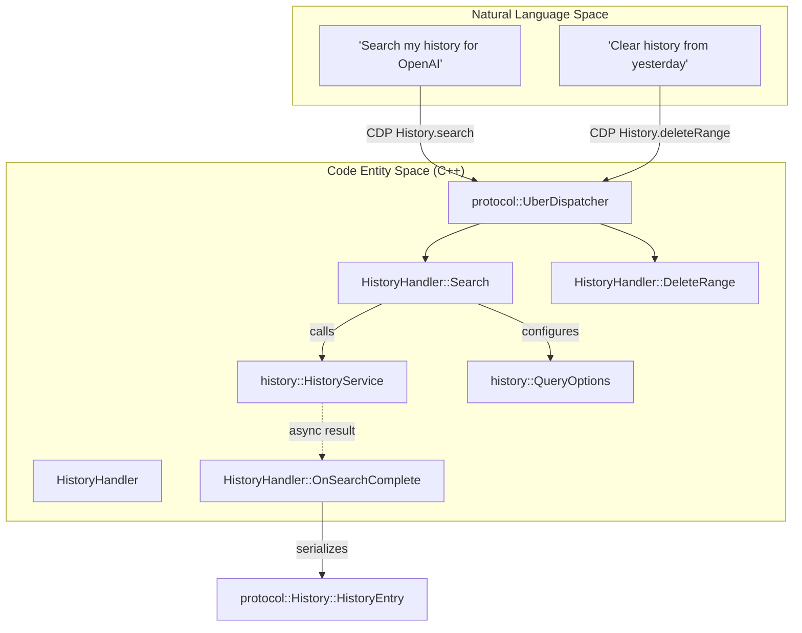
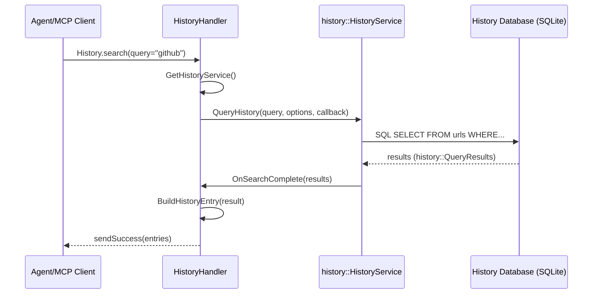
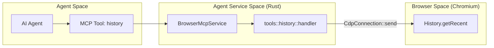

<!-- source: DeepWiki mcp.deepwiki.com · repo browseros-ai/BrowserOS · page 8.5 History API · fetched 2026-10-29 -->

# History API

<details>
<summary>Relevant source files</summary>

The following files were used as context for generating this wiki page:

- [packages/browseros-agent/crates/browseros-mcp/Cargo.toml](packages/browseros-agent/crates/browseros-mcp/Cargo.toml)
- [packages/browseros-agent/crates/browseros-mcp/src/framework.rs](packages/browseros-agent/crates/browseros-mcp/src/framework.rs)
- [packages/browseros-agent/crates/browseros-mcp/src/service.rs](packages/browseros-agent/crates/browseros-mcp/src/service.rs)
- [packages/browseros-agent/crates/browseros-mcp/src/tests.rs](packages/browseros-agent/crates/browseros-mcp/src/tests.rs)
- [packages/browseros-agent/crates/browseros-mcp/src/tools/history.rs](packages/browseros-agent/crates/browseros-mcp/src/tools/history.rs)
- [packages/browseros-agent/crates/browseros-mcp/src/tools/mod.rs](packages/browseros-agent/crates/browseros-mcp/src/tools/mod.rs)
- [packages/browseros-agent/crates/browseros-mcp/src/tools/run.rs](packages/browseros-agent/crates/browseros-mcp/src/tools/run.rs)
- [packages/browseros-agent/crates/browseros-mcp/src/tools/tabs.rs](packages/browseros-agent/crates/browseros-mcp/src/tools/tabs.rs)
- [packages/browseros-agent/crates/browseros-mcp/src/tools/windows.rs](packages/browseros-agent/crates/browseros-mcp/src/tools/windows.rs)
- [packages/browseros-agent/packages/browser-mcp/src/tools/history.test.ts](packages/browseros-agent/packages/browser-mcp/src/tools/history.test.ts)
- [packages/browseros-agent/packages/browser-mcp/src/tools/history.ts](packages/browseros-agent/packages/browser-mcp/src/tools/history.ts)
- [packages/browseros-agent/packages/browser-mcp/src/tools/registry.ts](packages/browseros-agent/packages/browser-mcp/src/tools/registry.ts)
- [packages/browseros-agent/packages/browser-mcp/src/tools/structured-contract.test.ts](packages/browseros-agent/packages/browser-mcp/src/tools/structured-contract.test.ts)
- [packages/browseros/chromium_patches/chrome/browser/devtools/BUILD.gn](packages/browseros/chromium_patches/chrome/browser/devtools/BUILD.gn)
- [packages/browseros/chromium_patches/chrome/browser/devtools/chrome_devtools_session.cc](packages/browseros/chromium_patches/chrome/browser/devtools/chrome_devtools_session.cc)
- [packages/browseros/chromium_patches/chrome/browser/devtools/chrome_devtools_session.h](packages/browseros/chromium_patches/chrome/browser/devtools/chrome_devtools_session.h)
- [packages/browseros/chromium_patches/chrome/browser/devtools/inspector_protocol_config.json](packages/browseros/chromium_patches/chrome/browser/devtools/inspector_protocol_config.json)
- [packages/browseros/chromium_patches/chrome/browser/devtools/protocol/bookmarks_handler.cc](packages/browseros/chromium_patches/chrome/browser/devtools/protocol/bookmarks_handler.cc)
- [packages/browseros/chromium_patches/chrome/browser/devtools/protocol/bookmarks_handler.h](packages/browseros/chromium_patches/chrome/browser/devtools/protocol/bookmarks_handler.h)
- [packages/browseros/chromium_patches/chrome/browser/devtools/protocol/browser_handler.cc](packages/browseros/chromium_patches/chrome/browser/devtools/protocol/browser_handler.cc)
- [packages/browseros/chromium_patches/chrome/browser/devtools/protocol/browser_handler.h](packages/browseros/chromium_patches/chrome/browser/devtools/protocol/browser_handler.h)
- [packages/browseros/chromium_patches/chrome/browser/devtools/protocol/browser_handler_android.cc](packages/browseros/chromium_patches/chrome/browser/devtools/protocol/browser_handler_android.cc)
- [packages/browseros/chromium_patches/chrome/browser/devtools/protocol/browser_handler_android.h](packages/browseros/chromium_patches/chrome/browser/devtools/protocol/browser_handler_android.h)
- [packages/browseros/chromium_patches/chrome/browser/devtools/protocol/devtools_protocol_browsertest.cc](packages/browseros/chromium_patches/chrome/browser/devtools/protocol/devtools_protocol_browsertest.cc)
- [packages/browseros/chromium_patches/chrome/browser/devtools/protocol/history_handler.cc](packages/browseros/chromium_patches/chrome/browser/devtools/protocol/history_handler.cc)
- [packages/browseros/chromium_patches/third_party/blink/public/devtools_protocol/domains/Browser.pdl](packages/browseros/chromium_patches/third_party/blink/public/devtools_protocol/domains/Browser.pdl)

</details>


The History API is a custom Chrome DevTools Protocol (CDP) domain that provides programmatic access to browser history. It allows external clients and AI agents to search, retrieve, and delete browsing history entries through CDP commands. This API is part of BrowserOS's extended CDP capabilities for browser automation.

For bookmark management, see [Bookmarks API (8.4)](). For browser window and tab management, see [Browser Domain (8.1)]().

## Overview

The History domain exposes four async commands for managing browsing history:

| Command | Purpose | Async |
|---------|---------|-------|
| `History.search` | Search history entries by text query with time range filtering | Yes |
| `History.getRecent` | Retrieve the most recent history entries | Yes |
| `History.deleteUrl` | Delete all history entries for a specific URL | Yes |
| `History.deleteRange` | Delete all history entries within a time range | Yes |

All commands operate on the current profile's history database and return results asynchronously via callbacks. The API integrates directly with Chromium's `history::HistoryService` to provide reliable, profile-aware history management.

Sources: [packages/browseros/chromium_patches/chrome/browser/devtools/inspector_protocol_config.json:19-22](), [packages/browseros/chromium_patches/chrome/browser/devtools/protocol/history_handler.cc:73-167]()

## Architecture

### CDP Integration

The diagram below maps the Natural Language concepts of history management to the specific C++ entities in the `HistoryHandler` implementation.

**Diagram: Mapping Natural Language search/delete intents to HistoryHandler code entities**


The History domain is registered during DevTools session initialization. The handler resolves the active profile either from the target's browser context (for page targets) or from the last active browser window (for browser-level targets) using `GetLastActiveBrowserWindowInterfaceWithAnyProfile()`.

Sources: [packages/browseros/chromium_patches/chrome/browser/devtools/protocol/history_handler.cc:47-64](), [packages/browseros/chromium_patches/chrome/browser/devtools/protocol/history_handler.h:20-23]()

### Domain Configuration

The History domain is defined in the BrowserOS inspector protocol configuration, which triggers the generation of the backend dispatcher and frontend bindings.

```json
{
    "domain": "History",
    "include": ["search", "getRecent", "deleteUrl", "deleteRange"],
    "include_events": [],
    "async": ["search", "getRecent", "deleteUrl", "deleteRange"]
}
```

All commands are marked as `async`, meaning they use callback-based responses (`std::unique_ptr<SearchCallback>`) rather than returning immediately. This is necessary because history operations involve SQLite database queries on the history thread that should not block the browser's UI thread.

Sources: [packages/browseros/chromium_patches/chrome/browser/devtools/inspector_protocol_config.json:18-23](), [packages/browseros/chromium_patches/chrome/browser/devtools/protocol/history_handler.cc:77-103]()

## Commands Reference

### History.search

Searches history entries matching a text query with optional time range filtering.

**Parameters:**
| Parameter | Type | Required | Description |
|-----------|------|----------|-------------|
| `query` | string | Yes | Text to search for in URL and title |
| `maxResults` | integer | No | Maximum number of results (default: 100) |
| `startTime` | number | No | Unix timestamp in milliseconds for range start |
| `endTime` | number | No | Unix timestamp in milliseconds for range end |

**Returns:**
| Field | Type | Description |
|-------|------|-------------|
| `entries` | array of HistoryEntry | Matching history entries |

**Implementation:** The command uses `history::QueryOptions` with `REMOVE_ALL_DUPLICATES` policy. It calls `service->QueryHistory()` and passes a `base::BindOnce` callback to `OnSearchComplete`.

Sources: [packages/browseros/chromium_patches/chrome/browser/devtools/protocol/history_handler.cc:73-103](), [packages/browseros/chromium_patches/chrome/browser/devtools/protocol/history_handler.cc:169-178]()

### History.getRecent

Retrieves the most recent history entries without filtering.

**Parameters:**
| Parameter | Type | Required | Description |
|-----------|------|----------|-------------|
| `maxResults` | integer | No | Maximum number of results (default: 100) |

**Implementation:** This is a convenience wrapper around `QueryHistory()` with an empty `std::u16string()` query. It returns the most recent visits first, with duplicates removed.

Sources: [packages/browseros/chromium_patches/chrome/browser/devtools/protocol/history_handler.cc:105-123]()

### History.deleteUrl

Deletes all history entries for a specific URL.

**Parameters:**
| Parameter | Type | Required | Description |
|-----------|------|----------|-------------|
| `url` | string | Yes | URL to delete from history |

**Implementation:** Validates the URL via `GURL::is_valid()`, then calls `service->DeleteURLs({gurl})`.

Sources: [packages/browseros/chromium_patches/chrome/browser/devtools/protocol/history_handler.cc:125-143]()

### History.deleteRange

Deletes all history entries within a time range.

**Parameters:**
| Parameter | Type | Required | Description |
|-----------|------|----------|-------------|
| `startTime` | number | Yes | Unix timestamp in milliseconds (inclusive) |
| `endTime` | number | Yes | Unix timestamp in milliseconds (exclusive) |

**Implementation:** Converts timestamps to `base::Time` and calls `service->ExpireHistoryBetween()`. The `user_initiated` flag is set to `true` to ensure proper cleanup of ancillary data.

Sources: [packages/browseros/chromium_patches/chrome/browser/devtools/protocol/history_handler.cc:145-167]()

## Implementation Details

### Data Flow: Search Execution

The following diagram illustrates the flow from a CDP command to the Chromium internal history service and back to the client.

**Diagram: History search data flow from CDP request to SQLite database**


Sources: [packages/browseros/chromium_patches/chrome/browser/devtools/protocol/history_handler.cc:33-44](), [packages/browseros/chromium_patches/chrome/browser/devtools/protocol/history_handler.cc:98-103]()

### Profile Resolution

The handler resolves the profile using a two-stage approach in `GetProfile()`:

1.  **Target-based resolution**: If the CDP session is attached to a page target, extract the profile from `host->GetBrowserContext()`.
2.  **Fallback resolution**: For browser-level targets, use the profile from the last active browser window via `GetLastActiveBrowserWindowInterfaceWithAnyProfile()`.

Sources: [packages/browseros/chromium_patches/chrome/browser/devtools/protocol/history_handler.cc:55-64]()

### Result Building

The `BuildHistoryEntry` helper function maps Chromium internal types to the protocol definition:

| CDP Field | Source Type | Source Property |
|-----------|-------------|-----------------|
| `id` | `int64_t` | `result.id()` (converted to string) |
| `url` | `GURL` | `result.url().spec()` |
| `title` | `std::u16string` | `base::UTF16ToUTF8(result.title())` |
| `lastVisitTime` | `base::Time` | `result.visit_time().InMillisecondsFSinceUnixEpoch()` |
| `visitCount` | `int` | `result.visit_count()` |
| `typedCount` | `int` | `result.typed_count()` |

Sources: [packages/browseros/chromium_patches/chrome/browser/devtools/protocol/history_handler.cc:33-44]()

## Agent Integration

The History API is exposed to AI agents via the MCP (Model Context Protocol) `history` tool. The agent uses this tool to query the user's browsing history to answer questions or navigate to previously visited sites.

### MCP Tool Mapping

The `browseros-mcp` service maps the `history` tool directly to the `History.getRecent` CDP command.

**Diagram: Agent MCP history tool to CDP command mapping**


Sources: [packages/browseros-agent/crates/browseros-mcp/src/tools/history.rs:32-39](), [packages/browseros-agent/crates/browseros-mcp/src/tests.rs:186-216]()

### JS SDK Support

For multi-step automation scripts running via `browser.run`, history access is available through raw CDP calls.

```javascript
// Example: Searching history in a run script
const results = await browser.cdp("History.search", { query: "browseros" });
console.log(`Found ${results.entries.length} matches`);
```

Sources: [packages/browseros-agent/crates/browseros-mcp/src/tools/run.rs:55](), [packages/browseros-agent/crates/browseros-mcp/src/tools/run.rs:144]()

---

