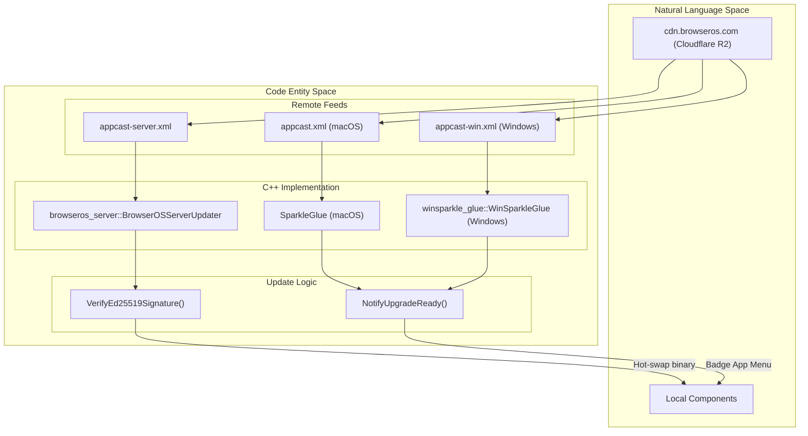
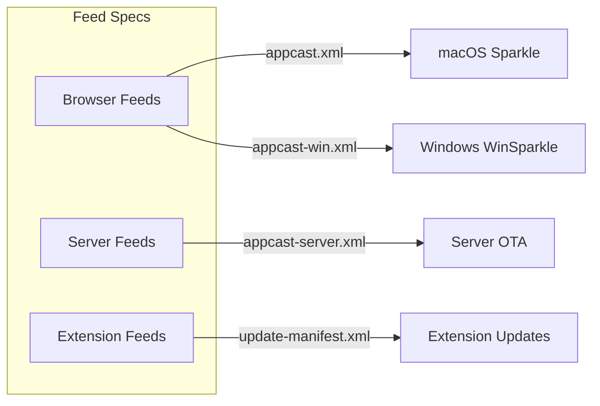

<!-- source: DeepWiki mcp.deepwiki.com · repo browseros-ai/BrowserOS · page 9 Update Systems · fetched 2026-10-29 -->

# Update Systems

Relevant source files

The following files were used as context for generating this wiki page:

- [packages/browseros/bos_build/browseros.py](packages/browseros/bos_build/browseros.py)
- [packages/browseros/bos_build/cli/ota.py](packages/browseros/bos_build/cli/ota.py)
- [packages/browseros/bos_build/cli/ota_test.py](packages/browseros/bos_build/cli/ota_test.py)
- [packages/browseros/bos_build/release/extensions/__init__.py](packages/browseros/bos_build/release/extensions/__init__.py)
- [packages/browseros/bos_build/release/extensions/manifests.py](packages/browseros/bos_build/release/extensions/manifests.py)
- [packages/browseros/bos_build/release/extensions/manifests_test.py](packages/browseros/bos_build/release/extensions/manifests_test.py)
- [packages/browseros/bos_build/release/feeds/publisher.py](packages/browseros/bos_build/release/feeds/publisher.py)
- [packages/browseros/bos_build/release/feeds/publisher_test.py](packages/browseros/bos_build/release/feeds/publisher_test.py)
- [packages/browseros/bos_build/release/feeds/render.py](packages/browseros/bos_build/release/feeds/render.py)
- [packages/browseros/bos_build/release/feeds/render_test.py](packages/browseros/bos_build/release/feeds/render_test.py)
- [packages/browseros/bos_build/release/feeds/spec.py](packages/browseros/bos_build/release/feeds/spec.py)
- [packages/browseros/bos_build/release/feeds/spec_test.py](packages/browseros/bos_build/release/feeds/spec_test.py)
- [packages/browseros/chromium_patches/chrome/BUILD.gn](packages/browseros/chromium_patches/chrome/BUILD.gn)
- [packages/browseros/chromium_patches/chrome/browser/BUILD.gn](packages/browseros/chromium_patches/chrome/browser/BUILD.gn)
- [packages/browseros/chromium_patches/chrome/browser/buildflags.gni](packages/browseros/chromium_patches/chrome/browser/buildflags.gni)
- [packages/browseros/chromium_patches/chrome/browser/mac/chrome_browser_main_extra_parts_mac.mm](packages/browseros/chromium_patches/chrome/browser/mac/chrome_browser_main_extra_parts_mac.mm)
- [packages/browseros/chromium_patches/chrome/browser/mac/sparkle_glue.h](packages/browseros/chromium_patches/chrome/browser/mac/sparkle_glue.h)
- [packages/browseros/chromium_patches/chrome/browser/mac/sparkle_glue.mm](packages/browseros/chromium_patches/chrome/browser/mac/sparkle_glue.mm)
- [packages/browseros/chromium_patches/chrome/browser/ui/toolbar/app_menu_icon_controller.cc](packages/browseros/chromium_patches/chrome/browser/ui/toolbar/app_menu_icon_controller.cc)
- [packages/browseros/chromium_patches/chrome/browser/ui/views/relaunch_notification/relaunch_notification_controller.cc](packages/browseros/chromium_patches/chrome/browser/ui/views/relaunch_notification/relaunch_notification_controller.cc)
- [packages/browseros/chromium_patches/chrome/browser/ui/webui/help/sparkle_version_updater_mac.h](packages/browseros/chromium_patches/chrome/browser/ui/webui/help/sparkle_version_updater_mac.h)
- [packages/browseros/chromium_patches/chrome/browser/ui/webui/help/sparkle_version_updater_mac.mm](packages/browseros/chromium_patches/chrome/browser/ui/webui/help/sparkle_version_updater_mac.mm)
- [packages/browseros/chromium_patches/chrome/browser/upgrade_detector/upgrade_detector_impl.cc](packages/browseros/chromium_patches/chrome/browser/upgrade_detector/upgrade_detector_impl.cc)

BrowserOS implements three independent update mechanisms to keep different components current: **Sparkle** for macOS browser updates, **WinSparkle** for Windows browser updates, **OTA (over-the-air) updates** for the sidecar server process, and **extension updates** for managed extensions. Each system operates autonomously with its own update feeds, verification mechanisms, and installation flows.

This page provides a high-level overview of the multi-layered update architecture.

---

## Update Architecture Overview

BrowserOS separates update concerns into three independent systems. All systems utilize **Ed25519 signature verification** for security and fetch updates from `cdn.browseros.com`.

| System | Component | Platform | Update Mechanism | Details |
|--------|-----------|----------|------------------|---------|
| **Sparkle** | Browser binary | macOS only | Sparkle framework, full binary replacement | See [Sparkle Framework](#9.2) |
| **WinSparkle** | Browser binary | Windows only | WinSparkle library, full binary replacement | See [Sparkle Framework](#9.2) |
| **Server OTA** | `browseros-server` | All platforms | Hot-swap with Ed25519 verification | See [Server OTA Updates](#9.4) |
| **Extension** | CRX files | All platforms | Maintenance logic for bundled/remote extensions | See [Extension Updates](#9.5) |

### Update Distribution and System Mapping

The following diagram bridges the high-level distribution concepts to the specific code entities responsible for update management.

**Sources:** [packages/browseros/chromium_patches/chrome/browser/upgrade_detector/upgrade_detector_impl.cc:299-303](), [packages/browseros/chromium_patches/chrome/browser/mac/sparkle_glue.mm:58-73](), [packages/browseros/chromium_patches/chrome/browser/mac/sparkle_glue.h:83-94]()

---

## Browser Updates (Sparkle and WinSparkle)

BrowserOS integrates platform-native update frameworks for the browser binary. These systems replace Chromium's default update mechanisms by disabling `installed_version_poller_` and outdated build detection [packages/browseros/chromium_patches/chrome/browser/upgrade_detector/upgrade_detector_impl.cc:27-33](), [packages/browseros/chromium_patches/chrome/browser/upgrade_detector/upgrade_detector_impl.cc:514-517]().

### macOS (Sparkle)

On macOS, BrowserOS integrates the **Sparkle** framework to handle background updates. The system uses a custom `SPUUserDriver` implementation called `BrowserOSUserDriver` to capture progress and status [packages/browseros/chromium_patches/chrome/browser/mac/sparkle_glue.mm:127-136]().

- **Architecture Specifics**: The system dynamically resolves the feed URL based on CPU architecture and product type (e.g., `appcast-claw.xml` vs `appcast.xml`) [packages/browseros/chromium_patches/chrome/browser/mac/sparkle_glue.mm:35-46]().
- **UI Integration**: When an update is ready, `NotifyUpgradeReady` sets the `BuildState` to `kNormalUpdate`, which triggers the app menu badge [packages/browseros/chromium_patches/chrome/browser/mac/sparkle_glue.mm:58-73]().
- **Thresholds**: Update annoyance thresholds are zeroed so the badge appears immediately upon detection [packages/browseros/chromium_patches/chrome/browser/upgrade_detector/upgrade_detector_impl.cc:41-51]().

For details on configuration, see [Info.plist Configuration](#9.3). For the integration logic, see [Sparkle Framework](#9.2).

**Sources:** [packages/browseros/chromium_patches/chrome/browser/mac/sparkle_glue.mm:35-73](), [packages/browseros/chromium_patches/chrome/browser/upgrade_detector/upgrade_detector_impl.cc:41-60]()

### Windows (WinSparkle)

On Windows, BrowserOS uses the **WinSparkle** library. The integration follows a similar pattern to macOS, using architecture-specific appcasts (e.g., `appcast-win.xml` or `appcast-win-arm64.xml`).

- **UI Integration**: Marshals update status to the Chromium UI thread to notify observers and update the help page.
- **Build Integration**: WinSparkle dependencies are linked via `//third_party/winsparkle` [packages/browseros/chromium_patches/chrome/browser/BUILD.gn:44-53]().

For details on the integration, see [Sparkle Framework](#9.2).

**Sources:** [packages/browseros/chromium_patches/chrome/browser/BUILD.gn:44-53](), [packages/browseros/chromium_patches/chrome/browser/upgrade_detector/upgrade_detector_impl.cc:41-51]()

---

## Server OTA Updates

The `browseros-server` component is updated independently via a specialized Over-The-Air (OTA) pipeline.

- **Release Automation**: The `ServerOTAModule` handles downloading, signing with `sparkle_sign_file`, and uploading update packages to R2 [packages/browseros/bos_build/cli/ota.py:153-160]().
- **Feed Management**: The `FeedPublisher` class enforces safety rails during publication, including well-formedness checks, HEAD-checks on enclosures, and downgrade guards [packages/browseros/bos_build/release/feeds/publisher.py:2-8]().
- **History**: Every update is backed up to `feeds-history/` before the live feed is updated [packages/browseros/bos_build/release/feeds/publisher.py:33-34]().

For details on the update flow and hot-swapping, see [Server OTA Updates](#9.4).

**Sources:** [packages/browseros/bos_build/cli/ota.py:153-160](), [packages/browseros/bos_build/release/feeds/publisher.py:2-34]()

---

## Extension Updates

BrowserOS maintains privileged extensions that are essential for AI functionality.

- **Build Integration**: Extensions are bundled via `//chrome/browser/browseros/bundled_extensions` and included in the application package [packages/browseros/chromium_patches/chrome/BUILD.gn:19-20](), [packages/browseros/chromium_patches/chrome/BUILD.gn:1204-1206]().
- **Manifest Generation**: The `ExtensionsFeedModule` regenerates `update-manifest.xml` and `extensions.json` to point clients at the latest CRX files on the CDN [packages/browseros/bos_build/release/extensions/manifests_test.py:87-98]().
- **Registry**: Extensions like `agent`, `bugreporter`, and `browserclaw` are tracked with their respective IDs and update URLs [packages/browseros/bos_build/release/feeds/spec.py:40-44]().

For details on extension management, see [Extension Updates](#9.5).

**Sources:** [packages/browseros/chromium_patches/chrome/BUILD.gn:19-20](), [packages/browseros/bos_build/release/feeds/spec.py:40-44]()

---

## Appcast Feeds

Appcasts are the authoritative source of version information for all components.

### Feed Types and Specifications

The `FeedSpec` system defines the flat R2 keys and metadata for every feed [packages/browseros/bos_build/release/feeds/spec.py:56-69]().

- **Verification**: Browser and Server updates require a `sparkle:edSignature` in the enclosure [packages/browseros/bos_build/release/feeds/render_test.py:173-182]().
- **Versioning**: macOS versions are stamped as `10000.<BrowserOS version>` to ensure Sparkle's version comparison logic functions correctly [packages/browseros/chromium_patches/chrome/browser/mac/sparkle_glue.h:56-59]().

For details on the XML schema and generation, see [Appcast Feeds](#9.6).

**Sources:** [packages/browseros/bos_build/release/feeds/spec.py:56-69](), [packages/browseros/chromium_patches/chrome/browser/mac/sparkle_glue.h:56-59](), [packages/browseros/bos_build/release/feeds/render_test.py:173-182]()

---

