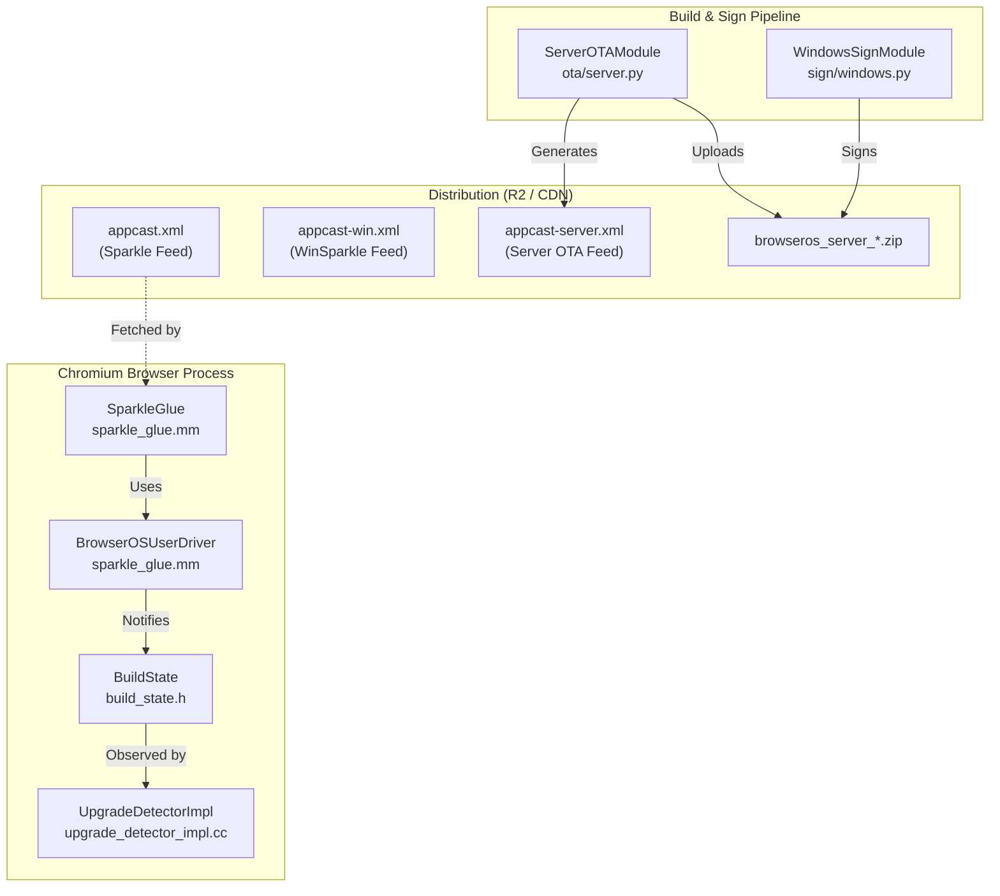
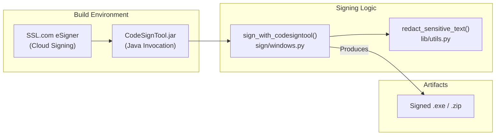

<!-- source: DeepWiki mcp.deepwiki.com · repo browseros-ai/BrowserOS · page 9.1 Update Architecture · fetched 2026-10-29 -->

# Update Architecture

Relevant source files

The following files were used as context for generating this wiki page:

- [packages/browseros/bos_build/lib/env.py](packages/browseros/bos_build/lib/env.py)
- [packages/browseros/bos_build/lib/logger.py](packages/browseros/bos_build/lib/logger.py)
- [packages/browseros/bos_build/lib/utils.py](packages/browseros/bos_build/lib/utils.py)
- [packages/browseros/bos_build/lib/utils_test.py](packages/browseros/bos_build/lib/utils_test.py)
- [packages/browseros/bos_build/release/ota/__init__.py](packages/browseros/bos_build/release/ota/__init__.py)
- [packages/browseros/bos_build/release/ota/common.py](packages/browseros/bos_build/release/ota/common.py)
- [packages/browseros/bos_build/release/ota/feeds_alignment_test.py](packages/browseros/bos_build/release/ota/feeds_alignment_test.py)
- [packages/browseros/bos_build/release/ota/server.py](packages/browseros/bos_build/release/ota/server.py)
- [packages/browseros/bos_build/release/ota/sign_binary.py](packages/browseros/bos_build/release/ota/sign_binary.py)
- [packages/browseros/bos_build/release/ota/sign_binary_test.py](packages/browseros/bos_build/release/ota/sign_binary_test.py)
- [packages/browseros/bos_build/steps/sign/windows.py](packages/browseros/bos_build/steps/sign/windows.py)
- [packages/browseros/bos_build/steps/sign/windows_test.py](packages/browseros/bos_build/steps/sign/windows_test.py)
- [packages/browseros/chromium_patches/chrome/BUILD.gn](packages/browseros/chromium_patches/chrome/BUILD.gn)
- [packages/browseros/chromium_patches/chrome/browser/BUILD.gn](packages/browseros/chromium_patches/chrome/browser/BUILD.gn)
- [packages/browseros/chromium_patches/chrome/browser/buildflags.gni](packages/browseros/chromium_patches/chrome/browser/buildflags.gni)
- [packages/browseros/chromium_patches/chrome/browser/mac/chrome_browser_main_extra_parts_mac.mm](packages/browseros/chromium_patches/chrome/browser/mac/chrome_browser_main_extra_parts_mac.mm)
- [packages/browseros/chromium_patches/chrome/browser/mac/sparkle_glue.h](packages/browseros/chromium_patches/chrome/browser/mac/sparkle_glue.h)
- [packages/browseros/chromium_patches/chrome/browser/mac/sparkle_glue.mm](packages/browseros/chromium_patches/chrome/browser/mac/sparkle_glue.mm)
- [packages/browseros/chromium_patches/chrome/browser/ui/toolbar/app_menu_icon_controller.cc](packages/browseros/chromium_patches/chrome/browser/ui/toolbar/app_menu_icon_controller.cc)
- [packages/browseros/chromium_patches/chrome/browser/ui/views/relaunch_notification/relaunch_notification_controller.cc](packages/browseros/chromium_patches/chrome/browser/ui/views/relaunch_notification/relaunch_notification_controller.cc)
- [packages/browseros/chromium_patches/chrome/browser/ui/webui/help/sparkle_version_updater_mac.h](packages/browseros/chromium_patches/chrome/browser/ui/webui/help/sparkle_version_updater_mac.h)
- [packages/browseros/chromium_patches/chrome/browser/ui/webui/help/sparkle_version_updater_mac.mm](packages/browseros/chromium_patches/chrome/browser/ui/webui/help/sparkle_version_updater_mac.mm)
- [packages/browseros/chromium_patches/chrome/browser/upgrade_detector/upgrade_detector_impl.cc](packages/browseros/chromium_patches/chrome/browser/upgrade_detector/upgrade_detector_impl.cc)

## Purpose and Scope

This document provides an architectural overview of BrowserOS's multi-layered update systems: browser updates (Sparkle framework on macOS, WinSparkle on Windows), server binary updates (OTA), and extension updates. It explains the technical separation between these components, the C++ implementation within Chromium for managing sidecar processes, and the verification mechanisms ensuring secure delivery.

---

## Overview of Update Systems

BrowserOS implements three distinct update mechanisms that operate independently but share common security and distribution infrastructure.

### Browser Updates (macOS Sparkle, Windows WinSparkle)

The browser application itself is updated using the Sparkle framework on macOS and WinSparkle on Windows. These systems handle the full application bundle replacement.

**Key Characteristics:**
- **Frequency**: Automatic checks are enabled by default. On macOS, `SUEnableAutomaticChecks` is set to `YES` in the Info.plist, and permissions are auto-granted in `showUpdatePermissionRequest` [packages/browseros/chromium_patches/chrome/browser/mac/sparkle_glue.mm:149-156]().
- **Architecture-Specific Feeds**: The update feed URL is dynamically determined based on the product (BrowserOS vs. BrowserClaw) and the CPU architecture (x86_64 vs. ARM64) [packages/browseros/chromium_patches/chrome/browser/mac/sparkle_glue.mm:35-46]().
- **Public Key**: Verified using `SUPublicEDKey` on macOS. Windows utilizes a hardcoded public key for WinSparkle verification.
- **Integration**: A custom `BrowserOSUserDriver` (implementing `SPUUserDriver`) captures progress and state changes, forwarding them to the `SparkleGlue` singleton [packages/browseros/chromium_patches/chrome/browser/mac/sparkle_glue.mm:127-136]().
- **Notification**: Triggers the native Chromium upgrade detector to show the update badge in the app menu by calling `NotifyUpgradeReady` [packages/browseros/chromium_patches/chrome/browser/mac/sparkle_glue.mm:58-73](). The `UpgradeDetectorImpl` is patched to zero out annoyance thresholds so the badge appears immediately upon discovery [packages/browseros/chromium_patches/chrome/browser/upgrade_detector/upgrade_detector_impl.cc:41-50]().

**Sources:**
- [packages/browseros/chromium_patches/chrome/browser/mac/sparkle_glue.mm:35-73]()
- [packages/browseros/chromium_patches/chrome/browser/mac/sparkle_glue.mm:127-197]()
- [packages/browseros/chromium_patches/chrome/browser/upgrade_detector/upgrade_detector_impl.cc:27-59]()

### Server OTA Updates

The `browseros_server` binary (the sidecar process) receives over-the-air updates independently of the browser. This allows for rapid iteration of AI agent capabilities without forcing a full Chromium update.

**Key Characteristics:**
- **Distribution**: Server binaries are bundled as signed ZIP artifacts stored in R2 [packages/browseros/bos_build/release/ota/server.py:41-46]().
- **Signing**: Windows server binaries are signed using `CodeSignTool` [packages/browseros/bos_build/steps/sign/windows.py:107-111](). The build system ensures all required binaries (e.g., `browseros_server.exe`, `browseros-claw-server.exe`) are signed before packaging [packages/browseros/bos_build/steps/sign/windows.py:94-106]().
- **Appcast Feeds**: Separate feeds are maintained for `alpha` and `prod` channels, and for different products like BrowserClaw [packages/browseros/bos_build/release/ota/feeds_alignment_test.py:87-97]().
- **Hot-Swap**: The system supports "hot-swapping" server binaries. The `ServerOTAModule` handles downloading, signing, and preparing these updates [packages/browseros/bos_build/release/ota/server.py:158-167]().

**Sources:**
- [packages/browseros/bos_build/release/ota/server.py:41-50]()
- [packages/browseros/bos_build/steps/sign/windows.py:87-112]()
- [packages/browseros/bos_build/release/ota/feeds_alignment_test.py:87-97]()

---

## System Architecture

The update architecture separates the high-level application lifecycle from the granular sidecar process management.

**Update Data Flow and Component Association**

**Sources:**
- [packages/browseros/chromium_patches/chrome/browser/mac/sparkle_glue.mm:127-146]()
- [packages/browseros/chromium_patches/chrome/browser/mac/sparkle_glue.mm:58-73]()
- [packages/browseros/chromium_patches/chrome/browser/upgrade_detector/upgrade_detector_impl.cc:91-98]()
- [packages/browseros/bos_build/release/ota/server.py:141-156]()
- [packages/browseros/bos_build/steps/sign/windows.py:75-86]()

---

## Implementation Details

### Browser Update Integration (Sparkle)
BrowserOS replaces the standard Google Update mechanism with Sparkle on macOS. The `UpgradeDetectorImpl` is modified to disable outdated build detection [packages/browseros/chromium_patches/chrome/browser/upgrade_detector/upgrade_detector_impl.cc:27-33](). Instead, it listens for updates via the `BuildState` observer [packages/browseros/chromium_patches/chrome/browser/upgrade_detector/upgrade_detector_impl.cc:91-94]().

Sparkle is initialized early in the browser lifecycle during `PreCreateMainMessageLoop` in `ChromeBrowserMainExtraPartsMac` [packages/browseros/chromium_patches/chrome/browser/mac/chrome_browser_main_extra_parts_mac.mm:23-30]().

**Sources:**
- [packages/browseros/chromium_patches/chrome/browser/upgrade_detector/upgrade_detector_impl.cc:27-33]()
- [packages/browseros/chromium_patches/chrome/browser/mac/chrome_browser_main_extra_parts_mac.mm:23-30]()

### Windows Signing Pipeline
The `WindowsSignModule` manages the complex multi-step signing process for Windows:
1.  **Sign Executables**: Primary `chrome.exe` and bundled server binaries (like `browseros_server.exe`) are signed using `sign_with_codesigntool` [packages/browseros/bos_build/steps/sign/windows.py:87-112]().
2.  **Build Installer**: The `mini_installer` target is compiled, incorporating the already-signed binaries [packages/browseros/bos_build/steps/sign/windows.py:113-117]().
3.  **Sign Installer**: The final `mini_installer.exe` is signed [packages/browseros/bos_build/steps/sign/windows.py:118-129]().

**Sources:**
- [packages/browseros/bos_build/steps/sign/windows.py:75-86]()
- [packages/browseros/bos_build/steps/sign/windows.py:177-182]()

---

## Security and Verification

All updates utilize digital signatures for integrity verification. Server OTA updates are signed and verified using Ed25519.

**Security Entities and Code Association**

**Sources:**
- [packages/browseros/bos_build/steps/sign/windows.py:194-213]()
- [packages/browseros/bos_build/steps/sign/windows_test.py:155-182]()
- [packages/browseros/bos_build/release/ota/sign_binary_test.py:97-132]()

### Credential Protection
The build system includes strict redaction logic to ensure that signing credentials (passwords, TOTP secrets) do not leak into build logs, even if the signing tool echoes them in an error message [packages/browseros/bos_build/release/ota/sign_binary_test.py:97-132](). The `redact_sensitive_text` utility is used across the signing modules [packages/browseros/bos_build/steps/sign/windows.py:24-27]().

**Sources:**
- [packages/browseros/bos_build/release/ota/sign_binary_test.py:128-132]()
- [packages/browseros/bos_build/steps/sign/windows.py:24-27]()

---

