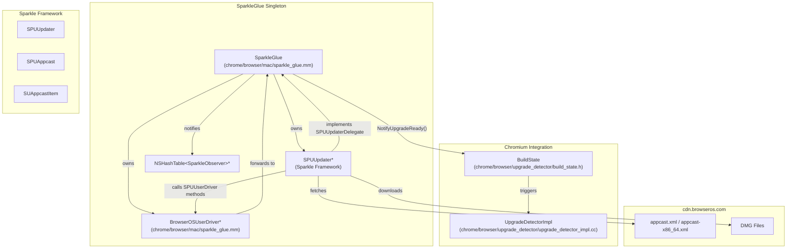
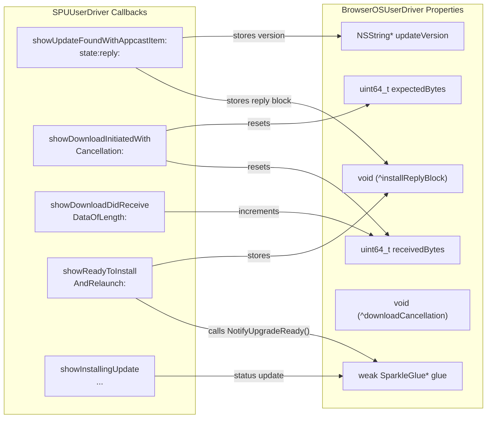
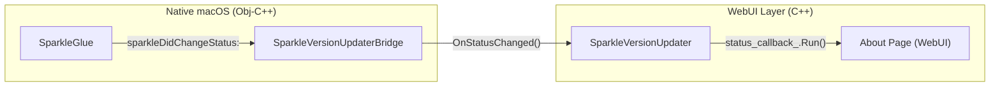

<!-- source: DeepWiki mcp.deepwiki.com · repo browseros-ai/BrowserOS · page 9.2 Sparkle Framework · fetched 2026-10-29 -->

# Sparkle Framework

<details>
<summary>Relevant source files</summary>

The following files were used as context for generating this wiki page:

- [packages/browseros/chromium_patches/chrome/BUILD.gn](packages/browseros/chromium_patches/chrome/BUILD.gn)
- [packages/browseros/chromium_patches/chrome/browser/BUILD.gn](packages/browseros/chromium_patches/chrome/browser/BUILD.gn)
- [packages/browseros/chromium_patches/chrome/browser/buildflags.gni](packages/browseros/chromium_patches/chrome/browser/buildflags.gni)
- [packages/browseros/chromium_patches/chrome/browser/mac/chrome_browser_main_extra_parts_mac.mm](packages/browseros/chromium_patches/chrome/browser/mac/chrome_browser_main_extra_parts_mac.mm)
- [packages/browseros/chromium_patches/chrome/browser/mac/sparkle_glue.h](packages/browseros/chromium_patches/chrome/browser/mac/sparkle_glue.h)
- [packages/browseros/chromium_patches/chrome/browser/mac/sparkle_glue.mm](packages/browseros/chromium_patches/chrome/browser/mac/sparkle_glue.mm)
- [packages/browseros/chromium_patches/chrome/browser/ui/toolbar/app_menu_icon_controller.cc](packages/browseros/chromium_patches/chrome/browser/ui/toolbar/app_menu_icon_controller.cc)
- [packages/browseros/chromium_patches/chrome/browser/ui/views/relaunch_notification/relaunch_notification_controller.cc](packages/browseros/chromium_patches/chrome/browser/ui/views/relaunch_notification/relaunch_notification_controller.cc)
- [packages/browseros/chromium_patches/chrome/browser/ui/webui/help/sparkle_version_updater_mac.h](packages/browseros/chromium_patches/chrome/browser/ui/webui/help/sparkle_version_updater_mac.h)
- [packages/browseros/chromium_patches/chrome/browser/ui/webui/help/sparkle_version_updater_mac.mm](packages/browseros/chromium_patches/chrome/browser/ui/webui/help/sparkle_version_updater_mac.mm)
- [packages/browseros/chromium_patches/chrome/browser/upgrade_detector/upgrade_detector_impl.cc](packages/browseros/chromium_patches/chrome/browser/upgrade_detector/upgrade_detector_impl.cc)

</details>


BrowserOS implements automatic browser updates on macOS through the Sparkle 2 framework. The integration is implemented in `chrome/browser/mac/sparkle_glue.mm`, which provides custom glue code between Sparkle's `SPUUpdater` and Chromium's upgrade notification system. Updates are distributed via architecture-specific appcast XML feeds hosted on `cdn.browseros.com`, with each DMG file signed using Ed25519 signatures. [packages/browseros/chromium_patches/chrome/browser/mac/sparkle_glue.mm:35-46]()

The system consists of three main components:
- `SparkleGlue`: Singleton managing Sparkle lifecycle and update state. [packages/browseros/chromium_patches/chrome/browser/mac/sparkle_glue.mm:323-334]()
- `BrowserOSUserDriver`: Custom `SPUUserDriver` capturing progress callbacks and suppressing native Sparkle UI. [packages/browseros/chromium_patches/chrome/browser/mac/sparkle_glue.mm:127-136]()
- **Appcast feeds**: RSS 2.0 XML manifests listing available versions, selected based on system architecture. [packages/browseros/chromium_patches/chrome/browser/mac/sparkle_glue.mm:35-46]()

For server OTA updates, see page 9.4. For extension updates, see page 9.5.

## SparkleGlue Architecture

The `SparkleGlue` class [packages/browseros/chromium_patches/chrome/browser/mac/sparkle_glue.mm:323-334]() serves as the primary interface between BrowserOS and Sparkle. It initializes Sparkle's `SPUUpdater` with a custom `BrowserOSUserDriver`, manages update checks, and notifies Chromium's `BuildState` when updates are ready. Initialization occurs during the `PreCreateMainMessageLoop` phase of the browser startup via `sparkle_glue::SparkleEnabled()`. [packages/browseros/chromium_patches/chrome/browser/mac/chrome_browser_main_extra_parts_mac.mm:23-30]()

### Component Interaction



**Key Methods:**
- `+[SparkleGlue sharedSparkleGlue]`: Returns the singleton instance. [packages/browseros/chromium_patches/chrome/browser/mac/sparkle_glue.mm:336-357]()
- `-[SparkleGlue initializeSparkle]`: Creates the `SPUUpdater` with the custom driver and sets up the appcast URL. [packages/browseros/chromium_patches/chrome/browser/mac/sparkle_glue.mm:374-400]()
- `-[SparkleGlue checkForUpdates]`: Triggers a manual update check. [packages/browseros/chromium_patches/chrome/browser/mac/sparkle_glue.mm:451-466]()
- `-[SparkleGlue installAndRelaunch]`: Triggers the installation of a downloaded update. [packages/browseros/chromium_patches/chrome/browser/mac/sparkle_glue.mm:468-476]()

**Sources:** [packages/browseros/chromium_patches/chrome/browser/mac/sparkle_glue.mm:323-476](), [packages/browseros/chromium_patches/chrome/browser/mac/chrome_browser_main_extra_parts_mac.mm:23-30]()

## BrowserOSUserDriver Implementation

`BrowserOSUserDriver` [packages/browseros/chromium_patches/chrome/browser/mac/sparkle_glue.mm:127-136]() implements Sparkle's `SPUUserDriver` protocol to intercept all update progress callbacks. It prevents Sparkle from showing its own windows, instead forwarding state changes to `SparkleGlue`.

### State Tracking

The driver maintains internal state for download progress and update readiness:



**Key SPUUserDriver Methods:**
- `-showUpdateFoundWithAppcastItem:state:reply:`: Automatically proceeds to download or notifies that an update is ready if already downloaded. [packages/browseros/chromium_patches/chrome/browser/mac/sparkle_glue.mm:163-196]()
- `-showDownloadInitiatedWithCancellation:`: Signals the start of the download phase. [packages/browseros/chromium_patches/chrome/browser/mac/sparkle_glue.mm:220-226]()
- `-showDownloadDidReceiveDataOfLength:`: Calculates and notifies progress percentages. [packages/browseros/chromium_patches/chrome/browser/mac/sparkle_glue.mm:234-242]()
- `-showReadyToInstallAndRelaunch:`: Called when the update is ready; triggers the Chromium upgrade badge. [packages/browseros/chromium_patches/chrome/browser/mac/sparkle_glue.mm:258-264]()

**Sources:** [packages/browseros/chromium_patches/chrome/browser/mac/sparkle_glue.mm:127-264]()

## Upgrade Notification Integration

When an update is ready to install, `BrowserOSUserDriver` calls `NotifyUpgradeReady()` [packages/browseros/chromium_patches/chrome/browser/mac/sparkle_glue.mm:58-73]() to integrate with Chromium's upgrade detection system. This triggers the app menu badge to appear.

### Chromium BuildState Integration

The `UpgradeDetectorImpl` has been patched to handle Sparkle updates by zeroing annoyance thresholds. This ensures that as soon as Sparkle reports an update, the badge appears at the highest priority without waiting for the standard Chromium multi-day timers. [packages/browseros/chromium_patches/chrome/browser/upgrade_detector/upgrade_detector_impl.cc:41-51]()

Additionally, `AppMenuIconController` is modified to treat `UPGRADE_ANNOYANCE_VERY_LOW` as `Severity::kMedium` (yellow/orange badge) to provide immediate visual feedback. [packages/browseros/chromium_patches/chrome/browser/ui/toolbar/app_menu_icon_controller.cc:8-12]()

**Sources:** [packages/browseros/chromium_patches/chrome/browser/mac/sparkle_glue.mm:58-73](), [packages/browseros/chromium_patches/chrome/browser/upgrade_detector/upgrade_detector_impl.cc:41-59](), [packages/browseros/chromium_patches/chrome/browser/ui/toolbar/app_menu_icon_controller.cc:8-12]()

## Settings Page Integration

The `SparkleVersionUpdater` [packages/browseros/chromium_patches/chrome/browser/ui/webui/help/sparkle_version_updater_mac.mm:23-43]() bridges the Sparkle state to the Chromium "About BrowserOS" settings page. It uses a `SparkleVersionUpdaterBridge` to observe `SparkleGlue` and translate its status into Chromium's `VersionUpdater::Status` enum.

### UI Bridge Data Flow



**Key Transitions:**
- `SparkleStatusDownloading` / `SparkleStatusExtracting` -> `UPDATING` [packages/browseros/chromium_patches/chrome/browser/ui/webui/help/sparkle_version_updater_mac.mm:122-126]()
- `SparkleStatusReadyToInstall` -> `NEARLY_UPDATED` [packages/browseros/chromium_patches/chrome/browser/ui/webui/help/sparkle_version_updater_mac.mm:128-130]()
- `SparkleStatusUpToDate` -> `UPDATED` [packages/browseros/chromium_patches/chrome/browser/ui/webui/help/sparkle_version_updater_mac.mm:132-134]()

**Sources:** [packages/browseros/chromium_patches/chrome/browser/ui/webui/help/sparkle_version_updater_mac.mm:105-147]()

## Appcast Feed Structure

BrowserOS maintains architecture-specific appcast feeds based on runtime detection to ensure users receive the correct binary for their hardware. [packages/browseros/chromium_patches/chrome/browser/mac/sparkle_glue.mm:35-46]()

- **ARM64**: `https://cdn.browseros.com/appcast.xml`
- **x86_64**: `https://cdn.browseros.com/appcast-x86_64.xml`

### Architecture Selection Logic
The function `GetArchitectureSpecificFeedURL` checks `base::SysInfo::OperatingSystemArchitecture()` and appends the `-x86_64` suffix if necessary. It also supports the "Claw" product variant. [packages/browseros/chromium_patches/chrome/browser/mac/sparkle_glue.mm:35-46]()

**Sources:** [packages/browseros/chromium_patches/chrome/browser/mac/sparkle_glue.mm:35-46]()

## Build Configuration

The Sparkle framework is integrated into the Chromium build via `chrome/browser/sparkle_buildflags.gni` and conditional logic in `chrome/BUILD.gn`. [packages/browseros/chromium_patches/chrome/BUILD.gn:54-58]()

```gn
if (enable_sparkle) {
  bundle_deps += [ "//third_party/sparkle:sparkle_framework_bundle" ]
  configs += [ "//third_party/sparkle:sparkle_link_framework" ]
  framework_contents += [ "Frameworks" ]
}
```

The build flag `ENABLE_SPARKLE` is propagated to C++ through `chrome/browser/buildflags.h`, enabling the `sparkle_glue` sources and the custom `UpgradeDetectorImpl` behavior. [packages/browseros/chromium_patches/chrome/browser/BUILD.gn:17-18]()

**Sources:** [packages/browseros/chromium_patches/chrome/BUILD.gn:54-58](), [packages/browseros/chromium_patches/chrome/browser/BUILD.gn:34-42](), [packages/browseros/chromium_patches/chrome/browser/buildflags.gni:21-22]()

---

