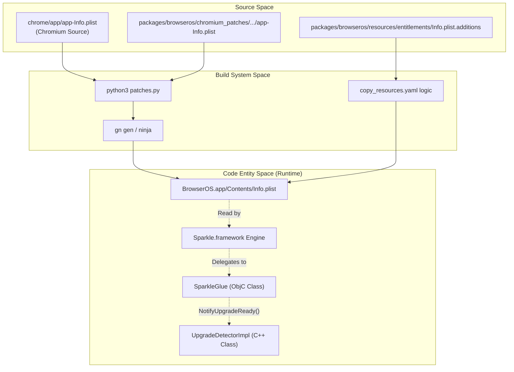
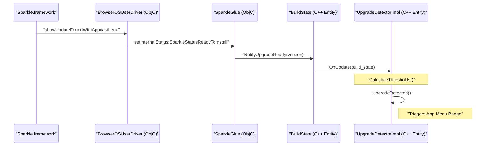
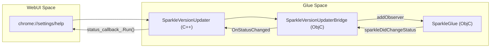

<!-- source: DeepWiki mcp.deepwiki.com · repo browseros-ai/BrowserOS · page 9.3 Info.plist Configuration · fetched 2026-10-29 -->

# Info.plist Configuration

Relevant source files

The following files were used as context for generating this wiki page:

- [packages/browseros/chromium_patches/chrome/BUILD.gn](packages/browseros/chromium_patches/chrome/BUILD.gn)
- [packages/browseros/chromium_patches/chrome/browser/BUILD.gn](packages/browseros/chromium_patches/chrome/browser/BUILD.gn)
- [packages/browseros/chromium_patches/chrome/browser/buildflags.gni](packages/browseros/chromium_patches/chrome/browser/buildflags.gni)
- [packages/browseros/chromium_patches/chrome/browser/mac/chrome_browser_main_extra_parts_mac.mm](packages/browseros/chromium_patches/chrome/browser/mac/chrome_browser_main_extra_parts_mac.mm)
- [packages/browseros/chromium_patches/chrome/browser/mac/sparkle_glue.h](packages/browseros/chromium_patches/chrome/browser/mac/sparkle_glue.h)
- [packages/browseros/chromium_patches/chrome/browser/mac/sparkle_glue.mm](packages/browseros/chromium_patches/chrome/browser/mac/sparkle_glue.mm)
- [packages/browseros/chromium_patches/chrome/browser/ui/toolbar/app_menu_icon_controller.cc](packages/browseros/chromium_patches/chrome/browser/ui/toolbar/app_menu_icon_controller.cc)
- [packages/browseros/chromium_patches/chrome/browser/ui/views/relaunch_notification/relaunch_notification_controller.cc](packages/browseros/chromium_patches/chrome/browser/ui/views/relaunch_notification/relaunch_notification_controller.cc)
- [packages/browseros/chromium_patches/chrome/browser/ui/webui/help/sparkle_version_updater_mac.h](packages/browseros/chromium_patches/chrome/browser/ui/webui/help/sparkle_version_updater_mac.h)
- [packages/browseros/chromium_patches/chrome/browser/ui/webui/help/sparkle_version_updater_mac.mm](packages/browseros/chromium_patches/chrome/browser/ui/webui/help/sparkle_version_updater_mac.mm)
- [packages/browseros/chromium_patches/chrome/browser/upgrade_detector/upgrade_detector_impl.cc](packages/browseros/chromium_patches/chrome/browser/upgrade_detector/upgrade_detector_impl.cc)

## Purpose and Scope

This document details the `Info.plist` configuration keys used by BrowserOS on macOS to enable Sparkle Framework update functionality and define application identity. It covers the specific keys added to the application bundle's `Info.plist`, their technical implementation, and how they control automatic update behavior and data isolation.

The configuration in `Info.plist` is critical for the `SparkleGlue` component, which manages the lifecycle of browser updates and communicates with the Chromium `UpgradeDetectorImpl` to notify the user when a restart is required.

## Configuration Files

BrowserOS modifies the standard Chromium `Info.plist` through two primary mechanisms to ensure that the final application bundle contains the necessary Sparkle metadata and product identifiers.

1.  **Chromium Patch**: The build system applies patches to Chromium's source `app-Info.plist`. This ensures that the keys are baked into the binary during the standard GN/Ninja build process.
2.  **Resource Additions**: The build system utilizes configuration files to inject canonical key-value pairs for resource management and entitlement injection during the packaging phase.

### Info.plist Data Flow

The following diagram illustrates how configuration data from the repository reaches the final application bundle and interacts with the `SparkleGlue` runtime.

Title: Info.plist Configuration and Runtime Data Flow

**Sources:** [packages/browseros/chromium_patches/chrome/browser/mac/sparkle_glue.mm:58-73](), [packages/browseros/chromium_patches/chrome/browser/mac/sparkle_glue.h:61-78]()

## Sparkle Configuration Keys

The following keys are injected into the `Info.plist` to configure the `Sparkle.framework` behavior within the browser.

### SUPublicEDKey
*   **Key**: `SUPublicEDKey`
*   **Value**: `LzQmcNuTsdB3/dsivo0eeN+jPfDoriRHAkkEJcfFs2A=`
*   **Description**: This is the Base64-encoded Ed25519 public key. It is the root of trust for the update system. Sparkle uses this key to verify the Ed25519 signature of the update archive (e.g., `.dmg`) provided in the appcast feed.
*   **Implementation**: The `Sparkle.framework` automatically looks for this key to validate updates downloaded from the feed URL.

### SUEnableAutomaticChecks
*   **Key**: `SUEnableAutomaticChecks`
*   **Value**: `<true/>`
*   **Description**: Instructs Sparkle to automatically poll the update server (Appcast URL) in the background. In `BrowserOSUserDriver`, this is used to auto-grant permission requests in `showUpdatePermissionRequest:reply:` [packages/browseros/chromium_patches/chrome/browser/mac/sparkle_glue.mm:149-156]().

### SUScheduledCheckInterval
*   **Key**: `SUScheduledCheckInterval`
*   **Value**: `3600`
*   **Description**: Defines the frequency of background update checks in seconds. BrowserOS is configured for a **1-hour interval** (3600 seconds) to ensure rapid delivery of security patches and AI model compatibility updates.

### SUAllowsAutomaticUpdates & SUAutomaticallyUpdate
*   **Keys**: `SUAllowsAutomaticUpdates` and `SUAutomaticallyUpdate`
*   **Values**: `<true/>`
*   **Description**: These keys work in tandem to enable a "silent" update experience. They permit the framework to download updates in the background and prepare the installation so that the user is only prompted to restart the browser via the Chromium app menu badge.

**Sources:** [packages/browseros/chromium_patches/chrome/browser/mac/sparkle_glue.mm:149-156](), [packages/browseros/chromium_patches/chrome/browser/mac/sparkle_glue.mm:178-182]()

## Browser Identity Configuration

### BROWSEROS_PRODUCT_DIR_NAME
*   **Key**: `CrProductDirName` (aliased via build flags)
*   **Value**: `BrowserOS`
*   **Description**: This is a Chromium-specific key that overrides the default directory name used for user profiles, caches, and local storage.
*   **Data Isolation**: By setting this to `BrowserOS`, the application stores its data in `~/Library/Application Support/BrowserOS/` rather than the default `Chromium` paths. This is controlled via `BROWSEROS_PRODUCT_DIR_NAME` in the build configuration [packages/browseros/chromium_patches/chrome/BUILD.gn:28-29]().

## Technical Implementation and Data Flow

The configuration in `Info.plist` acts as the declarative interface between the BrowserOS binary and the macOS system services.

### Sparkle Verification and Notification Logic

When an update is found, `SparkleGlue` uses a custom `BrowserOSUserDriver` to handle the update flow. If an update is ready, it calls `NotifyUpgradeReady`, which interacts with the Chromium `BuildState` [packages/browseros/chromium_patches/chrome/browser/mac/sparkle_glue.mm:58-73]().

The `UpgradeDetectorImpl` is patched to disable its default outdated build detection and set update thresholds to zero when `ENABLE_SPARKLE` is true. This ensures that the update notification appears immediately once Sparkle reports an update [packages/browseros/chromium_patches/chrome/browser/upgrade_detector/upgrade_detector_impl.cc:29-33](), [packages/browseros/chromium_patches/chrome/browser/upgrade_detector/upgrade_detector_impl.cc:41-50]().

Title: Sparkle to Chromium Notification Flow

**Sources:** [packages/browseros/chromium_patches/chrome/browser/mac/sparkle_glue.mm:58-73](), [packages/browseros/chromium_patches/chrome/browser/upgrade_detector/upgrade_detector_impl.cc:29-33](), [packages/browseros/chromium_patches/chrome/browser/upgrade_detector/upgrade_detector_impl.cc:41-50]()

### Sparkle Version Updater (Help Page)

BrowserOS implements `SparkleVersionUpdater` [packages/browseros/chromium_patches/chrome/browser/ui/webui/help/sparkle_version_updater_mac.h:23-43]() to bridge Sparkle status changes to the Chromium "About" page. It uses a `SparkleVersionUpdaterBridge` to observe `SparkleGlue` and translate `SparkleStatus` enums into Chromium `VersionUpdater::Status` values [packages/browseros/chromium_patches/chrome/browser/ui/webui/help/sparkle_version_updater_mac.mm:105-147]().

Title: Help Page Update UI Flow

**Sources:** [packages/browseros/chromium_patches/chrome/browser/ui/webui/help/sparkle_version_updater_mac.mm:105-147](), [packages/browseros/chromium_patches/chrome/browser/ui/webui/help/sparkle_version_updater_mac.h:23-43]()

### Configuration Summary Table

| Key | Value | Purpose |
| :--- | :--- | :--- |
| `SUPublicEDKey` | `LzQmcNuTsdB3...` | Ed25519 Public Key for Update Verification |
| `CrProductDirName` | `BrowserOS` | Overrides Profile/Data Directory |
| `SUEnableAutomaticChecks` | `true` | Enables Background Update Polling |
| `SUScheduledCheckInterval` | `3600` | Sets Update Check to 1 Hour |
| `SUAllowsAutomaticUpdates` | `true` | Allows Background Downloads |
| `SUAutomaticallyUpdate` | `true` | Enables Silent Background Staging |

**Sources:** [packages/browseros/chromium_patches/chrome/browser/mac/sparkle_glue.mm:35-46](), [packages/browseros/chromium_patches/chrome/browser/mac/sparkle_glue.mm:149-156](), [packages/browseros/chromium_patches/chrome/browser/upgrade_detector/upgrade_detector_impl.cc:41-50]()

---

