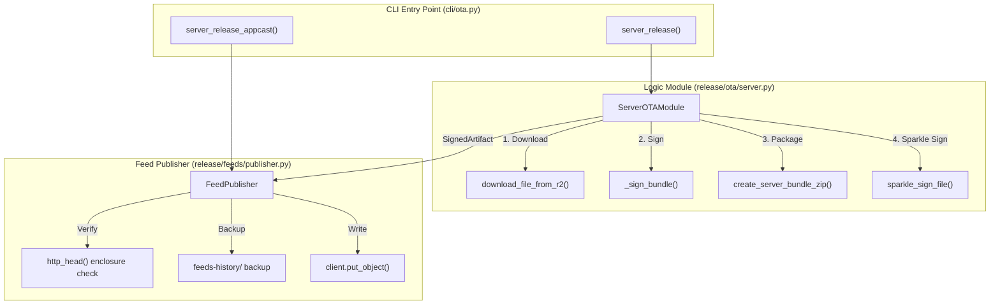
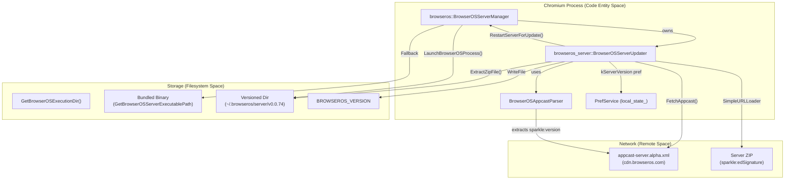
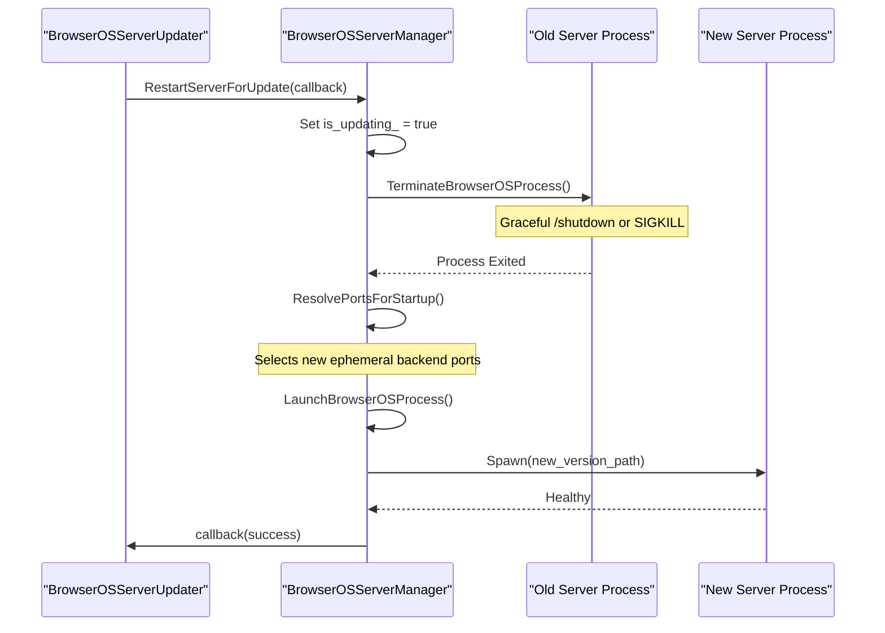

<!-- source: DeepWiki mcp.deepwiki.com · repo browseros-ai/BrowserOS · page 9.4 Server OTA Updates · fetched 2026-10-29 -->

# Server OTA Updates

<details>
<summary>Relevant source files</summary>

The following files were used as context for generating this wiki page:

- [packages/browseros/bos_build/browseros.py](packages/browseros/bos_build/browseros.py)
- [packages/browseros/bos_build/cli/ota.py](packages/browseros/bos_build/cli/ota.py)
- [packages/browseros/bos_build/cli/ota_test.py](packages/browseros/bos_build/cli/ota_test.py)
- [packages/browseros/bos_build/lib/env.py](packages/browseros/bos_build/lib/env.py)
- [packages/browseros/bos_build/lib/logger.py](packages/browseros/bos_build/lib/logger.py)
- [packages/browseros/bos_build/lib/utils.py](packages/browseros/bos_build/lib/utils.py)
- [packages/browseros/bos_build/lib/utils_test.py](packages/browseros/bos_build/lib/utils_test.py)
- [packages/browseros/bos_build/release/extensions/__init__.py](packages/browseros/bos_build/release/extensions/__init__.py)
- [packages/browseros/bos_build/release/extensions/manifests.py](packages/browseros/bos_build/release/extensions/manifests.py)
- [packages/browseros/bos_build/release/extensions/manifests_test.py](packages/browseros/bos_build/release/extensions/manifests_test.py)
- [packages/browseros/bos_build/release/feeds/publisher.py](packages/browseros/bos_build/release/feeds/publisher.py)
- [packages/browseros/bos_build/release/feeds/publisher_test.py](packages/browseros/bos_build/release/feeds/publisher_test.py)
- [packages/browseros/bos_build/release/feeds/render.py](packages/browseros/bos_build/release/feeds/render.py)
- [packages/browseros/bos_build/release/feeds/render_test.py](packages/browseros/bos_build/release/feeds/render_test.py)
- [packages/browseros/bos_build/release/feeds/spec.py](packages/browseros/bos_build/release/feeds/spec.py)
- [packages/browseros/bos_build/release/feeds/spec_test.py](packages/browseros/bos_build/release/feeds/spec_test.py)
- [packages/browseros/bos_build/release/ota/__init__.py](packages/browseros/bos_build/release/ota/__init__.py)
- [packages/browseros/bos_build/release/ota/common.py](packages/browseros/bos_build/release/ota/common.py)
- [packages/browseros/bos_build/release/ota/feeds_alignment_test.py](packages/browseros/bos_build/release/ota/feeds_alignment_test.py)
- [packages/browseros/bos_build/release/ota/server.py](packages/browseros/bos_build/release/ota/server.py)
- [packages/browseros/bos_build/release/ota/sign_binary.py](packages/browseros/bos_build/release/ota/sign_binary.py)
- [packages/browseros/bos_build/release/ota/sign_binary_test.py](packages/browseros/bos_build/release/ota/sign_binary_test.py)
- [packages/browseros/bos_build/steps/sign/windows.py](packages/browseros/bos_build/steps/sign/windows.py)
- [packages/browseros/bos_build/steps/sign/windows_test.py](packages/browseros/bos_build/steps/sign/windows_test.py)

</details>


This document describes the over-the-air (OTA) update system for the BrowserOS Server sidecar process. This system enables automatic background updates of the server binary without requiring a full browser restart.

**Scope**: This page covers the client-side update mechanism (fetching appcasts, downloading, and applying server updates) and the build-side release automation that generates these updates. For browser application updates, see [Sparkle Framework (9.2)]().

---

## Overview

The BrowserOS Server OTA system implements automatic background updates for the sidecar process. Key characteristics:

- **Periodic Checks**: The browser client fetches appcast XML every 15 minutes to check for new versions. [chrome/browser/browseros/chromium_patches/chrome/browser/browseros/server/browseros_server_updater.cc:57-58]()
- **Ed25519 Signature Verification**: All server update payloads are cryptographically verified using Sparkle-compatible Ed25519 signatures before extraction. [chrome/browser/browseros/chromium_patches/chrome/browser/browseros/server/browseros_server_updater.cc:122-175]()
- **Hot-Swap**: Updates are applied by the `BrowserOSServerManager` by rotating ephemeral ports and restarting the sidecar process, avoiding a full browser restart. [chrome/browser/browseros/chromium_patches/chrome/browser/browseros/server/browseros_server_manager.cc:917-930]()
- **Version Management**: The system maintains a bundled fallback binary and stores downloaded versions in versioned directories within the user data path. [chrome/browser/browseros/chromium_patches/chrome/browser/browseros/server/browseros_server_manager.cc:1048-1064]()

**Sources**: [chrome/browser/browseros/chromium_patches/chrome/browser/browseros/server/browseros_server_updater.cc:1-1076](), [chrome/browser/browseros/chromium_patches/chrome/browser/browseros/server/browseros_server_manager.cc:1-1120]()

---

## Release Automation (Code to Feed)

The server binaries are prepared, signed, and published using the `browseros ota server` CLI. This process ensures that binaries distributed via OTA are identical in trust to the bundled ones.

### OTA Release Component Mapping

The following diagram bridges the release CLI entities to the generated update artifacts.



**Sources**: [packages/browseros/bos_build/cli/ota.py:115-162](), [packages/browseros/bos_build/release/ota/server.py:41-50](), [packages/browseros/bos_build/release/feeds/publisher.py:179-180]()

### Release Steps

1.  **Validation**: `ServerOTAModule.validate` checks for required environment variables like `R2_ACCESS_KEY_ID` and platform-specific signing certificates. [packages/browseros/bos_build/release/ota/server.py:83-106]()
2.  **Binary Signing**:
    *   **Windows**: Uses `sign_server_bundle_windows` which invokes `CodeSignTool`. [packages/browseros/bos_build/release/ota/server.py:32-32](), [packages/browseros/bos_build/steps/sign/windows.py:110-111]()
    *   **macOS**: Uses `sign_server_bundle_macos` followed by `notarize_macos_zip`. [packages/browseros/bos_build/release/ota/server.py:30-31]()
3.  **Appcast Generation**: `render_server_appcast` creates the XML feed, merging new platform enclosures into existing version items if applicable. [packages/browseros/bos_build/release/feeds/render.py:168-180]()
4.  **Publication Rails**: The `FeedPublisher` enforces safety checks: it verifies that the appcast `<title>` matches the `FeedSpec`, checks that all enclosure URLs are reachable via HTTP HEAD, and prevents version downgrades unless explicitly forced. [packages/browseros/bos_build/release/feeds/publisher.py:246-310]()

**Sources**: [packages/browseros/bos_build/release/ota/server.py:158-195](), [packages/browseros/bos_build/release/feeds/publisher.py:1-8](), [packages/browseros/bos_build/release/feeds/render.py:181-199]()

---

## Appcast Feed Specification

BrowserOS uses a structured feed table to manage update keys for different products (BrowserOS vs. BrowserClaw) and channels (Alpha vs. Prod).

| Feed Key | Kind | Channel | Product |
| :--- | :--- | :--- | :--- |
| `appcast-server.xml` | server | prod | browseros |
| `appcast-server.alpha.xml` | server | alpha | browseros |
| `appcast-claw-server.xml` | server | prod | browserclaw |
| `appcast-claw-server.alpha.xml` | server | alpha | browserclaw |

**Sources**: [packages/browseros/bos_build/release/feeds/spec.py:85-88](), [packages/browseros/bos_build/release/feeds/spec.py:141-156]()

### Enclosure Format
Each `<item>` in the server appcast contains platform-specific enclosures. The `sparkle:os` and `sparkle:arch` attributes allow the client to select the correct binary.

```xml
<item>
  <sparkle:version>0.0.5</sparkle:version>
  <pubDate>Wed, 01 Jul 2026 01:18:52 +0000</pubDate>
  <enclosure
    url="https://cdn.browseros.com/server/browseros_server_0.0.5_darwin_arm64.zip"
    sparkle:os="macos"
    sparkle:arch="arm64"
    sparkle:edSignature="CLAWSIG=="
    length="123"
    type="application/zip"/>
</item>
```

**Sources**: [packages/browseros/bos_build/release/feeds/render_test.py:96-121](), [packages/browseros/bos_build/release/feeds/render.py:67-74]()

---

## Client-Side Update Mechanism

### Component Diagram: Update Flow

The following diagram maps the update logic to the specific C++ classes and filesystem entities within the browser.



**Sources**: [chrome/browser/browseros/chromium_patches/chrome/browser/browseros/server/browseros_server_updater.h:1-159](), [chrome/browser/browseros/chromium_patches/chrome/browser/browseros/server/browseros_server_manager.h:1-165](), [chrome/browser/browseros/chromium_patches/chrome/browser/browseros/server/browseros_server_manager.cc:167-172](), [packages/browseros/resources/BROWSEROS_VERSION:1-4]()

### Signature Verification (Ed25519)

BrowserOS uses the BoringSSL library to verify that downloaded binaries were signed by the BrowserOS build pipeline.

1.  **Public Key**: Decoded from base64 (hardcoded in updater constants). [chrome/browser/browseros/chromium_patches/chrome/browser/browseros/server/browseros_server_updater.cc:125-136]()
2.  **Signature Extraction**: Decoded from the `sparkle:edSignature` attribute in the appcast enclosure. [chrome/browser/browseros/chromium_patches/chrome/browser/browseros/server/browseros_server_updater.cc:138-149]()
3.  **Verification**: The function `ED25519_verify` is called against the raw ZIP file contents. [chrome/browser/browseros/chromium_patches/chrome/browser/browseros/server/browseros_server_updater.cc:167-171]()

**Sources**: [chrome/browser/browseros/chromium_patches/chrome/browser/browseros/server/browseros_server_updater.cc:122-175]()

---

## Hot-Swap Mechanism

The `BrowserOSServerManager` performs a "hot-swap" by shutting down the existing sidecar and launching the new version.

### Hot-Swap Sequence



**Sources**: [chrome/browser/browseros/chromium_patches/chrome/browser/browseros/server/browseros_server_manager.cc:917-930](), [chrome/browser/browseros/chromium_patches/chrome/browser/browseros/server/browseros_server_manager.h:115-126]()

---

