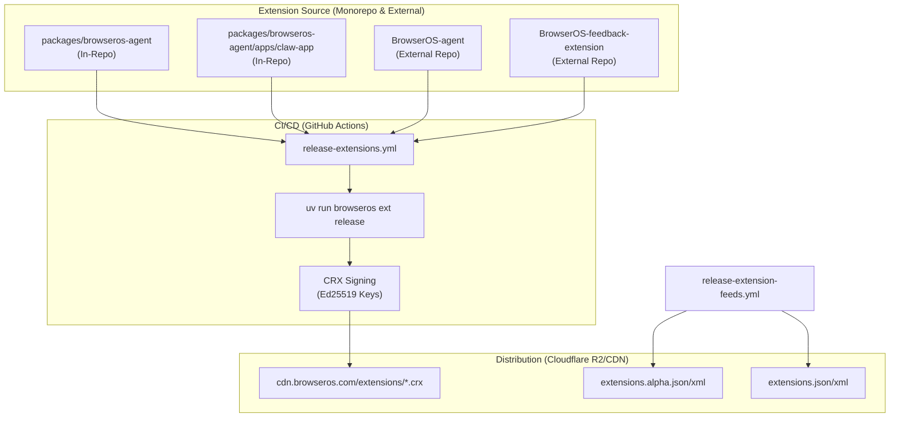
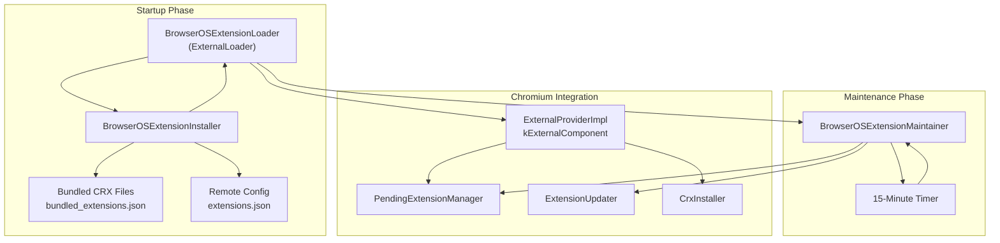

<!-- source: DeepWiki mcp.deepwiki.com · repo browseros-ai/BrowserOS · page 9.5 Extension Updates · fetched 2026-10-29 -->

# Extension Updates

Relevant source files

The following files were used as context for generating this wiki page:

- [.github/actionlint.yaml](.github/actionlint.yaml)
- [.github/workflows/nightly-browseros.yml](.github/workflows/nightly-browseros.yml)
- [.github/workflows/release-browserclaw.yml](.github/workflows/release-browserclaw.yml)
- [.github/workflows/release-browseros.yml](.github/workflows/release-browseros.yml)
- [.github/workflows/release-extension-feeds.yml](.github/workflows/release-extension-feeds.yml)
- [.github/workflows/release-extensions.yml](.github/workflows/release-extensions.yml)
- [.github/workflows/release-macos.yml](.github/workflows/release-macos.yml)
- [packages/browseros/bos_build/docs/release-ci.md](packages/browseros/bos_build/docs/release-ci.md)
- [packages/browseros/bos_build/profiles/nightly-macos.yaml](packages/browseros/bos_build/profiles/nightly-macos.yaml)
- [packages/browseros/bos_build/release/extensions/specs.py](packages/browseros/bos_build/release/extensions/specs.py)
- [packages/browseros/bos_build/release/extensions/specs_test.py](packages/browseros/bos_build/release/extensions/specs_test.py)
- [packages/browseros/bos_build/steps/patches/product_payload_manifest_test.py](packages/browseros/bos_build/steps/patches/product_payload_manifest_test.py)
- [packages/browseros/chromium_patches/chrome/browser/browseros/bundled_extensions/BUILD.gn](packages/browseros/chromium_patches/chrome/browser/browseros/bundled_extensions/BUILD.gn)
- [packages/browseros/chromium_patches/chrome/common/BUILD.gn](packages/browseros/chromium_patches/chrome/common/BUILD.gn)
- [packages/browseros/chromium_patches/chrome/common/chrome_constants.cc](packages/browseros/chromium_patches/chrome/common/chrome_constants.cc)
- [packages/browseros/chromium_patches/chrome/installer/mini_installer/chrome.release](packages/browseros/chromium_patches/chrome/installer/mini_installer/chrome.release)
- [updates/extensions/bundled-manifest.xml](updates/extensions/bundled-manifest.xml)

This document describes how BrowserOS extensions are built, packaged, and updated. It covers the dual-phase update strategy (bundled vs remote), the CI/CD pipeline for releasing CRX files, and the maintenance system that ensures extensions remain installed and current.

For information about extension privileges and URL routing, see [Extension Architecture](6.1), [Extension Privileges](6.4), and [URL Routing](6.5).

## Overview

BrowserOS extensions use a multi-layered update and maintenance strategy to ensure immediate availability and long-term reliability:

1.  **Initial Installation**: At browser startup, extensions are installed from bundled CRX files (preferred) or fetched from a remote configuration URL. [packages/browseros/chromium_patches/chrome/browser/browseros/extensions/browseros_extension_installer.cc:71-84]()
2.  **Ongoing Updates**: After installation, extensions receive updates through their `manifest.json` `update_url` field, checked periodically by the maintenance cycle. [packages/browseros/chromium_patches/chrome/browser/browseros/extensions/browseros_extension_loader.h:37-38]()
3.  **CI/CD Pipeline**: A dedicated GitHub Actions workflow builds, signs, and uploads CRX files to Cloudflare R2, while another workflow manages the update feed XML/JSON files. [.github/workflows/release-extensions.yml:1-30](), [.github/workflows/release-extension-feeds.yml:1-24]()

## Release Architecture

The release process bridges the TypeScript/Bun code space of the extensions with the production CDN distribution.

**Sources:** [.github/workflows/release-extensions.yml:124-175](), [packages/browseros/bos_build/release/extensions/specs.py:70-137]()

### Extension Specifications

The build system uses a centralized specification table to define how each extension is sourced and built.

| Extension | ID | Source Type | Build Command |
| :--- | :--- | :--- | :--- |
| **Agent** | `bflpfmnmnokmjhmgnolecpppdbdophmk` | `InRepoSource` | `bun run build:agent` |
| **Controller** | `nlnihljpboknmfagkikhkdblbedophja` | `ExternalRepoSource` | `bun run build:ext` |
| **Bug Reporter** | `adlpneommgkgeanpaekgoaolcpncohkf` | `ExternalRepoSource` | `yarn run build` |
| **BrowserClaw** | `pjimfkbpehlcllblajnpfamdfjhhlgkc` | `InRepoSource` | `bun run --filter @browseros/claw-app build` |

**Sources:** [packages/browseros/bos_build/release/extensions/specs.py:70-137](), [packages/browseros/bos_build/release/extensions/specs_test.py:31-35]()

## Browser-Side Architecture

The browser component manages the lifecycle of these extensions once distributed.

**Sources:** [packages/browseros/chromium_patches/chrome/browser/browseros/extensions/browseros_extension_loader.h:39-80](), [packages/browseros/chromium_patches/chrome/browser/browseros/extensions/browseros_extension_installer.cc:62-84]()

## Bundled Extensions

For immediate availability on first run, BrowserOS bundles specific CRX files directly into the browser build.

*   **Windows**: Extensions are placed in the `browseros_extensions` subdirectory within the versioned application directory. [packages/browseros/chromium_patches/chrome/installer/mini_installer/chrome.release:13]()
*   **macOS**: Extensions are bundled into the framework's `Resources/browseros_extensions` directory. [packages/browseros/chromium_patches/chrome/browser/browseros/bundled_extensions/BUILD.gn:44-47]()
*   **Manifest**: A `bundled_extensions.json` file maps extension IDs to local filenames and versions for the installer. [packages/browseros/chromium_patches/chrome/browser/browseros/bundled_extensions/BUILD.gn:23]()

**Sources:** [packages/browseros/chromium_patches/chrome/browser/browseros/bundled_extensions/BUILD.gn:13-48](), [packages/browseros/chromium_patches/chrome/installer/mini_installer/chrome.release:13]()

## Initial Installation Flow

The `BrowserOSExtensionLoader` coordinates the initial setup:

1.  **Bundled Check**: The `BrowserOSExtensionInstaller` first looks for `bundled_extensions.json` on the local filesystem. [packages/browseros/chromium_patches/chrome/browser/browseros/extensions/browseros_extension_installer.cc:86-100]()
2.  **Remote Fallback**: If bundled resources are missing, it fetches configuration from `kBrowserOSConfigUrl` (default: `https://cdn.browseros.com/extensions/extensions.json`). [packages/browseros/chromium_patches/chrome/browser/browseros/extensions/browseros_extension_installer.cc:200-205](), [packages/browseros/chromium_patches/chrome/browser/browseros/core/browseros_constants.h:34-37]()
3.  **Immediate Install**: Once sources are identified, the loader uses `CrxInstaller` for local files or `ExtensionUpdater::InstallPendingNow()` for remote URLs. [packages/browseros/chromium_patches/chrome/browser/browseros/extensions/browseros_extension_loader.cc:207-229](), [packages/browseros/chromium_patches/chrome/browser/extensions/updater/extension_updater.cc:9-101]()

**Sources:** [packages/browseros/chromium_patches/chrome/browser/browseros/extensions/browseros_extension_loader.cc:100-121](), [packages/browseros/chromium_patches/chrome/browser/extensions/updater/extension_updater.cc:5-101]()

## Periodic Maintenance

The `BrowserOSExtensionMaintainer` runs every 15 minutes to ensure system integrity. [packages/browseros/chromium_patches/chrome/browser/browseros/extensions/browseros_extension_maintainer.cc:45]()

It performs the following tasks:
*   **Uninstall Deprecated**: Removes extensions that are no longer present in the server-side configuration. [packages/browseros/chromium_patches/chrome/browser/browseros/extensions/browseros_extension_maintainer.cc:190-228]()
*   **Reinstall Missing**: If a required extension was manually uninstalled by a user, the maintainer re-registers it. [packages/browseros/chromium_patches/chrome/browser/browseros/extensions/browseros_extension_maintainer.cc:230-269]()
*   **Force Update**: Triggers a check against the `update_url` for all BrowserOS extensions to ensure they are on the latest version. [packages/browseros/chromium_patches/chrome/browser/browseros/extensions/browseros_extension_maintainer.cc:301-315]()

**Sources:** [packages/browseros/chromium_patches/chrome/browser/browseros/extensions/browseros_extension_maintainer.cc:172-180](), [packages/browseros/chromium_patches/chrome/browser/browseros/extensions/browseros_extension_maintainer.cc:66-87]()

## Release Workflows

Extension updates are managed via two primary GitHub Action workflows:

### release-extensions.yml
This workflow is responsible for building and signing the CRX binaries.
*   **Signing**: Uses Ed25519 keys (e.g., `BROWSEROS_AGENT_V2_KEY`) to sign the CRX. [.github/workflows/release-extensions.yml:140-144]()
*   **Storage**: Uploads the resulting CRX to Cloudflare R2 using the format `extensions/{name}-{version}.crx`. [packages/browseros/bos_build/release/extensions/specs.py:66-67](), [.github/workflows/release-extensions.yml:134-138]()
*   **Versioning**: Stamped with the version provided during dispatch. [.github/workflows/release-extensions.yml:6-9]()

### release-extension-feeds.yml
This workflow manages the update manifests that the browser checks.
*   **Channels**: Supports `alpha`, `prod`, or `both`. [.github/workflows/release-extension-feeds.yml:6-14]()
*   **Pins**: Allows pinning specific extensions to specific versions in the feed. [.github/workflows/release-extension-feeds.yml:15-19]()
*   **Dry Run**: Supports a dry-run mode to verify feed changes before publishing to R2. [.github/workflows/release-extension-feeds.yml:20-24]()

**Sources:** [.github/workflows/release-extensions.yml:1-180](), [.github/workflows/release-extension-feeds.yml:1-142](), [packages/browseros/bos_build/docs/release-ci.md:64-65]()

---

