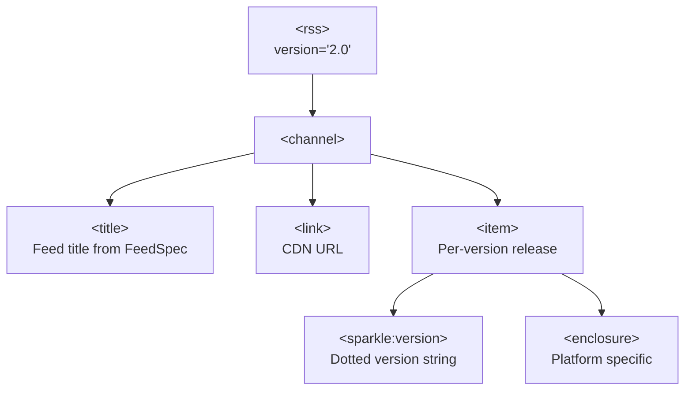
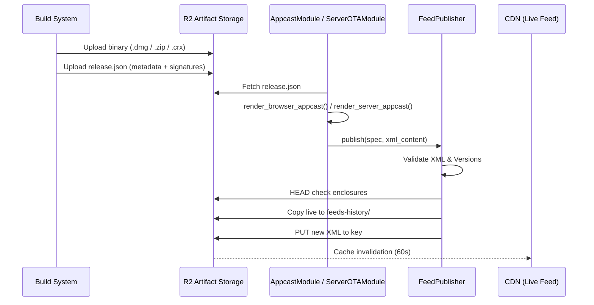

<!-- source: DeepWiki mcp.deepwiki.com · repo browseros-ai/BrowserOS · page 9.6 Appcast Feeds · fetched 2026-10-29 -->

# Appcast Feeds

<details>
<summary>Relevant source files</summary>

The following files were used as context for generating this wiki page:

- [packages/browseros/bos_build/browseros.py](packages/browseros/bos_build/browseros.py)
- [packages/browseros/bos_build/cli/ota.py](packages/browseros/bos_build/cli/ota.py)
- [packages/browseros/bos_build/cli/ota_test.py](packages/browseros/bos_build/cli/ota_test.py)
- [packages/browseros/bos_build/cli/release.py](packages/browseros/bos_build/cli/release.py)
- [packages/browseros/bos_build/cli/release_feeds.py](packages/browseros/bos_build/cli/release_feeds.py)
- [packages/browseros/bos_build/cli/release_test.py](packages/browseros/bos_build/cli/release_test.py)
- [packages/browseros/bos_build/release/appcast.py](packages/browseros/bos_build/release/appcast.py)
- [packages/browseros/bos_build/release/appcast_test.py](packages/browseros/bos_build/release/appcast_test.py)
- [packages/browseros/bos_build/release/common.py](packages/browseros/bos_build/release/common.py)
- [packages/browseros/bos_build/release/common_test.py](packages/browseros/bos_build/release/common_test.py)
- [packages/browseros/bos_build/release/extensions/__init__.py](packages/browseros/bos_build/release/extensions/__init__.py)
- [packages/browseros/bos_build/release/extensions/manifests.py](packages/browseros/bos_build/release/extensions/manifests.py)
- [packages/browseros/bos_build/release/extensions/manifests_test.py](packages/browseros/bos_build/release/extensions/manifests_test.py)
- [packages/browseros/bos_build/release/feeds/publisher.py](packages/browseros/bos_build/release/feeds/publisher.py)
- [packages/browseros/bos_build/release/feeds/publisher_test.py](packages/browseros/bos_build/release/feeds/publisher_test.py)
- [packages/browseros/bos_build/release/feeds/render.py](packages/browseros/bos_build/release/feeds/render.py)
- [packages/browseros/bos_build/release/feeds/render_test.py](packages/browseros/bos_build/release/feeds/render_test.py)
- [packages/browseros/bos_build/release/feeds/spec.py](packages/browseros/bos_build/release/feeds/spec.py)
- [packages/browseros/bos_build/release/feeds/spec_test.py](packages/browseros/bos_build/release/feeds/spec_test.py)
- [packages/browseros/bos_build/release/github.py](packages/browseros/bos_build/release/github.py)
- [packages/browseros/bos_build/release/publish.py](packages/browseros/bos_build/release/publish.py)
- [packages/browseros/bos_build/release/publish_test.py](packages/browseros/bos_build/release/publish_test.py)
- [packages/browseros/bos_build/steps/storage/upload.py](packages/browseros/bos_build/steps/storage/upload.py)
- [packages/browseros/bos_build/steps/storage/upload_test.py](packages/browseros/bos_build/steps/storage/upload_test.py)

</details>


Appcast feeds are XML files following the Sparkle framework format that provide version information, download URLs, and cryptographic signatures for BrowserOS updates. The system uses a multi-layered update architecture that separates browser application updates (managed by Sparkle on macOS and WinSparkle on Windows) from BrowserOS Server binary updates (managed by a custom OTA system) and BrowserOS Extension updates.

For information about the Sparkle framework integration, see [Sparkle Framework (9.2)](). For server update mechanisms, see [Server OTA Updates (9.4)]().

## Appcast Types

BrowserOS maintains distinct appcast feeds for different products and update targets, managed through a central `FeedSpec` registry.

| Appcast Type | Target Product | Update Target | Framework | Key File Patterns |
|--------------|----------------|---------------|-----------|-------------------|
| **Browser Appcast** | `browseros`, `browserclaw` | Application binaries (.dmg, .exe) | Sparkle / WinSparkle | `appcast.xml`, `appcast-win.xml` |
| **Server Appcast** | `browseros-server`, `browserclaw-server` | `browseros_server` binary | Custom OTA | `appcast-server.xml`, `appcast-server.alpha.xml` |
| **Extension Manifest**| `agent`, `bugreporter` | Chrome Extensions (.crx) | Chrome Update Protocol | `update-manifest.xml`, `extensions.json` |

**Sources:** [packages/browseros/bos_build/release/feeds/spec.py:55-68](), [packages/browseros/bos_build/release/feeds/spec.py:159-188]()

## Feed Specification and Registry

The system uses a frozen dataclass `FeedSpec` to define every publishable feed object. This ensures that update URLs and titles are consistent across channels.

```python
@dataclass(frozen=True)
class FeedSpec:
    key: str           # The R2/CDN key (e.g., "appcast.xml")
    kind: str          # "browser", "server", or "extensions"
    product: str       # "browseros" or "browserclaw"
    channel: str       # "prod" or "alpha"
    platform: str      # "macos" or "win"
    artifact_keys: Tuple[str, ...] # release.json priority (e.g., "universal", "arm64")
```

**Sources:** [packages/browseros/bos_build/release/feeds/spec.py:55-70]()

## XML Feed Structure

### Sparkle RSS Format
Browser and Server appcasts use RSS 2.0 with the Sparkle namespace (`xmlns:sparkle="http://www.andymatuschak.org/xml-namespaces/sparkle"`).



**Sources:** [packages/browseros/bos_build/release/feeds/render_test.py:38-65](), [packages/browseros/bos_build/release/feeds/publisher.py:65-106]()

### Extension Update Manifests
Extensions use the Google Update protocol format. The `ExtensionsFeedModule` generates these manifests by mapping extension IDs to their corresponding CRX download URLs.

```xml
<gupdate xmlns="http://www.google.com/update2/response" protocol="2.0">
  <app appid="bflpfmnmnokmjhmgnolecpppdbdophmk">
    <updatecheck codebase="https://cdn.browseros.com/extensions/agent-0.0.118.0.crx" version="0.0.118.0" />
  </app>
</gupdate>
```

**Sources:** [packages/browseros/bos_build/release/feeds/render_test.py:123-133](), [packages/browseros/bos_build/release/extensions/manifests.py:11-21]()

## The Feed Publisher "Safety Rails"

The `FeedPublisher` class is the authoritative write path for all live feeds. It enforces several safety checks before updating a feed in R2 storage:

1.  **Well-formedness Check**: Ensures the XML is valid and contains exactly one channel [packages/browseros/bos_build/release/feeds/publisher.py:52-62]().
2.  **Metadata Match**: Validates that the `<title>` and `<link>` in the XML match the `FeedSpec` for that key, preventing "alpha" content from being accidentally published to "prod" keys [packages/browseros/bos_build/release/feeds/publisher.py:4-7]().
3.  **Availability Check**: Performs a `HEAD` request on every download URL (enclosure) to ensure artifacts exist before the feed goes live [packages/browseros/bos_build/release/feeds/publisher.py:152-160]().
4.  **Downgrade Guard**: Compares the version in the new feed against the live version in R2. Unless `allow_downgrade` is True, it refuses to publish older versions [packages/browseros/bos_build/release/feeds/publisher.py:280-300]().
5.  **Backup**: Automatically copies the existing live feed to a `feeds-history/` prefix before overwriting [packages/browseros/bos_build/release/feeds/publisher.py:150-168]().

**Sources:** [packages/browseros/bos_build/release/feeds/publisher.py:1-8](), [packages/browseros/bos_build/release/feeds/publisher.py:179-208]()

## Data Flow: Artifact to Feed

The transition from a built artifact to a live feed involves metadata extraction and template rendering.



**Sources:** [packages/browseros/bos_build/release/appcast.py:76-139](), [packages/browseros/bos_build/release/feeds/publisher.py:210-240]()

## Code Entity Reference

### Primary Classes

| Entity | Role | Source |
|--------|------|--------|
| `FeedSpec` | Defines the mapping between R2 keys, products, and channels. | [packages/browseros/bos_build/release/feeds/spec.py:55]() |
| `FeedPublisher` | Enforces safety rails (backups, version guards, URL checks) during publication. | [packages/browseros/bos_build/release/feeds/publisher.py:179]() |
| `AppcastModule` | High-level build step that fetches metadata and renders browser feeds. | [packages/browseros/bos_build/release/appcast.py:20]() |
| `ExtensionsFeedModule` | Orchestrates the regeneration of extension manifests and `extensions.json`. | [packages/browseros/bos_build/release/extensions/manifests.py:11]() |

### Rendering Functions

| Function | Output Format | Source |
|----------|---------------|--------|
| `render_browser_appcast` | RSS/Sparkle (Browser) | [packages/browseros/bos_build/release/feeds/render.py:17]() |
| `render_server_appcast` | RSS/Sparkle (Server) | [packages/browseros/bos_build/release/feeds/render.py:19]() |
| `render_update_manifest` | Google Update XML (Extensions) | [packages/browseros/bos_build/release/feeds/render.py:20]() |
| `render_extensions_json` | JSON (Extension metadata) | [packages/browseros/bos_build/release/feeds/render.py:18]() |

**Sources:** [packages/browseros/bos_build/release/feeds/render_test.py:7-21](), [packages/browseros/bos_build/release/feeds/spec.py:107-129]()

---

