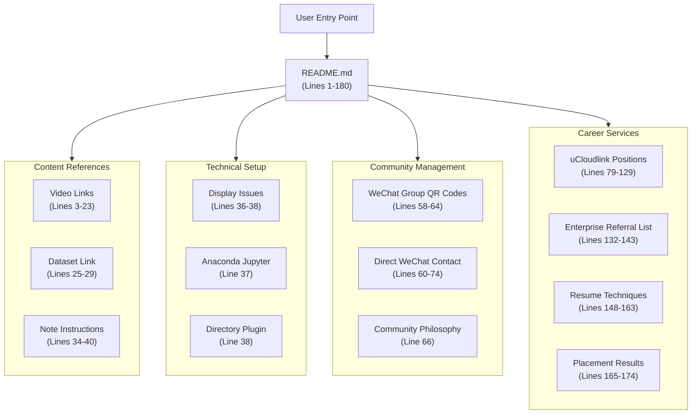
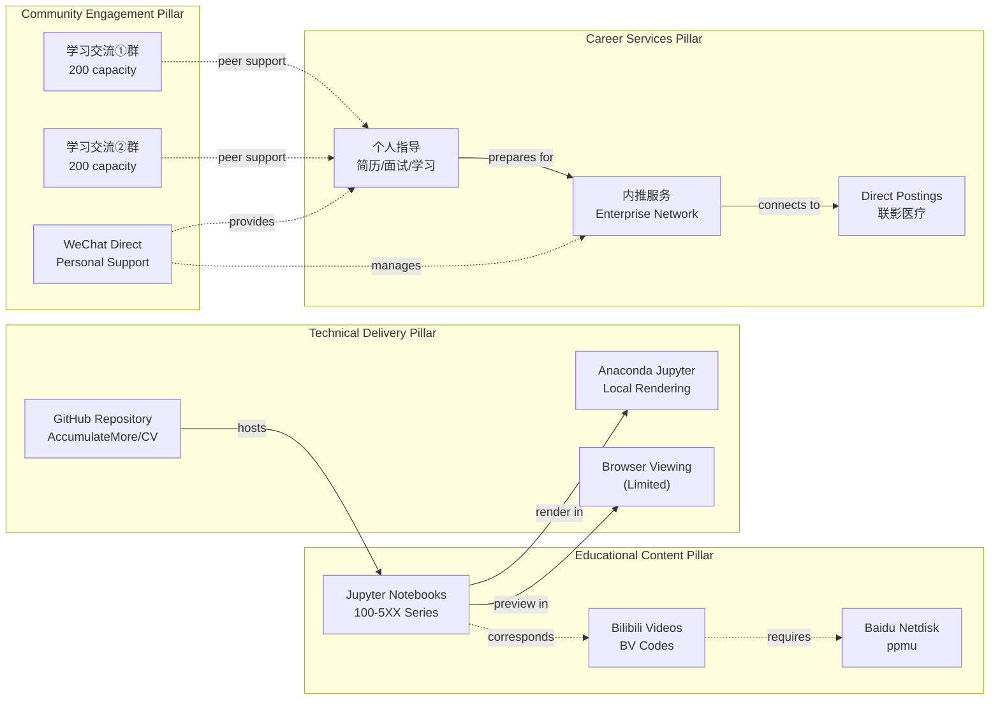
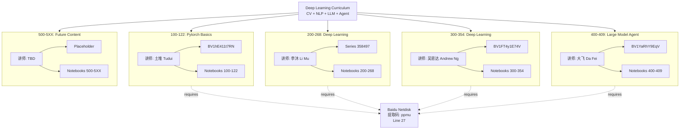
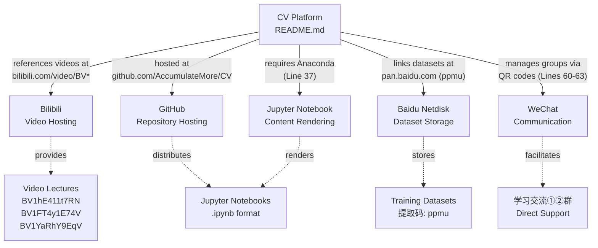
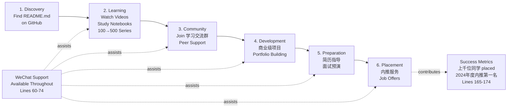
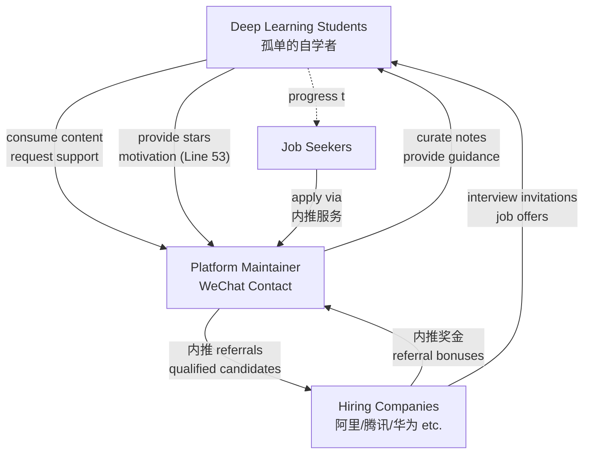

<!-- source: DeepWiki mcp.deepwiki.com · repo AccumulateMore/CV · page 1 Overview · fetched 2026-10-29 -->

# Overview

Relevant source files

The following files were used as context for generating this wiki page:

- [README.md](README.md)

## Purpose and Scope

This document provides an overview of the CV repository, a comprehensive deep learning education and career development platform orchestrated through a single `README.md` file. The platform coordinates educational content, technical delivery, community support, and career services to guide users from initial learning through job placement.

The system covers deep learning across multiple domains: computer vision (CV), natural language processing (NLP), large language models (LLMs), and AI agents. For detailed information about specific curriculum series, see [Curriculum Structure and Course Series](#2.1). For career services including resume guidance and job referrals (内推), see [Career Services and Job Placement](#5).

**Sources:** [README.md:1-180]()

## Single-File Architecture

The entire platform operates through `README.md` as the central coordination hub. Unlike traditional multi-file codebases, this architecture consolidates all system logic, content references, access instructions, and community management into a single Markdown document.

### README.md as System Orchestrator

The `README.md` file contains structured sections accessible via line ranges. Each section serves a distinct architectural function while maintaining referential integrity through hyperlinks and cross-references.

**Sources:** [README.md:1-180]()

## Four-Pillar System Architecture

The platform implements a four-pillar architecture where each pillar addresses a distinct user need while integrating with others to form a cohesive system.

### Pillar Integration Model

**Sources:** [README.md:1-180]()

### Pillar Descriptions

| Pillar | Primary Function | Line References | Key Components |
|--------|-----------------|-----------------|----------------|
| Educational Content | Deliver learning materials | [README.md:3-29]() | Video lectures (Bilibili), Jupyter notebooks (100-5XX), Datasets (Baidu) |
| Technical Delivery | Enable content access | [README.md:34-40]() | GitHub repository, Anaconda Jupyter, directory plugin |
| Community Engagement | Facilitate peer learning | [README.md:58-74]() | WeChat groups (学习交流①②群), direct contact, community philosophy |
| Career Services | Support job placement | [README.md:79-174]() | Resume guidance, interview prep, internal referrals (内推), direct postings |

**Sources:** [README.md:1-180]()

## Content Organization System

The platform organizes educational content using a numeric series system where each series corresponds to a specific instructor and topic area.

### Series Numbering and Content Mapping

Each series follows the pattern defined in [README.md:5-21]():
- Series identifier (e.g., "100-122")
- Instructor name (e.g., "土堆")
- Bilibili video reference (e.g., "BV1hE411t7RN")
- Corresponding note range

**Sources:** [README.md:3-27]()

## External Platform Dependencies

The system integrates five external platforms, each serving a specific architectural role. No custom infrastructure is maintained; all functionality leverages existing platform capabilities.

### Platform Integration Architecture

| Platform | Purpose | Access Method | Line References |
|----------|---------|---------------|-----------------|
| Bilibili | Video lecture hosting | Direct URLs (BV codes) | [README.md:7,11,15,19]() |
| GitHub | Note distribution and version control | Repository download | [README.md:36,49]() |
| Baidu Netdisk | Dataset file storage | Link with extraction code `ppmu` | [README.md:27]() |
| WeChat | Community communication and support | QR codes and direct contact | [README.md:60-74]() |
| Jupyter Notebook | Local content rendering | Anaconda installation | [README.md:37-38]() |

**Sources:** [README.md:7-74]()

## User Journey Model

The platform guides users through a structured progression from discovery to employment. Each stage builds upon the previous, with support mechanisms available throughout.

### User Progression Pipeline

Key transition points:
1. **Discovery → Learning**: User accesses [README.md:3-23]() to identify video and note series
2. **Learning → Community**: User joins groups via [README.md:60-63]() QR codes or direct contact [README.md:62]()
3. **Community → Development**: User requests guidance via [README.md:68-74]() support channels
4. **Development → Preparation**: User submits resume for review following techniques in [README.md:148-163]()
5. **Preparation → Placement**: User receives referrals (内推) to companies listed in [README.md:132-143]()

**Sources:** [README.md:1-180]()

## Technical Requirements and Known Limitations

The system has specific technical requirements for optimal content access and documented limitations when using alternative methods.

### Required Technical Stack

| Component | Requirement | Reason | Line Reference |
|-----------|-------------|--------|----------------|
| Editor | Anaconda Jupyter Notebook | Proper image and formula display | [README.md:37]() |
| Editor (NOT) | Pycharm Jupyter | Images do not display correctly | [README.md:37]() |
| Plugin | Jupyter directory plugin | Navigation via table of contents | [README.md:38]() |
| Access Method | Local download | Online viewing has display issues | [README.md:36]() |
| Browser Access | Limited | Incomplete image/formula rendering | [README.md:36]() |

### Known Display Issues

The platform documents rendering problems at [README.md:36-38]():

1. **Online Viewing Issue**: GitHub does not properly parse images and formulas when viewing notebooks in browser
2. **Solution**: Download notebooks locally and open with Anaconda Jupyter Notebook
3. **Pycharm Incompatibility**: Pycharm's Jupyter implementation fails to display images correctly
4. **Setup Guidance**: Additional instructions available in maintainer's Python repository (`Python仓库`) in section `00_Python编辑器`

**Sources:** [README.md:34-40]()

## Value Proposition and Platform Philosophy

The platform operates on a dual value creation model, serving both learners and employers while maintaining a philosophical foundation centered on mutual benefit and community support.

### Stakeholder Value Exchange

### Guiding Philosophy

The platform articulates its philosophy at [README.md:66,172-174,179]():

1. **看人之长,天下皆是吾师** ("See others' strengths, everyone is a teacher") - Focus on learning from all sources
2. **提灯人** ("Lamp bearer") - Illuminate the path for others rather than celebrating one's own light
3. **不走弯路错路** ("Avoid detours and wrong paths") - Direct guidance prevents wasted effort
4. **双赢** ("Win-win") - Companies receive qualified candidates and pay referral bonuses (内推奖金); students gain employment

### Measurable Outcomes

Success metrics documented at [README.md:165-174]():
- **上千位同学** (Thousands of students) successfully placed in employment
- **2024年度内推第一名** (2024 top internal referral provider)
- Demonstrated through screenshot evidence in lines 167-170

**Sources:** [README.md:53,66,130,165-179]()

## Related Documentation

For comprehensive information on specific subsystems:

- **Educational content structure**: See [Curriculum Structure and Course Series](#2.1) and [Lecture Series and Instructors](#2.2)
- **Technical setup procedures**: See [Technical Setup and Access](#3)
- **Community engagement**: See [Community and Support System](#4)
- **Career services**: See [Career Services and Job Placement](#5) and [Internal Referral System](#5.4)
- **Platform outcomes**: See [Platform Outcomes and Success Stories](#6)

**Sources:** [README.md:1-180]()

---

