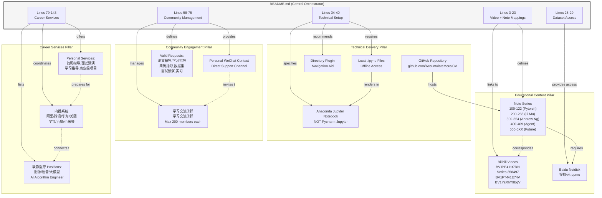
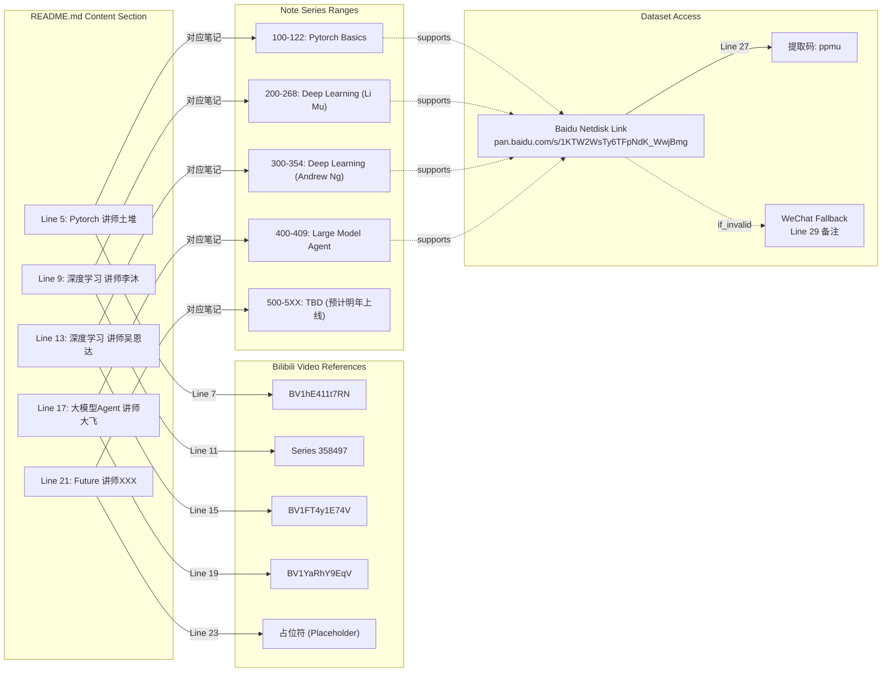
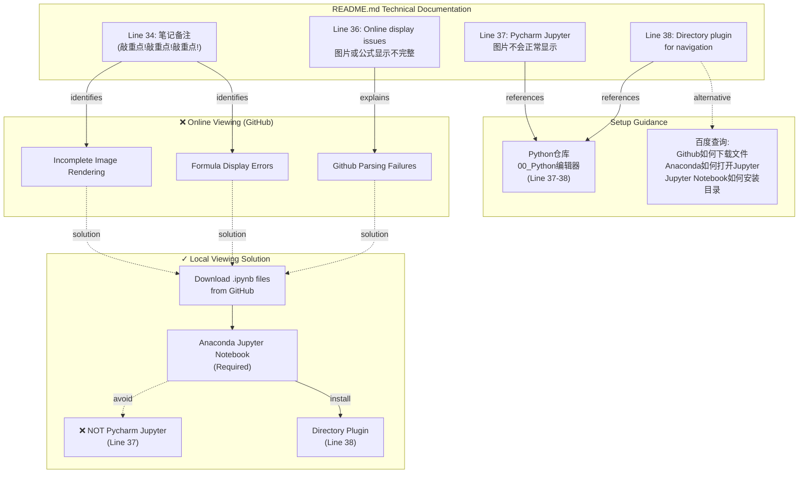
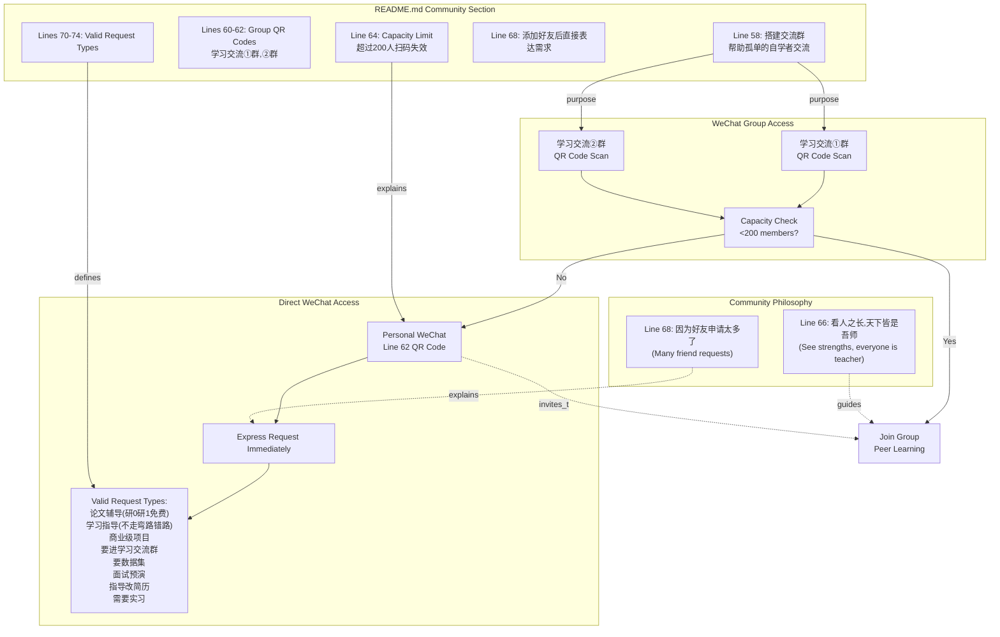
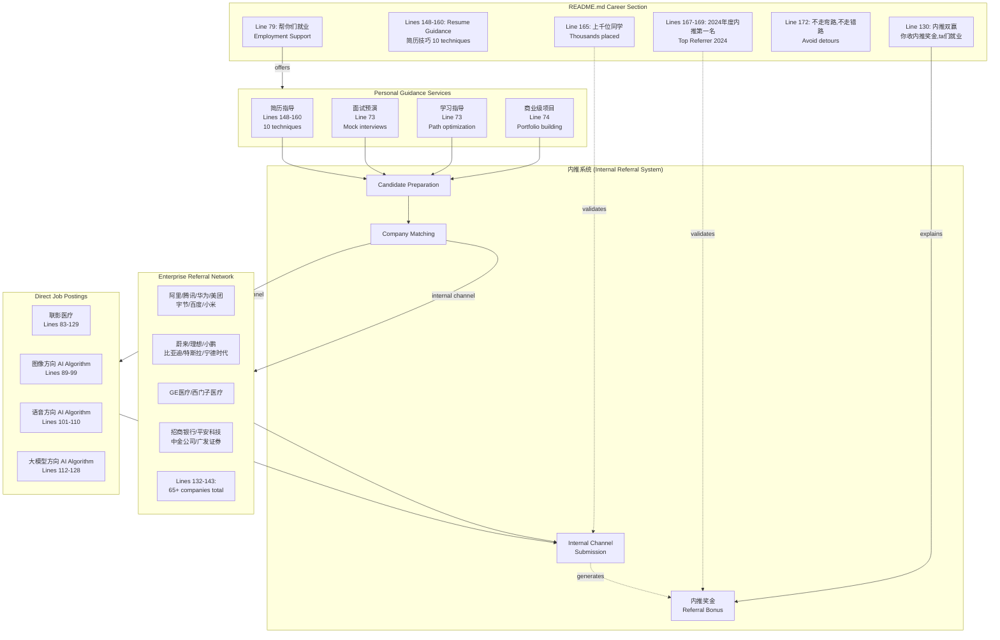
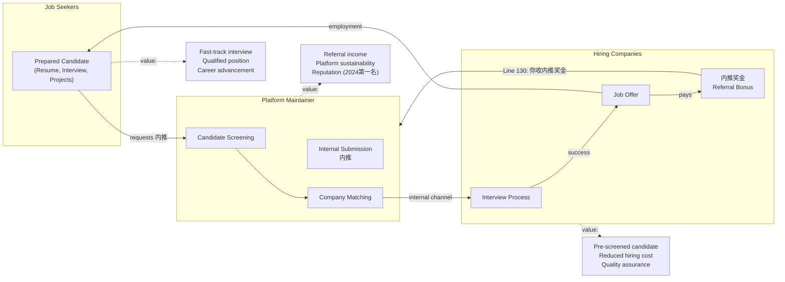
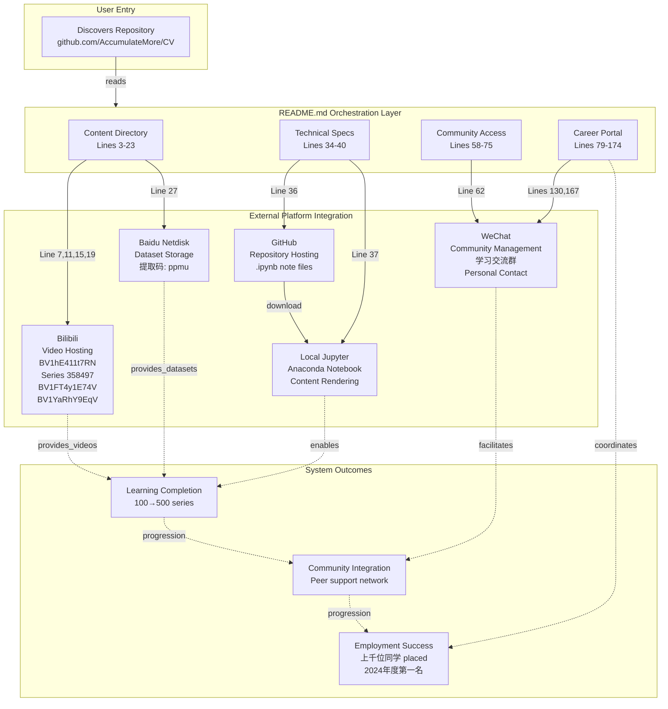
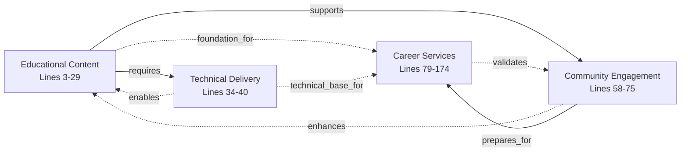

<!-- source: DeepWiki mcp.deepwiki.com · repo AccumulateMore/CV · page 1.1 System Architecture · fetched 2026-10-29 -->

# System Architecture

Relevant source files

The following files were used as context for generating this wiki page:

- [README.md](README.md)

This document describes the architectural design of the deep learning educational platform, focusing on how a single `README.md` file orchestrates four distinct functional pillars (Educational Content, Technical Delivery, Community Engagement, and Career Services) through integration with multiple external platforms. For information about specific external platform dependencies and integration strategies, see [Platform Dependencies](#1.3). For the complete user journey and progression model, see [User Journey and Progression Model](#6.2).

## Overview: Single-File Orchestration Architecture

The CV repository implements a unique architectural pattern where a single documentation file (`README.md`) serves as the complete system orchestrator. Rather than building custom infrastructure, the system coordinates multiple external platforms into a cohesive educational and career development pipeline.

**Architectural Principle**: The entire platform state, content directory, access control, community management, and career services are encoded in the 180-line [README.md:1-180](). This file acts as:

- **Content Directory**: Lines 3-23 map video lectures to note series
- **Access Gateway**: Lines 25-29 provide dataset access credentials
- **Technical Documentation**: Lines 34-40 specify rendering requirements
- **Community Hub**: Lines 58-75 manage group memberships and support channels
- **Career Portal**: Lines 79-143 coordinate job placements and referrals
- **Success Metrics**: Lines 148-174 document outcomes and guidance principles

### Core Architecture Characteristics

| Characteristic | Implementation | Code Reference |
|---------------|----------------|----------------|
| **Single Source of Truth** | All system configuration in one file | [README.md:1-180]() |
| **Zero Custom Infrastructure** | Leverages external platforms only | [README.md:7,11,15,19,27,62]() |
| **Stateless Design** | No backend, database, or application server | N/A - Pure documentation |
| **Multi-Platform Integration** | Coordinates 5+ external services | [README.md:7,27,62]() Bilibili, Baidu, WeChat, GitHub, Jupyter |
| **Progressive Engagement** | Users advance through defined stages | [README.md:3-180]() (entire flow) |

Sources: [README.md:1-180]()

---

## Four-Pillar Architecture

**Diagram: Four-Pillar Architecture with README.md Line Mappings**

Sources: [README.md:1-180]()

---

## Pillar 1: Educational Content System

The Educational Content Pillar organizes learning materials through a structured numbering system that maps video lectures to Jupyter notebook notes and datasets.

### Content Taxonomy and Mapping

**Diagram: Content Mapping System (Video → Notes → Datasets)**

### Content Organization Table

| Note Range | Instructor | Video Platform | Video ID | Dataset Required | Lines in README |
|------------|-----------|----------------|----------|------------------|-----------------|
| 100-122 | 土堆 (Tudui) | Bilibili | BV1hE411t7RN | Yes | [README.md:5-7]() |
| 200-268 | 李沐 (Li Mu) | Bilibili | Series 358497 | Yes | [README.md:9-11]() |
| 300-354 | 吴恩达 (Andrew Ng) | Bilibili | BV1FT4y1E74V | Yes | [README.md:13-15]() |
| 400-409 | 大飞 (Da Fei) | Bilibili | BV1YaRhY9EqV | Yes | [README.md:17-19]() |
| 500-5XX | TBD | Bilibili | Placeholder | TBD | [README.md:21-23]() |

**Key Implementation Details**:
- **Video-Note Correspondence**: Explicitly stated using "对应笔记" (corresponding notes) pattern in [README.md:5,9,13,17]()
- **Dataset Sharing**: Single unified dataset for all series accessed via [README.md:27]() with extraction code "ppmu" on [README.md:27]()
- **Fallback Mechanism**: Dataset link failures handled via WeChat contact as documented in [README.md:29]()
- **Future Extensibility**: Series 500-5XX reserved with placeholder in [README.md:21-23]()

Sources: [README.md:3-29]()

---

## Pillar 2: Technical Delivery System

The Technical Delivery Pillar specifies the exact toolchain required to properly render educational content, addressing known display issues with specific technical solutions.

### Rendering Stack and Known Issues

**Diagram: Technical Delivery Stack and Issue Resolution**

### Technical Requirements Specification

| Component | Status | Reason | Documentation Line |
|-----------|--------|--------|-------------------|
| **GitHub Online Viewing** | ❌ Not Recommended | Images/formulas display incompletely | [README.md:36]() |
| **Local Download** | ✓ Required | Resolves parsing issues | [README.md:36]() |
| **Anaconda Jupyter** | ✓ Required | Proper image rendering | [README.md:37]() |
| **Pycharm Jupyter** | ❌ Prohibited | Images won't display normally | [README.md:37]() |
| **Directory Plugin** | ✓ Recommended | Quick chapter navigation | [README.md:38]() |
| **Python仓库 Reference** | ✓ Available | Setup guides in `00_Python编辑器` | [README.md:37-38]() |

**Display Issue Root Cause**:
The system explicitly identifies that online viewing problems stem from "Github网站没有解析好" (GitHub website parsing failures) as documented in [README.md:36](). The solution architecture mandates local download and specific tooling to bypass GitHub's rendering limitations.

**Setup Guidance Chain**:
1. Primary documentation: [README.md:34-40]()
2. External search fallback: "百度查一下" (search on Baidu) for generic how-to guides
3. Internal repository reference: "我的主页Python仓库" with specific subdirectory `00_Python编辑器` in [README.md:37-38]()
4. Visual reference: Directory plugin screenshot provided in [README.md:40]()

Sources: [README.md:34-40]()

---

## Pillar 3: Community Engagement System

The Community Engagement Pillar implements a tiered support system designed to address "孤单的自学者" (isolated self-learners) through structured group interaction and direct support channels.

### Community Infrastructure and Access Control

**Diagram: Community Access Flow and Support Tiers**

### Support Request Taxonomy

The system explicitly defines valid request types in [README.md:70-74]() using a structured table format:

| Request Category | Specific Service | Additional Context | Line Reference |
|------------------|------------------|--------------------|----------------|
| **Academic** | 论文辅导 | 研0研1免费,半年掌握三年知识 | [README.md:72]() |
| **Learning** | 学习指导 | 不走弯路错路,快速拿到offer | [README.md:73]() |
| **Projects** | 商业级项目 | 简历增添项目,提升核心竞争力 | [README.md:74]() |
| **Community** | 要进学习交流群 | When groups are full | [README.md:72]() |
| **Resources** | 要数据集 | When Baidu link fails | [README.md:72]() |
| **Career Prep** | 面试预演 | 简历拷打问题 | [README.md:73]() |
| **Resume** | 指导改简历 | 从面试官角度出发 | [README.md:74]() |
| **Internship** | 需要实习 | Entry-level positions | [README.md:73]() |

**Access Control Logic**:
1. **Tier 1 (Self-Service)**: QR code scan for groups when capacity < 200 members [README.md:62]()
2. **Tier 2 (Manual Invite)**: Personal WeChat contact when groups are full [README.md:64]()
3. **Request Protocol**: "直接表达你的需求" (directly express your need) upon adding contact [README.md:68]()

**Philosophical Foundation**:
The community design is guided by the principle "看人之短，无一可交之人。看人之长，天下皆是吾师" (Focus on people's strengths, everyone becomes a teacher) documented in [README.md:66](). This philosophy frames the community as a mutual learning environment rather than a traditional support hierarchy.

Sources: [README.md:58-75]()

---

## Pillar 4: Career Services System

The Career Services Pillar implements a comprehensive employment pipeline, from skill development through job placement via internal referrals (内推), with documented success metrics.

### Career Services Architecture

**Diagram: Career Services Pipeline and Internal Referral System**

### Resume Guidance Framework (简历技巧 10%)

The system documents specific resume techniques used during the maintainer's 2021 graduation in [README.md:148-160](). These techniques are presented as "我的简历技巧10%" (my resume techniques at 10% capacity), indicating additional undocumented expertise:

| Technique | Description | Implementation | Line |
|-----------|-------------|----------------|------|
| **1. Skill Mastery Filter** | 只写掌握了XX,没掌握不要写 | Only list truly mastered skills | [README.md:154]() |
| **2. Skill Ordering** | 掌握且更熟练的放前面 | More proficient skills listed first | [README.md:154]() |
| **3. Evidence Provision** | 后面要论证自己真的掌握了 | Provide proof of mastery with experience | [README.md:155]() |
| **4. Role-Centered Focus** | 围绕算法岗展开技能阐述 | Focus on algorithm position requirements | [README.md:156]() |
| **5. Relevance Filtering** | 只写岗位需要的技能 | Exclude irrelevant hardware/organization skills | [README.md:157]() |
| **6. Visual Consistency** | 掌握一种类别技能,只占一行 | One line per skill category for neatness | [README.md:158]() |
| **7. HR Perspective** | 面试官及HR会看着感觉整齐 | Design for 10-second HR scan | [README.md:159-161]() |
| **8. High Volume Context** | 一天要看几百份甚至上千份简历 | Optimize for high-volume screening | [README.md:161]() |
| **9. Decision Timing** | 关键的10秒,HR就决定了 | Critical 10-second decision window | [README.md:163]() |
| **10. Progression Logic** | 编程语言→深度学习框架→算法 | Logical skill progression presentation | [README.md:156]() |

### Internal Referral Economics (内推双赢 Win-Win Model)

The referral system implements a dual-value exchange model documented in [README.md:130]():

**Diagram: Internal Referral Win-Win Economics**

### Enterprise Network Scale

The platform maintains referral relationships with 65+ companies across multiple sectors, documented in [README.md:132-143]():

| Sector | Company Examples | Total Count | Lines |
|--------|-----------------|-------------|-------|
| **Internet & Tech** | 阿里巴巴,腾讯,美团,京东,拼多多,百度,字节跳动,华为 | 8+ | [README.md:134]() |
| **Consumer Electronics** | 小米,OPPO,vivo,联想 | 4+ | [README.md:135]() |
| **AI & Vision** | 商汤科技,旷视科技,海康威视,大华股份,科大讯飞 | 5+ | [README.md:135-136]() |
| **Automotive** | 蔚来汽车,理想汽车,小鹏汽车,比亚迪,特斯拉,宁德时代 | 6+ | [README.md:136,143]() |
| **Telecom** | 中国移动,中国联通,中国电信,中兴通讯 | 4+ | [README.md:136-137]() |
| **Medical** | 联影医疗,GE医疗,西门子医疗 | 3+ | [README.md:83,143]() |
| **Finance** | 招商银行,工商银行,平安科技,中金公司,广发证券 | 5+ | [README.md:140-141]() |
| **Other Sectors** | Various (content, logistics, semiconductor, etc.) | 30+ | [README.md:137-143]() |

### 联影医疗 (uCloudlink Medical) Detailed Specifications

Direct job postings for 联影医疗 are documented in [README.md:83-129]() across three technical directions:

**Image Direction AI Algorithm Engineer** [README.md:89-99]():
- **Key Responsibilities**: Product-level AI algorithm development for 联影 platforms including universal software, advanced post-processing workstation, intelligent uAl platform, and robotic surgical planning
- **Technical Requirements**: Machine vision, 3D reconstruction, SLAM, object detection, pose estimation, medical image processing algorithms (segmentation, detection, classification, registration, deep learning, fluid dynamics)

**Voice Direction AI Algorithm Engineer** [README.md:101-110]():
- **Key Responsibilities**: Audio signal processing (echo cancellation, microphone arrays, blind source separation), deep learning for audio
- **Technical Requirements**: Digital signal processing, Matlab, C/C++, speech/audio processing experience, ASR/TTS research

**Large Model Direction AI Algorithm Engineer** [README.md:112-128]():
- **Key Responsibilities**: LLM algorithm development and optimization, medical domain applications, training process optimization, large-scale medical text dataset construction, model evaluation
- **Academic Requirements**: Publications in top-tier conferences (ICML, NeurIPS, ICLR, CVPR, ICCV, ECCV, ACL, EMNLP, MICCAI) or journals (IEEE T-PAMI, IEEE TMI, Medical Image Analysis)
- **Degree Requirements**: Master's or above in AI-related fields

**Geographic Flexibility**: [README.md:83]() lists 9 location options: 上海,北京,深圳,武汉,广州,成都,西安,沈阳,三亚

### Success Metrics and Validation

The career services system documents measurable outcomes:

| Metric | Value | Evidence Location | Interpretation |
|--------|-------|-------------------|----------------|
| **Total Placements** | 上千位同学 (Thousands of students) | [README.md:165]() | Validated track record |
| **Referral Ranking** | 2024年度内推第一名 | [README.md:167-169]() | Top internal referrer in 2024 |
| **Success Images** | 3 celebration screenshots | [README.md:167-169]() | Visual validation of outcomes |
| **Philosophy** | 不走弯路,不走错路 | [README.md:172]() | Core value proposition |

Sources: [README.md:79-174]()

---

## System Integration Model

The following diagram shows how data and control flow between the four pillars through the README.md orchestration layer:

**Diagram: System Integration and Data Flow Across Pillars**

### Integration Patterns

| Integration Type | Mechanism | Code Reference | Purpose |
|------------------|-----------|----------------|---------|
| **Content Linking** | Direct URL embedding | [README.md:7,11,15,19,27]() | Connect to external content |
| **Access Control** | QR code images + capacity logic | [README.md:62,64]() | Manage community membership |
| **Fallback Routing** | Alternative contact methods | [README.md:29,64]() | Ensure service continuity |
| **State Management** | Documentation-based configuration | [README.md:1-180]() | Maintain system state |
| **Quality Control** | Explicit tool specifications | [README.md:37-38]() | Ensure proper rendering |

### Cross-Pillar Dependencies

**Diagram: Inter-Pillar Dependencies**

Sources: [README.md:1-180]()

---

## Platform Orchestration Layer

The README.md file implements a sophisticated orchestration pattern through strategic information architecture:

### Information Architecture Strategy

| Section | Line Range | Function | Control Mechanism |
|---------|------------|----------|-------------------|
| **Title & Introduction** | [README.md:1-2]() | System identity and scope | Establishes platform purpose |
| **Content Mappings** | [README.md:3-29]() | Educational content directory | URL-based external references |
| **Technical Requirements** | [README.md:34-40]() | Quality assurance specifications | Tool-specific mandates |
| **Community Infrastructure** | [README.md:58-75]() | Social access control | QR codes + capacity logic |
| **Career Services** | [README.md:79-143]() | Employment coordination | Request taxonomy + referral network |
| **Success Evidence** | [README.md:148-174]() | Outcome validation | Metrics + screenshots + philosophy |
| **Motivation Appeal** | [README.md:51-54]() | User engagement | "Star是我更新的动力" |

### State Management Through Documentation

Unlike traditional systems with databases or configuration files, this architecture stores all system state in human-readable documentation:

**State Categories**:
1. **Content State**: Video-to-note mappings [README.md:5-21]()
2. **Access State**: QR codes for group access [README.md:60-62]()
3. **Capacity State**: Group limits documentation [README.md:64]()
4. **Credential State**: Dataset extraction code "ppmu" [README.md:27]()
5. **Network State**: Company referral list [README.md:132-143]()
6. **Metrics State**: Success indicators [README.md:165-169]()

**State Update Mechanism**: Changes require direct README.md editing and git commit, ensuring version control and transparency.

### Orchestration Benefits

| Benefit | Implementation | Trade-off |
|---------|----------------|-----------|
| **Transparency** | All configuration visible in one file | Manual updates required |
| **Version Control** | Git-tracked state changes | No real-time dynamic updates |
| **Zero Infrastructure** | No servers, databases, or maintenance | Limited scalability |
| **Resilience** | No single point of technical failure | Platform dependency (GitHub, Bilibili, etc.) |
| **Accessibility** | Human-readable configuration | Requires README parsing for automation |

Sources: [README.md:1-180]()

---

## Summary

The CV repository implements a unique four-pillar architecture orchestrated through a single `README.md` file, coordinating Educational Content (lines 3-29), Technical Delivery (lines 34-40), Community Engagement (lines 58-75), and Career Services (lines 79-174). This stateless, documentation-driven approach leverages external platforms (Bilibili, GitHub, Baidu Netdisk, WeChat, Jupyter) to create a complete learning-to-employment pipeline that has successfully placed thousands of students (上千位同学) with the maintainer achieving 2024年度内推第一名 (top internal referrer 2024).

**Key Architectural Principles**:
- Single-file orchestration with zero custom infrastructure
- Multi-platform integration via URL references and QR codes
- Progressive user engagement from learning through employment
- Documentation-as-state for transparency and version control
- Fallback mechanisms at multiple levels for resilience

For technical setup details, see [Jupyter Environment Setup](#3.2). For the complete user journey, see [User Journey and Progression Model](#6.2). For success metrics and outcomes, see [Success Metrics](#6.1).

Sources: [README.md:1-180]()

---

