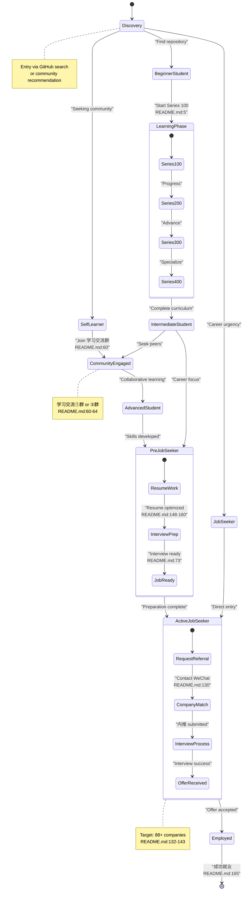
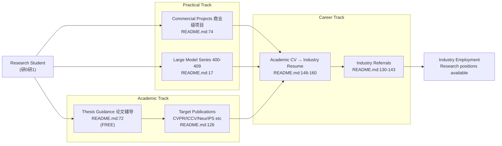

<!-- source: DeepWiki mcp.deepwiki.com · repo AccumulateMore/CV · page 1.2 Target Audience and Use Cases · fetched 2026-10-29 -->

# Target Audience and Use Cases

Relevant source files

The following files were used as context for generating this wiki page:

- [README.md](README.md)

## Purpose and Scope

This document defines the target audience segments for the CV repository platform and catalogs their primary use cases. It explains who uses the platform, why they use it, and how different user types progress through the system from initial discovery to successful employment. 

For information about the overall system architecture that supports these users, see [System Architecture](#1.1). For details on how users access career services, see [Career Services and Job Placement](#5). For community engagement mechanisms, see [Community and Support System](#4).

---

## Primary User Segments

The platform serves four distinct but overlapping user segments, each with specific needs and progression paths through the system.

### Deep Learning Students (深度学习学习者)

**Characteristics:**
- Currently studying or planning to study deep learning
- Range from complete beginners (初学者) to advanced practitioners
- Need structured learning paths and comprehensive materials
- Often studying courses from Pytorch basics through large model development

**Entry Points:**
- Discovery through GitHub search for deep learning notes
- Reference to the platform via [README.md:1]() title and description
- Access to video lectures via Bilibili links [README.md:5-19]()

**Primary Needs:**
- Sequential curriculum following the 100→500 series progression
- Video lectures paired with detailed Jupyter notebook notes
- Practice datasets for hands-on learning [README.md:25-29]()
- Clarification on technical setup issues [README.md:34-40]()

Sources: [README.md:1-54]()

### Self-Learners (孤单的自学者)

**Characteristics:**
- Learning independently without institutional support
- Experience isolation during the learning process ("孤单的自学者")
- Need peer interaction and community support
- Benefit from guidance to avoid common mistakes

**Platform Value Proposition:**
- "搭建交流群，帮助孤单的自学者交流" [README.md:58]()
- Access to learning exchange groups (学习交流①群 and ②群) [README.md:60-64]()
- Philosophy: "看人之长，天下皆是吾师" [README.md:66]()

**Primary Needs:**
- Community connection to overcome isolation
- Peer Q&A and knowledge sharing
- Direction on learning paths to avoid detours ("不走弯路错路") [README.md:73]()
- Access to experienced mentorship

Sources: [README.md:58-75]()

### Job Seekers (求职者)

**Characteristics:**
- Have completed or are completing deep learning education
- Actively seeking employment in AI/ML roles
- Need resume optimization and interview preparation
- Target positions at major tech companies and specialized AI firms

**Career Preparation Needs:**
Defined in [README.md:70-74](), job seekers require:

| Service Type | Description | README Location |
|-------------|-------------|-----------------|
| Resume Guidance (简历指导) | Resume review and optimization | [README.md:74]() |
| Interview Rehearsal (面试预演) | Mock interviews and preparation | [README.md:73]() |
| Learning Direction (学习指导) | Skill gap analysis and study plans | [README.md:73]() |
| Internal Referrals (内推) | Job referrals to partner companies | [README.md:130-143]() |
| Internships (实习) | Internship placement support | [README.md:73]() |

**Target Positions:**
The platform specifically addresses three AI algorithm engineer directions at companies like 联影医疗:
- Image Direction AI Algorithm Engineer [README.md:89-100]()
- Voice Direction AI Algorithm Engineer [README.md:101-111]()
- Large Model Direction AI Algorithm Engineer [README.md:112-129]()

Sources: [README.md:70-144]()

### Research Students (研究生)

**Characteristics:**
- Graduate students in first or second year (研0研1)
- Working on research projects and publications
- Need specialized guidance for academic and industry transitions
- Often seeking both publication support and career preparation

**Specialized Needs:**
- Thesis guidance (论文辅导) - free for 研0研1 [README.md:72]()
- Commercial-grade project experience (商业级项目) [README.md:74]()
- Research publication support for top-tier conferences
- Accelerated learning: "半年掌握三年知识" [README.md:72]()

**Academic Target Venues:**
Per [README.md:126](), students target publications at:
- Machine Learning: ICML, NeurIPS, ICLR
- Computer Vision: CVPR, ICCV, ECCV
- Natural Language Processing: ACL, EMNLP
- Medical Imaging: MICCAI, IPMI
- Top journals: IEEE T-PAMI, IEEE TMI, Medical Image Analysis

Sources: [README.md:72](), [README.md:122-128]()

---

## User Segment Mapping to Platform Resources

```mermaid
graph TB
    subgraph Users["User Segments"]
        Students["Deep Learning Students<br/>(初学者 to advanced)"]
        SelfLearners["Self-Learners<br/>(孤单的自学者)"]
        JobSeekers["Job Seekers<br/>(求职者)"]
        ResearchStudents["Research Students<br/>(研0研1)"]
    end
    
    subgraph Content["Educational Content Resources"]
        Series100["100-122: Pytorch Basics<br/>README.md:5"]
        Series200["200-268: Li Mu Deep Learning<br/>README.md:9"]
        Series300["300-354: Andrew Ng Deep Learning<br/>README.md:13"]
        Series400["400-409: Large Model Agent<br/>README.md:17"]
        Datasets["Datasets Baidu Netdisk<br/>README.md:27"]
    end
    
    subgraph Community["Community Resources"]
        Group1["学习交流①群<br/>README.md:60"]
        Group2["学习交流②群<br/>README.md:60"]
        WeChat["WeChat Contact<br/>README.md:62"]
    end
    
    subgraph Career["Career Services"]
        Resume["Resume Guidance 简历指导<br/>README.md:148-160"]
        Interview["Interview Rehearsal 面试预演<br/>README.md:73"]
        Referral["Internal Referrals 内推<br/>README.md:130-143"]
        Projects["Commercial Projects<br/>README.md:74"]
    end
    
    Students -->|"primary use"| Series100
    Students -->|"progression"| Series200
    Students -->|"progression"| Series300
    Students -->|"advanced"| Series400
    Students -->|"practice"| Datasets
    
    SelfLearners -->|"overcome isolation"| Group1
    SelfLearners -->|"overflow"| Group2
    SelfLearners -->|"direct support"| WeChat
    SelfLearners -->|"guided learning"| Series100
    
    JobSeekers -->|"preparation"| Resume
    JobSeekers -->|"preparation"| Interview
    JobSeekers -->|"placement"| Referral
    JobSeekers -->|"skill building"| Projects
    
    ResearchStudents -->|"academic"| Projects
    ResearchStudents -->|"transition"| Resume
    ResearchStudents -->|"publications"| WeChat
    ResearchStudents -->|"advanced topics"| Series400
    
    Students -.evolves to.-> SelfLearners
    SelfLearners -.progresses to.-> JobSeekers
    ResearchStudents -.transitions to.-> JobSeekers
```

Sources: [README.md:1-180]()

---

## Core Use Cases by User Journey Stage

### Discovery Stage Use Cases

**UC-1: Finding Learning Resources**
- **Actor:** Deep Learning Student (beginner)
- **Goal:** Locate comprehensive deep learning notes and video lectures
- **Entry Point:** GitHub repository discovery via search or recommendation
- **Primary Interaction:** View [README.md:1]() title, scan curriculum structure [README.md:5-21]()
- **Success Criteria:** Understanding available course series and instructors

**UC-2: Evaluating Platform Credibility**
- **Actor:** Prospective User (any segment)
- **Goal:** Assess platform quality and success rate
- **Evidence Points:** 
  - "上千位同学" successfully placed [README.md:165]()
  - "2024年度内推第一名" achievement [README.md:167]()
  - Maintainer's 2021 resume example [README.md:148-160]()
- **Success Criteria:** Decision to engage with platform

Sources: [README.md:1-21](), [README.md:148-170]()

### Learning Stage Use Cases

**UC-3: Sequential Course Progression**
- **Actor:** Deep Learning Student
- **Workflow:**
  1. Start with Pytorch basics [README.md:5-7]()
  2. Watch corresponding Bilibili video (BV1hE411t7RN)
  3. Download notes 100-122 from repository
  4. Access datasets via Baidu Netdisk [README.md:27]()
  5. Progress to Li Mu series [README.md:9-11]() (notes 200-268)
  6. Continue through Andrew Ng [README.md:13-15]() and Da Fei [README.md:17-19]()
- **Prerequisites:** Anaconda Jupyter Notebook setup [README.md:37-38]()
- **Common Issues:** Online display problems requiring local download [README.md:36]()

**UC-4: Resolving Technical Setup Issues**
- **Actor:** Any User
- **Common Problems:**
  - Images/formulas not displaying online [README.md:36]()
  - Pycharm Jupyter incompatibility [README.md:37]()
  - Missing directory navigation plugin [README.md:38-40]()
- **Resolution Path:** 
  - Reference Python仓库 for setup guides [README.md:37-38]()
  - Contact via WeChat for dataset link issues [README.md:29]()

Sources: [README.md:5-40]()

### Community Integration Use Cases

**UC-5: Joining Learning Exchange Groups**
- **Actor:** Self-Learner
- **Motivation:** "帮助孤单的自学者交流" [README.md:58]()
- **Process:**
  1. Scan QR code for 学习交流①群 [README.md:60-62]()
  2. If group full (>200 members), scan 学习交流②群
  3. If both full, add personal WeChat [README.md:64]()
  4. Explicit statement of need when adding [README.md:68-74]()
- **Group Activities:** Peer Q&A, knowledge sharing, problem-solving

**UC-6: Requesting Direct Support**
- **Actor:** Any User
- **Valid Request Types** [README.md:70-74]():

| Request Type | Chinese Term | Target User |
|-------------|--------------|-------------|
| Join learning groups | 要进学习交流群 | Self-learners |
| Dataset access | 要数据集 | Students |
| Thesis guidance | 论文辅导 | 研0研1 (free) |
| Learning direction | 学习指导 | Job seekers |
| Resume review | 指导改简历 | Job seekers |
| Interview practice | 面试预演 | Job seekers |
| Commercial projects | 商业级项目 | All segments |
| Internship needs | 需要实习 | Students/Job seekers |

- **Contact Method:** WeChat with clear need statement [README.md:68-69]()
- **Philosophy:** "看人之长，天下皆是吾师" [README.md:66]()

Sources: [README.md:58-75]()

### Career Preparation Use Cases

**UC-7: Resume Optimization**
- **Actor:** Job Seeker
- **Service:** 简历指导 - Resume review from interviewer perspective [README.md:74]()
- **Methodology:** Based on maintainer's 2021 techniques [README.md:148-160]()
- **Key Principles:**
  1. Only list mastered skills, no unmastered content [README.md:154]()
  2. Provide evidence for each claimed skill [README.md:155]()
  3. Focus on job-relevant skills [README.md:156-157]()
  4. Maintain consistent formatting (one line per skill) [README.md:158]()
  5. Optimize for 10-second HR scan time [README.md:161-163]()
- **Success Metric:** Higher callback rate for interviews

**UC-8: Interview Preparation**
- **Actor:** Job Seeker
- **Service:** 面试预演 - Mock interviews [README.md:73]()
- **Process:** "简历拷打问题" - Resume-based interrogation practice
- **Goal:** Prepare for technical and behavioral questions
- **Outcome:** Job-ready status

**UC-9: Internal Referral Request**
- **Actor:** Qualified Job Seeker
- **Service:** 内推 (Internal referral) [README.md:130]()
- **Target Companies:** 88+ enterprise partners [README.md:132-143]()
- **Major Categories:**
  - Tech Giants: 阿里巴巴, 腾讯, 字节跳动, 华为, 百度
  - E-commerce: 京东, 拼多多, 美团
  - Automotive: 蔚来, 理想, 小鹏, 比亚迪
  - AI Companies: 商汤, 旷视, 智谱, 寒武纪
  - Medical: GE医疗, 西门子医疗, 联影医疗
  - Finance: 招商银行, 平安科技, 中金公司
  - Telecom: 中国移动, 中国联通, 华为
- **Win-Win Model:** "你收公司内推奖金、ta们就业，双赢" [README.md:130]()
- **Success Rate:** "上千位同学" placed, "2024年度内推第一名" [README.md:165-167]()

Sources: [README.md:70-143](), [README.md:148-170]()

---

## User Progression Flow Diagram

Sources: [README.md:1-180]()

---

## Specialized Use Case: Research Student to Industry Transition

**UC-10: Graduate Student Career Acceleration**
- **Actor:** Research Student (研0研1)
- **Unique Value:** "半年掌握三年知识" [README.md:72]()
- **Multi-Track Support:**

**Research-Relevant Job Postings:**
Large Model Direction at 联影医疗 [README.md:112-129]() specifically requires:
- Publication record at top venues (ICML, NeurIPS, CVPR, MICCAI, etc.) [README.md:126]()
- Master's degree or above in AI-related fields [README.md:127]()
- Experience with pre-trained large language models or GPT [README.md:125]()

Sources: [README.md:72](), [README.md:112-129]()

---

## Use Case Statistics and Success Metrics

**Platform Impact:**
- **Scale:** "上千位同学" (thousands of students) successfully placed [README.md:165]()
- **Achievement:** "2024年度内推第一名" (2024 top internal referral provider) [README.md:167]()
- **Success Proof:** Three success case screenshots [README.md:169]() with caption "一起沾沾喜气，好运是可以传染的"

**Key Success Factor:**
Per [README.md:172](): "拿offer最快的方式，就是不走弯路，不走错路。方向错了，努力没有意义。"
- Translation: The fastest way to get offers is to avoid detours and wrong paths. Wrong direction makes effort meaningless.

**Platform Philosophy:**
[README.md:179](): "我们读书是为了成为提灯人去照亮黑暗，而不是为了自己有灯而沾沾自喜还要去吹灭别人的蜡烛"
- Translation: We study to become lamp bearers illuminating darkness, not to be smug about having our own lamp and blow out others' candles.

Sources: [README.md:165-180]()

---

## Entry Point Analysis

Different user segments discover and enter the platform through distinct channels:

| Entry Method | Target Segment | First Interaction | README Reference |
|-------------|----------------|-------------------|------------------|
| GitHub Search | Deep Learning Students | Repository title and description | [README.md:1]() |
| Course Recommendation | Students (structured learners) | Bilibili video links | [README.md:5-19]() |
| Job Board Referral | Job Seekers | Career services section | [README.md:79-143]() |
| Peer Recommendation | Self-Learners | Community groups description | [README.md:58-66]() |
| Academic Network | Research Students | Thesis guidance offer | [README.md:72]() |

**Critical First Impression:**
The repository title [README.md:1]() immediately signals scope:
- "最全面的" (most comprehensive)
- Coverage: CV, NLP, 大模型, Agent
- Format: 笔记 (notes)

This positioning attracts serious learners seeking complete resources rather than fragmentary tutorials.

Sources: [README.md:1-180]()

---

## Anti-Use Cases and Platform Boundaries

**Explicitly Supported:**
- Free thesis guidance for 研0研1 [README.md:72]()
- Dataset access support [README.md:29]()
- Learning group membership [README.md:60-64]()
- Resume and interview guidance [README.md:73-74]()
- Internal job referrals [README.md:130]()

**Implicitly Limited:**
- Commercial projects: not free, positioned as portfolio builders [README.md:74]()
- Advanced guidance: may have costs beyond basic support
- Job referrals: require baseline qualification (completed learning, prepared resume)

**Technical Prerequisites:**
- Users must handle local setup: Anaconda Jupyter Notebook [README.md:37-38]()
- No online-only experience: "图片不完整" issue requires local download [README.md:36]()
- Self-service for most technical issues: reference Python仓库 [README.md:37-38]()

**Contact Expectations:**
Per [README.md:68-69](): "因为好友申请太多了,添加好友后,直接表达你的需求"
- Translation: Because there are too many friend requests, directly state your need after adding.
- Platform operates at scale; efficiency required in communication

Sources: [README.md:29](), [README.md:36-38](), [README.md:68-74]()

---

