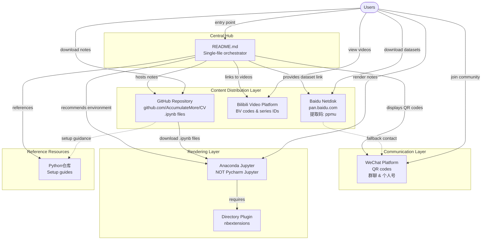
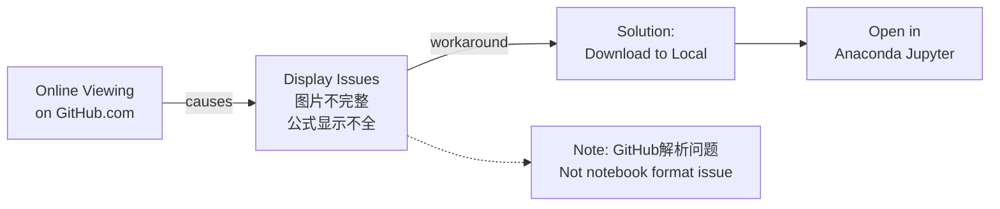
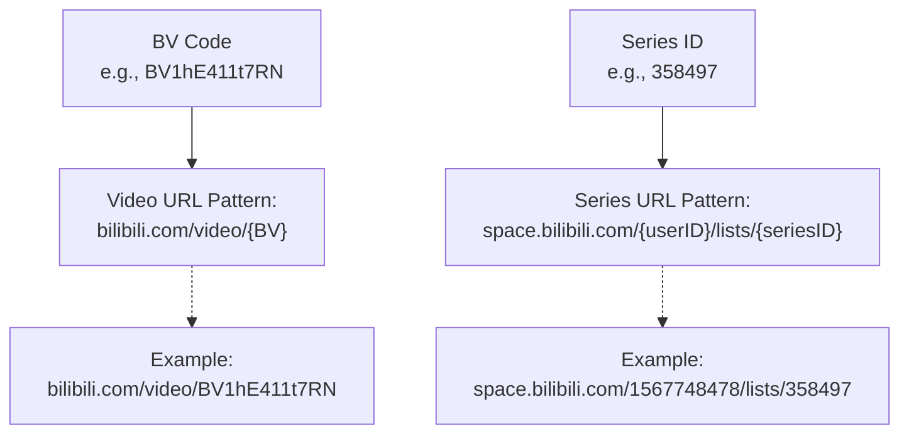
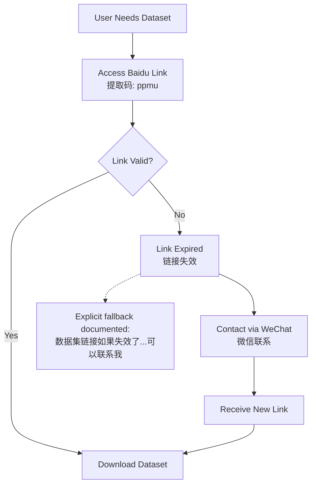
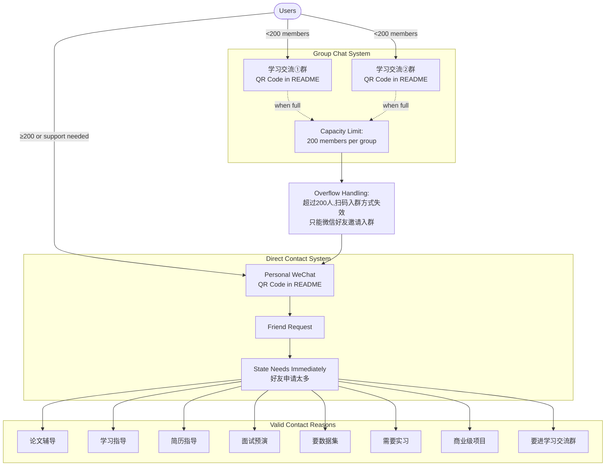
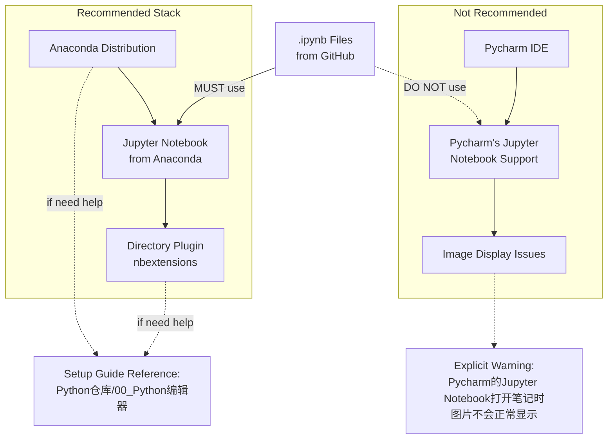
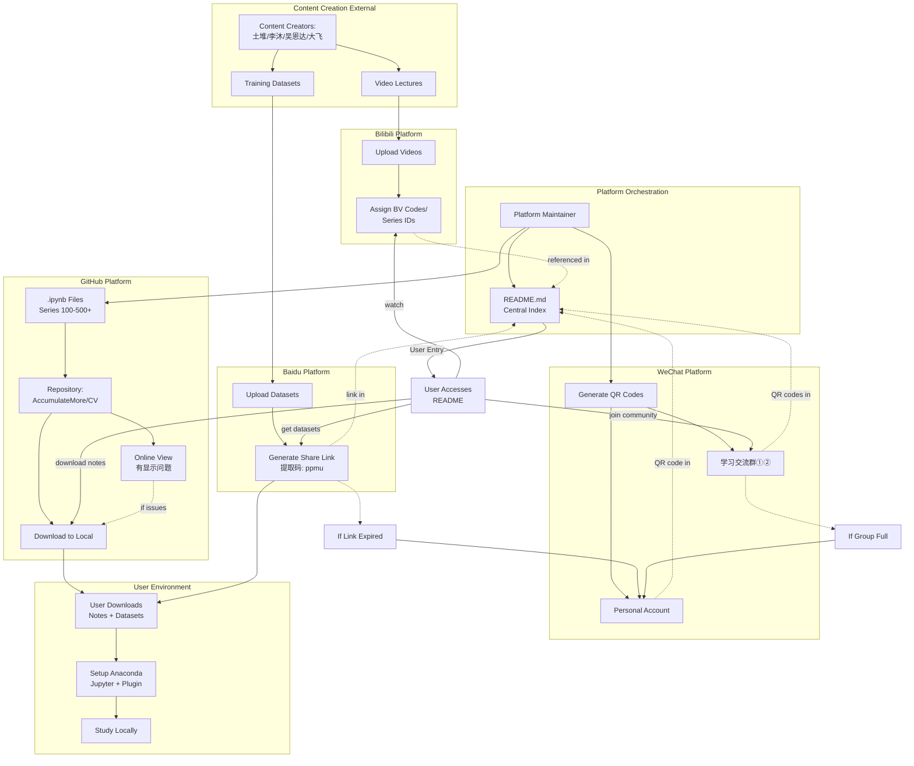
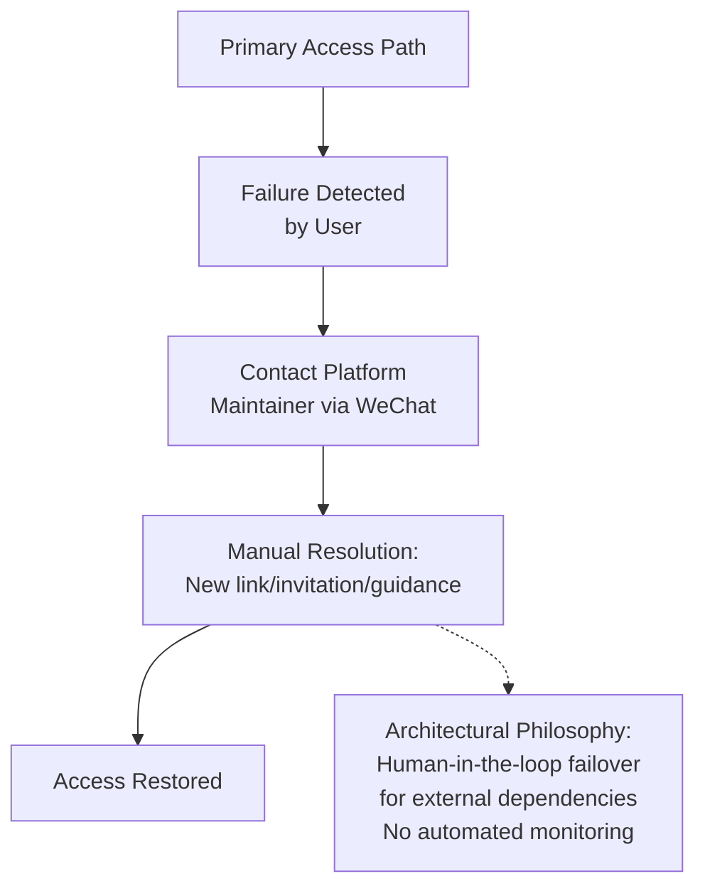

<!-- source: DeepWiki mcp.deepwiki.com · repo AccumulateMore/CV · page 1.3 Platform Dependencies · fetched 2026-10-29 -->

# Platform Dependencies

Relevant source files

The following files were used as context for generating this wiki page:

- [README.md](README.md)

## Purpose and Scope

This document details the external platform dependencies that the CV deep learning notes system relies upon for content delivery, community management, and career services. The system follows a **multi-platform integration architecture** where a single `README.md` file orchestrates multiple external services rather than building custom infrastructure. 

This page focuses on the technical integration requirements and constraints of each platform. For information about the educational content structure itself, see [Curriculum Structure and Course Series](#2.1). For community usage patterns, see [Community and Support System](#4).

---

## Dependency Architecture Overview

**Sources**: [README.md:1-180]()

---

## Core Platform Dependencies

### GitHub Repository

**Platform**: GitHub (github.com)  
**Repository**: `AccumulateMore/CV`  
**Primary Function**: Source code hosting and note distribution

#### Integration Points

| Integration Aspect | Implementation Detail | File Reference |
|-------------------|----------------------|----------------|
| Repository URL | `https://github.com/AccumulateMore/CV` | [README.md:49]() |
| Content Format | Jupyter Notebook `.ipynb` files (100-500+ series) | Implicit from context |
| Distribution Method | Manual download (not Git clone workflow) | [README.md:36]() |
| Display Limitation | Online viewing has image/formula rendering issues | [README.md:36]() |
| Related Repositories | User homepage contains Python仓库 for setup guides | [README.md:37-38](), [README.md:47-49]() |

#### Known Technical Issues

The README explicitly warns users: "在线观看笔记时，有时会出现图片（或公式）显示不完整，这是Github网站没有解析好，笔记下载到本地观看就正常了" [README.md:36](). This indicates a fundamental constraint in the architecture: GitHub's online notebook rendering cannot be relied upon for complete content display.

**Sources**: [README.md:36](), [README.md:47-49]()

---

### Bilibili Video Platform

**Platform**: Bilibili (bilibili.com)  
**Primary Function**: Video lecture hosting and streaming

#### Video Identifier Mapping

The system uses two types of Bilibili identifiers: **BV codes** (individual videos) and **series IDs** (playlists).

| Lecturer | Series Range | Bilibili Identifier | Type | File Reference |
|----------|-------------|---------------------|------|----------------|
| 土堆 (Tudui) | 100-122 (Pytorch) | `BV1hE411t7RN` | BV Code | [README.md:5-7]() |
| 李沐 (Li Mu) | 200-268 (Deep Learning) | Series `358497` | Series ID | [README.md:9-11]() |
| 吴恩达 (Andrew Ng) | 300-354 (Deep Learning) | `BV1FT4y1E74V` | BV Code | [README.md:13-15]() |
| 大飞 (Da Fei) | 400-409 (Large Model Agent) | `BV1YaRhY9EqV` | BV Code | [README.md:17-19]() |
| TBD | 500-5XX (Future) | Placeholder | N/A | [README.md:21-23]() |

#### URL Construction

**Notes on Integration**:
- Bilibili content is **read-only** from this system's perspective
- No programmatic API integration; users manually navigate to URLs
- Videos are created by external content creators (土堆, 李沐, 吴恩达, 大飞)
- The README acts as an index, mapping note series to corresponding video series

**Sources**: [README.md:5-23]()

---

### Baidu Netdisk Storage

**Platform**: Baidu Pan (pan.baidu.com / 百度网盘)  
**Primary Function**: Large dataset file storage and distribution

#### Access Configuration

| Parameter | Value | File Reference |
|-----------|-------|----------------|
| Share Link | `https://pan.baidu.com/s/1KTW2WsTy6TFpNdK_WwjBmg` | [README.md:27]() |
| Extraction Code | `ppmu` | [README.md:27]() |
| Content | Datasets for 土堆, 李沐, 吴恩达, 大飞 courses | [README.md:25]() |
| Backup Access Method | WeChat contact | [README.md:29]() |

#### Fallback Mechanism

The system anticipates link failures with explicit fallback documentation: "数据集链接如果失效了，下面有微信，可以联系我" [README.md:29](). This is a critical architectural pattern: **manual failover through direct human contact** rather than automated redundancy.

**Sources**: [README.md:25-29]()

---

### WeChat Social Infrastructure

**Platform**: WeChat (微信)  
**Primary Functions**: Community management, direct support, career services coordination

#### Integration Modalities

#### Contact Protocol

The README specifies an explicit protocol due to high volume: "因为好友申请太多了，添加好友后，直接表达你的需求" [README.md:68](). Valid needs are documented in a table [README.md:70-74]():

- 论文辅导 (Thesis guidance)
- 学习指导 (Learning guidance)  
- 简历指导 (Resume guidance)
- 面试预演 (Interview rehearsal)
- 要数据集 (Request datasets)
- 需要实习 (Internship needs)
- 商业级项目 (Commercial projects)
- 要进学习交流群 (Join learning groups)

**Technical Constraint**: WeChat groups have a hard capacity limit of 200 members [README.md:64](). When this limit is reached, QR code scanning becomes invalid, and users must add the personal WeChat account for manual group invitation. This creates a **two-tier access pattern**: automated (QR codes) vs. manual (personal invitations).

**Sources**: [README.md:58-74]()

---

### Anaconda Jupyter Environment

**Platform**: Anaconda Jupyter Notebook  
**Primary Function**: Local notebook rendering and interaction

#### Environment Requirements

#### Technical Specifications

| Component | Requirement | Rationale | File Reference |
|-----------|-------------|-----------|----------------|
| **Editor** | Anaconda Jupyter Notebook | Correct image rendering | [README.md:37]() |
| **Not Supported** | Pycharm Jupyter Notebook | Images don't display properly | [README.md:37]() |
| **Extension** | Directory Plugin | Quick navigation via table of contents | [README.md:38]() |
| **Setup Guide** | Python仓库 → 00_Python编辑器 | Installation instructions | [README.md:37-38]() |

#### Plugin Installation

The README references a directory plugin that enables table-of-contents navigation in Jupyter notebooks [README.md:38-40](). The plugin creates a sidebar for quick chapter jumping:

![Example plugin interface shown in README]

Installation instructions are located in an external repository reference: "我的主页Python仓库里面'00_Python编辑器'里面有相关链接" [README.md:38]().

**Critical Architectural Decision**: The choice of Anaconda Jupyter over Pycharm Jupyter is **mandatory**, not optional. This is because notebook files contain embedded images that only render correctly in Anaconda's implementation. This is documented explicitly: "Pycharm的Jupyter Notebook打开笔记时，图片不会正常显示，笔记是用Anaconda的Jupyter Notebook打开的" [README.md:37]().

**Sources**: [README.md:34-40]()

---

## Integration Data Flow

The following diagram maps the complete data flow across all platform dependencies, showing how content moves from creation to consumption:

**Sources**: [README.md:1-180]()

---

## Dependency Management and Failure Handling

### Known Failure Modes and Mitigations

| Dependency | Failure Mode | Detection | Mitigation | File Reference |
|------------|--------------|-----------|------------|----------------|
| **GitHub** | Online rendering fails (images/formulas) | User reports display issues | Download locally, use Anaconda | [README.md:36]() |
| **Bilibili** | Video unavailable | Link access fails | No documented fallback (external platform) | N/A |
| **Baidu Netdisk** | Share link expires | User cannot access extraction code | Contact via WeChat for new link | [README.md:29]() |
| **WeChat Groups** | Group reaches 200 capacity | QR code scan fails | Add personal WeChat for manual invitation | [README.md:64]() |
| **Jupyter (Pycharm)** | Images don't render | Visual inspection | Switch to Anaconda Jupyter | [README.md:37]() |

### Resilience Architecture Pattern

The system employs a **manual failover pattern** rather than automated redundancy:

This approach is consistent with the platform's philosophy of personalized support ("看人之长，天下皆是吾师" [README.md:66]()) and the maintainer's role as a "提灯人" (lamp bearer) [README.md:179]() who actively guides users through obstacles.

**Sources**: [README.md:29](), [README.md:36](), [README.md:64](), [README.md:66](), [README.md:179]()

---

## Technical Requirements Matrix

### By User Activity

| Activity | Required Dependencies | Optional Dependencies | Configuration Notes |
|----------|----------------------|----------------------|---------------------|
| **View Course Index** | GitHub (README.md) | None | Browser sufficient |
| **Watch Video Lectures** | Bilibili | WeChat (if link issues) | External playback |
| **Read Notes Online** | GitHub | None | May have display issues [README.md:36]() |
| **Study Notes Locally** | GitHub, Anaconda Jupyter | Directory Plugin | **Recommended path** [README.md:37]() |
| **Access Datasets** | Baidu Netdisk | WeChat (if link expired) | Extraction code: ppmu |
| **Join Community** | WeChat | None | Two groups available [README.md:60-63]() |
| **Get Career Support** | WeChat | None | Direct contact [README.md:68-74]() |

### By Platform Role

| Platform | Read/Write | Authentication Required | Capacity Constraints | Critical to System |
|----------|-----------|-------------------------|---------------------|-------------------|
| **GitHub** | Read-only | No (public repo) | None | Yes (content hosting) |
| **Bilibili** | Read-only | No (public videos) | None | Yes (video content) |
| **Baidu Netdisk** | Read-only | Baidu account | Link expiration | Yes (dataset access) |
| **WeChat** | Read/Write | WeChat account | 200/group limit | Yes (support/career) |
| **Anaconda Jupyter** | Local install | No | Local disk space | Yes (proper rendering) |

**Sources**: [README.md:1-180]()

---

## Platform-Specific Constraints

### Chinese Internet Ecosystem Dependencies

All external platforms are **Chinese internet services**, which has architectural implications:

1. **Geographic Accessibility**: Bilibili, Baidu, WeChat are optimized for Chinese mainland access
2. **Language**: All platform interfaces are in Chinese (Simplified)
3. **Account Systems**: Require Chinese phone numbers or alternative verification methods
4. **Regulatory Compliance**: Platforms subject to Chinese internet regulations

### No Self-Hosted Infrastructure

The system makes a deliberate architectural choice to **avoid self-hosted infrastructure**:

- No custom video hosting (uses Bilibili)
- No custom file hosting (uses Baidu + GitHub)
- No custom forum software (uses WeChat)
- No custom authentication (relies on platform accounts)

This "platform aggregation" architecture minimizes maintenance burden for the single maintainer but creates **hard dependencies** on external service availability and policies.

**Sources**: [README.md:1-180]()

---

## Integration with System Components

### Upstream Dependencies

The following system components rely on these platform dependencies:

- **Educational Content System** [see #2]: Requires GitHub (notes), Bilibili (videos), Baidu (datasets)
- **Technical Setup** [see #3]: Requires Anaconda Jupyter, GitHub download capability
- **Community System** [see #4]: Requires WeChat platform availability
- **Career Services** [see #5]: Requires WeChat for communication and coordination

### Reference Documentation

For detailed setup procedures, users are directed to:
- **Python仓库**: Additional repository at maintainer's GitHub homepage containing `00_Python编辑器` directory with Anaconda setup and plugin installation guides [README.md:37-38]()

**Sources**: [README.md:37-38](), [README.md:47-49]()

---

