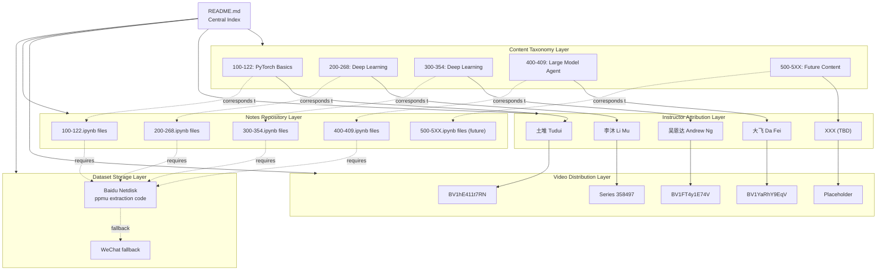
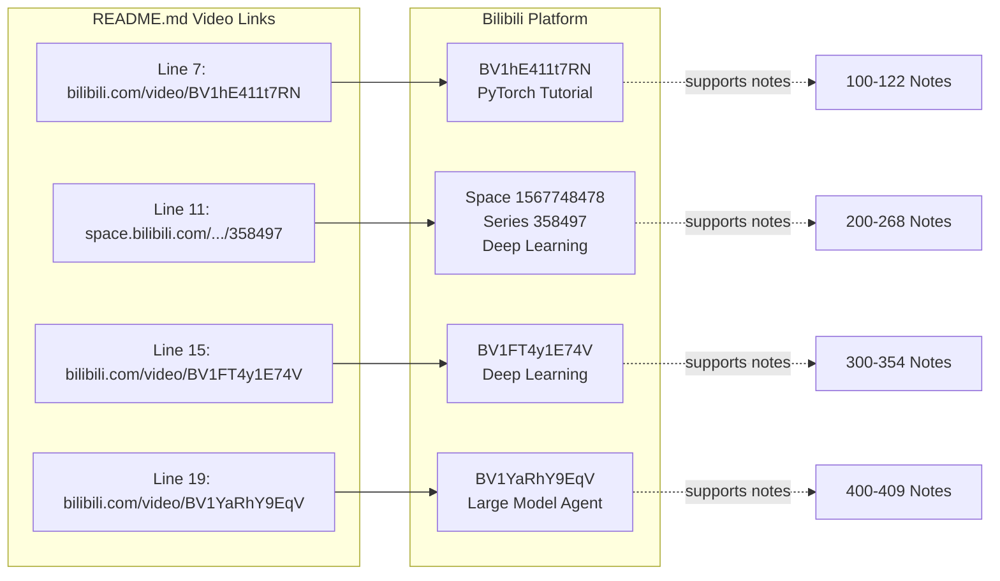
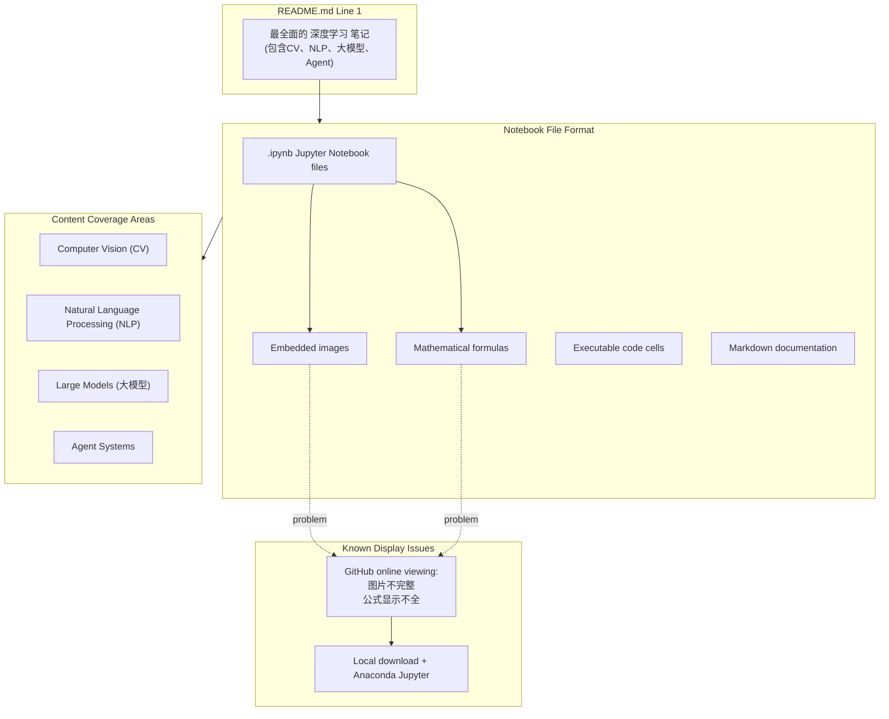
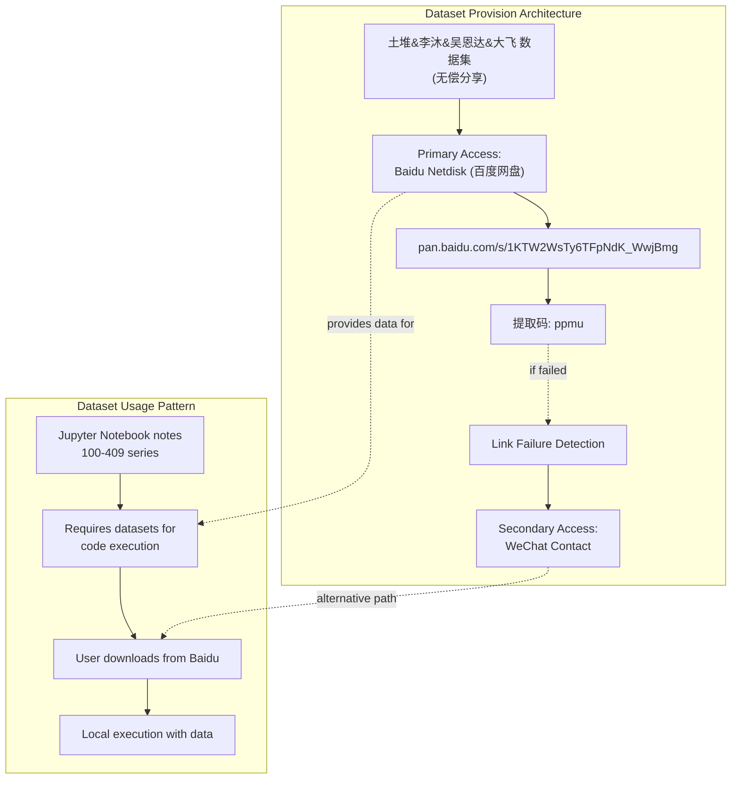
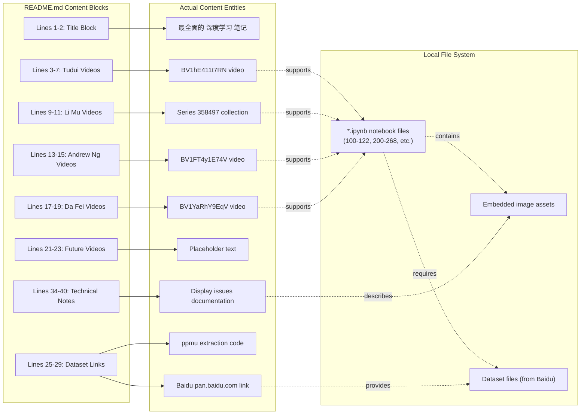
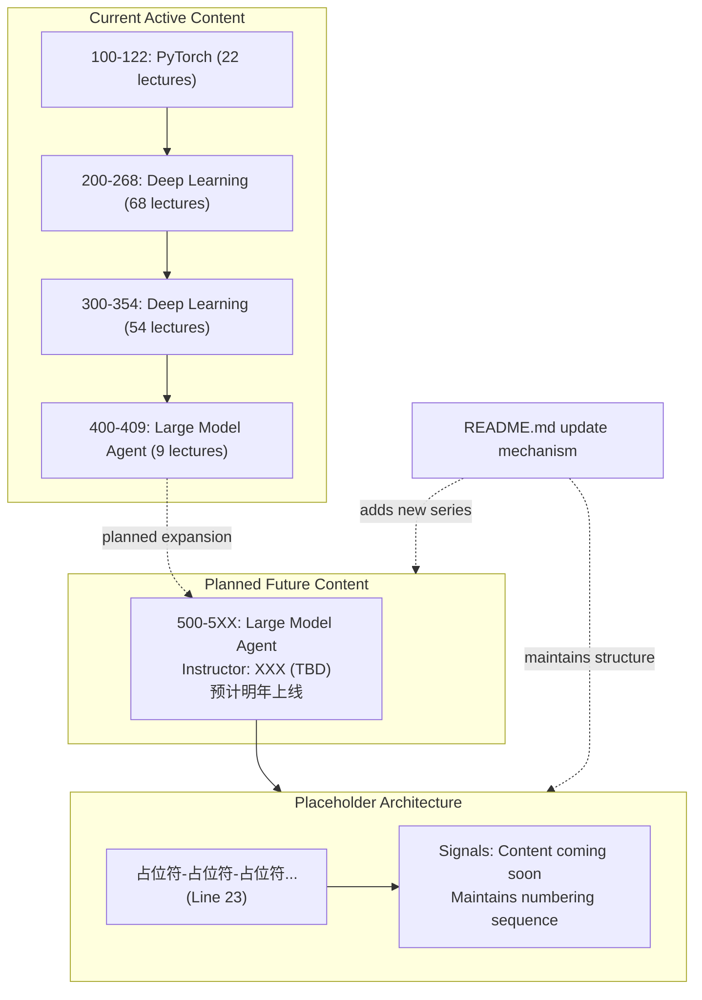

<!-- source: DeepWiki mcp.deepwiki.com · repo AccumulateMore/CV · page 2 Educational Content System · fetched 2026-10-29 -->

# Educational Content System

<details>
<summary>Relevant source files</summary>

The following files were used as context for generating this wiki page:

- [README.md](README.md)

</details>


## Purpose and Scope

The Educational Content System manages the core learning materials in this platform, encompassing curriculum organization, video lectures, Jupyter notebook-based notes, and associated datasets. This system coordinates content from multiple instructors across a structured series numbering scheme (100-500+) covering topics from PyTorch fundamentals through large language model agents.

This document focuses on the content architecture and organization. For technical setup and rendering requirements, see [Technical Setup and Access](#3). For community support related to content access, see [Community and Support System](#4). For career services that build upon this educational foundation, see [Career Services and Job Placement](#5).

---

## Content Architecture Overview

The educational content is organized as a multi-layered system where each layer serves a specific delivery function:



**Diagram: Content Architecture - Five-Layer System**

The system implements a five-layer architecture where `README.md` serves as the central index coordinating all layers. The Content Taxonomy Layer defines the progression structure. The Instructor Attribution Layer maps series to specific educators. The Video Distribution Layer points to Bilibili hosting. The Notes Repository Layer contains local `.ipynb` files. The Dataset Storage Layer provides supporting materials via Baidu Netdisk with WeChat as a fallback mechanism.

Sources: [README.md:1-29]()

---

## Series Numbering and Progression System

The curriculum uses a systematic numbering scheme where the hundreds digit indicates the major topic area and progression level:

| Series Range | Topic Focus | Instructor | Status | Line Reference |
|--------------|-------------|------------|--------|----------------|
| 100-122 | PyTorch Basics | 土堆 (Tudui) | Active | [README.md:5]() |
| 200-268 | Deep Learning | 李沐 (Li Mu) | Active | [README.md:9]() |
| 300-354 | Deep Learning | 吴恩达 (Andrew Ng) | Active | [README.md:13]() |
| 400-409 | Large Model Agent | 大飞 (Da Fei) | Active | [README.md:17]() |
| 500-5XX | Large Model Agent | XXX (TBD) | Planned | [README.md:21]() |

**Table: Series to Instructor Mapping**

Each series represents a complete course module with consistent numbering across video lectures and corresponding notes. The numbering provides clear progression paths where lower series (100-122) establish foundational knowledge required for higher series (400-409).

Sources: [README.md:3-23]()

---

## Video Lecture Distribution



**Diagram: Video-to-Notes Correspondence Architecture**

All video lectures are hosted on the Bilibili platform. The `README.md` file contains direct links at specific line numbers that serve as the canonical access points. Each video series has a one-to-one correspondence with a numbered note series, indicated in the bracketed annotations [对应笔记:XXX].

### Video Access Details

| Instructor | Series | Bilibili Code | Access Pattern | Line |
|------------|--------|---------------|----------------|------|
| 土堆 | 100-122 | BV1hE411t7RN | Direct video link | [README.md:7]() |
| 李沐 | 200-268 | Series 358497 | Space/series collection | [README.md:11]() |
| 吴恩达 | 300-354 | BV1FT4y1E74V | Direct video link | [README.md:15]() |
| 大飞 | 400-409 | BV1YaRhY9EqV | Direct video link | [README.md:19]() |

**Table: Bilibili Video Identifiers**

The platform uses two access patterns: direct video links (`/video/BVXXXXXXXX`) for single-video series and space collections (`/space/XXXX/lists/YYYY?type=series`) for multi-video sequences. The 李沐 series uses a space collection structure due to its larger content volume (68 lectures: 200-268).

Sources: [README.md:3-23]()

---

## Jupyter Notebook Notes Structure

The deep learning notes are distributed as Jupyter Notebook files (`.ipynb` format) stored directly in the repository root. These notes provide comprehensive coverage of computer vision (CV), natural language processing (NLP), and large model topics.



**Diagram: Notebook Structure and Display Considerations**

The notes are authored in `.ipynb` format containing embedded images, mathematical formulas (LaTeX), executable Python code cells, and markdown documentation. The system explicitly documents known display issues when viewing online through GitHub's renderer, particularly with incomplete image rendering and formula display problems.

### Technical Specifications

| Property | Value | Source |
|----------|-------|--------|
| File Format | `.ipynb` | [README.md:1]() |
| Content Types | CV, NLP, 大模型, Agent | [README.md:1]() |
| Recommended Editor | Anaconda Jupyter Notebook | [README.md:37]() |
| Not Recommended | Pycharm Jupyter Notebook | [README.md:37]() |
| Display Issue Context | Online viewing incomplete | [README.md:36]() |
| Resolution | Download to local | [README.md:36]() |

**Table: Notebook Technical Requirements**

The critical distinction is that Pycharm's Jupyter implementation does not properly render images [README.md:37](), while Anaconda's Jupyter Notebook provides correct rendering. This requirement is explicitly stated: "笔记是用 Anaconda 的 Jupyter Notebook 打开的" (notes are opened with Anaconda's Jupyter Notebook).

Sources: [README.md:1](), [README.md:34-40]()

---

## Dataset Distribution System



**Diagram: Dataset Access and Fallback Architecture**

The dataset distribution implements a two-tier access system. The primary distribution channel is Baidu Netdisk (百度网盘), a widely-used file storage platform in China. The system explicitly acknowledges potential link expiration and provides a fallback mechanism through WeChat contact.

### Dataset Access Specification

| Component | Value | Line Reference |
|-----------|-------|----------------|
| Primary Platform | Baidu Netdisk (百度网盘) | [README.md:25]() |
| Access Link | `pan.baidu.com/s/1KTW2WsTy6TFpNdK_WwjBmg` | [README.md:27]() |
| Extraction Code | `ppmu` | [README.md:27]() |
| Coverage | 土堆, 李沐, 吴恩达, 大飞 datasets | [README.md:25]() |
| Fallback Method | WeChat contact | [README.md:29]() |
| Failure Scenario | "数据集链接如果失效了" | [README.md:29]() |

**Table: Dataset Distribution Parameters**

The extraction code `ppmu` [README.md:27]() is required for access and is permanently documented in the README to prevent user frustration if the link structure changes. The fallback mechanism explicitly states: "数据集链接如果失效了,下面有微信,可以联系我" (if the dataset link fails, there is WeChat below, you can contact me) [README.md:29]().

Sources: [README.md:25-29]()

---

## Content-to-Code Entity Mapping



**Diagram: Content Entity to Code Location Mapping**

This diagram bridges the natural language descriptions to actual code entities and file locations. The `README.md` file is divided into specific line-range blocks, each containing distinct content entities. The Bilibili video codes (BV1hE411t7RN, etc.) are concrete identifiers that can be searched in the codebase. The `.ipynb` files referenced exist as actual files in the repository root, though not shown in the provided file listing. The Baidu link at line 27 and extraction code `ppmu` are literal strings that users must access.

Sources: [README.md:1-40]()

---

## Content Organization Principles

The educational content follows three key organizational principles embedded in the `README.md` structure:

### 1. Explicit Correspondence Mapping

Each video lecture section uses the pattern `【对应笔记:XXX】` (corresponding notes: XXX) to create explicit bidirectional mapping:

```
Pytorch 视频讲解【主讲人:土堆】【对应笔记:100-122】
深度学习 视频讲解【主讲人:李沐】【对应笔记:200-268】
深度学习 视频讲解【主讲人:吴恩达】【对应笔记:300-354】
大模型Agent 视频讲解【主讲人:大飞】【对应笔记:400-409】
```

This pattern appears at [README.md:5](), [README.md:9](), [README.md:13](), and [README.md:17](). It ensures users understand that notes are not standalone but paired with video lectures.

### 2. Incremental Disclosure Architecture

The content follows a progressive disclosure pattern where critical information appears in order of user need:

1. **Discovery Phase**: Title and video links [README.md:1-23]()
2. **Access Phase**: Dataset links [README.md:25-29]()
3. **Setup Phase**: Technical notes and warnings [README.md:34-40]()

This ordering minimizes cognitive load by deferring technical details until after initial content discovery.

### 3. Proactive Issue Documentation

The system explicitly documents known issues before users encounter them:

```
笔记备注（敲重点！敲重点！敲重点！）:
1. 在线观看笔记时,有时会出现图片(或公式)显示不完整...
2. Pycharm 的 Jupyter Notebook 打开笔记时,图片不会正常显示...
3. 安装 Jupyter Notebook 的目录插件...
```

This appears at [README.md:34-40]() with emphatic markers "敲重点" (emphasize key points) repeated three times, indicating critical information. Each point provides both problem identification and solution path.

Sources: [README.md:5-40]()

---

## Content Update and Extension Mechanism



**Diagram: Content Extension and Placeholder System**

The platform implements a forward-looking content structure where the 500-series is pre-announced at [README.md:21]() with the notation "预计明年上线" (expected to go live next year). The placeholder text at [README.md:23]() consists of repeated "占位符" (placeholder) characters, serving as a visual signal that this content slot is reserved but not yet populated.

This design pattern allows the curriculum structure to remain stable while content is incrementally added. The 500-5XX series maintains the hundreds-digit progression pattern (100→200→300→400→500), indicating it represents the next major topic area in the curriculum evolution.

Sources: [README.md:21-23]()

---

## Summary

The Educational Content System implements a structured, multi-layered architecture where `README.md` serves as the central index coordinating video lectures (Bilibili), notebook files (`.ipynb`), and datasets (Baidu Netdisk). The system uses:

- **Series numbering** (100-500+) for curriculum progression
- **Explicit correspondence mapping** between videos and notes
- **Instructor attribution** for each series
- **Dual-channel access** (primary + fallback) for datasets
- **Proactive issue documentation** for technical problems
- **Forward compatibility** through placeholder mechanisms

All content is freely distributed (无偿分享) with the expectation that users will download locally and use Anaconda Jupyter Notebook for proper rendering. The architecture prioritizes accessibility through multi-platform integration while maintaining clear organizational structure through consistent numbering and explicit correspondence annotations.

Sources: [README.md:1-40]()

---

