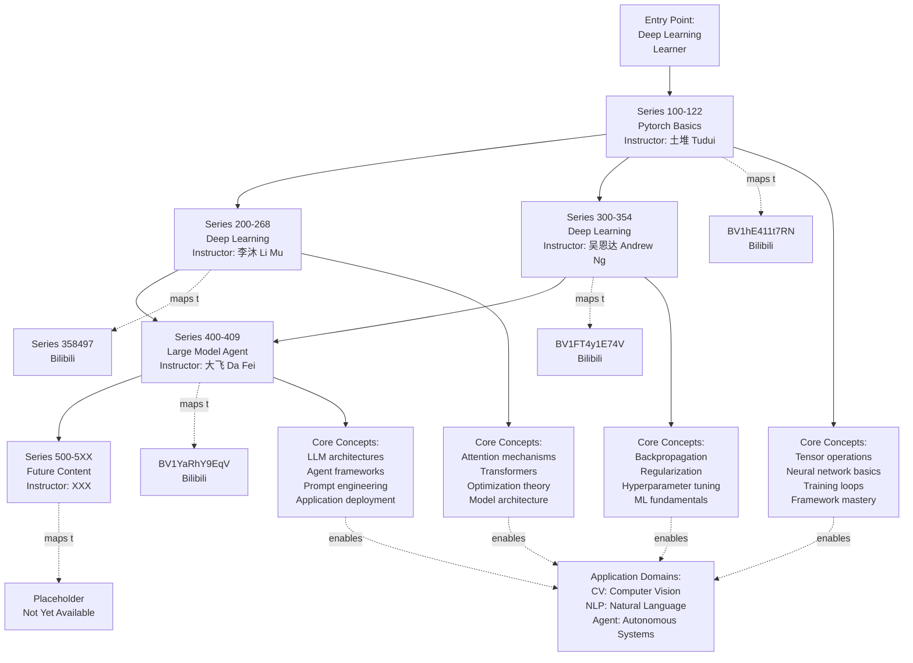
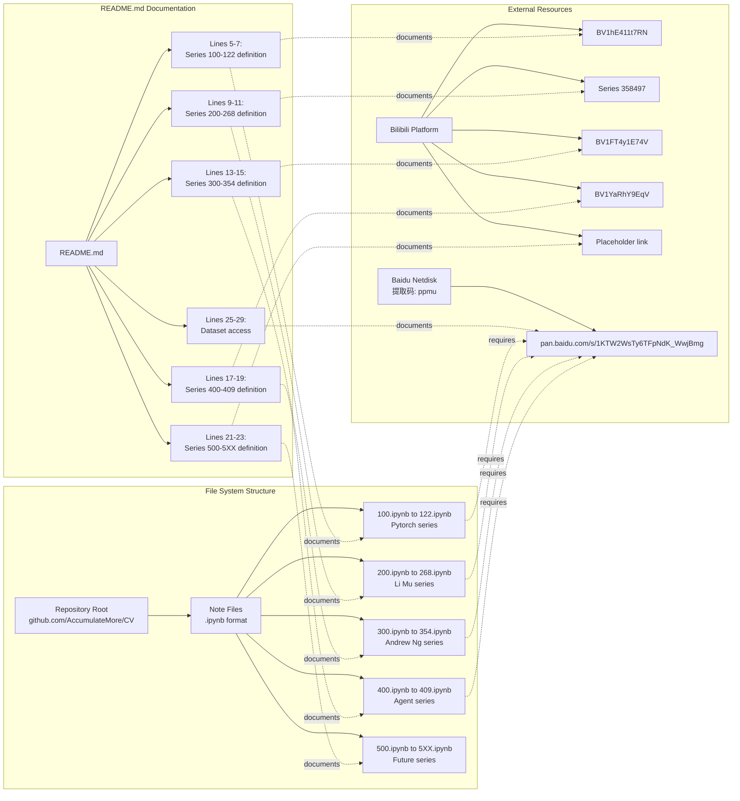
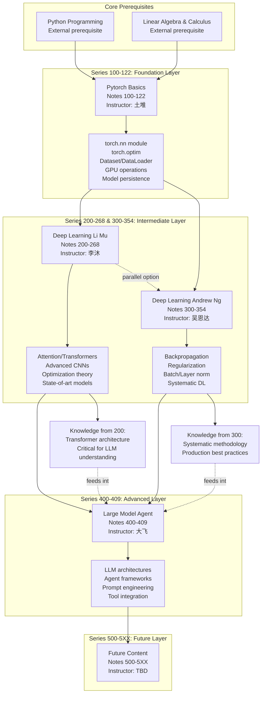

<!-- source: DeepWiki mcp.deepwiki.com · repo AccumulateMore/CV · page 2.1 Curriculum Structure and Course Series · fetched 2026-10-29 -->

# Curriculum Structure and Course Series

<details>
<summary>Relevant source files</summary>

The following files were used as context for generating this wiki page:

- [README.md](README.md)

</details>


## Purpose and Scope

This document describes the curriculum organization within the educational content system, specifically the 100-500+ series numbering scheme that structures all learning materials in the repository. This page covers the hierarchical progression from foundational Pytorch concepts through advanced large model agents, explains how each series builds upon previous knowledge, and documents the mapping between series numbers and instructional content.

For information about the instructors who teach each series, see [Lecture Series and Instructors](#2.2). For details on accessing the video lectures, see [Video Lectures on Bilibili](#2.3). For the Jupyter notebook format of the notes, see [Deep Learning Notes](#2.4).

---

## Series Numbering System

The curriculum employs a hierarchical numbering system where each hundred-level range represents a distinct course series taught by a specific instructor. The series are designed to be progressive, with each building foundational knowledge for the next.

### Series Range Structure

| Series Range | Topic Focus | Instructor | Note Count | Status |
|--------------|-------------|------------|------------|---------|
| 100-122 | Pytorch Fundamentals | 土堆 (Tudui) | 23 notes | Active |
| 200-268 | Deep Learning Theory & Practice | 李沐 (Li Mu) | 69 notes | Active |
| 300-354 | Deep Learning Foundations | 吴恩达 (Andrew Ng) | 55 notes | Active |
| 400-409 | Large Model Agent Development | 大飞 (Da Fei) | 10 notes | Active |
| 500-5XX | Advanced Topics (TBD) | XXX (TBD) | TBD | Planned |

**Sources:** [README.md:5-23]()

---

## Curriculum Progression Architecture

The following diagram illustrates how the five series progress from foundational programming concepts through to advanced AI agent development, with each series building prerequisite knowledge for subsequent courses.



**Sources:** [README.md:5-23]()

---

## Series 100-122: Pytorch Fundamentals

### Overview
The foundational series introducing the Pytorch deep learning framework, covering 23 notes numbered from 100 to 122. This series serves as the technical prerequisite for all subsequent courses.

### Content Scope
- Tensor manipulation and operations
- Neural network construction using `torch.nn`
- Training loop implementation
- Dataset and DataLoader usage
- Model saving and loading
- GPU acceleration basics

### Prerequisites
- Basic Python programming
- Understanding of linear algebra concepts
- Familiarity with NumPy (recommended)

### Learning Path Position
**Entry point** for the curriculum. All other series assume mastery of Pytorch basics covered in 100-122.

**Sources:** [README.md:5-7]()

---

## Series 200-268: Deep Learning Theory (Li Mu)

### Overview
Comprehensive deep learning course taught by Li Mu (李沐), covering 69 notes numbered from 200 to 268. This series emphasizes both theoretical understanding and practical implementation.

### Content Scope
- Advanced neural network architectures
- Attention mechanisms and transformers
- Convolutional neural networks for computer vision
- Recurrent networks for sequential data
- Modern optimization techniques
- State-of-the-art model architectures

### Prerequisites
- Completion of Series 100-122 (Pytorch fundamentals)
- Solid understanding of calculus and linear algebra
- Familiarity with basic machine learning concepts

### Learning Path Position
**Advanced theory track** building on Pytorch foundations. Can be taken in parallel with Series 300 or sequentially.

**Sources:** [README.md:9-11]()

---

## Series 300-354: Deep Learning Foundations (Andrew Ng)

### Overview
Structured deep learning course taught by Andrew Ng (吴恩达), covering 55 notes numbered from 300 to 354. This series provides systematic coverage of deep learning fundamentals with emphasis on practical applications.

### Content Scope
- Backpropagation algorithm and gradient computation
- Regularization techniques (L1, L2, dropout)
- Batch normalization and layer normalization
- Hyperparameter tuning strategies
- Convolutional neural networks (CNNs)
- Recurrent neural networks (RNNs)

### Prerequisites
- Completion of Series 100-122 (Pytorch fundamentals)
- Basic calculus and linear algebra
- Understanding of supervised learning concepts

### Learning Path Position
**Structured fundamentals track** providing systematic deep learning education. Can be taken in parallel with Series 200 or sequentially.

**Sources:** [README.md:13-15]()

---

## Series 400-409: Large Model Agents

### Overview
Advanced course on large language models and autonomous agents taught by Da Fei (大飞), covering 10 notes numbered from 400 to 409. This series focuses on cutting-edge AI agent development and LLM applications.

### Content Scope
- Large language model architectures
- Agent framework design
- Prompt engineering and optimization
- Tool integration and function calling
- Multi-agent systems
- LLM deployment and inference optimization

### Prerequisites
- Completion of Series 100-122 (Pytorch fundamentals)
- Completion or concurrent enrollment in Series 200 OR Series 300
- Understanding of transformer architectures
- Familiarity with NLP concepts

### Learning Path Position
**Advanced application track** requiring solid foundation from earlier series. Represents current frontier of AI agent technology.

**Sources:** [README.md:17-19]()

---

## Series 500-5XX: Future Content

### Overview
Planned expansion series currently under development. Instructor and specific topics to be announced.

### Status
- **Launch Timeline**: Estimated next year (预计明年上线)
- **Current State**: Placeholder content only
- **Note Range**: 500-5XX (exact upper bound TBD)

### Expected Prerequisites
Based on the progression pattern, Series 500 will likely require:
- Completion of Series 100-122
- Completion of at least one of Series 200 or 300
- Completion of Series 400 (recommended)

**Sources:** [README.md:21-23]()

---

## Content-to-File Mapping Architecture

This diagram shows how the series numbering system maps to actual file artifacts in the repository, including note files, video identifiers, and dataset resources.



**Sources:** [README.md:5-29]()

---

## Recommended Learning Paths

The curriculum supports multiple learning trajectories depending on learner background and goals. The following table outlines recommended paths:

### Path Comparison

| Path Type | Series Sequence | Duration Estimate | Target Audience |
|-----------|----------------|-------------------|-----------------|
| **Sequential Foundation** | 100 → 200 → 300 → 400 | 6-9 months | Complete beginners to deep learning |
| **Rapid Application** | 100 → 300 → 400 | 4-6 months | Those with ML background seeking practical skills |
| **Theory-First** | 100 → 200 → 400 | 5-7 months | Research-oriented learners |
| **Parallel Learning** | 100 → (200 \|\| 300) → 400 | 5-7 months | Experienced programmers |

### Path Details

#### Sequential Foundation Path
```
Series 100-122 (Pytorch) 
  ↓ (2-3 weeks)
Series 200-268 (Li Mu Deep Learning)
  ↓ (2-3 months)
Series 300-354 (Andrew Ng Deep Learning)
  ↓ (1-2 months)
Series 400-409 (Large Model Agents)
  ↓ (3-4 weeks)
Series 500-5XX (Future Content)
```

**Advantages:**
- Most comprehensive understanding
- Solid theoretical foundation
- Multiple perspectives on core concepts
- Best preparation for Series 400

**Disadvantages:**
- Longest time commitment
- Some content overlap between 200 and 300
- May delay reaching advanced topics

#### Rapid Application Path
```
Series 100-122 (Pytorch)
  ↓ (2-3 weeks)
Series 300-354 (Andrew Ng Deep Learning)
  ↓ (1-2 months)
Series 400-409 (Large Model Agents)
  ↓ (3-4 weeks)
[Optional] Series 200-268 for deeper theory
```

**Advantages:**
- Faster path to modern AI applications
- Structured learning from Andrew Ng
- Sufficient foundation for agent development
- Can backfill Series 200 as needed

**Disadvantages:**
- Less exposure to cutting-edge architectures
- May miss some advanced optimization techniques
- Series 200's transformer focus beneficial for 400

#### Parallel Learning Path
```
Series 100-122 (Pytorch)
  ↓ (2-3 weeks)
Series 200-268 (Li Mu) + Series 300-354 (Andrew Ng)
  ↓ (2-3 months, concurrent)
Series 400-409 (Large Model Agents)
```

**Advantages:**
- Multiple teaching perspectives simultaneously
- Reinforcement through different explanations
- Faster overall completion
- Rich conceptual understanding

**Disadvantages:**
- Requires more hours per week
- Managing two video sources and note sets
- Potential confusion from different terminology

**Sources:** [README.md:5-23]()

---

## Series Completion Tracking

The curriculum structure enables self-paced learning with clear completion milestones:

### Completion Criteria by Series

| Series | Total Notes | Completion Indicator | Expected Outcomes |
|--------|-------------|---------------------|-------------------|
| 100-122 | 23 | Can build and train neural networks in Pytorch | Ready for advanced courses |
| 200-268 | 69 | Understand modern architectures and transformers | Can read research papers |
| 300-354 | 55 | Solid grasp of deep learning fundamentals | Can implement standard models |
| 400-409 | 10 | Can develop LLM-based agents | Ready for production applications |
| 500-5XX | TBD | TBD | TBD |

### Progress Verification

Each series includes practical exercises within the Jupyter notebooks (`.ipynb` files). Learners can verify understanding through:

1. **Code Execution**: Running all cells without errors
2. **Concept Application**: Modifying examples to test understanding
3. **Dataset Integration**: Working with provided datasets from Baidu Netdisk
4. **Video Correspondence**: Matching note content to lecture segments

**Sources:** [README.md:5-23](), [README.md:34-40]()

---

## Series Interdependencies

The following diagram illustrates prerequisite relationships and knowledge flow between series:



**Sources:** [README.md:5-23]()

---

## Content Domain Coverage

The series collectively span three major AI domains as indicated in the repository title: Computer Vision (CV), Natural Language Processing (NLP), and Large Model Agents.

### Domain Coverage by Series

| Series | CV Coverage | NLP Coverage | Agent Coverage | Foundational |
|--------|-------------|--------------|----------------|--------------|
| 100-122 | ✓ Basic | ✓ Basic | ✓ Basic | ✓ Primary |
| 200-268 | ✓ Advanced | ✓ Advanced | ○ Preparation | ✓ Theory |
| 300-354 | ✓ Advanced | ✓ Intermediate | ○ Preparation | ✓ Systematic |
| 400-409 | ○ Application | ✓ Advanced | ✓ Primary | ○ Advanced |
| 500-5XX | TBD | TBD | TBD | TBD |

**Legend:**
- ✓ Primary focus with extensive coverage
- ○ Secondary or preparatory coverage
- TBD To be determined

### Domain Integration Points

The curriculum integrates domains through shared foundational concepts:

1. **Pytorch Foundation (100-122)**: Provides unified framework for all domains
2. **Network Architectures (200 & 300)**: CNNs for CV, RNNs/Transformers for NLP
3. **Transfer Learning**: Series 200 and 300 prepare for fine-tuning in Series 400
4. **Agent Applications (400)**: Combines CV and NLP for autonomous systems

**Sources:** [README.md:1](), [README.md:5-23]()

---

## Summary

The curriculum structure employs a systematic 100-500+ series numbering scheme that progresses learners from Pytorch fundamentals through advanced AI agent development. The five-tier structure (100s through 500s) provides clear learning milestones, with each series taught by expert instructors and supported by corresponding Bilibili videos, Jupyter notebook notes, and shared datasets. Multiple learning paths accommodate different backgrounds and goals, while maintaining prerequisite relationships that ensure solid knowledge foundations.

**Sources:** [README.md:1-29]()

---

