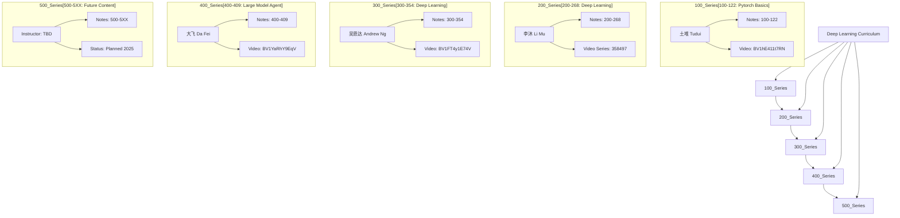
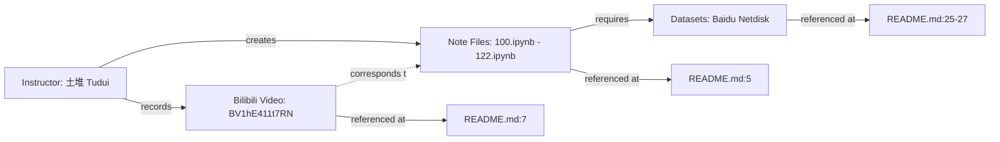
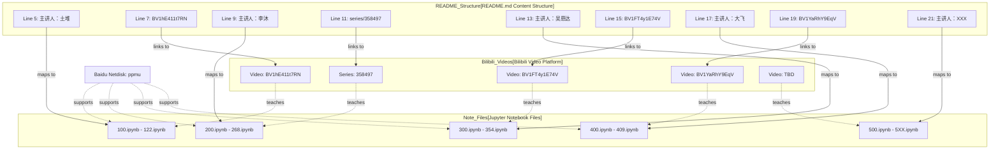

<!-- source: DeepWiki mcp.deepwiki.com · repo AccumulateMore/CV · page 2.2 Lecture Series and Instructors · fetched 2026-10-29 -->

# Lecture Series and Instructors

Relevant source files

The following files were used as context for generating this wiki page:

- [README.md](README.md)

## Purpose and Scope

This page documents the instructors who provide video lectures for the platform and details each lecture series. The educational content is organized into five distinct series (100-500+), each taught by a recognized expert in their field. Each series corresponds to a specific range of Jupyter notebook files and Bilibili video lectures.

For information about accessing video content, see [Video Lectures on Bilibili](#2.3). For details on the note files themselves, see [Deep Learning Notes](#2.4). For curriculum structure and progression, see [Curriculum Structure and Course Series](#2.1).

---

## Lecture Series Architecture

The platform organizes educational content into a numbered series system where each hundred-level range corresponds to a specific instructor and topic focus:

**Diagram: Instructor-Series Mapping and Progression**

Sources: [README.md:5-23]()

---

## Instructor Series Overview

| Series Range | Instructor (Chinese) | Instructor (Pinyin/English) | Topic Focus | Note Count | Video Platform | Status |
|--------------|---------------------|----------------------------|-------------|------------|----------------|--------|
| 100-122 | 土堆 | Tudui | Pytorch Basics | 23 | Bilibili | Active |
| 200-268 | 李沐 | Li Mu | Deep Learning | 69 | Bilibili | Active |
| 300-354 | 吴恩达 | Andrew Ng | Deep Learning | 55 | Bilibili | Active |
| 400-409 | 大飞 | Da Fei | Large Model Agent | 10 | Bilibili | Active |
| 500-5XX | XXX | TBD | Large Model Agent | TBD | Bilibili | Planned 2025 |

Sources: [README.md:5-21]()

---

## Series 100-122: Pytorch Basics

**Instructor:** 土堆 (Tudui)

**Note Range:** 100-122 (23 notebooks)

**Video Link:** BV1hE411t7RN

**Focus:** This series provides foundational training in Pytorch, the primary deep learning framework used throughout the curriculum. It covers essential concepts needed to understand and implement deep learning models.

### Content Structure

The 100-series serves as the entry point for the curriculum, teaching:
- Pytorch framework fundamentals
- Tensor operations and data structures
- Neural network building blocks
- Training loops and optimization
- Data loading and preprocessing

### Mapping to Code

**Diagram: Tudui Series Component Mapping**

Sources: [README.md:5-7](), [README.md:25-27]()

---

## Series 200-268: Deep Learning (Li Mu)

**Instructor:** 李沐 (Li Mu)

**Note Range:** 200-268 (69 notebooks)

**Video Link:** Bilibili Space Series 358497

**Focus:** Comprehensive deep learning curriculum covering theoretical foundations and practical implementations. This is the largest series by note count, providing extensive coverage of deep learning architectures and techniques.

### Content Structure

The 200-series builds upon Pytorch fundamentals with:
- Deep neural network architectures
- Convolutional neural networks (CNN)
- Recurrent neural networks (RNN)
- Attention mechanisms and transformers
- Advanced optimization techniques

### Video Access Method

Unlike other series that use single video IDs, Li Mu's series is accessed through a Bilibili space playlist (series ID: 358497), containing multiple organized videos.

Sources: [README.md:9-11]()

---

## Series 300-354: Deep Learning (Andrew Ng)

**Instructor:** 吴恩达 (Andrew Ng)

**Note Range:** 300-354 (55 notebooks)

**Video Link:** BV1FT4y1E74V

**Focus:** Deep learning from a different pedagogical perspective, complementing Li Mu's approach. Andrew Ng is renowned for his clear teaching style and systematic curriculum design.

### Content Structure

The 300-series provides alternative explanations and approaches to:
- Neural network fundamentals
- Structuring machine learning projects
- Convolutional networks for computer vision
- Sequence models
- Deep learning strategies and hyperparameter tuning

### Complementary Approach

While covering similar deep learning topics as the 200-series, Andrew Ng's series offers different perspectives and examples, allowing learners to reinforce understanding through multiple teaching styles.

Sources: [README.md:13-15]()

---

## Series 400-409: Large Model Agent

**Instructor:** 大飞 (Da Fei)

**Note Range:** 400-409 (10 notebooks)

**Video Link:** BV1YaRhY9EqV

**Focus:** Specialized content on large language models (LLMs) and AI agents, representing the cutting edge of deep learning applications.

### Content Structure

The 400-series introduces:
- Large language model architectures
- Agent frameworks and design patterns
- Prompt engineering techniques
- Model deployment and optimization
- Practical agent applications

### Modern AI Focus

This series represents the platform's commitment to covering current AI trends, particularly the emergence of large models and agent-based systems that have become prominent in 2023-2024.

Sources: [README.md:17-19]()

---

## Series 500-5XX: Future Content

**Instructor:** XXX (To Be Announced)

**Note Range:** 500-5XX (Count TBD)

**Video Link:** Not yet available

**Status:** Planned for 2025 release

**Focus:** Continued coverage of large model agent topics with additional advanced content.

### Placeholder Status

The 500-series is currently represented by a placeholder in the README to indicate future expansion. The specific instructor, note count, and video content have not been announced.

Sources: [README.md:21-23]()

---

## Instructor-Video-Note Mapping

The following diagram shows the precise mapping between code entities in the README and the educational content:

**Diagram: Code-Level Content Mapping**

Sources: [README.md:5-27]()

---

## Dataset Sharing Across Series

All instructors' series share a common dataset repository hosted on Baidu Netdisk. This unified dataset approach ensures:

- **Consistency:** All learners work with the same data across different teaching styles
- **Efficiency:** Single download location reduces fragmentation
- **Accessibility:** Backup mechanism via WeChat contact if primary link fails

### Dataset Access Details

| Component | Value | Reference |
|-----------|-------|-----------|
| Platform | Baidu Netdisk | README.md:27 |
| Link | https://pan.baidu.com/s/1KTW2WsTy6TFpNdK_WwjBmg | README.md:27 |
| Extraction Code | `ppmu` | README.md:27 |
| Covered Series | 土堆 & 李沐 & 吴恩达 & 大飞 | README.md:25 |
| Fallback Method | WeChat contact | README.md:29 |

Sources: [README.md:25-29]()

---

## Teaching Philosophy and Instructor Selection

The platform curates content from multiple instructors to provide:

1. **Multiple Perspectives:** Different teaching styles help reinforce concepts
2. **Progression Path:** Each series builds on previous knowledge
3. **Specialization:** Later series (400+) focus on emerging topics
4. **Quality Curation:** Selected instructors are recognized experts with proven teaching effectiveness

The multi-instructor approach aligns with the platform philosophy: "看人之长,天下皆是吾师" (see others' strengths, everyone can be a teacher), acknowledging that different instructors excel at explaining different concepts.

Sources: [README.md:66]()

---

## Instructor Series Technical Specifications

### File Naming Convention

All note files follow the pattern:
- Series 100: `100.ipynb`, `101.ipynb`, ..., `122.ipynb`
- Series 200: `200.ipynb`, `201.ipynb`, ..., `268.ipynb`
- Series 300: `300.ipynb`, `301.ipynb`, ..., `354.ipynb`
- Series 400: `400.ipynb`, `401.ipynb`, ..., `409.ipynb`
- Series 500: `500.ipynb`, `501.ipynb`, ..., `5XX.ipynb` (future)

The numbering system provides:
- **Clear organization:** Easy to identify which instructor series
- **Sequential ordering:** Natural progression through topics
- **Scalability:** Room for expansion within each hundred-level range

### Video-Note Correspondence

Each Bilibili video lecture corresponds directly to one or more notebook files, with:
- **Synchronized content:** Video explains concepts demonstrated in notebooks
- **Timestamp alignment:** Code cells in notebooks match video segments
- **Interactive learning:** Students can watch video then execute code locally

Sources: [README.md:5-21]()

---

## Summary Table: Complete Instructor Mapping

| Series | Instructor | Note Range | Note Count | Video ID/Series | Video Type | Topic | Status |
|--------|-----------|------------|------------|-----------------|------------|-------|--------|
| 100 | 土堆 (Tudui) | 100-122 | 23 | BV1hE411t7RN | Single Video | Pytorch | ✓ Active |
| 200 | 李沐 (Li Mu) | 200-268 | 69 | 358497 | Series | Deep Learning | ✓ Active |
| 300 | 吴恩达 (Andrew Ng) | 300-354 | 55 | BV1FT4y1E74V | Single Video | Deep Learning | ✓ Active |
| 400 | 大飞 (Da Fei) | 400-409 | 10 | BV1YaRhY9EqV | Single Video | Large Model Agent | ✓ Active |
| 500 | XXX (TBD) | 500-5XX | TBD | TBD | TBD | Large Model Agent | ⏳ Planned |

**Total Active Notes:** 157 notebooks  
**Total Instructors:** 4 active, 1 planned  
**Platform:** Bilibili for all video content  
**Dataset:** Unified Baidu Netdisk repository

Sources: [README.md:5-23]()

---

