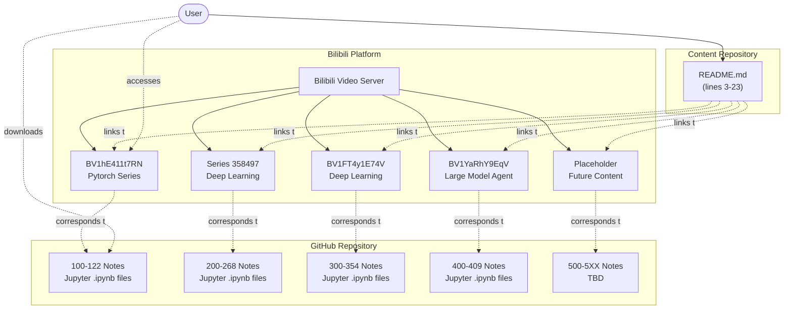
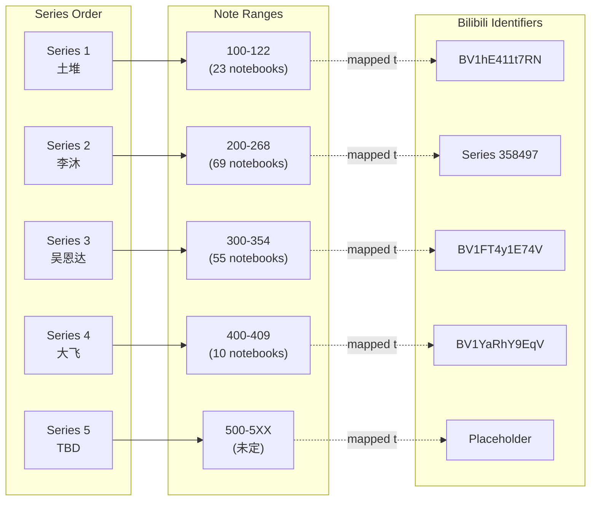
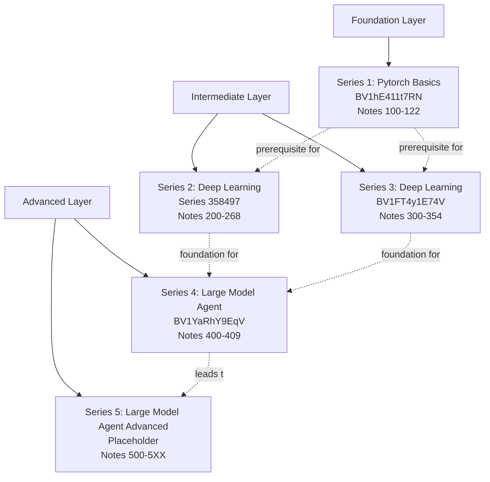
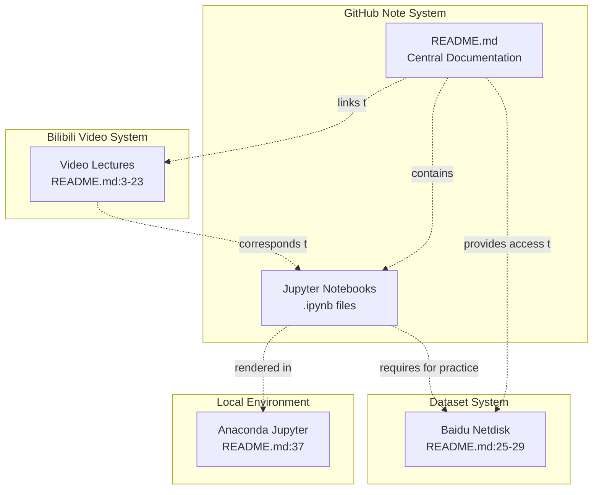

<!-- source: DeepWiki mcp.deepwiki.com · repo AccumulateMore/CV · page 2.3 Video Lectures on Bilibili · fetched 2026-10-29 -->

# Video Lectures on Bilibili

<details>
<summary>Relevant source files</summary>

The following files were used as context for generating this wiki page:

- [README.md](README.md)

</details>


## Purpose and Scope

This document provides a complete reference for all video lecture content hosted on the Bilibili platform. It catalogs the specific Bilibili video identifiers (BV codes and series numbers), maps them to their corresponding note ranges (100-5XX series), identifies the instructors for each series, and explains how to access and navigate the video content. For information about the Jupyter notebook-based notes themselves, see [Deep Learning Notes](#2.4). For dataset access that accompanies these lectures, see [Datasets and Additional Resources](#2.5).

**Sources:** [README.md:1-23]()

---

## Video Distribution Architecture

The platform uses Bilibili as its exclusive video hosting provider. All lecture content is externally hosted on Bilibili rather than stored in the GitHub repository, creating a clear separation between video delivery and note distribution.



**Diagram: Video Distribution and Note Mapping Architecture**

This architecture demonstrates the external dependency on Bilibili for video content while maintaining note synchronization through numeric series mapping.

**Sources:** [README.md:3-23]()

---

## Video Series Catalog

### Complete Series Mapping

The following table provides the authoritative mapping between video identifiers, instructors, note ranges, and access URLs:

| Series ID | Instructor | Topic | Note Range | Bilibili Identifier | Access URL |
|-----------|-----------|-------|------------|---------------------|------------|
| Series 1 | 土堆 (Tudui) | Pytorch Basics | 100-122 | BV1hE411t7RN | https://www.bilibili.com/video/BV1hE411t7RN |
| Series 2 | 李沐 (Li Mu) | Deep Learning | 200-268 | Series 358497 | https://space.bilibili.com/1567748478/lists/358497?type=series |
| Series 3 | 吴恩达 (Andrew Ng) | Deep Learning | 300-354 | BV1FT4y1E74V | https://www.bilibili.com/video/BV1FT4y1E74V |
| Series 4 | 大飞 (Da Fei) | Large Model Agent | 400-409 | BV1YaRhY9EqV | https://www.bilibili.com/video/BV1YaRhY9EqV |
| Series 5 | XXX (TBD) | Large Model Agent (Advanced) | 500-5XX | Placeholder | Not yet available |

**Sources:** [README.md:5-23]()

---

## Series 1: Pytorch Basics by 土堆 (Tudui)

### Identifier Information
- **Bilibili Code:** `BV1hE411t7RN`
- **Corresponding Notes:** 100-122
- **URL:** `https://www.bilibili.com/video/BV1hE411t7RN`

This series provides foundational instruction on Pytorch framework fundamentals. The note range 100-122 contains 23 notebooks that correspond to the video lectures.

**Sources:** [README.md:5-7]()

---

## Series 2: Deep Learning by 李沐 (Li Mu)

### Identifier Information
- **Bilibili Series Number:** `358497`
- **Corresponding Notes:** 200-268
- **URL:** `https://space.bilibili.com/1567748478/lists/358497?type=series`

This series uses a Bilibili series collection format rather than a single BV code. The URL points to a space playlist containing multiple organized videos. The note range 200-268 spans 69 notebooks, making this the most extensive series in the curriculum.

**Sources:** [README.md:9-11]()

---

## Series 3: Deep Learning by 吴恩达 (Andrew Ng)

### Identifier Information
- **Bilibili Code:** `BV1FT4y1E74V`
- **Corresponding Notes:** 300-354
- **URL:** `https://www.bilibili.com/video/BV1FT4y1E74V`

This series covers deep learning concepts with note range 300-354, containing 55 notebooks.

**Sources:** [README.md:13-15]()

---

## Series 4: Large Model Agent by 大飞 (Da Fei)

### Identifier Information
- **Bilibili Code:** `BV1YaRhY9EqV`
- **Corresponding Notes:** 400-409
- **URL:** `https://www.bilibili.com/video/BV1YaRhY9EqV`

This series focuses on large language model agent development. The note range 400-409 contains 10 notebooks, making this the most focused series.

**Sources:** [README.md:17-19]()

---

## Series 5: Future Content (500-5XX)

### Status Information
- **Instructor:** Not yet announced (listed as "XXX")
- **Corresponding Notes:** 500-5XX
- **Availability:** Scheduled for next year ("预计明年上线")
- **Current State:** Placeholder only

This series is planned but not yet available. The README.md contains a placeholder string at line 23.

**Sources:** [README.md:21-23]()

---

## Video-Note Correspondence System

The platform uses a strict numeric mapping convention where the note series number (first digit) directly corresponds to the series order:



**Diagram: Numeric Series Mapping Convention**

The first digit of any note number identifies its series. For example:
- Note 115 belongs to Series 1 (Pytorch by 土堆)
- Note 245 belongs to Series 2 (Deep Learning by 李沐)
- Note 328 belongs to Series 3 (Deep Learning by 吴恩达)
- Note 405 belongs to Series 4 (Large Model Agent by 大飞)

**Sources:** [README.md:5-23]()

---

## Access Instructions

### Direct URL Access

All video URLs are provided in the README.md file and can be accessed directly through a web browser. The videos do not require authentication or special access credentials.

### Navigation Within Series

The two types of Bilibili content formats require different navigation approaches:

**Single Video Format (BV Codes):**
- Series 1, 3, and 4 use BV codes
- These typically represent single video pages or video collections under one identifier
- Navigate using Bilibili's standard video player interface

**Series Collection Format:**
- Series 2 uses a space series collection (`space.bilibili.com` URL)
- Navigate using `?type=series` parameter
- Videos are organized as a playlist within the creator's space

### Integration with Notes

The README.md structure presents videos before notes to establish the recommended learning workflow:

1. Access video lecture via Bilibili link (lines 7, 11, 15, or 19)
2. Watch video content
3. Download corresponding note range from GitHub repository
4. Study notes locally using Jupyter Notebook (see [Jupyter Environment Setup](#3.2))

**Sources:** [README.md:3-39]()

---

## Bilibili Platform Dependencies

### External Platform Characteristics

The system has a complete dependency on Bilibili's infrastructure:

| Dependency Type | Description | Impact if Unavailable |
|----------------|-------------|----------------------|
| Video Hosting | All lecture content stored on Bilibili servers | No video access possible |
| URL Stability | BV codes and series numbers must remain valid | Links would break |
| Player Interface | Bilibili's web player for video rendering | Alternative player required |
| Bandwidth | Bilibili's CDN for video streaming | Video buffering/unavailability |

### No Local Video Storage

The GitHub repository does not contain any video files. All video content references are URL links in [README.md:7,11,15,19]() that point to external Bilibili resources.

**Sources:** [README.md:3-23]()

---

## Video Metadata Structure in README.md

The README.md uses a consistent markdown format for each video series entry:

```
[Topic] 视频讲解【主讲人：[Instructor]】【对应笔记：[Range]】

1. [URL]
```

This structure appears at:
- Lines 5-7: Series 1 (Pytorch)
- Lines 9-11: Series 2 (Deep Learning by Li Mu)
- Lines 13-15: Series 3 (Deep Learning by Andrew Ng)
- Lines 17-19: Series 4 (Large Model Agent)
- Lines 21-23: Series 5 (Future placeholder)

Each entry provides three key pieces of information:
1. **主讲人 (Instructor)**: The video lecturer's name
2. **对应笔记 (Corresponding Notes)**: The note range in numeric format
3. **URL**: The direct Bilibili access link

**Sources:** [README.md:5-23]()

---

## Content Coverage by Series

### Topical Distribution

The video series progress from foundational to advanced topics:



**Diagram: Learning Progression Across Video Series**

**Sources:** [README.md:5-23]()

---

## Instructor Attribution

Each video series has a single primary instructor identified in the README.md:

| Instructor | Chinese Name | Series | Topic Area |
|-----------|--------------|--------|------------|
| Tudui | 土堆 | 1 | Pytorch Framework |
| Li Mu | 李沐 | 2 | Deep Learning Theory |
| Andrew Ng | 吴恩达 | 3 | Deep Learning Applications |
| Da Fei | 大飞 | 4 | Large Model Agent |
| TBD | XXX | 5 | Large Model Agent (Advanced) |

The instructor names appear in the format `【主讲人：[Name]】` in the README.md structure.

**Sources:** [README.md:5-21]()

---

## Relationship to Other System Components

### Cross-Component Integration



**Diagram: Video System Integration with Other Platform Components**

The video lectures form one pillar of a three-part content delivery system:
1. **Videos (Bilibili)**: Lecture presentation and instruction
2. **Notes (GitHub)**: Structured code examples and documentation
3. **Datasets (Baidu)**: Practice data for hands-on learning

**Sources:** [README.md:3-39]()

---

## Future Expansion

Series 5 (500-5XX) represents planned content expansion. The README.md indicates:
- **Launch Timeline:** "预计明年上线" (Expected to launch next year)
- **Topic:** Large Model Agent (advanced continuation)
- **Current State:** Placeholder text at line 23
- **Note Range:** 500-5XX (specific endpoint not yet defined)

This indicates the platform is designed for ongoing content addition, with the numeric series system supporting open-ended expansion (5XX can accommodate 100 notes, following the pattern of previous series).

**Sources:** [README.md:21-23]()

---

