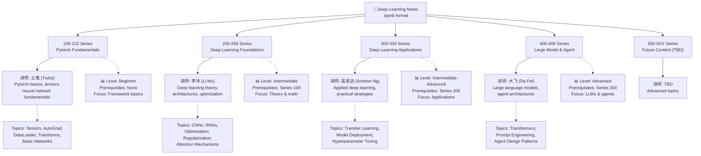
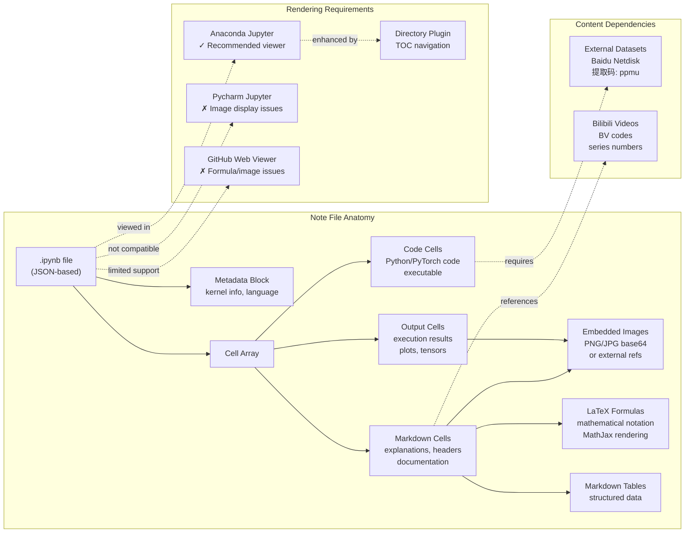
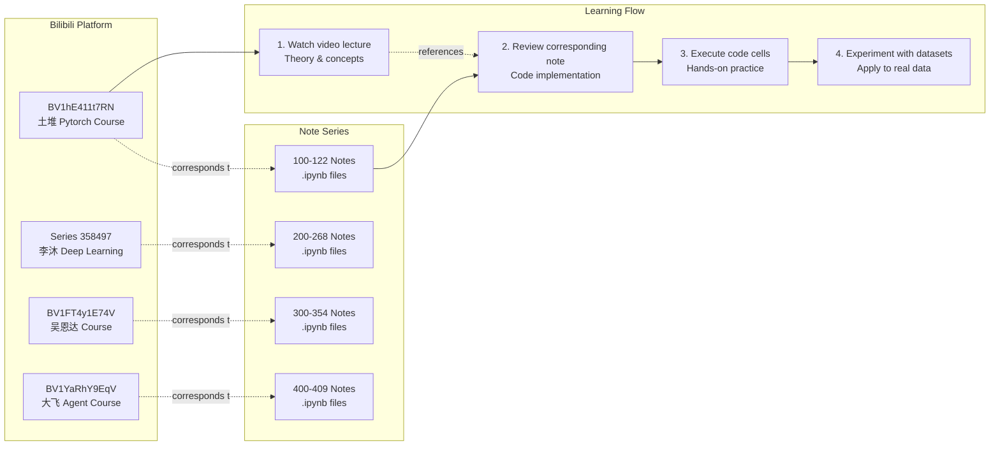
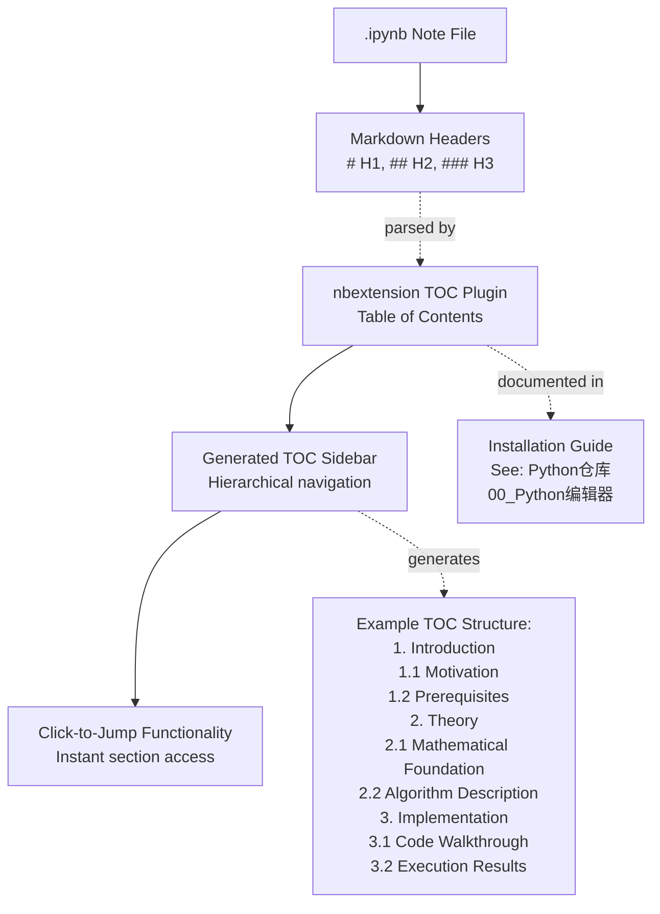
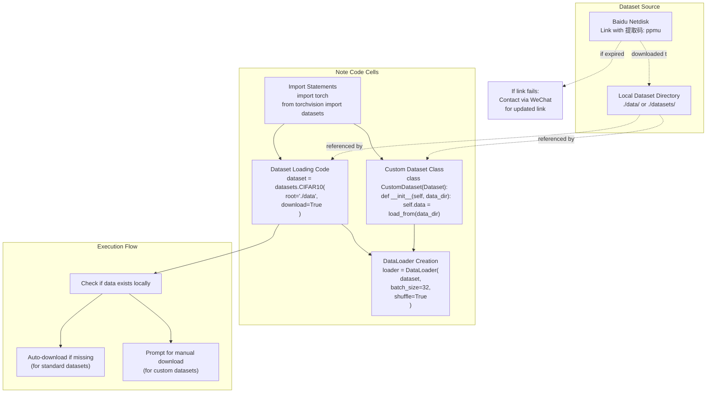
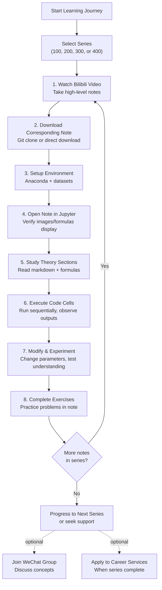

<!-- source: DeepWiki mcp.deepwiki.com · repo AccumulateMore/CV · page 2.4 Deep Learning Notes · fetched 2026-10-29 -->

# Deep Learning Notes

<details>
<summary>Relevant source files</summary>

The following files were used as context for generating this wiki page:

- [README.md](README.md)

</details>


## Purpose and Scope

The Deep Learning Notes constitute the core written educational materials in this platform, provided as Jupyter Notebook files (`.ipynb` format) that document and expand upon video lecture content. These notes cover comprehensive deep learning topics including Computer Vision (CV), Natural Language Processing (NLP), large language models, and AI agents across a structured progression from fundamentals through advanced applications.

The notes are designed to be studied alongside video lectures (see [Video Lectures on Bilibili](#2.3)) using datasets from shared resources (see [Datasets and Additional Resources](#2.5)). For technical setup and proper viewing environment, refer to [Jupyter Environment Setup](#3.2) and [Display Issues and Solutions](#3.3).

**Sources**: [README.md:1-1](), [README.md:34-38]()

---

## Note Series Architecture

The notes are organized into a hierarchical numbering system spanning series 100 through 500+, with each series corresponding to specific instructors and progressive skill levels. This architecture enables modular learning paths and clear prerequisite relationships.

### Series Numbering Taxonomy



**Sources**: [README.md:5-23]()

### Series Coverage Table

| Series Range | Note Count | Instructor | Primary Focus | Technical Domain |
|-------------|-----------|------------|---------------|------------------|
| 100-122 | 23 notes | 土堆 (Tudui) | Pytorch framework fundamentals | Framework mastery, tensor operations |
| 200-268 | 69 notes | 李沐 (Li Mu) | Deep learning theory and implementation | CV, NLP foundations, model architectures |
| 300-354 | 55 notes | 吴恩达 (Andrew Ng) | Applied deep learning strategies | Practical deployment, optimization |
| 400-409 | 10 notes | 大飞 (Da Fei) | Large language models and agents | LLM architecture, agent frameworks |
| 500-5XX | TBD | TBD | Future advanced topics | To be announced |

**Sources**: [README.md:5-23]()

---

## File Format and Technical Characteristics

### Notebook File Structure

Each note exists as a standalone `.ipynb` (Jupyter Notebook) file containing structured educational content with executable code cells, markdown explanations, mathematical formulas (LaTeX), and embedded visualizations.



**Sources**: [README.md:36-38]()

### Known Display Issues and Solutions

The notes contain technical rendering challenges when viewed in certain environments:

| Environment | Images | LaTeX Formulas | Recommended |
|------------|--------|----------------|-------------|
| **GitHub Web Viewer** | ⚠️ Incomplete display | ⚠️ Incomplete rendering | ❌ No |
| **Anaconda Jupyter Notebook** | ✅ Full display | ✅ Full rendering | ✅ Yes |
| **Pycharm Jupyter Plugin** | ❌ No display | ⚠️ Limited rendering | ❌ No |
| **Local download + Anaconda** | ✅ Full display | ✅ Full rendering | ✅ **Recommended** |

**Critical viewing requirement**: Notes must be downloaded locally and opened with Anaconda's Jupyter Notebook to ensure complete image and formula display. Online viewing through GitHub results in incomplete rendering due to parsing limitations.

**Sources**: [README.md:34-38]()

---

## Content Coverage by Domain

### Computer Vision (CV) Topics

The notes provide comprehensive coverage of computer vision techniques distributed across multiple series:

```mermaid
graph TB
    CV["Computer Vision Coverage"]
    
    subgraph "Series 100: CV Foundations"
        CV100_1["Image Loading & Display<br/>PIL, OpenCV integration"]
        CV100_2["Transforms & Augmentation<br/>torchvision.transforms"]
        CV100_3["Dataset Classes<br/>Custom datasets, DataLoader"]
        CV100_4["Basic CNNs<br/>Conv2d, Pooling, Activation"]
    end
    
    subgraph "Series 200: Advanced CV"
        CV200_1["Classic Architectures<br/>LeNet, AlexNet, VGG, ResNet"]
        CV200_2["Object Detection<br/>R-CNN family, YOLO"]
        CV200_3["Segmentation<br/>FCN, U-Net, Mask R-CNN"]
        CV200_4["Attention Mechanisms<br/>Self-attention, Vision Transformer"]
    end
    
    subgraph "Series 300: Applied CV"
        CV300_1["Transfer Learning<br/>Pre-trained models, fine-tuning"]
        CV300_2["Model Optimization<br/>Pruning, quantization"]
        CV300_3["Deployment Strategies<br/>ONNX, TensorRT"]
    end
    
    CV --> CV100_1
    CV --> CV100_2
    CV --> CV100_3
    CV --> CV100_4
    CV --> CV200_1
    CV --> CV200_2
    CV --> CV200_3
    CV --> CV200_4
    CV --> CV300_1
    CV --> CV300_2
    CV --> CV300_3
    
    Datasets["📦 CV Datasets<br/>CIFAR-10, ImageNet,<br/>COCO, Pascal VOC"]
    
    CV100_3 -.uses.-> Datasets
    CV200_2 -.uses.-> Datasets
    CV200_3 -.uses.-> Datasets
```



**Sources**: [README.md:1-1](), [README.md:5-23]()

### Natural Language Processing (NLP) Topics

NLP content is integrated throughout the series with increasing complexity:

```mermaid
graph TB
    NLP["NLP Coverage"]
    
    subgraph "Series 100: Text Basics"
        NLP100_1["Text Preprocessing<br/>Tokenization, embeddings"]
        NLP100_2["Sequence Models Intro<br/>RNN basics in PyTorch"]
    end
    
    subgraph "Series 200: Deep NLP"
        NLP200_1["RNN Architectures<br/>LSTM, GRU networks"]
        NLP200_2["Sequence-to-Sequence<br/>Encoder-decoder models"]
        NLP200_3["Attention Mechanisms<br/>Bahdanau, Luong attention"]
        NLP200_4["Transformer Architecture<br/>Self-attention, positional encoding"]
    end
    
    subgraph "Series 300: Applied NLP"
        NLP300_1["Text Classification<br/>Sentiment analysis"]
        NLP300_2["Named Entity Recognition<br/>Sequence tagging"]
        NLP300_3["Machine Translation<br/>Production systems"]
    end
    
    subgraph "Series 400: Large Models"
        NLP400_1["Pre-trained LLMs<br/>BERT, GPT architecture"]
        NLP400_2["Fine-tuning Strategies<br/>LoRA, prompt tuning"]
        NLP400_3["Agent Design<br/>ReAct, Tool use"]
    end
    
    NLP --> NLP100_1
    NLP --> NLP100_2
    NLP --> NLP200_1
    NLP --> NLP200_2
    NLP --> NLP200_3
    NLP --> NLP200_4
    NLP --> NLP300_1
    NLP --> NLP300_2
    NLP --> NLP300_3
    NLP --> NLP400_1
    NLP --> NLP400_2
    NLP --> NLP400_3
```



**Sources**: [README.md:1-1](), [README.md:17-19]()

### Large Language Models and AI Agents

The 400-series notes focus specifically on modern LLM architectures and agent design patterns:

| Note Range | Topic | Technical Focus |
|-----------|-------|----------------|
| 400-402 | LLM Foundations | Transformer architecture, attention mechanisms, scaling laws |
| 403-405 | Pre-training & Fine-tuning | Training strategies, LoRA, prompt engineering techniques |
| 406-407 | Agent Architectures | ReAct pattern, tool integration, memory systems |
| 408-409 | Agent Applications | Multi-agent systems, planning, execution frameworks |

**Sources**: [README.md:17-19]()

---

## Integration with Video Lectures

The notes are designed as companion materials to video lectures, with explicit correspondence mappings maintained throughout the platform.

### Video-Note Correspondence Architecture



**Sources**: [README.md:3-23]()

### Synchronization Strategy

The note-video correspondence follows these principles:

1. **One-to-One Mapping**: Each note file corresponds to one or more video lectures in sequence
2. **Code Elaboration**: Notes expand on code shown in videos with additional comments and variations
3. **Mathematical Detail**: LaTeX formulas in notes provide rigorous mathematical foundations referenced but not fully derived in videos
4. **Practical Extensions**: Notes include additional examples and edge cases beyond video scope
5. **Cross-References**: Markdown cells contain explicit Bilibili video timestamps for specific concepts

**Sources**: [README.md:3-23]()

---

## Note Navigation and Directory Structure

### Directory Plugin Integration

Notes are optimally navigated using a table-of-contents plugin for Jupyter Notebook that generates dynamic navigation based on markdown headers within each `.ipynb` file.



The directory plugin provides visual navigation as shown in the README screenshot, enabling rapid movement between sections within lengthy notebook files.

**Sources**: [README.md:38-40]()

### Typical Note Internal Structure

Most notes follow a consistent internal organization:

| Section | Purpose | Content Type |
|---------|---------|--------------|
| **Header / Title** | Identify topic and series position | Markdown with note number (e.g., "200-01: CNNs Introduction") |
| **Prerequisites** | List required prior knowledge | Markdown list with references to earlier note numbers |
| **Theory Overview** | Explain concepts and mathematics | Markdown + LaTeX formulas |
| **Code Implementation** | Provide working implementations | Python code cells with inline comments |
| **Execution Examples** | Demonstrate code with real data | Code cells + output cells with visualizations |
| **Exercises** | Practice problems for learners | Markdown descriptions + empty code cells |
| **References** | Link to papers, documentation | Markdown links to external resources |
| **Next Steps** | Point to subsequent notes | Markdown with note number references |

**Sources**: [README.md:36-38]()

---

## Dataset Integration Patterns

Notes reference and utilize datasets distributed via Baidu Netdisk, with specific loading patterns embedded in code cells.

### Dataset Loading Architecture



**Sources**: [README.md:25-29]()

### Common Dataset References in Notes

Notes across series utilize these dataset categories:

- **Series 100-122**: MNIST, Fashion-MNIST, CIFAR-10 (small-scale learning)
- **Series 200-268**: ImageNet subsets, COCO, Pascal VOC (CV tasks), Penn Treebank, WikiText (NLP tasks)
- **Series 300-354**: Domain-specific medical imaging, satellite imagery, custom industrial datasets
- **Series 400-409**: Large text corpora for LLM fine-tuning, instruction-following datasets

**Sources**: [README.md:25-29]()

---

## Note Content Examples and Patterns

### Code Cell Patterns

Typical code cell structure found throughout notes:

```python
# Example from Series 100: Tensor operations
import torch

# Clear documentation of purpose
# Create a sample tensor and perform operations

x = torch.randn(3, 4)  # Random tensor
y = torch.ones_like(x)  # Ones with same shape

# Step-by-step operations with comments
z = x + y  # Element-wise addition
print(f"Shape: {z.shape}")  # Output shape information
print(f"Device: {z.device}")  # Display device (CPU/GPU)
```

```python
# Example from Series 200: Model definition
import torch.nn as nn

class SimpleNet(nn.Module):
    """
    Simple CNN for image classification.
    Demonstrates conv -> pool -> fc pattern.
    """
    def __init__(self, num_classes=10):
        super(SimpleNet, self).__init__()
        # Convolutional layers
        self.conv1 = nn.Conv2d(3, 64, kernel_size=3, padding=1)
        self.pool = nn.MaxPool2d(2, 2)
        # Fully connected layers
        self.fc1 = nn.Linear(64 * 16 * 16, num_classes)
    
    def forward(self, x):
        x = self.pool(F.relu(self.conv1(x)))
        x = x.view(x.size(0), -1)  # Flatten
        x = self.fc1(x)
        return x
```

### Markdown Explanation Patterns

Notes consistently use markdown for conceptual explanations:

```markdown
## Convolutional Neural Networks

### Mathematical Foundation

The convolution operation is defined as:

$$ (f * g)(x) = \int_{-\infty}^{\infty} f(\tau)g(x-\tau)d\tau $$

For discrete 2D images, this becomes:

$$ S(i,j) = (I * K)(i,j) = \sum_m \sum_n I(m,n)K(i-m, j-n) $$

### Key Properties

1. **Local Connectivity**: Each neuron connects to local region
2. **Weight Sharing**: Same kernel applied across spatial dimensions
3. **Translation Equivariance**: Shift in input causes shift in output

### Implementation Notes

See code cell below for PyTorch implementation using `nn.Conv2d`...
```

**Sources**: [README.md:36-38]()

---

## Quality Assurance and Update Mechanism

### Note Verification Process

Notes undergo continuous quality assurance:

1. **Code Cell Execution**: All code cells must execute without errors in Anaconda Jupyter environment
2. **Image Rendering Check**: Embedded images verified in local viewing
3. **Formula Validation**: LaTeX formulas tested for proper MathJax rendering
4. **Dataset Availability**: Dataset links verified and fallback contact provided
5. **Video Synchronization**: Correspondence with Bilibili videos maintained

### Update Communication

- New notes in 500-5XX series announced via WeChat groups
- Users encouraged to star the repository on GitHub to receive notifications
- Dataset link updates provided through WeChat contact when Baidu links expire

**Sources**: [README.md:29-29](), [README.md:52-53]()

---

## Technical Specifications Summary

### File Format Specifications

| Attribute | Value |
|-----------|-------|
| **Format** | `.ipynb` (Jupyter Notebook JSON) |
| **Kernel** | Python 3.x (typically 3.7+) |
| **Primary Libraries** | PyTorch, torchvision, NumPy, Matplotlib |
| **Encoding** | UTF-8 |
| **Size Range** | 100KB - 50MB per file (depending on embedded outputs) |
| **Total Repository Size** | Multiple GB (all notes + embedded images) |

### Required Environment

| Component | Specification |
|-----------|--------------|
| **Viewer** | Anaconda Jupyter Notebook (mandatory) |
| **Python Version** | 3.7 or higher |
| **PyTorch Version** | 1.0 or higher (version varies by series) |
| **Navigation Plugin** | `jupyter_contrib_nbextensions` with TOC2 |
| **Display Backend** | MathJax 2.x or 3.x for formula rendering |

**Sources**: [README.md:36-38]()

---

## Usage Workflow

The recommended workflow for utilizing the notes effectively:



**Sources**: [README.md:3-40]()

---

## Summary

The Deep Learning Notes represent a comprehensive educational resource spanning 157+ Jupyter notebooks across four active series (100-409) with future expansion planned (500-5XX). These `.ipynb` files provide detailed implementations, mathematical foundations, and practical examples covering CV, NLP, and large language models. 

Critical requirements for effective use:
- **Download locally** (not web viewing)
- **Use Anaconda Jupyter Notebook** (not Pycharm)
- **Install TOC plugin** for navigation
- **Access datasets via Baidu Netdisk** (提取码: ppmu)
- **Study alongside corresponding Bilibili videos**

For technical setup assistance, see [Jupyter Environment Setup](#3.2). For troubleshooting display issues, see [Display Issues and Solutions](#3.3). For community support while studying notes, see [WeChat Learning Groups](#4.1).

**Sources**: [README.md:1-40]()

---

