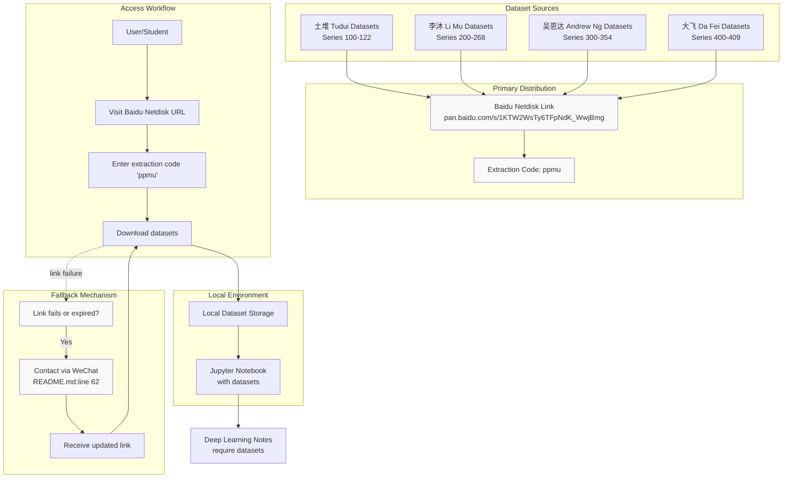
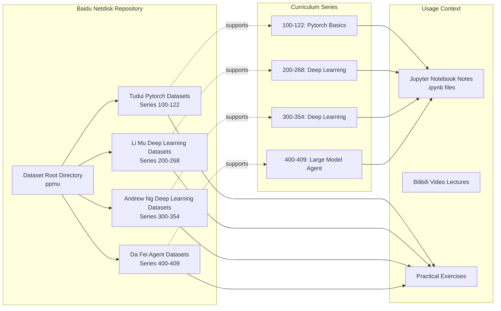
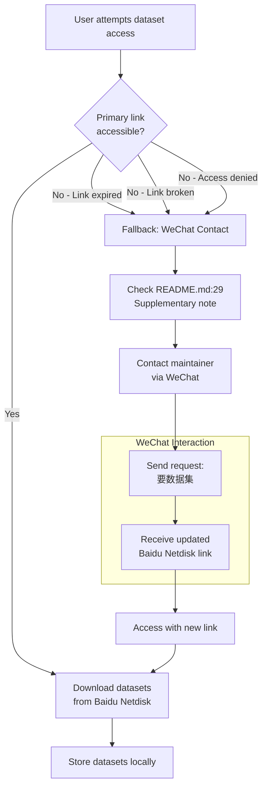
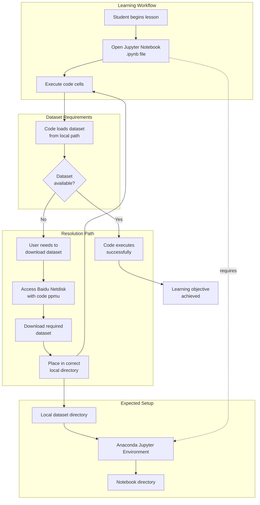
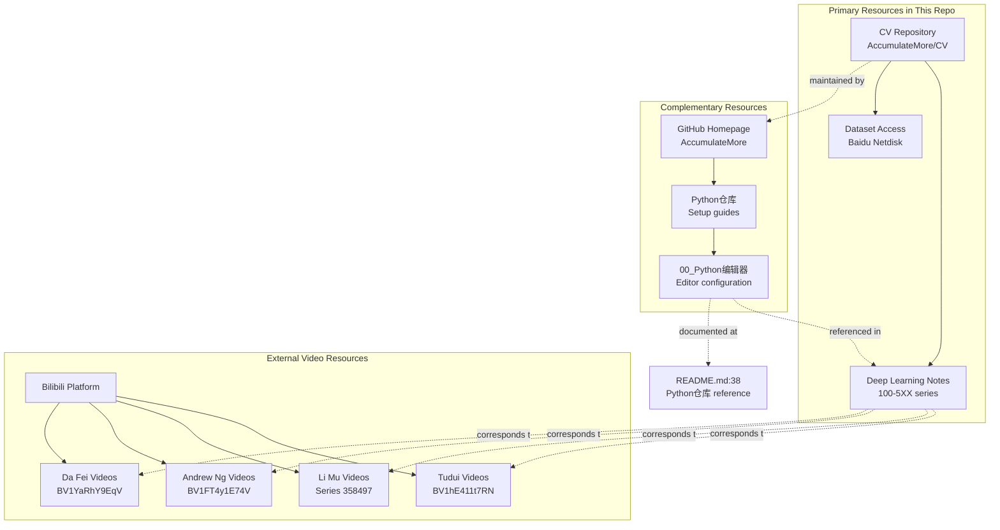

<!-- source: DeepWiki mcp.deepwiki.com · repo AccumulateMore/CV · page 2.5 Datasets and Additional Resources · fetched 2026-10-29 -->

# Datasets and Additional Resources

<details>
<summary>Relevant source files</summary>

The following files were used as context for generating this wiki page:

- [README.md](README.md)

</details>


This document covers the dataset distribution system and additional learning resources that support the educational content. It explains how to access datasets via Baidu Netdisk, the fallback mechanisms when primary links fail, and how these resources integrate with the curriculum series (100-500+).

For information about the curriculum structure and course series, see [2.1](#2.1). For details about the lecture notes themselves, see [2.4](#2.4). For video lecture access, see [2.3](#2.3).

---

## Purpose and Scope

The platform provides comprehensive datasets required for hands-on learning across all curriculum series. These datasets enable students to execute the code examples in the Jupyter notebook-based learning materials and complete practical exercises. The system uses Baidu Netdisk (百度网盘) as the primary distribution platform with a WeChat-based fallback mechanism to ensure continuous access.

Sources: [README.md:25-29]()

---

## Dataset Distribution Architecture

The following diagram illustrates the complete dataset access system, including primary and fallback channels:



**Dataset Access Architecture**: This diagram shows how datasets from all four instructors are aggregated into a single Baidu Netdisk link with extraction code `ppmu`. Users follow a straightforward workflow: visit the link, enter the code, and download. When the primary link fails, users contact via WeChat to receive an updated link, ensuring continuous access.

Sources: [README.md:25-29](), [README.md:62]()

---

## Primary Access Method

### Baidu Netdisk Distribution

The platform distributes all datasets through a single Baidu Netdisk (百度网盘) link, which serves as the centralized distribution point for all curriculum series.

**Access Details:**

| Property | Value |
|----------|-------|
| Platform | Baidu Netdisk (pan.baidu.com) |
| Link | https://pan.baidu.com/s/1KTW2WsTy6TFpNdK_WwjBmg |
| Extraction Code | `ppmu` |
| Coverage | All instructor datasets (土堆、李沐、吴恩达、大飞) |
| Access Type | Public link with extraction code |
| Cost | Free (无偿分享) |

Sources: [README.md:25-27]()

### Access Instructions

To access the datasets:

1. Navigate to the Baidu Netdisk URL provided in [README.md:27]()
2. When prompted, enter the extraction code: `ppmu`
3. Browse the directory structure organized by instructor/series
4. Select and download required datasets to local storage
5. Place datasets in the appropriate directory for Jupyter notebook access

The extraction code `ppmu` is permanently documented in the README to ensure users can always reference it.

Sources: [README.md:27]()

---

## Dataset Contents and Coverage

The Baidu Netdisk repository contains datasets corresponding to all major curriculum series:



**Dataset Coverage Mapping**: This diagram shows how datasets in the Baidu Netdisk repository align with curriculum series and support both notebook-based learning and video lectures.

Sources: [README.md:5-21](), [README.md:25-27]()

### Dataset Organization by Instructor

| Instructor | Series Range | Dataset Scope | Primary Topics |
|------------|--------------|---------------|----------------|
| 土堆 (Tudui) | 100-122 | Pytorch fundamentals | Tensor operations, neural network basics, training loops |
| 李沐 (Li Mu) | 200-268 | Deep learning techniques | CNN, RNN, optimization, advanced architectures |
| 吴恩达 (Andrew Ng) | 300-354 | Deep learning theory | Classical ML, neural networks, structured data |
| 大飞 (Da Fei) | 400-409 | Large model agents | LLM datasets, agent frameworks, prompt engineering |

Sources: [README.md:5-19](), [README.md:25]()

---

## Fallback Mechanism

The platform implements a robust fallback system to handle Baidu Netdisk link failures or expiration:



**Fallback Process Flow**: When the primary Baidu Netdisk link fails, users follow the documented fallback process through WeChat contact to receive an updated link.

Sources: [README.md:29](), [README.md:70-74]()

### Fallback Contact Process

The system explicitly documents the fallback mechanism in [README.md:29]():

> "补充说明：数据集链接如果失效了，下面有微信，可以联系我。"
> 
> Translation: "Supplementary note: If the dataset link fails, there is WeChat below, you can contact me."

**Valid Request Format:**

When contacting via WeChat for datasets, users should express their need directly. From the documented need examples in [README.md:70-74](), the format is:

```
需求示例: 要数据集
(Need example: Need datasets)
```

This explicit request format ensures efficient processing of dataset access requests.

Sources: [README.md:29](), [README.md:72]()

---

## Integration with Learning Materials

Datasets are designed to integrate seamlessly with the Jupyter notebook-based learning system:



**Dataset Integration in Learning Workflow**: This diagram shows how datasets integrate with the Jupyter notebook learning process, including the resolution path when datasets are missing.

Sources: [README.md:25-38]()

### Dataset Usage Context

Datasets support multiple aspects of the learning experience:

| Usage Context | Description | Related Documentation |
|---------------|-------------|----------------------|
| Code Execution | Notebooks contain code that loads and processes datasets | See [2.4](#2.4) for notebook structure |
| Hands-on Practice | Students apply learned concepts to real data | See [2.1](#2.1) for curriculum progression |
| Exercise Completion | Practical exercises require dataset manipulation | See [2.2](#2.2) for instructor-specific exercises |
| Project Development | Datasets enable project-based learning | See [5.3](#5.3) for project guidance |

Sources: [README.md:25-38]()

---

## Additional Resources Reference

Beyond datasets, the platform references additional resources for comprehensive learning support:



**Additional Resources Ecosystem**: This diagram shows how datasets relate to other learning resources, including video lectures, setup guides, and the maintainer's other repositories.

Sources: [README.md:36-50]()

### Python Repository (Python仓库) Reference

The README references a complementary repository for technical setup:

From [README.md:37-38]():

> "不会打开笔记的，百度查一下'Anaconda如何打开Jupyter Notebook文件'，或者我的主页Python仓库里面'00_Python编辑器'里面有写。"

This Python repository contains:
- Editor configuration guides (`00_Python编辑器`)
- Jupyter Notebook setup instructions
- Environment configuration details

The reference provides an alternative to web search for users needing setup assistance.

Sources: [README.md:37-38](), [README.md:47-49]()

### GitHub Homepage Reference

The maintainer's GitHub homepage hosts additional educational resources:

From [README.md:47-49]():

> "我的Github主页，还有其他优秀视频的笔记，希望能帮助到你~"
> 
> Link: https://github.com/AccumulateMore

This homepage provides access to:
- Other course note repositories
- Related educational content
- Additional technical resources

Sources: [README.md:47-49]()

---

## Dataset Access Troubleshooting

The following table summarizes common issues and resolution paths:

| Issue | Symptoms | Resolution | Reference |
|-------|----------|------------|-----------|
| Link Expired | Baidu Netdisk returns error | Contact via WeChat with request "要数据集" | [README.md:29](), [README.md:72]() |
| Missing Extraction Code | Cannot access shared folder | Use code `ppmu` as documented | [README.md:27]() |
| Unknown Directory Structure | Cannot find specific datasets | Datasets organized by instructor (土堆/李沐/吴恩达/大飞) | [README.md:25]() |
| Setup Questions | Need help configuring environment | Check Python仓库 `00_Python编辑器` section | [README.md:38]() |
| Dataset Not Working | Code fails to load data | Verify local dataset path matches notebook expectations | See [3.2](#3.2) for environment setup |

Sources: [README.md:27-38](), [README.md:70-74]()

---

## Resource Distribution Summary

The complete resource distribution system for this platform:

| Resource Type | Distribution Platform | Access Method | Fallback |
|---------------|----------------------|---------------|----------|
| Datasets | Baidu Netdisk | Link + extraction code `ppmu` | WeChat contact |
| Video Lectures | Bilibili | Direct BV codes | N/A - stable platform |
| Notebook Notes | GitHub Repository | Repository download | Always available |
| Setup Guides | Python仓库 (GitHub) | GitHub access | README documentation |
| Community Support | WeChat Groups | QR codes in README | Personal WeChat |

This multi-platform distribution strategy balances accessibility, reliability, and bandwidth considerations while providing robust fallback mechanisms for critical resources like datasets.

Sources: [README.md:1-180]()

---

## Summary

The dataset distribution system provides:

1. **Centralized Access**: Single Baidu Netdisk link with extraction code `ppmu` for all instructor datasets
2. **Complete Coverage**: Datasets spanning all curriculum series (100-500+) from four instructors
3. **Robust Fallback**: WeChat-based contact mechanism when primary link fails
4. **Seamless Integration**: Datasets designed to work directly with Jupyter notebook learning materials
5. **Free Distribution**: All datasets provided at no cost (无偿分享) to support learning
6. **Complementary Resources**: References to Python仓库 and GitHub homepage for additional support

The system ensures continuous access to essential learning resources through redundant distribution channels and clear documentation of fallback procedures.

Sources: [README.md:25-50]()

---

