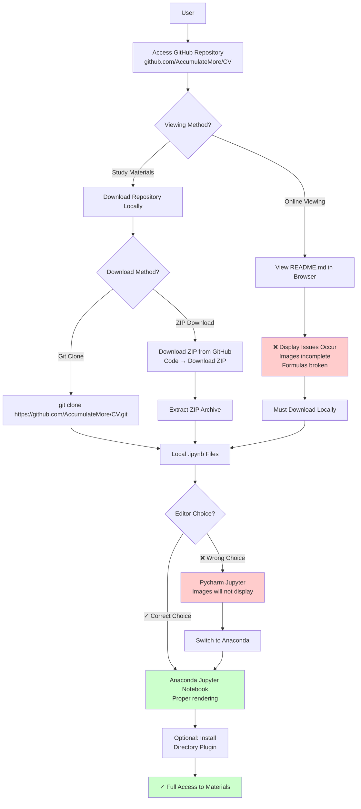
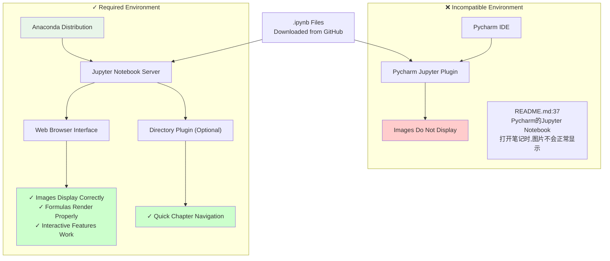
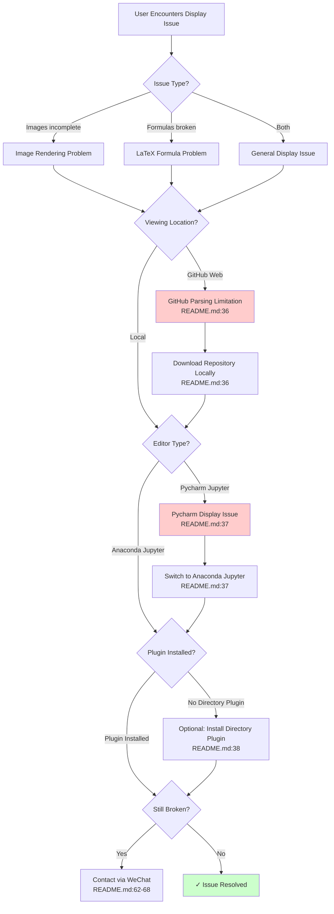
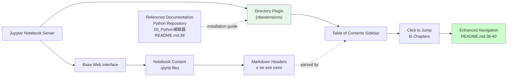
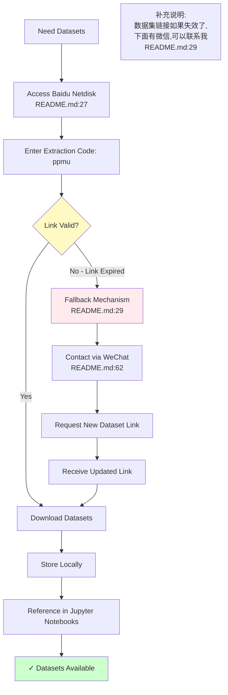
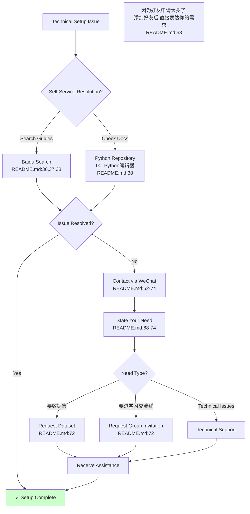

<!-- source: DeepWiki mcp.deepwiki.com · repo AccumulateMore/CV · page 3 Technical Setup and Access · fetched 2026-10-29 -->

# Technical Setup and Access

<details>
<summary>Relevant source files</summary>

The following files were used as context for generating this wiki page:

- [README.md](README.md)

</details>


This document provides comprehensive technical instructions for accessing, downloading, and properly rendering the deep learning educational materials in the CV repository. It addresses known display issues with online viewing and specifies the required technical environment for optimal content consumption.

For information about the educational content structure and curriculum, see [Educational Content System](#2). For troubleshooting dataset access and community support, see [Community and Support System](#4).

---

## Purpose and Scope

This page documents the technical requirements and setup procedures necessary to access and view the Jupyter notebook-based deep learning notes. Due to known rendering limitations on GitHub's web interface, specific local environment configuration is required for proper display of images and mathematical formulas. This document covers:

- Repository access and download procedures
- Required Jupyter Notebook environment configuration
- Common display issues and their resolutions
- Recommended tools and plugins for optimal navigation
- Dataset access procedures with fallback mechanisms

---

## Repository Access Methods

The educational content is distributed through GitHub and requires specific access patterns based on viewing method. The following diagram illustrates the access architecture:

### Access Decision Flow



**Sources:** [README.md:34-40]()

### Online Viewing Limitations

When viewing notebooks directly on GitHub's web interface, the following rendering issues occur due to GitHub's parsing limitations:

| Issue Type | Manifestation | Cause | Impact |
|------------|---------------|-------|---------|
| Image Display | Incomplete or missing images | GitHub parsing failure | Critical content loss |
| Formula Rendering | Broken mathematical notation | LaTeX rendering issues | Cannot understand mathematical concepts |
| Notebook Navigation | Linear scrolling only | No interactive features | Poor learning experience |

As documented in [README.md:36](): "在线观看笔记时，有时会出现图片（或公式）显示不完整，这是Github网站没有解析好" (When viewing notes online, images or formulas may display incompletely due to GitHub website parsing issues).

**Solution:** The only reliable method is local download and viewing in a properly configured Jupyter environment.

**Sources:** [README.md:34-36]()

---

## Local Download Procedures

### Download Methods

Two primary methods are available for obtaining the repository locally:

#### Method 1: Git Clone (Recommended for Version Control)

```bash
git clone https://github.com/AccumulateMore/CV.git
cd CV
```

This method:
- Preserves Git history
- Enables easy updates via `git pull`
- Maintains repository structure

#### Method 2: ZIP Archive Download

1. Navigate to https://github.com/AccumulateMore/CV
2. Click the green "Code" button
3. Select "Download ZIP"
4. Extract the archive to your working directory

This method:
- No Git required
- Simpler for non-technical users
- Snapshot of current state only

For users unfamiliar with GitHub download procedures, [README.md:36]() references: "不会下载笔记的，百度查一下'Github如何下载文件'" (If you don't know how to download notes, search Baidu for 'How to download files from GitHub').

**Sources:** [README.md:36]()

### File Structure

After download, the repository contains Jupyter notebook files (`.ipynb` format) organized by series:

```
CV/
├── README.md                    # Central documentation hub
├── 100-122_*.ipynb             # Pytorch series (讲师: 土堆)
├── 200-268_*.ipynb             # Deep Learning series (讲师: 李沐)
├── 300-354_*.ipynb             # Deep Learning series (讲师: 吴恩达)
├── 400-409_*.ipynb             # Large Model Agent series (讲师: 大飞)
└── [Future: 500-5XX_*.ipynb]  # Upcoming content
```

Each `.ipynb` file is a Jupyter notebook containing:
- Text explanations
- Code cells with examples
- Embedded images and diagrams
- Mathematical formulas in LaTeX format
- Exercise problems and solutions

**Sources:** [README.md:5-21]()

---

## Jupyter Environment Configuration

### Required Environment: Anaconda Jupyter Notebook

The notebooks **must** be opened using Anaconda's Jupyter Notebook environment. This is explicitly stated in [README.md:37](): "笔记是用 Anaconda 的 Jupyter Notebook 打开的" (Notes are opened with Anaconda's Jupyter Notebook).

### Environment Architecture



**Sources:** [README.md:37-38]()

### Why Pycharm Jupyter Fails

As explicitly documented in [README.md:37](): "Pycharm 的 Jupyter Notebook 打开笔记时，图片不会正常显示" (When opening notes with Pycharm's Jupyter Notebook, images will not display normally).

**Technical reason:** Pycharm's Jupyter implementation handles image paths and embedded resources differently from standard Jupyter Notebook, causing rendering failures for notebook-embedded images.

### Anaconda Installation Reference

For users who need installation guidance, [README.md:37-38]() provides two resources:

1. **External Search:** "百度查一下'Anaconda如何打开Jupyter Notebook文件'" (Search Baidu for 'How to open Jupyter Notebook files with Anaconda')

2. **Internal Documentation:** "或者我的主页Python仓库里面'00_Python编辑器'里面有写" (Or in my homepage's Python repository under '00_Python编辑器' there are instructions)

The Python repository is accessible via the maintainer's GitHub homepage: [README.md:47-49]()
- URL: https://github.com/AccumulateMore
- Specific location: `00_Python编辑器` directory
- Content: Editor setup and configuration guides

**Sources:** [README.md:37-38, 47-49]()

---

## Display Issue Resolution

### Problem-Solution Mapping



**Sources:** [README.md:34-40, 62-68]()

### Technical Root Causes

#### GitHub Web Rendering

[README.md:36]() explicitly states: "这是Github网站没有解析好" (This is because the GitHub website hasn't parsed it correctly).

**Root cause:** GitHub's notebook rendering engine has limitations in:
- Processing embedded images with certain path structures
- Rendering complex LaTeX mathematical expressions
- Handling large notebook files with multiple resources

**Resolution:** Local download eliminates dependency on GitHub's web renderer.

#### Pycharm Jupyter Incompatibility

[README.md:37]() documents: "Pycharm 的 Jupyter Notebook 打开笔记时，图片不会正常显示" (When opening notes with Pycharm's Jupyter Notebook, images will not display normally).

**Root cause:** Pycharm's Jupyter plugin uses a different image resolution mechanism that fails to locate embedded notebook images.

**Resolution:** Use Anaconda's standard Jupyter Notebook server.

**Sources:** [README.md:36-37]()

---

## Recommended Tools and Plugins

### Directory Plugin for Jupyter Notebook

The repository strongly recommends installing a table of contents/directory plugin for efficient navigation through lengthy notebooks.

#### Plugin Purpose

As stated in [README.md:38](): "安装 Jupyter Notebook 的目录插件，可以快速通过目录，跳转到相应的章节" (Installing Jupyter Notebook's directory plugin allows quick navigation through the table of contents to jump to corresponding chapters).

#### Visual Reference

[README.md:40]() includes a screenshot showing the directory plugin interface with chapter navigation sidebar.

#### Installation Resources

Two installation guidance sources are provided in [README.md:38]():

1. **External Search:** "百度查一下'Jupyter Notebook如何安装目录'" (Search Baidu for 'How to install table of contents in Jupyter Notebook')

2. **Internal Documentation:** "或者我的主页Python仓库里面'00_Python编辑器'里面有相关链接" (Or in my homepage's Python repository under '00_Python编辑器' there are related links)

### Plugin Architecture Integration



**Sources:** [README.md:38-40]()

---

## Dataset Access Procedures

### Primary Access: Baidu Netdisk

Dataset files required for the course exercises are hosted on Baidu Netdisk (百度网盘).

**Access Information** [README.md:25-27]():
- Link: https://pan.baidu.com/s/1KTW2WsTy6TFpNdK_WwjBmg
- Extraction Code: `ppmu`
- Content: Datasets for all lecture series (土堆, 李沐, 吴恩达, 大飞)

### Dataset Access Flow



**Sources:** [README.md:25-29, 62]()

### Fallback Mechanism

[README.md:29]() provides explicit fallback instructions: "补充说明：数据集链接如果失效了，下面有微信，可以联系我。" (Supplementary note: If the dataset link expires, there is WeChat contact below, you can contact me.)

This resilient design ensures continuous dataset access even when primary links fail.

For WeChat contact information, see [Community and Support System](#4). The contact details are provided in [README.md:62]() with QR codes and contact protocols.

**Sources:** [README.md:29, 62]()

---

## Complete Setup Checklist

The following table provides a comprehensive checklist for proper technical setup:

| Step | Component | Requirement | Verification | Reference |
|------|-----------|-------------|--------------|-----------|
| 1 | Repository Access | Download locally (not web view) | `.ipynb` files present | [README.md:36]() |
| 2 | Python Distribution | Anaconda installed | `jupyter --version` works | [README.md:37]() |
| 3 | Editor | Anaconda Jupyter (NOT Pycharm) | Launch via `jupyter notebook` | [README.md:37]() |
| 4 | Dataset Access | Baidu Netdisk extraction code `ppmu` | Files downloaded | [README.md:27]() |
| 5 | Display Verification | Images and formulas render | Open sample notebook | [README.md:36]() |
| 6 | Optional Enhancement | Directory plugin installed | TOC sidebar visible | [README.md:38]() |

---

## Additional Setup Resources

### Python Repository Reference

For detailed editor configuration and environment setup guidance, the maintainer provides additional documentation in a separate Python repository:

**Location:** https://github.com/AccumulateMore (maintainer's GitHub homepage)
**Specific Directory:** `00_Python编辑器`
**Content Includes:**
- Anaconda installation guides
- Jupyter Notebook setup procedures
- Directory plugin installation instructions
- Editor configuration best practices

As referenced in [README.md:38](): "或者我的主页Python仓库里面'00_Python编辑器'里面有写" (Or in my homepage's Python repository under '00_Python编辑器' there are instructions).

The maintainer's GitHub homepage containing multiple repositories is mentioned in [README.md:47-49](): "我的Github主页，还有其他优秀视频的笔记" (My GitHub homepage has notes from other excellent videos).

**Sources:** [README.md:38, 47-49]()

### Support Escalation Path

When technical setup issues cannot be resolved through documentation:



**Sources:** [README.md:36-38, 62-74]()

For specific support protocols and valid contact reasons, see [Community and Support System](#4).

---

## Summary

Proper technical setup requires:

1. **Local Environment:** Download repository locally; online viewing is insufficient
2. **Specific Editor:** Anaconda Jupyter Notebook (Pycharm Jupyter is incompatible)
3. **Dataset Access:** Baidu Netdisk with extraction code `ppmu`, WeChat fallback available
4. **Optional Enhancement:** Directory plugin for navigation improvement
5. **Reference Documentation:** Python repository (`00_Python编辑器`) for detailed guides

These requirements ensure proper rendering of images, formulas, and interactive features essential for effective learning from the educational materials.

**Sources:** [README.md:34-40, 25-29, 47-49]()

---

