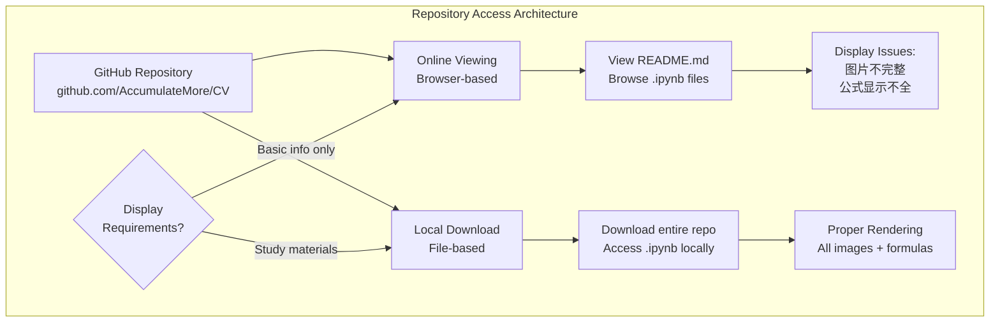
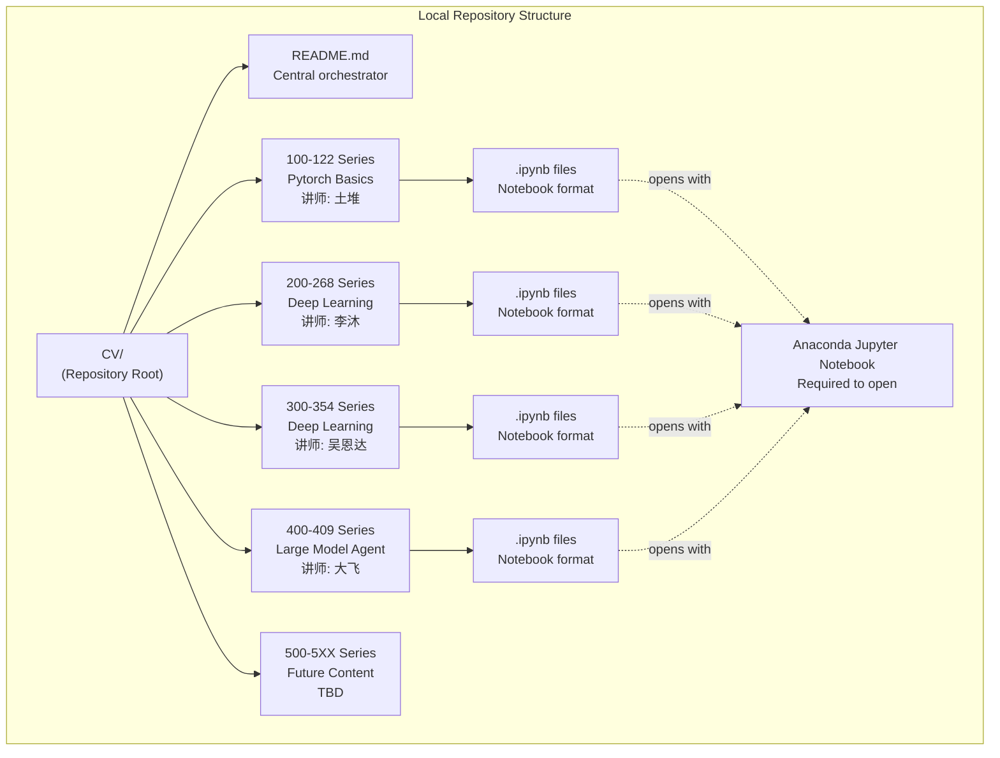
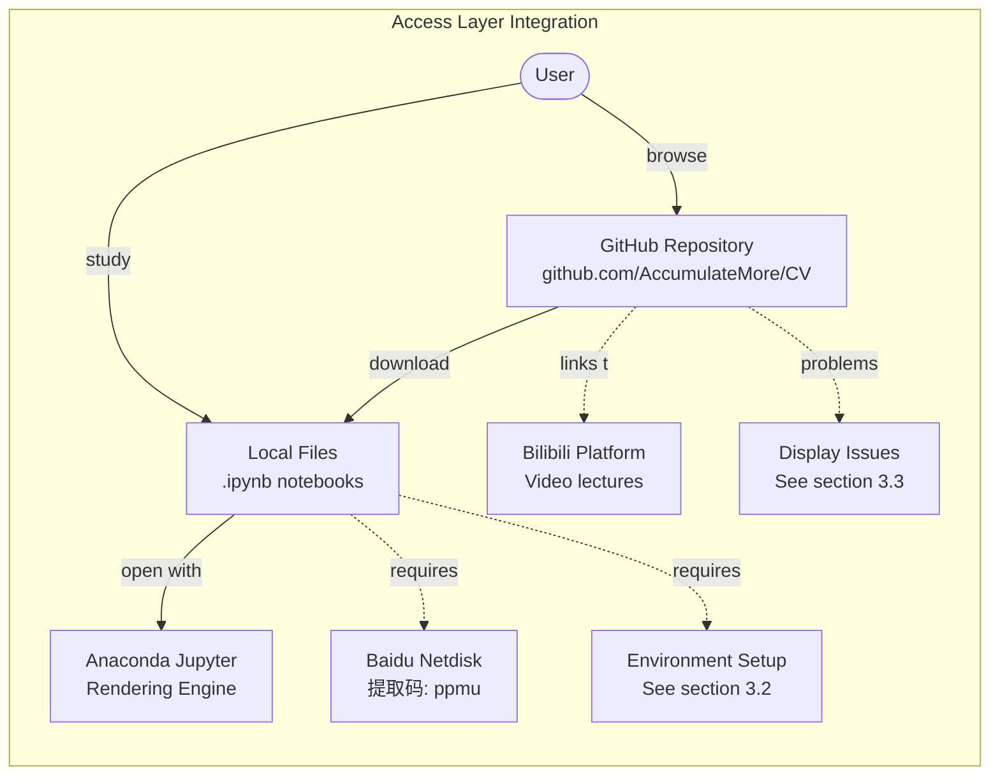

<!-- source: DeepWiki mcp.deepwiki.com · repo AccumulateMore/CV · page 3.1 Accessing the Repository · fetched 2026-10-29 -->

# Accessing the Repository

<details>
<summary>Relevant source files</summary>

The following files were used as context for generating this wiki page:

- [README.md](README.md)

</details>


## Purpose and Scope

This page explains how to access the CV repository hosted on GitHub, download the deep learning notes locally, and understand when local download is necessary versus online viewing. This covers the initial access layer of the Technical Delivery Pillar, which forms the foundation for all subsequent technical setup.

For information about setting up the proper Jupyter environment after downloading, see [Jupyter Environment Setup](#3.2). For troubleshooting specific display problems, see [Display Issues and Solutions](#3.3).

---

## Repository Location

The CV repository is hosted on GitHub at the following location:

**Repository URL:** `https://github.com/AccumulateMore/CV`

The repository consists of a single primary file:
- `README.md` - The complete system orchestrator containing curriculum information, access instructions, community details, and career services

All educational content (Jupyter notebook files with `.ipynb` extension) is distributed through this repository, organized by the series numbering system (100-122, 200-268, 300-354, 400-409, 500-5XX).

Sources: [README.md:1-180]()

---

## Access Methods Overview

The repository supports two primary access methods, each with distinct characteristics and use cases:



**Figure 1: Repository Access Decision Flow**

Sources: [README.md:34-40]()

---

## Online Viewing vs. Local Download

### Online Viewing Characteristics

**Advantages:**
- Immediate access without download
- Suitable for browsing curriculum structure
- Good for accessing community information (WeChat QR codes, group details)
- Sufficient for reading career services information

**Known Limitations:**
- Images may display incompletely (图片不完整)
- Mathematical formulas may not render properly (公式显示不全)
- GitHub's parser does not fully process Jupyter notebook formatting
- Not suitable for studying technical content

**Use Cases:**
| Task | Online Viewing Suitable? |
|------|--------------------------|
| Read curriculum overview | ✓ Yes |
| Access Bilibili video links | ✓ Yes |
| View WeChat contact information | ✓ Yes |
| Study notebook content | ✗ No - Download required |
| View images in notebooks | ✗ No - Display issues |
| Read formulas in notes | ✗ No - Rendering problems |

Sources: [README.md:34-37]()

### Local Download Characteristics

**Advantages:**
- Complete rendering of all images
- Proper display of mathematical formulas
- Full functionality when opened in Jupyter Notebook
- Required for actual studying and learning

**Requirements:**
- Anaconda Jupyter Notebook environment (see [3.2](#3.2))
- Local disk space for repository files
- Understanding of GitHub file download process

**Mandatory Download Scenarios:**
- Studying any notebook content from series 100-5XX
- Viewing embedded images in notes
- Reading mathematical formulas
- Using the notes alongside video lectures

Sources: [README.md:34-40]()

---

## File Structure After Download

When the repository is downloaded locally, the file structure contains notebook files organized by series:



**Figure 2: Downloaded Repository File Organization**

Sources: [README.md:5-21](), [README.md:36-38]()

---

## Download Process

### Method 1: GitHub Web Interface Download

The standard approach for downloading the repository through GitHub's web interface:

**Steps:**
1. Navigate to `https://github.com/AccumulateMore/CV`
2. Click the green "Code" button
3. Select "Download ZIP"
4. Extract the ZIP file to your local machine
5. Navigate to the extracted folder

**Note:** The README.md acknowledges users may need guidance with this process and suggests searching for "Github如何下载文件" (How to download files from GitHub) if unfamiliar with the process.

Sources: [README.md:36]()

### Method 2: Git Clone (Advanced Users)

For users familiar with Git version control:

```
git clone https://github.com/AccumulateMore/CV.git
cd CV
```

This method provides version control capabilities and easier updates when new content is added.

---

## Access Decision Matrix

The following matrix helps determine the appropriate access method based on user intent:

| User Intent | Access Method | Rationale |
|-------------|---------------|-----------|
| Check available courses | Online viewing | README.md displays properly online |
| Copy Bilibili video links | Online viewing | Text links render correctly |
| Get WeChat contact | Online viewing | QR codes and text display adequately |
| Review job postings | Online viewing | Text-based content renders properly |
| Study Pytorch basics (100-122) | **Local download** | Notebooks require proper rendering |
| Study Li Mu notes (200-268) | **Local download** | Complex formulas need local viewer |
| Study Andrew Ng notes (300-354) | **Local download** | Images and equations require local |
| Study Agent notes (400-409) | **Local download** | All educational content needs local |
| Use datasets with notes | **Local download** | Notes reference local dataset files |

Sources: [README.md:34-40]()

---

## Integration with Other Components



**Figure 3: Repository Access Integration Architecture**

This diagram shows how repository access integrates with:
- The Jupyter rendering environment (detailed in [3.2](#3.2))
- Dataset access from Baidu Netdisk (detailed in [2.5](#2.5))
- Video lectures on Bilibili (detailed in [2.3](#2.3))
- Display issue resolution (detailed in [3.3](#3.3))

Sources: [README.md:25-40]()

---

## File References and Citations

### README.md Content Structure

The `README.md` file contains several critical sections that users access:

| Section | Line Range | Content | Access Requirement |
|---------|-----------|---------|-------------------|
| Video links | [README.md:3-23]() | Bilibili URLs for all series | Online sufficient |
| Dataset links | [README.md:25-29]() | Baidu Netdisk with extraction code | Online sufficient |
| Display warnings | [README.md:34-40]() | Known rendering issues | Online sufficient |
| Community info | [README.md:58-75]() | WeChat groups and contact | Online sufficient |
| Job postings | [README.md:79-144]() | Career opportunities | Online sufficient |
| Resume guidance | [README.md:148-175]() | Career preparation tips | Online sufficient |

The key distinction: **README.md content renders properly online, but .ipynb notebook files do not.**

Sources: [README.md:1-180]()

---

## Critical Technical Notes

### Why Local Download is Mandatory for Study

The system explicitly warns about display limitations:

**Official Statement (Chinese):** "在线观看笔记时，有时会出现图片（或公式）显示不完整，这是Github网站没有解析好，笔记下载到本地观看就正常了。"

**Translation:** "When viewing notes online, sometimes images (or formulas) display incompletely. This is because the GitHub website doesn't parse them properly. Downloading the notes locally for viewing resolves this issue."

This is not an optional recommendation but a **mandatory requirement** for using the educational content effectively. The display issues are:
- Caused by GitHub's limited Jupyter notebook rendering
- Systematic, not sporadic
- Affect core educational content (images and formulas)
- Only resolved through local download + proper environment setup

Sources: [README.md:34-37]()

### Relationship to Python Repository

The README.md references another repository for additional setup guidance:

**Reference:** "我的主页Python仓库里面'00_Python编辑器'里面有写" (My homepage Python repository has this written in '00_Python编辑器')

This Python repository (Python仓库) is mentioned at [README.md:38]() and provides supplementary setup instructions for editor configuration, documented further in [7.1](#7.1).

Sources: [README.md:37-38]()

---

## Next Steps After Access

Once the repository is accessed and downloaded:

1. **Set up Jupyter environment** - See [Jupyter Environment Setup](#3.2) for Anaconda installation
2. **Install directory plugin** - See [Recommended Tools and Plugins](#3.4) for navigation enhancement
3. **Understand display issues** - See [Display Issues and Solutions](#3.3) for troubleshooting
4. **Access datasets** - See [Datasets and Additional Resources](#2.5) for Baidu Netdisk setup
5. **Begin learning** - See [Curriculum Structure and Course Series](#2.1) for study path

The access layer is the foundation of the Technical Delivery Pillar. Without proper local download and setup, the educational content cannot be consumed effectively.

Sources: [README.md:34-40]()

---

