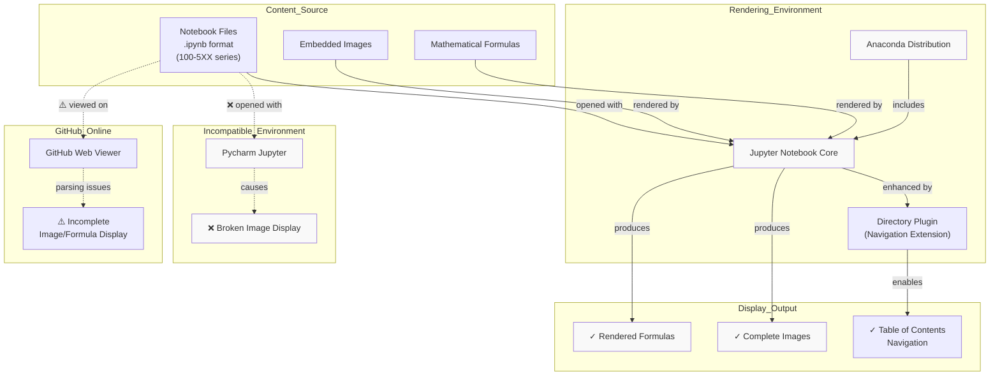
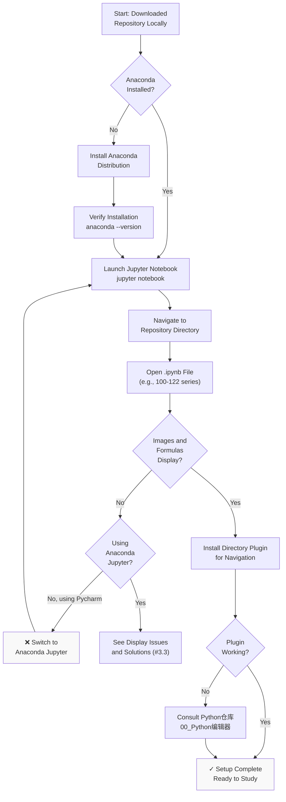
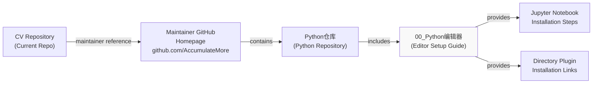
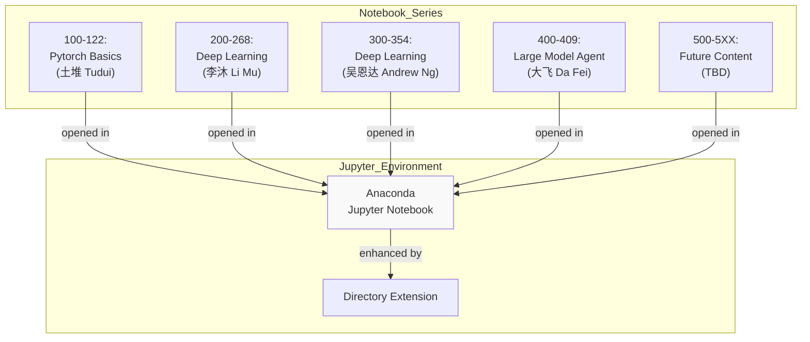

<!-- source: DeepWiki mcp.deepwiki.com · repo AccumulateMore/CV · page 3.2 Jupyter Environment Setup · fetched 2026-10-29 -->

# Jupyter Environment Setup

Relevant source files

The following files were used as context for generating this wiki page:

- [README.md](README.md)

This document details the required Jupyter Notebook environment for accessing and rendering the deep learning notes in this repository. It covers the specific requirement for Anaconda Jupyter Notebook, explains why alternative editors are incompatible, and provides setup instructions for optimal viewing experience with proper image and formula display.

For information about downloading notes from the repository, see [Accessing the Repository](#3.1). For troubleshooting display problems, see [Display Issues and Solutions](#3.3). For additional setup tools and plugins, see [Recommended Tools and Plugins](#3.4).

---

## Purpose and Scope

The Jupyter notebooks (`.ipynb` files) in this repository contain deep learning educational materials with embedded images, mathematical formulas, and formatted content. These materials require a specific rendering environment to display correctly. This page documents:

- The mandatory requirement for Anaconda Jupyter Notebook
- Why Pycharm Jupyter is incompatible and must not be used
- Setup procedures for the Anaconda environment
- Directory plugin installation for navigation
- References to additional setup documentation in the Python repository

---

## Environment Requirements

### Mandatory: Anaconda Jupyter Notebook

The notebooks in this repository **must** be opened using Anaconda's Jupyter Notebook application. This is explicitly stated in the repository documentation and is non-negotiable for proper content rendering.

| Environment | Status | Reason |
|-------------|--------|--------|
| Anaconda Jupyter Notebook | ✓ **Required** | Correct image display, formula rendering, full content visibility |
| Pycharm Jupyter | ❌ **Incompatible** | Images do not display correctly, rendering failures |
| Online GitHub Viewer | ⚠️ **Limited** | Incomplete image/formula display due to GitHub parsing issues |

**Critical Requirement**: Images will not display properly when using Pycharm's Jupyter Notebook implementation. All notes were created and tested using Anaconda Jupyter Notebook.

Sources: [README.md:36-38]()

---

## Technical Architecture

### Rendering Stack Overview

**Diagram: Jupyter Environment Rendering Architecture**

This diagram illustrates why Anaconda Jupyter Notebook is the only supported environment. The Pycharm Jupyter implementation fails to render images correctly, while GitHub's online viewer has parsing limitations that result in incomplete formula and image display.

Sources: [README.md:36-38]()

---

## Setup Workflow

### Installation and Configuration Process

**Diagram: Jupyter Environment Setup Workflow**

This flowchart maps the complete setup process from initial repository download through plugin installation, including decision points and troubleshooting paths.

Sources: [README.md:36-40]()

---

## Anaconda Jupyter Notebook Setup

### Why Anaconda Jupyter is Required

The repository documentation explicitly states:

> "Pycharm 的 Jupyter Notebook 打开笔记时，图片不会正常显示，笔记是用 Anaconda 的 Jupyter Notebook 打开的。"

Translation: "When Pycharm's Jupyter Notebook opens the notes, images will not display normally. The notes are opened using Anaconda's Jupyter Notebook."

**Technical Reason**: The notebooks were authored and tested using Anaconda's Jupyter implementation. The image embedding and formula rendering rely on specific behaviors in Anaconda's Jupyter kernel and frontend that are not replicated in Pycharm's Jupyter implementation.

Sources: [README.md:37]()

### Installation Reference

For users unfamiliar with Anaconda Jupyter Notebook installation and usage, the repository provides two reference sources:

1. **General Search Method**: Search for "Anaconda如何打开Jupyter Notebook文件" (How to open Jupyter Notebook files with Anaconda)

2. **Maintainer's Python Repository**: The maintainer's GitHub homepage includes a Python repository with detailed setup guides in the `00_Python编辑器` (00_Python Editor) section

Sources: [README.md:37-38](), [README.md:49]()

### Accessing the Python Repository

**Diagram: Python Repository Reference Structure**

Sources: [README.md:37-38](), [README.md:49]()

---

## Directory Plugin for Navigation

### Purpose and Functionality

The directory plugin adds a table of contents sidebar to Jupyter notebooks, enabling quick navigation between sections. The repository includes a visual example of this functionality:

> "安装 Jupyter Notebook 的目录插件，可以快速通过目录，跳转到相应的章节"

Translation: "Install the Jupyter Notebook directory plugin to quickly navigate through the table of contents and jump to corresponding sections."

### Visual Reference

The repository provides a screenshot showing the directory plugin in action at [README.md:40]().

### Installation Instructions

Two methods are documented:

| Method | Source | Details |
|--------|--------|---------|
| Search Method | Web Search | Search for "Jupyter Notebook如何安装目录" (How to install directory in Jupyter Notebook) |
| Python Repository | `00_Python编辑器` | Detailed instructions with relevant links in the maintainer's Python repository |

Sources: [README.md:38-40]()

---

## Environment Configuration Matrix

The following matrix summarizes the technical specifications and requirements:

| Component | Requirement | Status | Notes |
|-----------|-------------|--------|-------|
| **Base System** | Anaconda Distribution | Mandatory | Includes Python and Jupyter |
| **Notebook Application** | Anaconda Jupyter Notebook | Mandatory | Not Pycharm, not JupyterLab |
| **Navigation Plugin** | Directory/TOC Extension | Recommended | Enhances usability |
| **File Format** | `.ipynb` Jupyter Notebooks | Read-only | Series 100-5XX |
| **Python Version** | Anaconda-included | Automatic | Managed by Anaconda |
| **Kernel** | Anaconda Jupyter Kernel | Automatic | Handles rendering |

Sources: [README.md:36-40]()

---

## Usage Instructions

### Opening Notebooks Correctly

1. **Launch Anaconda Jupyter Notebook**:
   - Do not use Pycharm's Jupyter implementation
   - Do not use command line `jupyter lab` (use `jupyter notebook`)
   
2. **Navigate to Repository**:
   - Browse to the locally downloaded repository directory
   - Locate the desired `.ipynb` file (e.g., series 100-122, 200-268, etc.)

3. **Open and Verify**:
   - Click to open the notebook
   - Verify that images display correctly
   - Verify that mathematical formulas render properly

4. **Use Directory Navigation** (if plugin installed):
   - Access the table of contents sidebar
   - Click section headings to jump to specific content

Sources: [README.md:36-40]()

---

## File Structure and Note Organization

The notebooks follow a structured numbering system:

**Diagram: Notebook Series and Rendering Environment**

All notebook series (100-5XX) must be opened using the same Anaconda Jupyter Notebook environment to ensure consistent rendering across all content.

Sources: [README.md:5-23](), [README.md:37]()

---

## Troubleshooting Common Setup Issues

### Issue: Images Not Displaying

| Problem | Cause | Solution |
|---------|-------|----------|
| Images show as broken links | Using Pycharm Jupyter | Switch to Anaconda Jupyter Notebook |
| Images partially visible | Viewing on GitHub online | Download locally and use Anaconda |
| Images completely missing | Wrong notebook implementation | Verify using Anaconda's implementation |

### Issue: Formulas Not Rendering

| Problem | Cause | Solution |
|---------|-------|----------|
| Raw LaTeX code visible | GitHub parsing limitation | Download and open in Anaconda Jupyter |
| Formula display incomplete | Online viewer issues | Use local Anaconda environment |

### Issue: Cannot Find Installation Instructions

| Problem | Solution |
|---------|----------|
| Unfamiliar with Anaconda setup | Search "Anaconda如何打开Jupyter Notebook文件" |
| Need detailed guide | Check Python仓库 → `00_Python编辑器` section |
| Directory plugin not working | Check Python仓库 for plugin installation links |

Sources: [README.md:36-40]()

---

## Reference Documentation

### Maintainer's Resources

The repository maintainer provides additional technical documentation:

- **GitHub Homepage**: `https://github.com/AccumulateMore` [README.md:49]()
- **Python Repository**: Contains `00_Python编辑器` section with editor setup guides [README.md:37-38]()
- **Directory Plugin Links**: Available in the Python repository [README.md:38]()

### Related Wiki Pages

- **[Accessing the Repository](#3.1)**: How to download notebooks from GitHub
- **[Display Issues and Solutions](#3.3)**: Troubleshooting rendering problems
- **[Recommended Tools and Plugins](#3.4)**: Additional tools including directory plugin details

Sources: [README.md:37-40](), [README.md:49]()

---

## Summary of Requirements

**Mandatory Setup**:
1. Install Anaconda Distribution
2. Use Anaconda's Jupyter Notebook application (not Pycharm)
3. Download notebooks locally for proper viewing
4. Install directory plugin for navigation enhancement

**Verification Steps**:
1. Open any notebook in series 100-122
2. Confirm all images display correctly
3. Confirm mathematical formulas render properly
4. Test directory navigation (if plugin installed)

**Support Resources**:
- Python仓库 `00_Python编辑器` section for detailed guides
- Web search for general Anaconda and Jupyter setup
- WeChat contact for dataset access or technical issues (see [Community and Support System](#4))

Sources: [README.md:36-40]()

---

