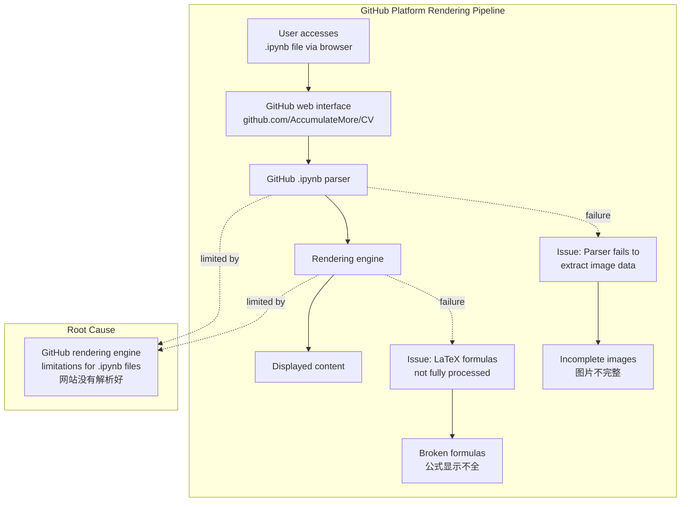
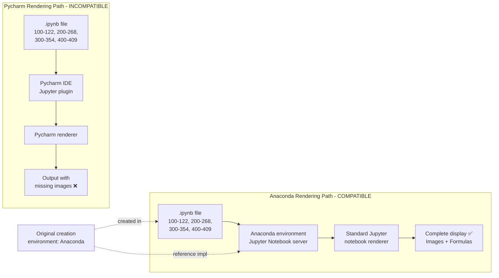
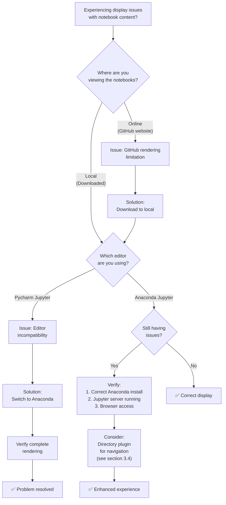

<!-- source: DeepWiki mcp.deepwiki.com · repo AccumulateMore/CV · page 3.3 Display Issues and Solutions · fetched 2026-10-29 -->

# Display Issues and Solutions

Relevant source files

The following files were used as context for generating this wiki page:

- [README.md](README.md)

## Purpose and Scope

This document provides comprehensive technical documentation of display issues that occur when accessing Jupyter notebook-based deep learning notes (.ipynb files) in the repository, their root causes, and recommended solutions. This page specifically addresses rendering problems related to images and mathematical formulas.

For information about setting up the Jupyter environment, see [Jupyter Environment Setup](#3.2). For details on recommended tools and plugins, see [Recommended Tools and Plugins](#3.4). For general repository access instructions, see [Accessing the Repository](#3.1).

**Sources:** [README.md:34-40]()

---

## Common Display Issues Overview

The repository contains Jupyter notebook files (.ipynb format) with embedded images and LaTeX mathematical formulas. Two primary categories of display issues have been documented:

| Issue Category | Manifestation | Affected Content | Impact Severity |
|---------------|---------------|------------------|-----------------|
| Online Rendering Failure | Incomplete image display, broken formula rendering | Images, LaTeX equations | High - Content unreadable |
| Editor Incompatibility | Images not displayed, navigation difficulties | All visual content | Critical - Unusable |

**Sources:** [README.md:36-37]()

---

## Issue Type 1: GitHub Online Viewing Problems

### Problem Description

When viewing notebook files directly through the GitHub web interface (browser-based viewing), users encounter:

- **Incomplete Image Display (图片显示不完整)**: Images render partially or fail to load entirely
- **Broken Formula Rendering (公式显示不全)**: LaTeX mathematical formulas display as raw code or render incorrectly

### Root Cause Analysis

The root cause is identified as GitHub's notebook rendering engine limitations. The platform's `.ipynb` parser does not fully process all embedded content formats used in the notebooks.

**Diagram 1: GitHub Online Rendering Failure Chain**

The specific technical limitation is that GitHub's online viewer does not fully parse the JSON structure within .ipynb files that contains base64-encoded images and LaTeX markup.

**Sources:** [README.md:36]()

---

## Issue Type 2: Pycharm Jupyter Incompatibility

### Problem Description

When opening notebook files using Pycharm's integrated Jupyter Notebook viewer, images fail to display entirely, even when files are downloaded locally.

### Editor Comparison

| Editor | Image Display | Formula Rendering | Navigation | Recommendation |
|--------|---------------|-------------------|------------|----------------|
| Pycharm Jupyter Notebook | ❌ Failed | ⚠️ Inconsistent | Limited | **Not Recommended** |
| Anaconda Jupyter Notebook | ✅ Correct | ✅ Correct | Full (with plugin) | **Recommended** |

### Technical Incompatibility Details

Pycharm's Jupyter implementation uses a different rendering pipeline than Anaconda's Jupyter Notebook server. The notebooks in this repository were created and tested using Anaconda Jupyter, making it the reference implementation.

**Diagram 2: Editor Compatibility Comparison**

**Sources:** [README.md:37]()

---

## Recommended Solutions

### Solution 1: Download to Local Environment

**Problem Addressed:** Online viewing issues (incomplete images, broken formulas)

**Implementation Steps:**

1. Download notebook files from GitHub repository to local filesystem
2. Open using Anaconda Jupyter Notebook (not Pycharm)
3. Verify complete rendering

**Technical Details:**

- Files are located at: `https://github.com/AccumulateMore/CV`
- File naming convention: Sequential numbering (100-122, 200-268, 300-354, 400-409)
- File format: `.ipynb` (Jupyter Notebook JSON format)

**Reference for Download Instructions:**

Users unfamiliar with GitHub file download can search: "Github如何下载文件" (How to download files from GitHub)

**Sources:** [README.md:36]()

### Solution 2: Use Anaconda Jupyter Notebook

**Problem Addressed:** Both online viewing and editor compatibility issues

**Implementation Steps:**

1. Install Anaconda distribution
2. Launch Jupyter Notebook server from Anaconda
3. Navigate to downloaded `.ipynb` files
4. Open notebooks in browser-based Jupyter interface

**Why Anaconda Specifically:**

The notebooks were authored using `Anaconda 的 Jupyter Notebook`, establishing it as the reference rendering environment. This ensures:
- Correct base64 image decoding
- Proper LaTeX formula rendering via MathJax
- Complete CSS styling application

**Reference for Setup Instructions:**

- Search: "Anaconda如何打开Jupyter Notebook文件"
- Alternative: Maintainer's Python repository → `00_Python编辑器` directory contains setup documentation

**Sources:** [README.md:37-38]()

---

## Troubleshooting Decision Tree

**Diagram 3: Display Issue Troubleshooting Workflow**

**Sources:** [README.md:34-39]()

---

## Technical Root Cause Summary

### GitHub Online Rendering Limitations

The GitHub platform uses a server-side notebook renderer that converts `.ipynb` JSON structures to HTML for browser display. This renderer has known limitations:

1. **Image Handling**: Base64-encoded images embedded in notebook cells may not be fully decoded
2. **LaTeX Processing**: Mathematical notation requires client-side MathJax rendering that may fail
3. **Cell Output Complexity**: Complex output formats (multiple images, mixed content) may render incorrectly

The repository maintainer explicitly states: `这是Github网站没有解析好` (GitHub website has not parsed it correctly).

### Pycharm Editor Incompatibility

Pycharm's Jupyter plugin implements its own rendering engine separate from the standard Jupyter Notebook server. Key differences:

1. **Different IPython kernel integration**
2. **Alternative notebook display mechanism**
3. **Incompatible with notebooks created in standard Jupyter environments**

The repository explicitly states: `笔记是用 Anaconda 的 Jupyter Notebook 打开的` (Notes are opened using Anaconda's Jupyter Notebook), indicating the reference implementation.

**Sources:** [README.md:36-37]()

---

## Solution Implementation Table

| Problem | Root Cause | Solution | Implementation Reference |
|---------|-----------|----------|-------------------------|
| Incomplete images online | GitHub `.ipynb` parser limitations | Download to local + Anaconda Jupyter | Search: "Github如何下载文件" |
| Broken formulas online | GitHub LaTeX rendering issues | Download to local + Anaconda Jupyter | [README.md:36]() |
| No image display in Pycharm | Editor incompatibility | Switch to Anaconda Jupyter | Search: "Anaconda如何打开Jupyter Notebook文件" |
| Missing navigation | No directory plugin | Install Jupyter TOC plugin | Maintainer's Python repository: `00_Python编辑器` |

**Sources:** [README.md:36-39]()

---

## Cross-Reference to Related Solutions

### Additional Setup Requirements

Beyond resolving display issues, users should also:

1. **Install Directory Plugin**: For enhanced notebook navigation (see [Recommended Tools and Plugins](#3.4))
2. **Configure Python Environment**: For code execution capabilities (maintainer's Python repository: `00_Python编辑器`)
3. **Access Datasets**: Required for running code cells (see [Datasets and Additional Resources](#2.5))

### Alternative Support Channels

If display issues persist after following recommended solutions, users can:

- Contact maintainer via WeChat for direct troubleshooting
- Reference the Python repository (`Python仓库`) for additional setup guides
- Join learning exchange groups for peer support (see [Community and Support System](#4))

**Sources:** [README.md:38-39](), [README.md:58-74]()

---

## Summary of Critical Actions

For users experiencing display issues:

1. ❌ **Do Not**: Rely on GitHub online viewing for complete content
2. ❌ **Do Not**: Use Pycharm Jupyter Notebook to open files
3. ✅ **Do**: Download notebook files to local filesystem
4. ✅ **Do**: Install and use Anaconda Jupyter Notebook
5. ✅ **Do**: Verify image and formula rendering after opening locally
6. ✅ **Do**: Install directory plugin for improved navigation

**Critical Note**: The statement `笔记备注（敲重点！敲重点！敲重点！）` (Notes - Important! Important! Important!) emphasizes that these display issues are well-documented and solutions are mandatory for proper content access.

**Sources:** [README.md:34-40]()

---

