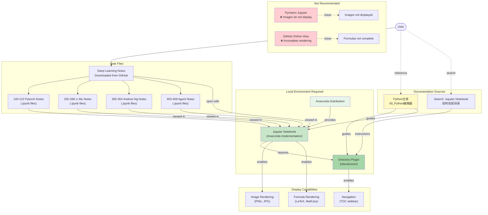
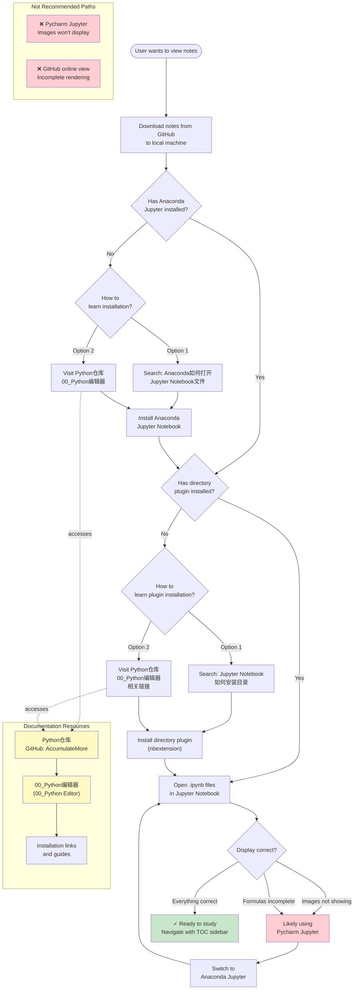
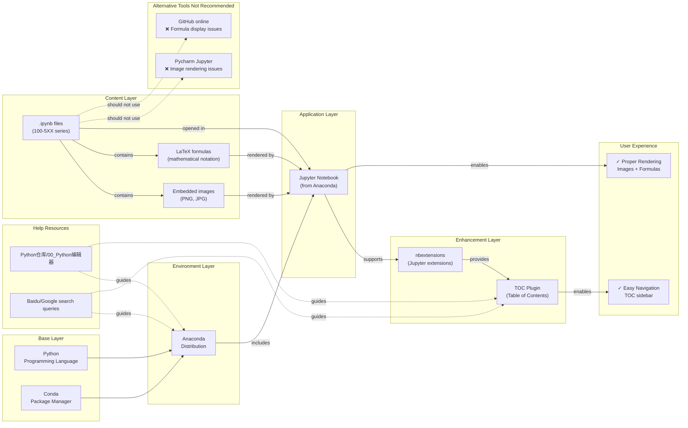

<!-- source: DeepWiki mcp.deepwiki.com · repo AccumulateMore/CV · page 3.4 Recommended Tools and Plugins · fetched 2026-10-29 -->

# Recommended Tools and Plugins

<details>
<summary>Relevant source files</summary>

The following files were used as context for generating this wiki page:

- [README.md](README.md)

</details>


## Purpose and Scope

This page documents the essential tools and plugins required to properly view and navigate the deep learning notes in this repository. It covers the Jupyter Notebook directory plugin for efficient navigation, references to the Python repository for detailed setup guides, and clarifies editor requirements. For general technical setup instructions, see [Technical Setup and Access](#3). For environment configuration, see [Jupyter Environment Setup](#3.2). For troubleshooting rendering problems, see [Display Issues and Solutions](#3.3).

---

## Jupyter Notebook Directory Plugin

The Jupyter Notebook directory plugin provides table of contents functionality that enables rapid navigation through the extensive note files (100-5XX series). Without this plugin, users must manually scroll through lengthy notebook files to locate specific sections.

### Plugin Functionality

The directory plugin generates an interactive table of contents sidebar that:

- Automatically extracts all markdown headers from the notebook
- Displays hierarchical structure of sections and subsections
- Enables single-click navigation to any chapter
- Updates dynamically as the notebook structure changes

### Installation Requirements

The directory plugin must be installed in the Anaconda Jupyter Notebook environment. Installation instructions are available through two sources:

1. **Search Query Method**: "Jupyter Notebook如何安装目录" (How to install directory in Jupyter Notebook)
2. **Python Repository Method**: Navigate to the maintainer's Python repository under the `00_Python编辑器` (00_Python Editor) directory

### Visual Example

[README.md:40]() includes a screenshot demonstrating the directory plugin interface with the expandable table of contents visible on the left side of the Jupyter notebook interface.

**Sources:** [README.md:38-40]()

---

## Python Repository Reference

The maintainer provides a dedicated Python repository containing comprehensive setup guides and editor configuration documentation. This repository serves as the authoritative reference for technical environment configuration.

### Repository Structure

```
GitHub: https://github.com/AccumulateMore (maintainer homepage)
└── Python仓库 (Python Repository)
    └── 00_Python编辑器 (00_Python Editor)
        ├── Jupyter Notebook installation guides
        ├── Directory plugin installation links
        └── Editor configuration documentation
```

### Access Information

| Resource | Location | Purpose |
|----------|----------|---------|
| Maintainer GitHub | https://github.com/AccumulateMore | Root access to all repositories |
| Python Repository | Under maintainer's GitHub homepage | Technical setup documentation |
| Editor Configuration | `00_Python编辑器` directory | Jupyter and editor setup guides |
| Directory Plugin Links | Within `00_Python编辑器` | Direct references for plugin installation |

### Referenced Scenarios

The Python repository documentation is referenced in [README.md:37-38]() for two specific scenarios:

1. How to open Jupyter Notebook files using Anaconda
2. How to install the directory plugin for navigation

**Sources:** [README.md:37-38](), [README.md:47-49]()

---

## Editor Requirements and Configuration

### Anaconda Jupyter Notebook (Required)

The notes in this repository **must** be opened using Anaconda's Jupyter Notebook implementation. This specific environment is required because:

- Images display correctly
- Mathematical formulas render properly
- The directory plugin functions as expected
- File encoding is handled correctly

### Pycharm Jupyter (Not Recommended)

**DO NOT** use Pycharm's Jupyter Notebook implementation. [README.md:37]() explicitly states that Pycharm's Jupyter Notebook does not properly display images when opening the notes.

### Configuration Comparison

| Feature | Anaconda Jupyter Notebook | Pycharm Jupyter |
|---------|--------------------------|-----------------|
| Image Display | ✓ Correct rendering | ✗ Images do not display properly |
| Formula Display | ✓ Proper rendering | ✗ May have issues |
| Directory Plugin | ✓ Compatible | ✗ Compatibility issues |
| Recommendation | ✓ **Required** | ✗ **Not recommended** |

### Installation Resources

Users unfamiliar with opening Jupyter Notebook files in Anaconda can find instructions through:

1. **Search Query**: "Anaconda如何打开Jupyter Notebook文件" (How to open Jupyter Notebook files in Anaconda)
2. **Python Repository**: The `00_Python编辑器` directory in the maintainer's Python repository contains detailed instructions

**Sources:** [README.md:37]()

---

## Tool Stack Architecture

The following diagram illustrates the complete tool stack required for proper note viewing, showing the relationship between components and why specific tools are required.



**Sources:** [README.md:34-40]()

---

## Setup Workflow and Decision Tree

This diagram maps the complete workflow for configuring the required tools, showing decision points and fallback mechanisms when users lack specific knowledge.



**Sources:** [README.md:34-40]()

---

## Plugin Installation Methods

Two primary methods exist for obtaining directory plugin installation instructions:

### Method 1: Direct Search

Execute a search query for "Jupyter Notebook如何安装目录" (How to install directory in Jupyter Notebook). This returns current installation guides from various sources including official documentation and community tutorials.

### Method 2: Python Repository Reference

Navigate to the maintainer's GitHub homepage at https://github.com/AccumulateMore, locate the Python repository, and access the `00_Python编辑器` directory. This directory contains:

- Curated links to reliable installation guides
- Editor configuration instructions
- Setup verification procedures
- Troubleshooting information

The Python repository method is recommended for users who prefer maintainer-verified resources over general search results.

**Sources:** [README.md:38](), [README.md:47-49]()

---

## Tool Dependency Chain

The following diagram illustrates the dependency relationships between tools and their purposes in the system.



**Sources:** [README.md:34-40]()

---

## Configuration Validation

After installing the required tools, users can validate their configuration by checking the following:

| Validation Check | Expected Result | Failure Indicator |
|-----------------|-----------------|-------------------|
| Open any .ipynb file (e.g., 100-122 series) | File opens in Jupyter Notebook interface | File opens in text editor or wrong application |
| Check image display | All images render clearly | Broken image icons or missing images |
| Check formula display | LaTeX formulas render as mathematical notation | Raw LaTeX code visible as text |
| Check TOC sidebar | Directory plugin shows navigation panel | No table of contents visible |
| Expand/collapse sections in TOC | Sections expand and collapse smoothly | TOC not interactive or missing |
| Click TOC items | Notebook scrolls to selected section | No navigation occurs |

If any validation check fails, refer to:
- [Jupyter Environment Setup](#3.2) for environment configuration
- [Display Issues and Solutions](#3.3) for troubleshooting
- The `00_Python编辑器` directory in the Python repository for detailed configuration guides

**Sources:** [README.md:34-40]()

---

## Summary Table of Tools

| Tool | Status | Purpose | Installation Source |
|------|--------|---------|---------------------|
| Anaconda Distribution | **Required** | Provides Jupyter Notebook environment | https://www.anaconda.com |
| Jupyter Notebook (Anaconda) | **Required** | Opens and renders .ipynb files correctly | Included with Anaconda |
| Directory Plugin (nbextension) | **Highly Recommended** | Provides navigation via TOC sidebar | Python仓库/00_Python编辑器 or search |
| Pycharm Jupyter | **Not Recommended** | Does not display images properly | N/A - Do not use |
| GitHub Online Viewer | **Not Recommended** | Incomplete formula and image rendering | N/A - Download locally instead |

**Sources:** [README.md:34-40]()

---

