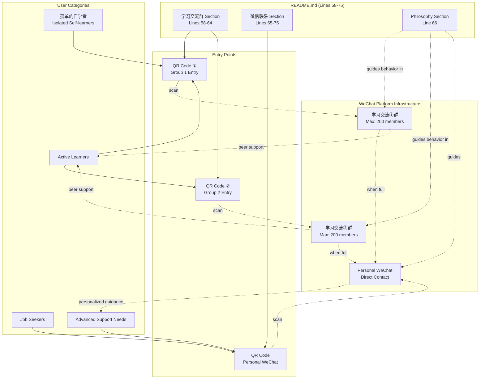
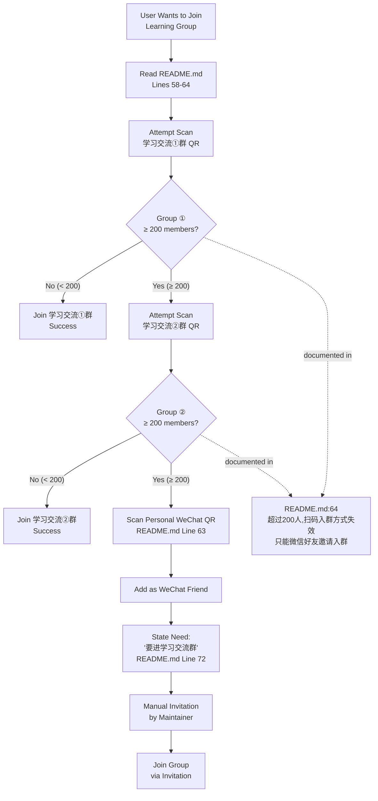
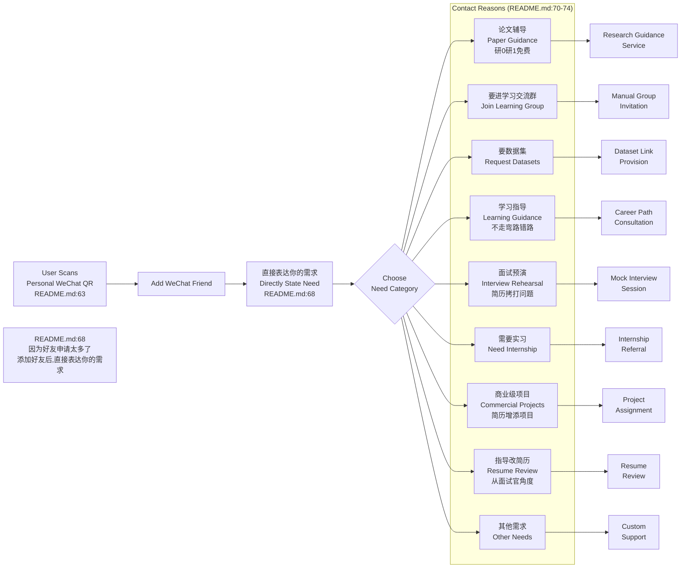
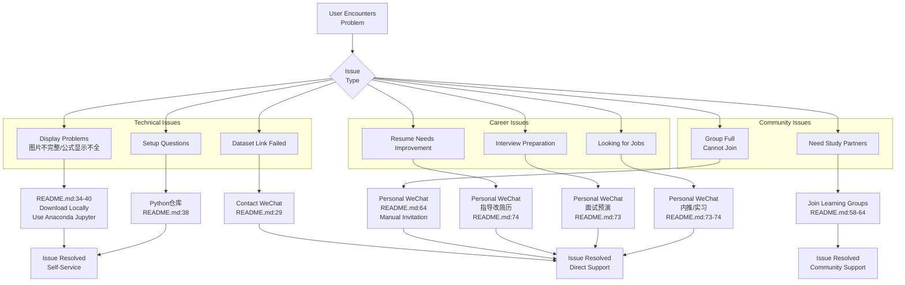
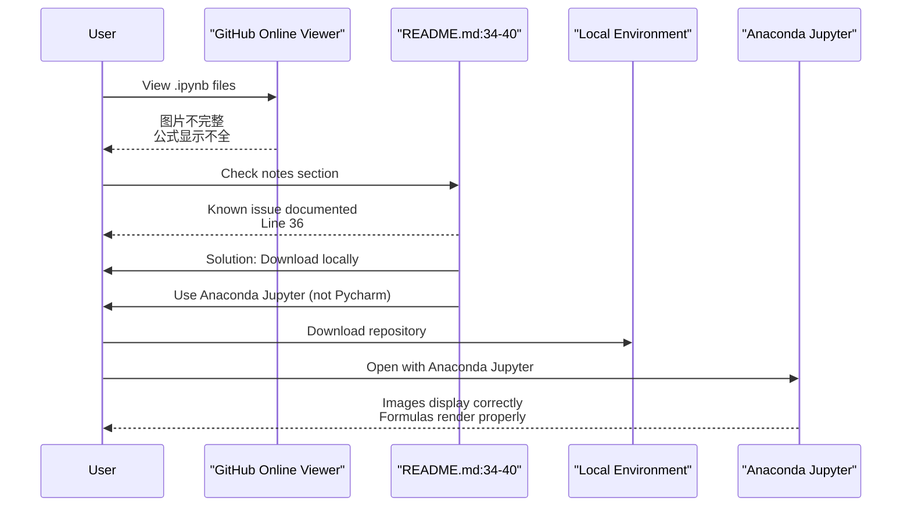
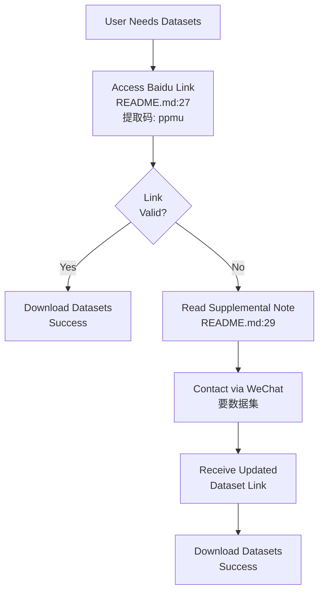
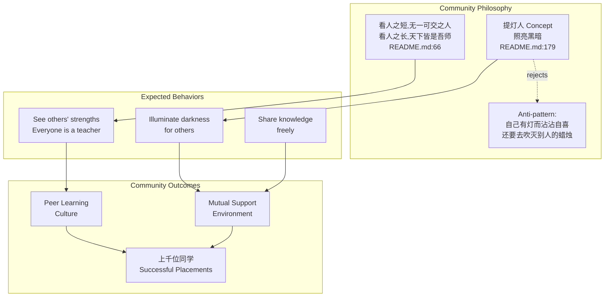
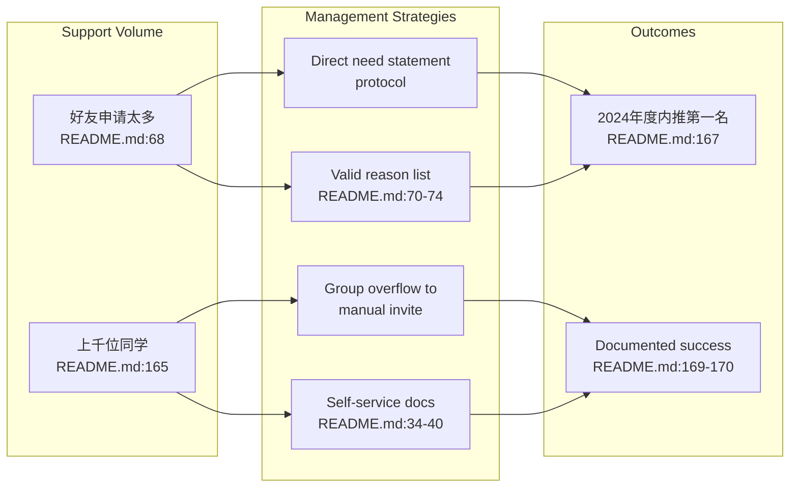
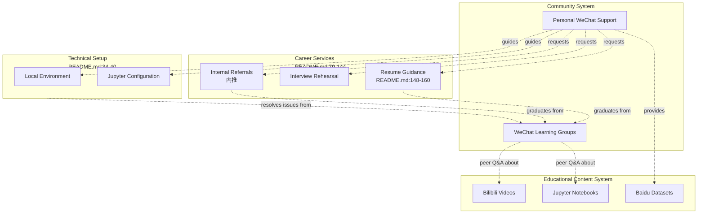

<!-- source: DeepWiki mcp.deepwiki.com · repo AccumulateMore/CV · page 4 Community and Support System · fetched 2026-10-29 -->

# Community and Support System

<details>
<summary>Relevant source files</summary>

The following files were used as context for generating this wiki page:

- [README.md](README.md)

</details>


This document describes the social infrastructure designed to support learners and combat isolated self-study (孤单的自学者). The community system provides structured peer interaction through WeChat groups and personalized support through direct contact channels. This system serves as the third pillar of the platform architecture, bridging educational content with career services.

For information about educational content access, see [Educational Content System](#2). For career services including resume guidance and job referrals, see [Career Services and Job Placement](#5).

**Scope**: This document covers the WeChat-based community infrastructure, group management, support request handling, contact workflows, and the philosophical foundation that guides community interactions. Technical setup issues are covered in [Technical Setup and Access](#3).

---

## System Architecture Overview

The community system is implemented entirely through WeChat as the communication platform, with coordination points defined in [README.md:58-75](). The architecture consists of two parallel learning groups, a direct contact channel, and structured support request handling.

### Community Infrastructure Components



**Diagram: Community Infrastructure and Entry Point Architecture**

This diagram maps the README.md sections to the actual WeChat infrastructure. The system uses three QR codes embedded in the README as entry points to the community infrastructure.

Sources: [README.md:58-75]()

---

## WeChat Learning Groups (学习交流群)

Two parallel WeChat groups provide peer interaction and Q&A support for learners. These groups are designed to combat isolated self-study by creating a shared learning environment.

### Group Configuration

The group configuration is defined in [README.md:58-64]():

| Group | Purpose | Capacity | Entry Method |
|-------|---------|----------|--------------|
| 学习交流①群 | Learning exchange, peer Q&A | 200 members | QR code scan (if < 200) |
| 学习交流②群 | Learning exchange, peer Q&A | 200 members | QR code scan (if < 200) |

### Group Entry Workflow



**Diagram: Group Entry Flow with Overflow Handling**

The system implements a capacity-aware entry flow. When both groups reach 200 members, the QR code scan method becomes invalid, and users must follow the manual invitation path through personal WeChat contact.

Sources: [README.md:58-64]()

### Group Purpose and Activities

The groups serve three primary functions as defined in [README.md:58]():

1. **Exchange Learning Experiences** (学习交流) - Members share learning progress, resources, and techniques
2. **Peer Q&A Support** - Members help each other resolve technical questions and conceptual difficulties
3. **Combat Isolation** (帮助孤单的自学者交流) - Provides social connection for learners who would otherwise study alone

---

## Direct Support Channels

The personal WeChat contact provides one-on-one support for needs that cannot be addressed through group channels or require personalized attention.

### Contact Protocol

The contact protocol is explicitly defined in [README.md:65-75]():



**Diagram: Direct Support Request Routing**

The system requires users to immediately state their need after adding the personal WeChat contact due to high volume of friend requests. This protocol is documented in [README.md:68]().

Sources: [README.md:65-75]()

### Valid Support Request Categories

The README explicitly lists valid contact reasons in [README.md:70-74]() to manage expectations and request volume:

| Category | Description | Implementation |
|----------|-------------|----------------|
| 论文辅导 | Paper guidance for research students | 研0研1免费 (free for early grad students), 半年掌握三年知识 |
| 要进学习交流群 | Join learning groups when full | Manual invitation process |
| 要数据集 | Dataset link provision | Fallback when Baidu link fails ([README.md:29]()) |
| 学习指导 | Learning path guidance | 不走弯路错路,快速拿到offer |
| 面试预演 | Interview rehearsal | 简历拷打问题 |
| 需要实习 | Internship opportunities | Connected to enterprise network |
| 商业级项目 | Commercial project guidance | 简历增添项目,提升核心竞争力 |
| 指导改简历 | Resume review | 从面试官角度出发 |

Sources: [README.md:70-74]()

---

## Problem Resolution System

The community system provides structured resolution paths for common issues learners encounter.

### Issue Routing Architecture



**Diagram: Issue Classification and Resolution Routing**

The system routes different issue types to appropriate resolution channels: self-service documentation, community peer support, or direct personal support.

Sources: [README.md:29](), [README.md:34-40](), [README.md:58-75]()

### Technical Issue Resolution Workflows

#### Display Issues Resolution

When users encounter display problems (documented in [README.md:36]()):



**Diagram: Display Issue Resolution Sequence**

Sources: [README.md:34-40]()

#### Dataset Access Issues

When the Baidu Netdisk link fails (documented in [README.md:27-29]()):



**Diagram: Dataset Access Fallback Mechanism**

The system provides a documented fallback mechanism in [README.md:29](): "数据集链接如果失效了，下面有微信，可以联系我。"

Sources: [README.md:27-29]()

---

## Community Philosophy and Values

The community system is guided by explicit philosophical principles that shape interactions and support behavior.

### Core Philosophical Principles

The philosophy is articulated in [README.md:66]() and [README.md:179]():



**Diagram: Community Philosophy and Behavioral Expectations**

Sources: [README.md:66](), [README.md:179]()

### The "Lamp Bearer" (提灯人) Concept

The maintainer articulates the purpose in [README.md:179]():

> "♥我们读书是为了成为提灯人去照亮黑暗，而不是为了自己有灯而沾沾自喜还要去吹灭别人的蜡烛♥"

This concept frames the entire community system: those who have learned should illuminate the path for others, rather than hoarding knowledge or actively hindering others' progress.

### Operational Implementation of Philosophy

The philosophy translates into concrete operational practices:

1. **Open Access** - Learning materials freely shared, no paywalls
2. **Free Early Support** - 研0研1免费 for early graduate students ([README.md:72]())
3. **Active Response** - Personal response to support requests despite high volume ([README.md:68]())
4. **Win-Win Mindset** - 双赢 approach to job referrals ([README.md:130]())
5. **Avoiding Detours** - 不走弯路错路 guidance philosophy ([README.md:73](), [README.md:172]())

Sources: [README.md:68](), [README.md:72](), [README.md:130](), [README.md:172](), [README.md:179]()

---

## Support Volume Management

The system handles high support volume through structured processes and explicit protocols.

### Volume Indicators

The README documents volume pressure in [README.md:68]():

> "因为好友申请太多了，添加好友后，直接表达你的需求。"

This indicates the system receives a high volume of friend requests, requiring efficiency protocols.

### Success Metrics

The community system has demonstrable scale and impact as documented in [README.md:165-170]():

| Metric | Value | Source |
|--------|-------|--------|
| Students Helped | 上千位同学 (thousands) | README.md:165 |
| 2024 Ranking | 年度内推第一名 (Top referral provider) | README.md:167 |
| Success Evidence | Screenshots of success stories | README.md:167-170 |



**Diagram: Volume Management and Success Metrics**

Sources: [README.md:68](), [README.md:165-170]()

---

## Integration with Other Systems

The community system integrates with the educational and career systems to provide comprehensive support.

### Cross-System Support Flows



**Diagram: Community System Integration Points**

Sources: [README.md:29](), [README.md:34-40](), [README.md:58-75](), [README.md:79-144]()

---

## Technical Infrastructure Details

### WeChat Platform Requirements

The entire community system runs on WeChat infrastructure:

- **Platform**: WeChat (微信)
- **Components**: Personal account, two group chats
- **Entry Method**: QR codes embedded in README.md as images
- **Capacity Limits**: 200 members per group (WeChat platform limitation)
- **Invitation Mechanism**: Friend request → Manual group invitation when groups full

### README.md Structure for Community System

```
README.md
├── Line 58-64: Learning Groups Section (学习交流群)
│   ├── Group ① QR Code Image
│   ├── Group ② QR Code Image  
│   ├── Personal WeChat QR Code Image
│   └── Overflow instruction (Line 64)
│
├── Line 66: Philosophy Statement (看人之长,天下皆是吾师)
│
├── Line 68: Volume Management Protocol (好友申请太多)
│
└── Line 70-74: Valid Request Categories Table
    ├── Column 1: 论文辅导, 学习指导, 商业级项目
    ├── Column 2: 要进学习交流群, 面试预演, 指导改简历
    └── Column 3: 要数据集, 需要实习, ......
```

Sources: [README.md:58-75]()

---

## Summary

The Community and Support System provides structured social infrastructure for learning support through:

1. **Dual Group Architecture**: Two parallel WeChat groups with 200-member capacity each
2. **Overflow Management**: Personal WeChat invitation when groups reach capacity
3. **Direct Support Channel**: Personal WeChat for specialized needs (resume, interview, career)
4. **Structured Request Protocol**: Explicit categories for support requests to manage volume
5. **Philosophical Foundation**: "看人之长,天下皆是吾师" and "提灯人" concepts guiding interactions
6. **Problem Resolution**: Multi-tier system (self-service, peer support, direct support)
7. **Cross-System Integration**: Bridges educational content with career services

The system has demonstrable success with 上千位同学 successfully placed and recognition as 2024年度内推第一名, validating the effectiveness of the community-based support model.

Sources: [README.md:58-180]()

---

