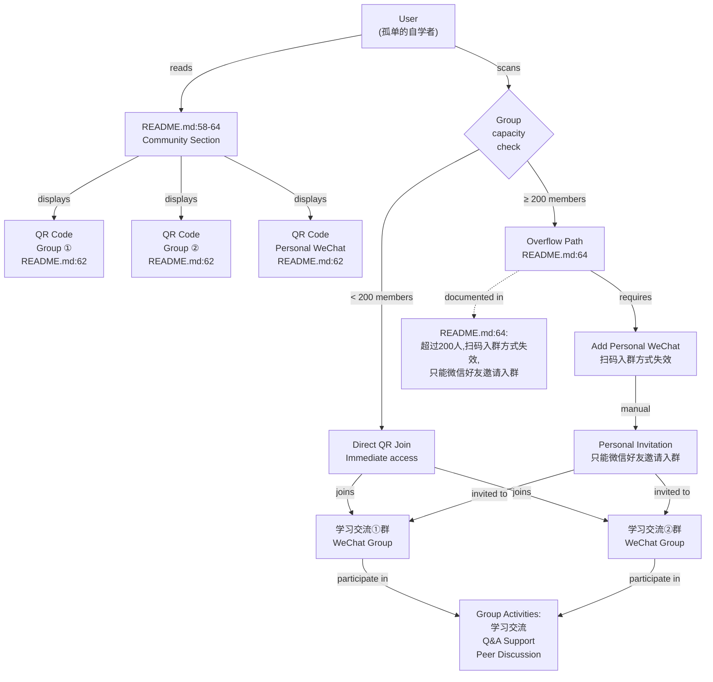
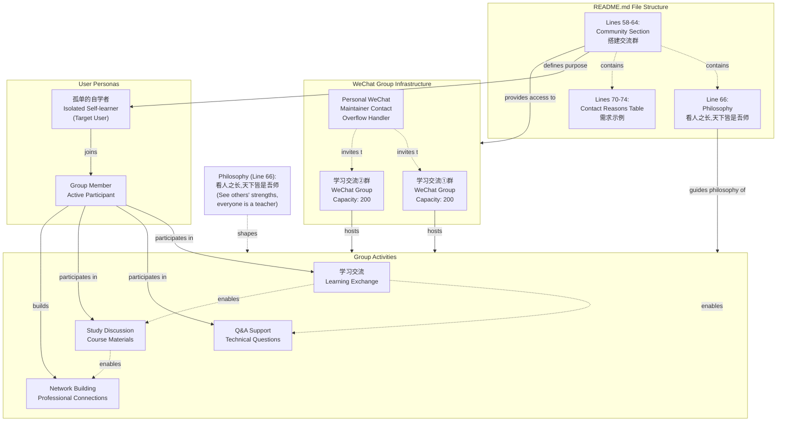
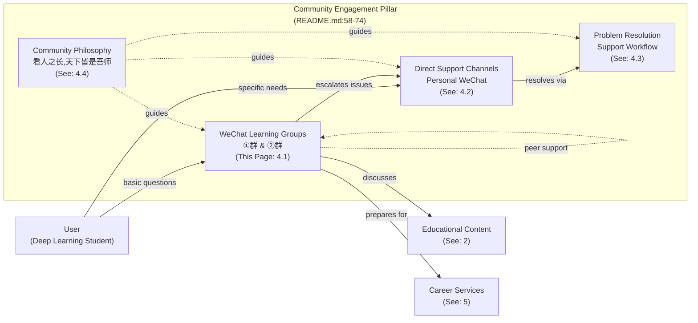
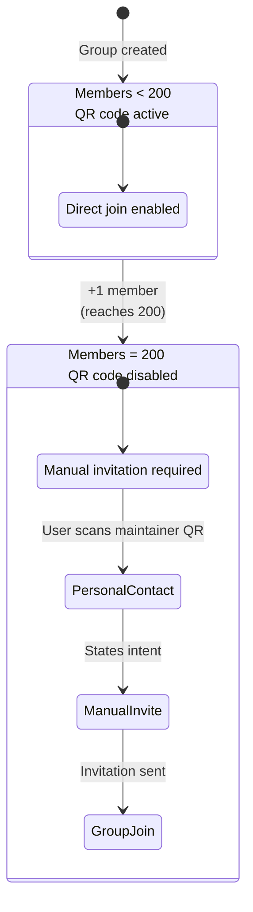

<!-- source: DeepWiki mcp.deepwiki.com · repo AccumulateMore/CV · page 4.1 WeChat Learning Groups · fetched 2026-10-29 -->

# WeChat Learning Groups

<details>
<summary>Relevant source files</summary>

The following files were used as context for generating this wiki page:

- [README.md](README.md)

</details>


## Purpose and Scope

This document describes the WeChat learning exchange groups (学习交流群) that serve as peer support infrastructure for students studying the deep learning curriculum. These groups provide a structured community environment to combat isolated self-learning (孤单的自学者) by enabling direct peer interaction, Q&A support, and collaborative learning discussions.

For information about direct one-on-one support with the platform maintainer, see [Direct Support Channels](#4.2). For broader community philosophy, see [Community Philosophy and Values](#4.4).

**Sources:** [README.md:58-64]()

---

## Group Infrastructure

The platform maintains two distinct WeChat learning exchange groups to distribute membership load:

| Group Identifier | Name | Platform | Capacity Limit |
|-----------------|------|----------|----------------|
| Group ① | 深度学习 学习交流①群 | WeChat | 200 members |
| Group ② | 深度学习 学习交流②群 | WeChat | 200 members |

Both groups serve identical purposes and provide the same level of peer support. The dual-group architecture exists solely to handle membership overflow, as WeChat enforces a 200-member limit per group before requiring personal invitation for new members.

### Primary Purpose

The groups are explicitly designed to address the isolation problem experienced by self-learners (帮助孤单的自学者交流). Key functions include:

- **Peer Learning Exchange**: Students at different stages of the curriculum can share knowledge and learning strategies
- **Q&A Support**: Members can ask and answer technical questions about course materials, code implementations, and concepts
- **Study Discussion**: Collaborative discussion of video lectures, notebook content, and deep learning topics
- **Network Building**: Formation of professional relationships among students pursuing similar career paths

**Sources:** [README.md:58-64]()

---

## Group Access Flow

### Diagram: WeChat Group Access Architecture



**Sources:** [README.md:58-64]()

---

## Joining Mechanisms

### Direct QR Code Join (Under Capacity)

When either group has fewer than 200 members, users can join directly by scanning the displayed QR code:

1. Navigate to the community section in [README.md:58-64]()
2. Identify QR codes for Group ① or Group ② in the displayed table [README.md:62]()
3. Scan the appropriate QR code using WeChat's scan function
4. Accept the group invitation
5. Immediate access granted to group chat

This method provides instant access without requiring interaction with the maintainer.

### Manual Invitation (At Capacity)

When a group reaches 200 members, WeChat platform restrictions disable the QR code join method. The system transitions to a manual invitation workflow:

**Trigger Condition:** `group_members >= 200`

**Process documented in [README.md:64]():**

```
超过200人，扫码入群方式失效，只能微信好友邀请入群。
(Over 200 people, QR code join method fails, can only join via WeChat friend invitation)
```

**Manual Invitation Workflow:**

1. User scans personal WeChat QR code [README.md:62]()
2. User sends friend request to maintainer
3. User states intention: "要进学习交流群" (want to join learning exchange group) [README.md:72]()
4. Maintainer accepts friend request
5. Maintainer manually invites user to Group ① or Group ②
6. User accepts group invitation

**Important:** Due to high volume of friend requests (好友申请太多了), users must immediately state their specific need when adding the maintainer. Simply saying "要进学习交流群" is sufficient for group access. See [Direct Support Channels](#4.2) for other valid contact reasons.

**Sources:** [README.md:64](), [README.md:66-74]()

---

## Valid Contact Reasons

The following table (from [README.md:70-74]()) shows valid reasons for contacting the maintainer via WeChat, including group access:

| Need Category | Example Request | Relevant Section |
|--------------|-----------------|------------------|
| Group Access | 要进学习交流群<br/>(want to join learning exchange group) | This page (4.1) |
| Dataset Access | 要数据集<br/>(want datasets) | See [Datasets](#2.5) |
| Learning Guidance | 需要学习指导<br/>(need learning guidance) | See [Learning Guidance](#5.3) |
| Resume Review | 指导改简历<br/>(guide resume revision) | See [Resume Guidance](#5.1) |
| Interview Prep | 面试预演<br/>(interview rehearsal) | See [Interview Preparation](#5.2) |
| Thesis Support | 需要论文辅导<br/>(need thesis guidance) | See [Career Services](#5) |
| Commercial Projects | 需要商业级项目<br/>(need commercial projects) | See [Career Services](#5) |
| Internship Support | 需要实习<br/>(need internship) | See [Internship Opportunities](#5.7) |

When the user's primary intent is group access, they should directly state "要进学习交流群" to expedite processing.

**Sources:** [README.md:70-74]()

---

## Group Interaction Model

### Diagram: Community Engagement Architecture



**Sources:** [README.md:58-74]()

---

## Capacity Management System

The platform implements a two-tier capacity management system to handle WeChat's group size restrictions:

### Tier 1: Direct QR Access (0-199 Members)

**Condition:** `total_members < 200`

**Access Method:** QR code scanning from [README.md:62]()

**User Experience:**
- Instant access without maintainer interaction
- Self-service joining process
- No waiting period

### Tier 2: Manual Invitation (200+ Members)

**Condition:** `total_members >= 200`

**Access Method:** Personal WeChat friend request + manual invitation

**Trigger:** WeChat platform restriction documented in [README.md:64]()

**Implementation Details:**
- QR code method automatically disabled by WeChat platform at 200 members
- System transitions from self-service to manual processing
- Maintainer acts as gatekeeper to manage invitation queue
- Users must explicitly state intent (要进学习交流群) to prioritize processing

### Load Distribution Strategy

When both groups approach capacity, the maintainer employs distribution logic:

```
IF Group1.members < Group2.members THEN
    invite_to(Group1)
ELSE IF Group2.members < Group1.members THEN
    invite_to(Group2)
ELSE
    invite_to(random_choice([Group1, Group2]))
END IF
```

This ensures balanced membership across both groups and prevents asymmetric loading.

**Sources:** [README.md:64]()

---

## Integration with Broader Community System

The WeChat learning groups form one component of the larger Community Engagement Pillar (see [Community and Support System](#4) for complete architecture). 

### Relationship to Other Community Components



**Key Distinctions:**

| Component | Purpose | Interaction Model | Documented In |
|-----------|---------|-------------------|---------------|
| **WeChat Groups** (4.1) | Peer learning, Q&A, study discussion | Many-to-many | This page |
| **Direct Support** (4.2) | Personalized guidance, career services, dataset access | One-to-one | [4.2](#4.2) |
| **Problem Resolution** (4.3) | Technical issues, access problems | Structured workflow | [4.3](#4.3) |
| **Philosophy** (4.4) | Community values, behavioral guidelines | Cultural framework | [4.4](#4.4) |

**Sources:** [README.md:58-74]()

---

## Technical Implementation Details

### Platform Specifications

**Primary Platform:** WeChat (微信)

**Group Type:** WeChat Group Chat

**Technical Constraints:**
- Maximum 200 members per group before requiring personal invitation (WeChat platform limitation)
- QR code join method disabled by platform at capacity threshold
- No API integration; manual management required

### Access Control Mechanism

The access control is implemented through README.md presentation layer:

```
README.md
├── Line 60: Table header with group names
├── Line 62: QR code images embedded for both groups + personal WeChat
├── Line 64: Capacity overflow documentation
└── Lines 66-74: Contact protocol specification
```

**QR Code Display Format (README.md:62):**
- Group ① QR code: Embedded image asset
- Group ② QR code: Embedded image asset  
- Personal WeChat QR code: Embedded image asset

All three QR codes are displayed in a markdown table for parallel presentation, allowing users to self-select based on availability.

### Overflow Handling Logic



**Sources:** [README.md:58-64]()

---

## Usage Guidelines

### When to Use Learning Groups

Users should join and utilize the WeChat learning groups for:

1. **General Questions**: Questions about course materials, concepts, or code that don't require maintainer expertise
2. **Peer Discussion**: Collaborative exploration of lecture topics or notebook content
3. **Study Coordination**: Finding study partners or forming sub-groups for specific courses
4. **Resource Sharing**: Sharing supplementary materials, links, or learning tips (that complement official resources)
5. **Network Building**: Connecting with peers at similar learning stages or career goals

### When to Use Direct Contact Instead

Switch to direct maintainer contact [see 4.2](#4.2) for:

- Dataset access issues (数据集链接失效)
- Resume review (简历指导)
- Interview preparation (面试预演)
- Career guidance (学习指导)
- Job referrals (内推)
- Commercial project opportunities (商业级项目)

This separation ensures group chat remains focused on peer learning while complex support requests receive appropriate one-on-one attention.

**Sources:** [README.md:68-74]()

---

## Group Philosophy Integration

The learning groups operate under the guiding principle stated in [README.md:66]():

> 看人之短，无一可交之人。看人之长，天下皆是吾师。
> 
> (See people's shortcomings, no one is worth associating with. See people's strengths, everyone is a teacher.)

This philosophy shapes group interactions in several ways:

### Peer Teaching Model

- Every member is positioned as both learner and teacher
- Members at different curriculum stages (100-series vs 400-series) provide value to each other
- Focus on knowledge sharing rather than knowledge hoarding

### Positive Interaction Norms

- Emphasis on recognizing and learning from others' strengths
- Discouragement of criticism without constructive contribution
- Creating environment where asking questions is encouraged, not stigmatized

### Distributed Knowledge Architecture

The groups implement a distributed knowledge model where:
- No single expert; collective intelligence of all members
- Questions may be answered by any member with relevant experience
- Maintainer participates but doesn't monopolize responses

This aligns with the broader platform philosophy of "照亮黑暗" (illuminating darkness) - helping others navigate the learning path rather than gatekeeping knowledge.

For complete philosophical framework, see [Community Philosophy and Values](#4.4).

**Sources:** [README.md:66](), [README.md:179]()

---

## Success Metrics

The learning groups contribute to the platform's overall success outcomes documented in [README.md:165-170]():

- Part of infrastructure that has supported "上千位同学" (thousands of students) in achieving employment
- Provides social proof and community support that increases learning completion rates
- Network effects: group members often refer each other for job opportunities
- Contributing factor to maintainer achieving "2024年度内推第一名" (2024 top internal referral provider)

The groups serve as the social foundation that transforms isolated self-learning into collaborative learning, which demonstrably improves employment outcomes.

**Sources:** [README.md:165-170]()

---

