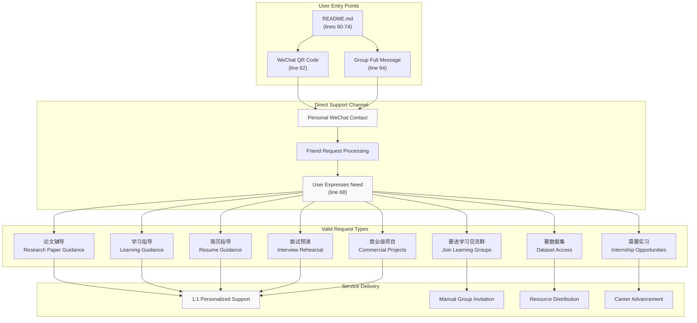
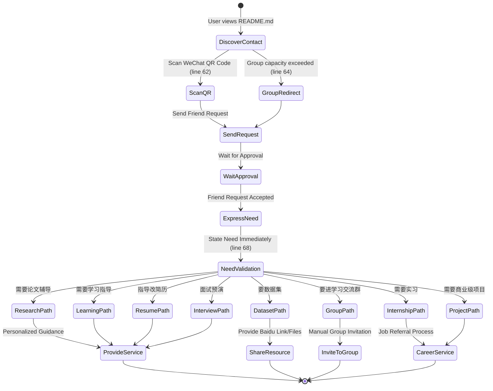
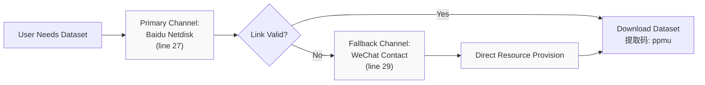
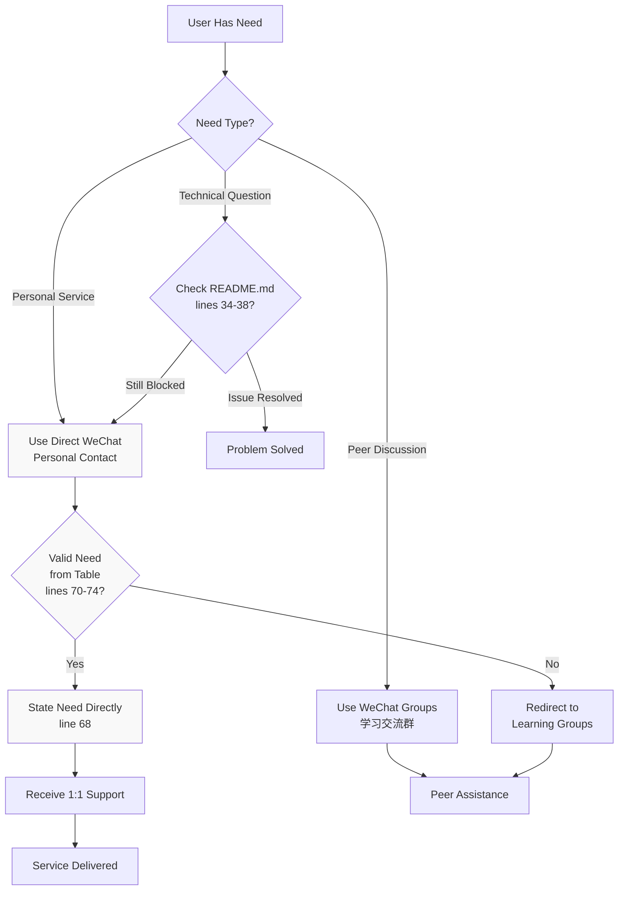
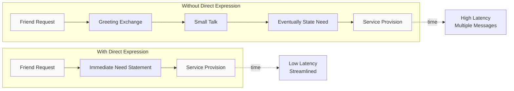

<!-- source: DeepWiki mcp.deepwiki.com · repo AccumulateMore/CV · page 4.2 Direct Support Channels · fetched 2026-10-29 -->

# Direct Support Channels

<details>
<summary>Relevant source files</summary>

The following files were used as context for generating this wiki page:

- [README.md](README.md)

</details>


## Purpose and Scope

This document describes the direct WeChat contact system that provides personalized support to users of the deep learning notes platform. Direct support channels offer one-on-one assistance for specific needs that require individual attention, such as resume guidance, interview preparation, dataset access, and career services.

For information about peer-to-peer learning support in group settings, see [WeChat Learning Groups](#4.1). For the complete career services pipeline including job referrals, see [Career Services and Job Placement](#5).

---

## System Overview

The direct support channel operates through a personal WeChat contact that serves as the primary interface for individualized assistance. This channel is distinct from the learning exchange groups and is specifically designed for requests that require direct interaction with the platform maintainer.



**Diagram: Direct Support Channel Architecture**

Sources: [README.md:60-74]()

---

## Valid Contact Reasons

The platform explicitly requires users to state their needs directly upon adding the WeChat contact due to high request volume. The following table documents all valid contact reasons as specified in the system:

| Need Category | Chinese Term | Purpose | Service Type |
|---------------|--------------|---------|--------------|
| Research Paper Guidance | 需要论文辅导 | Assistance with academic papers; free for first/second year graduate students (研0研1免费); master 3 years of knowledge in 6 months | One-on-one mentoring |
| Learning Guidance | 需要学习指导 | Career path optimization to avoid detours and obtain offers quickly (不走弯路错路,快速拿到offer) | Strategic planning |
| Resume Guidance | 指导改简历 | Resume review from interviewer's perspective (从面试官角度出发) | Career preparation |
| Interview Rehearsal | 面试预演 | Mock interviews to identify resume weaknesses (简历拷打问题) | Career preparation |
| Dataset Access | 要数据集 | Obtain datasets when Baidu Netdisk links fail | Resource distribution |
| Group Joining | 要进学习交流群 | Manual invitation when groups reach 200-member capacity | Community integration |
| Internship Opportunities | 需要实习 | Assistance securing internship positions | Career services |
| Commercial Projects | 需要商业级项目 | Access to business-level projects to strengthen resumes and competitive advantage (简历增添项目,提升核心竞争力) | Skill development |

Sources: [README.md:70-74]()

### Contact Request Protocol

The system implements a direct expression requirement due to capacity constraints:

```
因为好友申请太多了,添加好友后,直接表达你的需求。
(Because there are too many friend requests, after adding as friend, directly express your needs.)
```

This protocol is documented at [README.md:68]() and serves to streamline request processing by immediately routing users to appropriate support services.

Sources: [README.md:68]()

---

## Contact Process Workflow

The following diagram illustrates the complete workflow from initial contact through service delivery:



**Diagram: Direct Contact Request State Machine**

Sources: [README.md:62-74]()

---

## Fallback Mechanisms

The direct support channel serves as a critical fallback mechanism for system resources that may become unavailable. The primary fallback use case is dataset access:

### Dataset Link Failure Recovery

When the primary dataset distribution channel (Baidu Netdisk) fails, users are directed to the WeChat contact:

```
补充说明:数据集链接如果失效了,下面有微信,可以联系我。
(Supplementary note: If the dataset link expires, contact me via WeChat below.)
```

This creates a resilient resource distribution architecture where the personal WeChat acts as a backup channel:



**Diagram: Dataset Access Fallback Architecture**

Sources: [README.md:27](), [README.md:29]()

### Group Capacity Overflow

When WeChat learning groups reach the 200-member platform limit, the direct contact becomes the only method for group joining:

```
超过200人,扫码入群方式失效,只能微信好友邀请入群。
(Over 200 people, QR code group joining fails, can only join via WeChat friend invitation.)
```

This is documented at [README.md:64]() and represents a technical constraint of the WeChat platform that requires manual intervention.

Sources: [README.md:64]()

---

## Support Request Decision Tree

The following diagram helps determine when users should use direct support versus other channels:



**Diagram: Support Channel Selection Decision Tree**

Sources: [README.md:34-38](), [README.md:60-74]()

---

## Integration with Career Services

The direct support channel is the primary entry point for all career-related services. The following table maps contact reasons to specific career service components:

| Contact Reason | Career Service | Downstream Process | Target Outcome |
|----------------|----------------|-------------------|----------------|
| 指导改简历<br/>(Resume Guidance) | Resume review from interviewer perspective | Resume optimization using techniques from [README.md:148-160]() | Job-ready resume |
| 面试预演<br/>(Interview Rehearsal) | Mock interview with problem identification | Interview skill development | Interview confidence |
| 需要学习指导<br/>(Learning Guidance) | Strategic learning path design | Avoid detours (不走弯路错路) | Fast offer acquisition |
| 需要实习<br/>(Internship) | Internship referral through enterprise network | Position matching and referral | Internship placement |
| 需要商业级项目<br/>(Commercial Projects) | Project assignment for resume enhancement | Portfolio development | Competitive advantage |

All career-related contact reasons flow into the internal referral system (内推) documented in [Internal Referral System](#5.4), creating a complete pipeline from initial contact to job placement.

Sources: [README.md:70-74](), [README.md:130-143]()

---

## Support Capacity Management

The system implements explicit capacity management measures to handle high request volume:

### High Volume Acknowledgment

```
因为好友申请太多了
(Because there are too many friend requests)
```

This statement at [README.md:68]() acknowledges the popularity of the platform and sets expectations for users regarding the need for efficient communication.

### Immediate Need Expression Requirement

The direct expression requirement serves as a filtering and routing mechanism:

1. **Filtering**: Ensures only users with specific, valid needs proceed
2. **Routing**: Immediately directs requests to appropriate service categories
3. **Efficiency**: Reduces back-and-forth communication overhead
4. **Scalability**: Allows maintainer to process high volumes by eliminating exploratory conversations



**Diagram: Communication Efficiency Through Direct Expression**

Sources: [README.md:68]()

---

## Service Success Metrics

The direct support channel contributes to the platform's documented success metrics. The maintainer has guided over one thousand students (上千位同学) to successful employment, achieving the top internal referral position in 2024 (2024年度内推第一名).

Success evidence is presented at [README.md:165-170]() with three images demonstrating placement outcomes:

```
| 2024届年度 内推第一名 | 2024届年度 内推第一名 | 2024届年度 内推第一名 |
```

This metric validates the effectiveness of the direct support approach for career-related services.

Sources: [README.md:165-170]()

---

## Philosophy and Approach

The direct support channel operates under specific guiding principles documented in the README:

### Lamp Bearer Philosophy (提灯人)

```
我们读书是为了成为提灯人去照亮黑暗,而不是为了自己有灯而沾沾自喜还要去吹灭别人的蜡烛
(We study to become lamp bearers illuminating darkness, not to be proud of having light ourselves while extinguishing others' candles)
```

This philosophy at [README.md:179]() directly informs the one-on-one support model, where the maintainer acts as a guide illuminating the path for learners.

### Avoiding Detours Philosophy

```
拿offer最快的方式,就是不走弯路,不走错路。方向错了,努力没有意义。
(The fastest way to get offers is not taking detours or wrong paths. If the direction is wrong, effort is meaningless.)
```

This principle at [README.md:172]() explains why learning guidance (学习指导) is a valid contact reason—to provide strategic direction that prevents wasted effort.

### Win-Win Model (双赢)

The internal referral system creates mutual benefit:
- Companies receive qualified candidates and pay referral bonuses (内推奖金)
- Users secure employment
- Maintainer earns referral compensation

This is explicitly stated at [README.md:130]():
```
你收公司内推奖金、ta们就业,双赢
(You receive company referral bonuses, they get employed, win-win)
```

Sources: [README.md:130](), [README.md:172](), [README.md:179]()

---

## Summary

The direct support channel provides personalized assistance through WeChat contact for eight validated use cases: research guidance, learning guidance, resume review, interview rehearsal, dataset access, group joining, internships, and commercial projects. It implements capacity management through immediate need expression requirements and serves as a critical fallback mechanism for resource distribution. The channel is the primary entry point for career services and operates under philosophies of guidance (lamp bearer), efficiency (avoiding detours), and mutual benefit (win-win model), contributing to documented success metrics of over one thousand successful placements.

---

