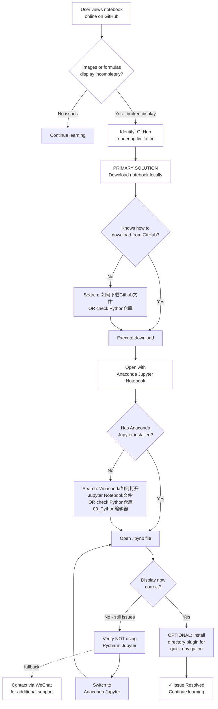
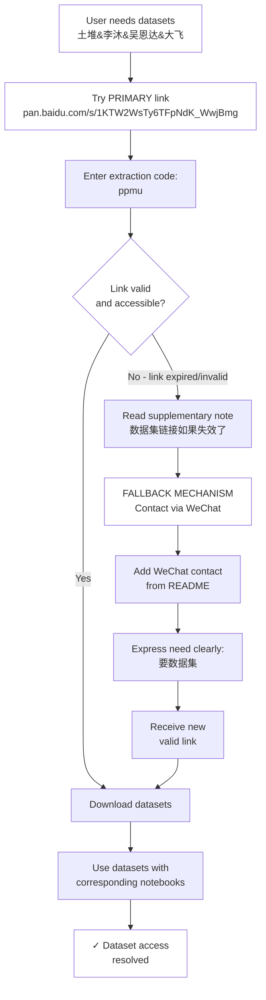
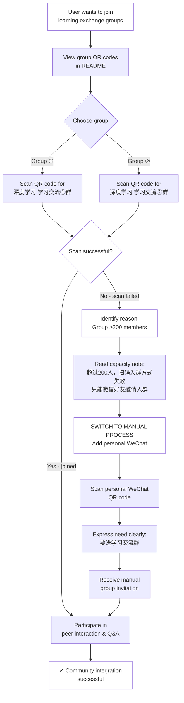
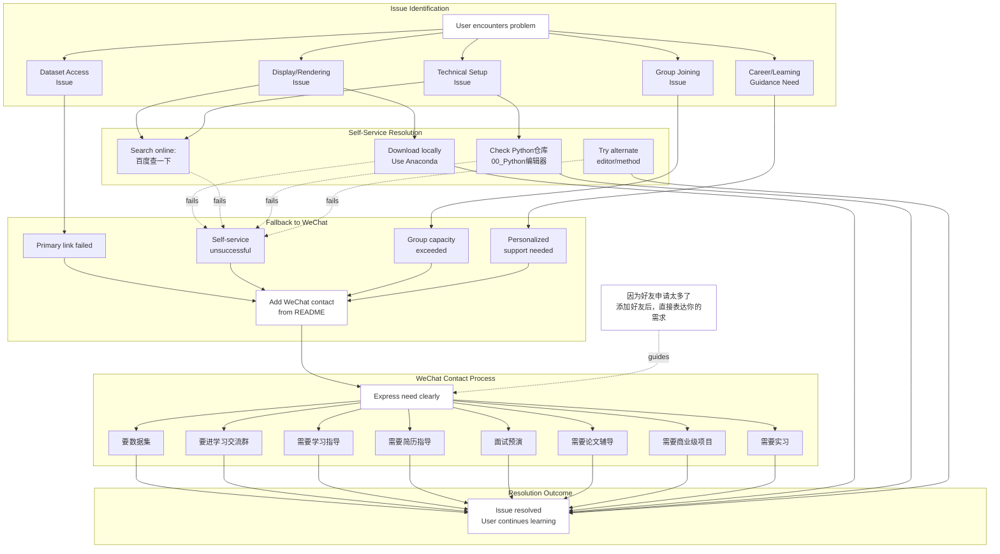
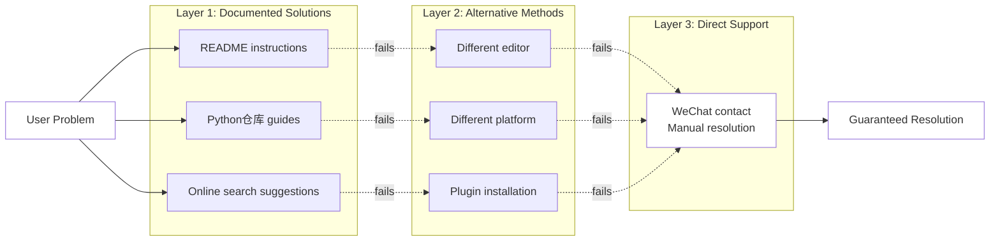
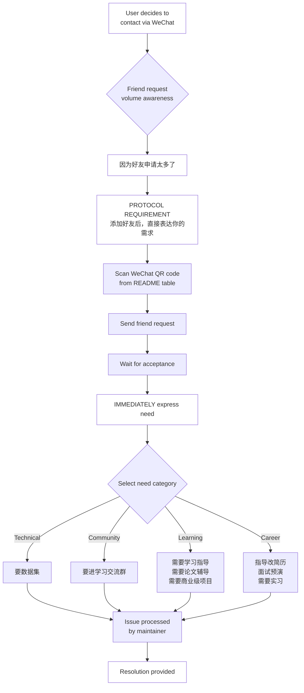
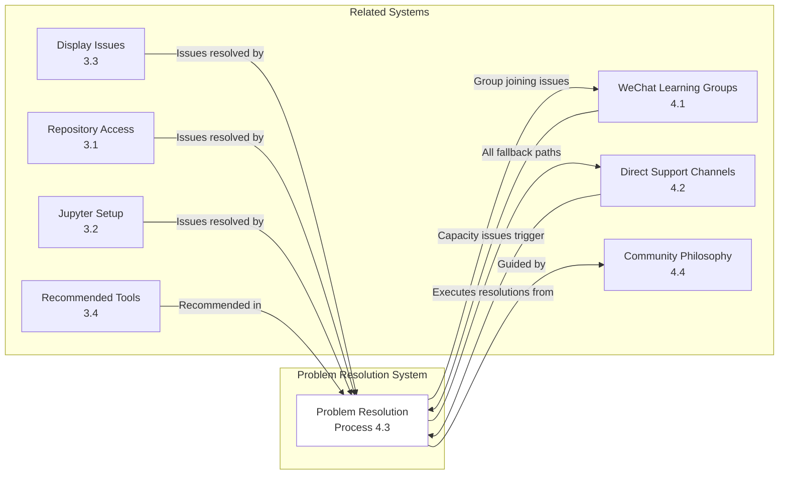

<!-- source: DeepWiki mcp.deepwiki.com · repo AccumulateMore/CV · page 4.3 Problem Resolution Process · fetched 2026-10-29 -->

# Problem Resolution Process

Relevant source files

The following files were used as context for generating this wiki page:

- [README.md](README.md)

## Purpose and Scope

This document details the systematic problem resolution process built into the platform to ensure users can overcome common technical, access, and community integration issues. The process encompasses issue identification, resolution pathways, fallback mechanisms, and support channel routing. For information about the broader community infrastructure, see [Community and Support System](#4). For specific guidance services offered through WeChat, see [Direct Support Channels](#4.2).

The resolution process addresses four primary problem categories: display and rendering issues, dataset access problems, community group joining obstacles, and general technical setup challenges. Each category has defined resolution workflows with automatic fallback mechanisms to ensure no user is left without support.

Sources: [README.md:34-75]()

---

## Problem Categories and Identification

The platform explicitly documents common issues users encounter, organized into distinct categories that map to specific resolution workflows.

### Issue Categorization Matrix

| Problem Category | Symptoms | Root Cause | Primary Resolution | Lines |
|-----------------|----------|------------|-------------------|-------|
| **Display Issues** | Images incomplete, formulas broken | GitHub online rendering limitations | Local download + Anaconda Jupyter | [README.md:36]() |
| **Dataset Access** | Baidu Netdisk link invalid/expired | Link expiration over time | WeChat contact for new link | [README.md:29]() |
| **Group Joining** | QR code scan fails | Group capacity ≥200 members | Personal WeChat friend invitation | [README.md:64]() |
| **Editor Issues** | Images not displaying in Pycharm | Incorrect Jupyter implementation | Switch to Anaconda Jupyter | [README.md:37]() |
| **Navigation Issues** | Difficult to jump between sections | No directory plugin installed | Install Jupyter directory plugin | [README.md:38]() |
| **Technical Setup** | General configuration problems | Environment setup confusion | Python仓库 reference or search | [README.md:37-38]() |

Sources: [README.md:34-75]()

---

## Display Issue Resolution Workflow

Display problems represent the most common technical issue, explicitly called out in the README with emphatic warnings ("敲重点！敲重点！敲重点！").

**Diagram: Display Issue Resolution Workflow**

### Key Resolution Steps

1. **Problem Recognition**: User notices incomplete images or broken formulas when viewing notebooks online ([README.md:36]())
2. **Cause Identification**: GitHub website rendering limitations, not notebook file corruption ([README.md:36]())
3. **Primary Solution**: Local download eliminates rendering issues ([README.md:36]())
4. **Tool Specification**: Anaconda Jupyter Notebook required, Pycharm Jupyter explicitly not recommended ([README.md:37]())
5. **Enhancement**: Directory plugin installation for improved navigation ([README.md:38-39]())
6. **Fallback**: WeChat contact if issues persist despite following steps ([README.md:68-74]())

Sources: [README.md:34-40]()

---

## Dataset Access Resolution Workflow

Dataset link expiration requires a different resolution path with a clear fallback mechanism built into the system.

**Diagram: Dataset Access Resolution with Fallback**

### Resolution Components

1. **Primary Access Method**: Baidu Netdisk link with extraction code `ppmu` ([README.md:27]())
2. **Explicit Fallback Note**: "数据集链接如果失效了，下面有微信，可以联系我" ([README.md:29]())
3. **Need Expression Format**: "要数据集" listed as valid contact reason ([README.md:72]())
4. **Manual Resolution**: Platform maintainer provides updated link via WeChat
5. **Success Metric**: Access to datasets for all lecture series (100-409)

Sources: [README.md:25-29, 72]()

---

## Community Group Joining Resolution

Group capacity limitations trigger an automatic workflow shift from QR code scanning to manual invitation.

**Diagram: Group Joining Resolution with Capacity Management**

### Workflow Characteristics

1. **Automatic Detection**: QR code scan failure indicates capacity exceeded ([README.md:64]())
2. **Explicit Rule**: Groups limited to 200 members per WeChat platform restrictions ([README.md:64]())
3. **Workflow Transition**: "扫码入群方式失效，只能微信好友邀请入群" ([README.md:64]())
4. **Manual Resolution**: Personal WeChat friend request followed by manual invitation
5. **Success Path**: User ultimately joins group regardless of initial QR code failure

Sources: [README.md:58-64]()

---

## Support Channel Decision Logic

The system implements clear routing logic to direct users to appropriate support channels based on issue type and complexity.

**Diagram: Complete Support Channel Routing Logic**

### Channel Selection Rules

1. **Self-Service First**: Display and technical setup issues attempt self-service resolution before WeChat contact
2. **Automatic Fallback**: Dataset access and group joining issues automatically route to WeChat when primary method fails
3. **Direct Channel**: Career and learning guidance needs go directly to WeChat without self-service attempt
4. **Clear Need Expression**: "添加好友后，直接表达你的需求" requirement due to high volume ([README.md:68]())
5. **Structured Request Format**: Eight example need categories provided ([README.md:70-74]())

Sources: [README.md:34-75]()

---

## Fallback Mechanisms Architecture

The system implements multiple layers of fallback to ensure users never encounter dead ends.

### Fallback Mechanism Matrix

| Primary Method | Failure Condition | Fallback Mechanism | Documentation Location |
|----------------|-------------------|--------------------|------------------------|
| GitHub online viewing | Rendering issues | Local download + Anaconda | [README.md:36]() |
| Anaconda not working | Still display issues | Verify not using Pycharm | [README.md:37]() |
| Directory navigation difficult | Manual scrolling tedious | Install directory plugin | [README.md:38]() |
| Plugin installation unclear | No instructions found | Search online or Python仓库 | [README.md:38]() |
| Baidu Netdisk link | Link expired | WeChat contact for new link | [README.md:29]() |
| Group QR code scan | Group ≥200 members | Personal WeChat invitation | [README.md:64]() |
| Self-service resolution | All methods unsuccessful | WeChat personalized support | [README.md:68-74]() |

**Diagram: Three-Layer Fallback Architecture**

### Fallback Design Principles

1. **No Dead Ends**: Every issue category has ultimate fallback to WeChat support
2. **Progressive Complexity**: Attempts simple solutions before engaging human support
3. **Explicit Documentation**: Fallback paths clearly documented in README ([README.md:29, 36-38, 64]())
4. **Resource Preservation**: Self-service reduces load on WeChat support channel
5. **User Empowerment**: Provides search terms and reference materials for independent resolution

Sources: [README.md:29, 34-75]()

---

## WeChat Contact Protocol

High contact volume necessitates a structured protocol for efficient issue resolution.

### Contact Requirements

**Diagram: WeChat Contact Protocol Flow**

### Valid Need Categories

The README explicitly lists acceptable contact reasons organized by purpose:

**Technical Needs** ([README.md:72]()):
- `要数据集` - Request datasets
- `要进学习交流群` - Join learning groups

**Learning Guidance** ([README.md:72-74]()):
- `需要论文辅导（研0研1免费，半年掌握三年知识）` - Thesis guidance
- `需要学习指导（不走弯路错路，快速拿到offer）` - Learning path guidance
- `需要商业级项目（简历增添项目，提升核心竞争力）` - Commercial project guidance

**Career Services** ([README.md:73-74]()):
- `指导改简历（从面试官角度出发）` - Resume revision
- `面试预演（简历拷打问题）` - Interview rehearsal
- `需要实习` - Internship opportunities

### Protocol Rationale

The requirement for immediate need expression addresses system constraints:
- High contact volume requires efficient triage
- Clear need statements enable appropriate routing
- Structured requests reduce back-and-forth communication
- Example formats provide templates for users

Sources: [README.md:68-74]()

---

## Response and Resolution Expectations

The platform sets clear expectations about resolution timelines and success rates.

### Resolution Success Metrics

From documented platform outcomes:
- **Placement Success**: "上千位同学" successfully supported ([README.md:165]())
- **2024 Achievement**: "2024届年度 内推第一名" ranking ([README.md:167]())
- **Win-Win Model**: Both students and companies benefit from resolution process ([README.md:130]())

### Issue-Specific Resolution Times

| Issue Type | Expected Resolution | Success Indicator |
|------------|---------------------|-------------------|
| Display issues | Immediate (self-service) | Images/formulas render correctly |
| Dataset access | Same-day via WeChat | New link provided |
| Group joining | Same-day via WeChat | Manual invitation received |
| Technical setup | Hours to 1 day | Environment working properly |
| Resume guidance | 1-3 days | Revised resume received |
| Interview prep | Scheduled session | Mock interview completed |
| Job referral | 1-2 weeks | Interview invitation received |

### Philosophy Statement

The resolution process embodies platform philosophy:

> "看人之短，无一可交之人。看人之长，天下皆是吾师。" ([README.md:66]())

> "我们读书是为了成为提灯人去照亮黑暗，而不是为了自己有灯而沾沾自喜还要去吹灭别人的蜡烛" ([README.md:179]())

This philosophy translates into:
1. **Patient Support**: No user issue is too small to address
2. **Knowledge Sharing**: Solutions documented for future users
3. **Community Building**: Helping others overcome obstacles
4. **Continuous Improvement**: "你的Star，是我更新的动力" ([README.md:53]())

Sources: [README.md:53, 66, 165-179]()

---

## Problem Prevention Through Documentation

The README proactively addresses issues before they occur through prominent warnings and instructions.

### Prevention Strategies

**Visual Emphasis**:
- "敲重点！敲重点！敲重点！" triple repetition for critical issues ([README.md:34]())
- Table formatting for QR codes and need examples ([README.md:60-74]())
- Line separators to organize information ([README.md:31-32, 42-43, 55-56, etc.]())

**Explicit Instructions**:
- "笔记下载到本地观看就正常了" clarifies solution upfront ([README.md:36]())
- "不会下载笔记的，百度查一下..." provides search guidance ([README.md:36]())
- "安装 Jupyter Notebook 的目录插件..." explains enhancement ([README.md:38]())

**Reference Materials**:
- Python仓库 mentioned for additional guides ([README.md:37-38]())
- Screenshot example of directory plugin in action ([README.md:40]())
- Resume technique example from 2021 with detailed explanation ([README.md:148-160]())

### Documentation Accessibility

All problem resolution information consolidated in single file:
- Centralized location: `README.md`
- Hierarchical organization with clear section breaks
- Multiple entry points (visual scanning, search, sequential reading)
- Links to external resources (Bilibili, Baidu, WeChat) clearly marked

Sources: [README.md:1-180]()

---

## Integration with Other Support Systems

The problem resolution process integrates seamlessly with other platform components.

### Cross-System Resolution Paths

**Diagram: Problem Resolution Integration Map**

### Resolution Process Position

The problem resolution process serves as:
1. **Technical Bridge**: Links technical setup issues to solutions ([3.1](#3.1), [3.2](#3.2), [3.3](#3.3))
2. **Community Gateway**: Facilitates entry to learning groups ([4.1](#4.1))
3. **Support Trigger**: Activates direct support channels when needed ([4.2](#4.2))
4. **Philosophy Implementation**: Embodies "提灯人" concept in practice ([4.4](#4.4))

Sources: [README.md:1-180]()

---

## Summary

The Problem Resolution Process provides a comprehensive, multi-layered support system ensuring no user encounters insurmountable obstacles. Key characteristics include:

1. **Categorized Issues**: Four main problem types with specific resolution workflows
2. **Self-Service Priority**: Empowers users to resolve common issues independently
3. **Automatic Fallback**: Seamless transition to human support when needed
4. **Clear Protocols**: Structured WeChat contact process handles high volume efficiently
5. **Documented Success**: Proven track record with thousands of successful resolutions
6. **Philosophical Alignment**: Resolution process embodies platform values of helping others

The system's effectiveness is demonstrated through measurable outcomes: thousands of students successfully supported, 2024 top referral ranking, and a sustainable win-win model for all stakeholders.

Sources: [README.md:1-180]()

---

