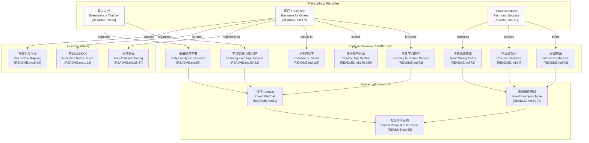
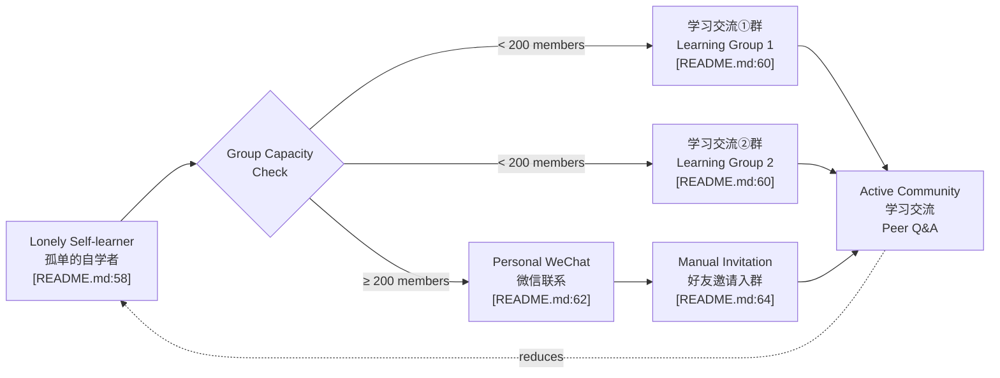
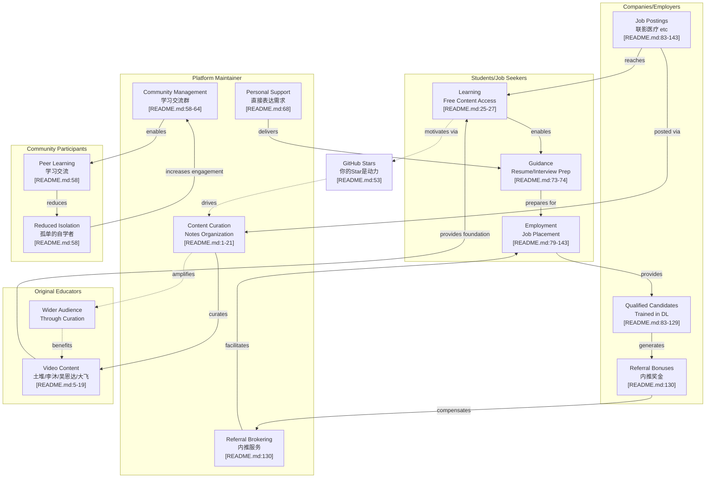
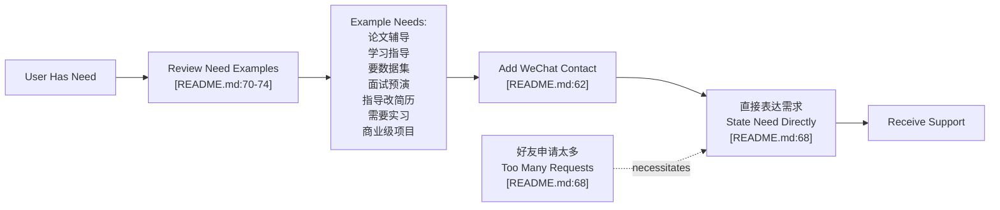
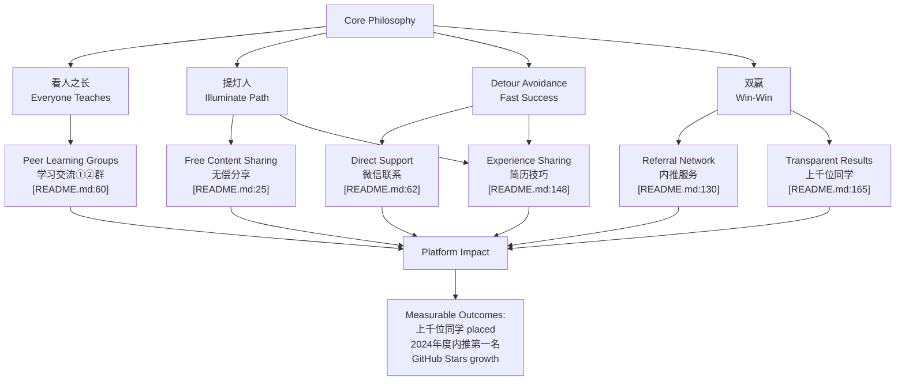

<!-- source: DeepWiki mcp.deepwiki.com · repo AccumulateMore/CV · page 4.4 Community Philosophy and Values · fetched 2026-10-29 -->

# Community Philosophy and Values

<details>
<summary>Relevant source files</summary>

The following files were used as context for generating this wiki page:

- [README.md](README.md)

</details>


## Purpose and Scope

This document explains the guiding philosophical principles that shape the community and support infrastructure of the CV repository platform. These values define how the maintainer approaches education, community building, and career support, differentiating this platform from traditional educational resources.

For practical details about WeChat groups and support channels, see [Community and Support System](#4). For how these values translate into career services, see [Career Services and Job Placement](#5). For operational community structures, see [WeChat Learning Groups](#4.1) and [Direct Support Channels](#4.2).

---

## Core Philosophical Principles

The platform is built on three foundational philosophical statements explicitly declared in [README.md]():

### Primary Philosophy: 看人之长，天下皆是吾师

[README.md:66]() states the central community value:

```
看人之短，无一可交之人。看人之长，天下皆是吾师。
```

**Translation**: "See people's shortcomings, no one is worth befriending. See people's strengths, everyone in the world is your teacher."

This principle establishes a learning mindset where:
- **Strength-focused interaction**: Community members are encouraged to learn from each other's expertise
- **Universal teacher concept**: Every person in the community has valuable knowledge to share
- **Non-judgmental environment**: Focus on what people can teach rather than their limitations
- **Peer learning enablement**: Reduces hierarchy and enables knowledge sharing across experience levels

### The 提灯人 (Lamp Bearer) Concept

[README.md:179]() articulates the platform's mission:

```
我们读书是为了成为提灯人去照亮黑暗，而不是为了自己有灯而沾沾自喜还要去吹灭别人的蜡烛
```

**Translation**: "We study to become lamp bearers who illuminate the darkness, not to be complacent about having a lamp and blow out others' candles."

This metaphor defines the role of those who have knowledge:
- **Illumination responsibility**: Those with knowledge should light the way for others
- **Anti-gatekeeping**: Explicitly rejects knowledge hoarding or making learning harder for others
- **Community elevation**: Success means lifting others up, not standing above them
- **Purpose of learning**: Knowledge exists to be shared and used to help others navigate

### The Detour Avoidance Philosophy

[README.md:172-173]() provides practical guidance:

```
我的经验（希望对你有帮助）：拿offer最快的方式，就是不走弯路，不走错路。方向错了，努力没有意义。
```

**Translation**: "My experience (hope it helps): The fastest way to get an offer is not to take detours or wrong paths. If the direction is wrong, effort has no meaning."

This principle emphasizes:
- **Efficiency through guidance**: Experienced members help others avoid mistakes they already made
- **Direction correctness**: Proper direction is more valuable than raw effort
- **Experience sharing**: Personal lessons become community knowledge
- **Pragmatic support**: Concrete help to reach career goals faster

Sources: [README.md:66](), [README.md:172-173](), [README.md:179]()

---

## Philosophy-to-Implementation Mapping

The abstract philosophical principles translate into concrete platform features:



**Key Mappings**:

1. **看人之长 → Peer Learning Groups**: The [README.md:60-62]() WeChat groups exist to enable peer-to-peer knowledge exchange
2. **提灯人 → Free Content Sharing**: All educational materials [README.md:25-27]() shared without charge
3. **提灯人 → Personal Guidance**: Resume tips [README.md:148-160]() shared from personal experience
4. **Detour Avoidance → Career Services**: Structured support [README.md:70-74]() prevents common mistakes
5. **Detour Avoidance → Success Metrics**: [README.md:165]() demonstrates effectiveness of guided approach

Sources: [README.md:58](), [README.md:60-74](), [README.md:148-160](), [README.md:165](), [README.md:172-179]()

---

## Addressing Isolation in Self-Learning

A specific philosophical commitment addresses the challenge of isolated learning:

### The 孤单的自学者 (Lonely Self-Learner) Problem

[README.md:58]() explicitly states:

```
搭建交流群，帮助孤单的自学者交流
```

**Translation**: "Build exchange groups to help lonely self-learners communicate."

This acknowledges that:
- **Self-learning is isolating**: Without community, learners face challenges alone
- **Peer support accelerates learning**: Discussion and Q&A help resolve blockers faster
- **Motivation through community**: Social connection provides persistence through difficult topics
- **Shared struggle validation**: Knowing others face similar challenges reduces discouragement

### Implementation: Two-Tier Group System

The platform addresses isolation through structured community access [README.md:60-64]():



**Capacity Management**: [README.md:64]() states that when groups exceed 200 members, QR code scanning fails, requiring personal invitation. This ensures no learner is excluded despite WeChat's technical limits.

Sources: [README.md:58](), [README.md:60-64]()

---

## The Win-Win (双赢) Value Exchange Model

The platform operates on a principle of mutual benefit rather than one-sided transactions:

### Stakeholder Value Flows

[README.md:130]() explicitly states the win-win model for job referrals:

```
你收公司内推奖金、ta们就业，双赢
```

**Translation**: "You receive company referral bonuses, they get employment, win-win."



**Value Creation at Each Level**:

1. **Students receive**: Free education + community + career support
2. **Maintainer receives**: Referral bonuses + community motivation (GitHub stars) + reputation [README.md:167-169]()
3. **Companies receive**: Pre-qualified candidates + reduced hiring costs
4. **Educators receive**: Wider reach through organized curation
5. **Community receives**: Reduced learning isolation + faster problem resolution

### The Referral Economy

[README.md:130]() invites others to participate in the referral network:

```
能内推简历的，也可以联系我，把岗位职责、任职要求发给我【你收公司内推奖金、ta们就业，双赢】
```

This extends the win-win model to:
- Other referrers who can earn bonuses
- Expanding the network of available opportunities
- Creating a scalable job placement system

Sources: [README.md:53](), [README.md:130](), [README.md:167-169]()

---

## Motivation and Engagement Philosophy

The platform explicitly acknowledges the importance of community feedback for sustained effort:

### GitHub Stars as Motivation

[README.md:53]() includes a direct request:

```
♥小声哔哔：你的Star，是我更新的动力~♥
```

**Translation**: "Whispering: Your Star is my motivation to update~"

This reveals:
- **Transparent motivation**: The maintainer openly states that community engagement drives content updates
- **Low-friction appreciation**: GitHub stars provide zero-cost way for users to show support
- **Reciprocal relationship**: Users receive free content, maintainer receives recognition
- **Sustainable model**: Social validation sustains long-term maintenance

### Direct Needs Communication

[README.md:68-69]() establishes efficient communication:

```
因为好友申请太多了，添加好友后，直接表达你的需求。
```

**Translation**: "Because there are too many friend requests, after adding friends, directly express your needs."

This philosophy prioritizes:
- **Efficiency over formality**: Skip pleasantries, state needs clearly
- **Respect for time**: Acknowledges high volume requires directness
- **Clear expectations**: [README.md:70-74]() provides need examples table
- **Reduced friction**: Makes it easier for users to ask for help



Sources: [README.md:53](), [README.md:68-74]()

---

## Practical Wisdom Sharing

Beyond abstract principles, the platform shares concrete, actionable advice based on real experience:

### Resume Writing Philosophy

[README.md:148-160]() shares specific resume techniques used by the maintainer in 2021:

**Key Principles Shared**:

1. **Skill Honesty** [README.md:154](): "只写掌握了XX，没掌握不要写" (Only write skills you've mastered, don't write what you haven't)
2. **Evidence-Based Claims** [README.md:155](): "写掌握某项技能时，后面要论证自己真的掌握了，提供相关经历" (When writing a skill, provide evidence you've mastered it)
3. **Job Alignment** [README.md:157](): "只写岗位需要的技能" (Only write skills the position needs)
4. **Visual Consistency** [README.md:158](): "掌握一种类别技能，只占一行" (Each skill category takes only one line for neatness)

### The 10-Second Rule

[README.md:161-163]() explains HR reality:

```
要知道，很多大公司HR经常一天要看几百份，甚至上千份简历，基本都是10秒内看一份简历。

就是这关键的10秒，HR就决定了是进入面试还是PASS。
```

**Translation**: "Know that many large company HRs often review hundreds or even thousands of resumes per day, basically 10 seconds per resume. In these critical 10 seconds, HR decides whether to interview or PASS."

This sharing demonstrates:
- **Insider perspective**: Maintainer provides information from decision-maker's viewpoint
- **Practical constraints**: Explains why resume formatting matters
- **Success factors**: Identifies what makes the difference in brief review time
- **Reality check**: Prepares users for actual hiring process mechanics

### Validation Through Results

[README.md:165]() and [README.md:167-169]() provide evidence that these principles work:

```
我已经指导过上千位同学，即使市场大环境不好，很多同学都入职各家公司成功了。
```

**Translation**: "I have already guided thousands of students, even though the market environment is not good, many students have successfully joined various companies."

The inclusion of "2024届年度 内推第一名" (2024 Top Internal Referral Provider) certificates validates the approach.

Sources: [README.md:148-169]()

---

## How Philosophy Shapes Platform Operations

The philosophical principles directly influence operational decisions:

### Free and Open Access

Aligned with 提灯人 (Lamp Bearer) concept:
- All notes freely downloadable from GitHub
- Video links publicly accessible on Bilibili
- Dataset sharing at no cost [README.md:25-27]()
- No paywalls or subscription requirements

### Direct Support Availability

Aligned with Detour Avoidance:
- Personal WeChat contact provided [README.md:62]()
- Multiple support pathways [README.md:70-74]()
- Quick response to resource access issues [README.md:29]()

### Transparent Success Metrics

Aligned with Win-Win philosophy:
- Publicly shares placement statistics [README.md:165]()
- Displays referral achievements [README.md:167-169]()
- Acknowledges community role in success

### Community-First Design

Aligned with 看人之长 (Everyone is a Teacher):
- Multiple learning groups for peer interaction [README.md:60-62]()
- Encourages asking questions and sharing knowledge
- Reduces hierarchy between experienced and new learners



Sources: [README.md:25-29](), [README.md:60-62](), [README.md:130](), [README.md:148-169]()

---

## Summary: Philosophy as Platform Foundation

The community philosophy is not decorative but foundational to platform operations. Every major feature traces back to one of the core principles:

| Philosophical Principle | README.md Location | Concrete Implementation |
|------------------------|-------------------|------------------------|
| 看人之长 (Everyone is a Teacher) | [README.md:66]() | Peer learning groups, community Q&A |
| 提灯人 (Lamp Bearer) | [README.md:179]() | Free content sharing, personal guidance |
| Detour Avoidance | [README.md:172]() | Resume tips, interview prep, career guidance |
| 双赢 (Win-Win) | [README.md:130]() | Referral network, mutual benefit model |
| Community Motivation | [README.md:53]() | GitHub stars, engagement feedback |
| Isolation Reduction | [README.md:58]() | Multiple WeChat groups, easy access |

The philosophical framework creates a self-sustaining ecosystem where:
1. Students receive free education and career support
2. Community engagement motivates continued maintenance
3. Successful placements generate referral rewards
4. Rewards enable continued free service provision
5. Shared success attracts new learners

This closes the loop, making the platform sustainable without charging users while maintaining high-quality support through the win-win referral model.

Sources: [README.md:53](), [README.md:58](), [README.md:66](), [README.md:130](), [README.md:172](), [README.md:179]()

---

