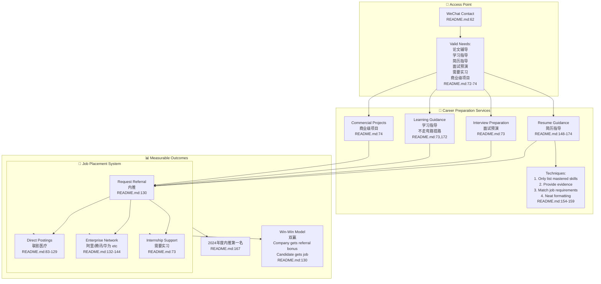
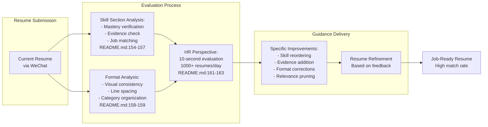
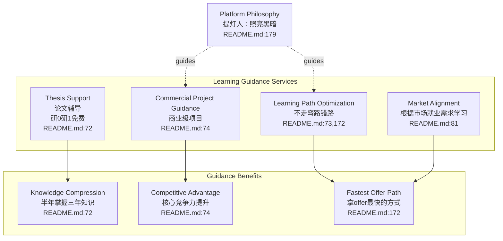
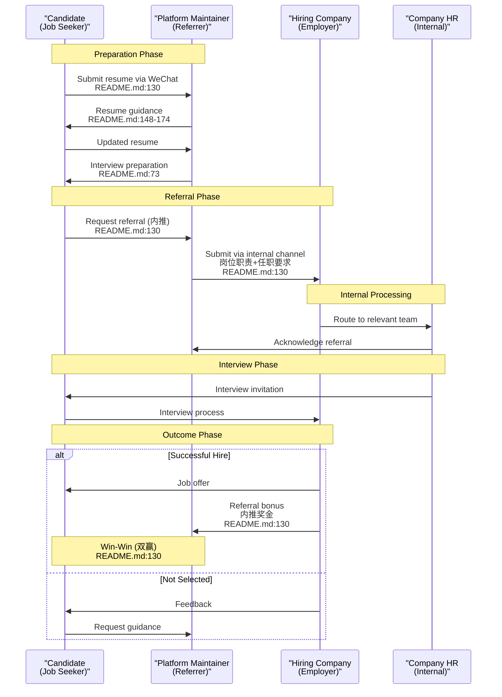
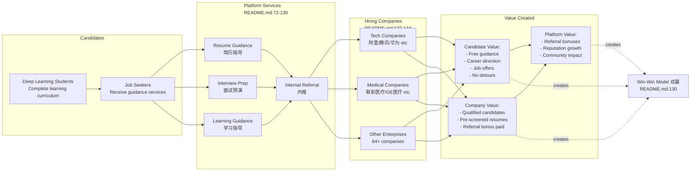

<!-- source: DeepWiki mcp.deepwiki.com · repo AccumulateMore/CV · page 5 Career Services and Job Placement · fetched 2026-10-29 -->

# Career Services and Job Placement

<details>
<summary>Relevant source files</summary>

The following files were used as context for generating this wiki page:

- [README.md](README.md)

</details>


## Purpose and Scope

This page documents the career services and job placement system implemented in the CV repository. The system provides a comprehensive pipeline from career preparation to job placement, leveraging an internal referral network (内推) to connect candidates with employment opportunities. The career services pillar transforms learning outcomes into employment results through resume guidance, interview preparation, learning direction, and direct job referrals.

For information about the educational content that prepares users for these career services, see [Educational Content System](#2). For community support infrastructure that complements career guidance, see [Community and Support System](#4). For success metrics and user progression models, see [Platform Outcomes and Success Stories](#6).

**Sources:** [README.md:79-180]()

---

## System Architecture Overview

The career services system operates as a structured pipeline coordinating multiple services through WeChat-based communication. All career-related services are accessed by contacting the platform maintainer via the WeChat channel shown in [README.md:62]().



**Diagram: Career Services Pipeline Architecture**

The system follows a three-stage pipeline: (1) Access through WeChat with validated needs, (2) Career preparation services that build job readiness, and (3) Job placement through referrals or direct postings. The preparation services feed into the placement system, which produces measurable outcomes including thousands of successful placements and recognition as the top referrer for 2024.

**Sources:** [README.md:60-180]()

---

## Resume Guidance System (简历指导)

The resume guidance service provides structured feedback on resume construction based on proven techniques. The guidance is available by contacting the platform maintainer via WeChat with the specific need "指导改简历" [README.md:74]().

### Resume Technique Framework

The system employs six specific techniques documented from 2021 experience [README.md:148-159](). These techniques are designed for HR screening where resumes are evaluated in approximately 10 seconds [README.md:161-163]().

| Technique | Description | Line Reference |
|-----------|-------------|----------------|
| Skill Mastery Only | Only list skills actually mastered; unmastered skills excluded. More proficient skills listed first. | [README.md:154]() |
| Evidence Provision | Provide related experience as evidence when claiming skill mastery to facilitate interviewer inquiry. | [README.md:155]() |
| Job-Centric Presentation | Structure skills around algorithm positions: programming languages → deep learning frameworks → image processing algorithms → server/database/storage. | [README.md:156]() |
| Relevance Filtering | Exclude non-essential skills (hardware knowledge, organizational abilities) that don't match algorithm positions. | [README.md:157]() |
| Formatting Consistency | Each skill category occupies exactly one line for visual uniformity. | [README.md:158]() |
| Perception Optimization | Resume appears organized, credible, and highly matched to target position. | [README.md:159]() |

### Example Resume Skills Section

[README.md:150]() displays a reference implementation from the maintainer's 2021 resume demonstrating 10% of total resume techniques. The image shows:
- Python, C/C++ listed as mastered languages
- Pytorch, Tensorflow frameworks
- Image processing algorithms
- Server and database technologies
- One-line per skill category formatting



**Diagram: Resume Guidance Workflow**

The resume undergoes analysis from both technical and format perspectives, then evaluated from HR's viewpoint considering the 10-second screening constraint. Feedback focuses on actionable improvements that increase matching probability.

**Sources:** [README.md:148-174]()

---

## Interview Preparation Service (面试预演)

The interview preparation service offers mock interviews described as "简历拷打问题" (resume grilling questions) [README.md:73](). This service prepares candidates for interviewer scrutiny by identifying potential weak points in resumes and practicing responses.

### Service Characteristics

- **Access Method**: WeChat contact with need "面试预演"
- **Focus**: Resume-based questioning to expose vulnerabilities
- **Purpose**: Prepare for actual interview scenarios before company interviews
- **Integration**: Works in conjunction with resume guidance service

The service addresses the philosophy that "方向错了，努力没有意义" (wrong direction makes effort meaningless) by ensuring candidates are properly prepared before pursuing opportunities [README.md:172]().

**Sources:** [README.md:73](), [README.md:172]()

---

## Learning and Career Guidance (学习指导)

The learning guidance service provides personalized direction to optimize learning paths and accelerate career outcomes. The service explicitly aims to help candidates "不走弯路错路，快速拿到offer" (avoid detours and errors, quickly secure offers) [README.md:73]().

### Guidance Components



**Diagram: Learning Guidance Service Components**

The guidance system provides four distinct services that contribute to accelerated career outcomes. The "lamp bearer" (提灯人) philosophy [README.md:179]() informs all guidance services, emphasizing illuminating the correct path for learners.

### Thesis Support Details

For graduate students (研0研1), thesis support is provided free of charge, promising "半年掌握三年知识" (master three years of knowledge in six months) [README.md:72]().

### Commercial Project Guidance

Commercial-grade project guidance helps candidates "简历增添项目，提升核心竞争力" (add projects to resume, enhance core competitiveness) [README.md:74](). This service addresses the need for practical project experience that distinguishes candidates in the job market.

**Sources:** [README.md:72-74](), [README.md:81](), [README.md:172](), [README.md:179]()

---

## Internal Referral System (内推)

The internal referral system is the primary job placement mechanism. The system operates on a win-win model where companies receive referral bonuses (内推奖金) and candidates gain streamlined access to interview processes [README.md:130]().

### Referral System Architecture



**Diagram: Internal Referral Process Sequence**

The referral system coordinates interactions between candidate, platform maintainer (acting as referrer), and hiring companies. The maintainer receives referral bonuses from successful placements while candidates benefit from prepared guidance and internal channel access.

### Reverse Referral Opportunities

The system also supports reverse referrals where individuals with internal referral capabilities can contribute. The model states: "能内推简历的，也可以联系我，把岗位职责、任职要求发给我【你收公司内推奖金、ta们就业，双赢】" (those who can provide internal referrals may contact me with job responsibilities and requirements - you receive company referral bonus, they get employment, win-win) [README.md:130]().

**Sources:** [README.md:130]()

---

## uCloudlink Medical (联影医疗) Job Postings

The system features direct job postings from 联影医疗 (uCloudlink Medical), a listed company valued in the billions with strong growth prospects in China's domestic high-end medical equipment sector [README.md:83-86]().

### Company Profile

- **Company Name**: 联影医疗 (uCloudlink Medical)
- **Status**: 上市千亿公司 (Listed, hundred-billion valuation)
- **Locations Available**: Shanghai, Beijing, Shenzhen, Wuhan, Guangzhou, Chengdu, Xi'an, Shenyang, Sanya, etc.
- **Context**: Development driven by national policy for domestic R&D of high-end medical equipment

**Sources:** [README.md:83-86]()

### Image Direction AI Algorithm Engineer (图像方向)

#### Job Responsibilities (岗位职责)

[README.md:89-95]() specifies responsibilities for participating in AI algorithm development or graphics algorithm development, including at least one of:

1. **Product-Level Algorithm Solutions** for:
   - 联影通用软件平台 (uCloudlink general software platform)
   - 联影高级应用后处理工作站 (Advanced application post-processing workstation)
   - 联影智能uAl平台 (Intelligent uAI platform)
   - 联影机器人手术规划与导航 (Robotic surgery planning and navigation)
   - MR/CT/RT/MI/US business unit algorithm requirements
   - Forward-looking research projects with research institutes and hospitals
   - Innovative technology productization

2. **Medical Image 3D Rendering**: Algorithm maintenance and development, medical image processing using image processing and AI technology

#### Requirements (任职要求)

[README.md:97-100]() lists:

1. Familiarity with machine vision principles and at least one of:
   - 3D reconstruction
   - Stereo vision
   - SLAM
   - Image/video classification
   - Object detection
   - Human pose estimation

2. Familiarity with at least one medical image post-processing algorithm:
   - Graphics algorithms
   - Reconstruction algorithms
   - Segmentation algorithms
   - Detection algorithms
   - Classification algorithms
   - Registration algorithms
   - Deep learning algorithms
   - Computational fluid dynamics algorithms
   - Perfusion algorithms
   - Texture analysis algorithms

**Sources:** [README.md:89-100]()

### Voice Direction AI Algorithm Engineer (语音方向)

#### Job Responsibilities

[README.md:101-105]() specifies:

1. Research and implementation of audio signal processing and recognition algorithms, including but not limited to:
   - Echo cancellation (回声消除)
   - Microphone array (麦克风阵列)
   - Blind source separation (盲源分离)

2. Research and implementation of AI audio algorithms including deep learning and neural networks

#### Requirements

[README.md:107-111]() requires:

1. Solid mathematical theory and digital signal processing foundation, proficiency in Matlab and C/C++ programming
2. Experience with speech/audio signal processing (noise reduction, echo cancellation, microphone array, audio effects, etc.)
3. Research in deep learning, neural networks, intelligent speech recognition

**Sources:** [README.md:101-111]()

### Large Model Direction AI Algorithm Engineer (大模型方向)

#### Job Responsibilities

[README.md:112-121]() details seven primary responsibilities:

| Responsibility Area | Description |
|---------------------|-------------|
| Algorithm Development | Development, optimization, and application landing of large language models |
| Solution Design | AI solution design, key technology R&D, technical challenge resolution |
| Model Implementation | Design and implement LLM-related algorithms and models, research new algorithms to solve application problems |
| Training Optimization | Develop and optimize LLM training processes, design training algorithms and strategies, configure and optimize hyperparameters and computational resources |
| Dataset Construction | Build and manage large-scale medical text datasets for pretraining and fine-tuning, complete downstream tasks in different scenarios |
| Evaluation | Design evaluation metrics and experiments, assess trained LLMs, identify weaknesses, propose improvement strategies |
| Collaboration | Participate in collaboration with universities, research institutes, medical institutions; assist with research outcome transformation |

#### Requirements

[README.md:122-129]() specifies:

1. Learning and research in machine learning, NLP, medical image analysis, or related fields
2. Experience in pre-trained large language models or GPT model development
3. Publications in top conferences:
   - Machine learning: ICML, NeurIPS, ICLR
   - Computer vision: CVPR, ICCV, ECCV
   - NLP: ACL, EMNLP
   - Medical image analysis: MICCAI, IPMI
   - Or top journals: IEEE T-PAMI, IEEE TMI, Medical Image Analysis
4. Master's degree or above in AI-related fields (computer vision, machine learning, medical image analysis)
5. Proficient English skills

**Sources:** [README.md:112-129]()

---

## Enterprise Referral Network

The platform maintains an extensive enterprise network capable of providing internal referrals (内推) to major companies across multiple industries [README.md:132-144]().

### Network Structure

The network spans 64+ companies organized across multiple sectors:

```mermaid
graph TB
    subgraph TechGiants["Major Tech Companies"]
        Alibaba["阿里巴巴"]
        Tencent["腾讯"]
        Huawei["华为"]
        Baidu["百度"]
        ByteDance["字节跳动"]
        Meituan["美团"]
        JD["京东"]
        Pinduoduo["拼多多"]
    end
    
    subgraph Automotive["Automotive & Smart Mobility"]
        Nio["蔚来汽车"]
        Li["理想汽车"]
        Xpeng["小鹏汽车"]
        BYD["比亚迪"]
        Tesla["特斯拉"]
    end
    
    subgraph AIVision["AI & Computer Vision"]
        SenseTime["商汤科技"]
        Megvii["旷视科技"]
        Cambricon["寒武纪"]
        Horizon["地平线"]
        Yitu["依图科技"]
        CloudWalk["云从科技"]
    end
    
    subgraph Medical["Medical Equipment"]
        GE["GE医疗"]
        Siemens["西门子医疗"]
        uCloudlink["联影医疗"]
    end
    
    subgraph Telecom["Telecommunications"]
        CMCC["中国移动"]
        Unicom["中国联通"]
        Telecom["中国电信"]
        ZTE["中兴通讯"]
    end
    
    subgraph Finance["Financial Services"]
        CMB["招商银行"]
        ICBC["工商银行"]
        CCB["建设银行"]
        ABC["农业银行"]
        BCM["交通银行"]
        Ping["平安科技"]
        PWC["普华永道"]
        Deloitte["德勤"]
        EY["安永"]
    end
    
    subgraph Hardware["Hardware & Electronics"]
        Xiaomi["小米"]
        OPPO["OPPO"]
        Vivo["vivo"]
        Lenovo["联想"]
        BOE["京东方"]
        Hikvision["海康威视"]
        Dahua["大华股份"]
    end
    
    subgraph Internet["Internet Services"]
        NetEase["网易"]
        Kuaishou["快手"]
        Ctrip["携程"]
        Bilibili["哔哩哔哩"]
        Zhihu["知乎"]
        Xiaohongshu["小红书"]
        Didi["滴滴"]
    end
    
    ReferralNetwork["Internal Referral Network<br/>内推<br/>README.md:132-144"]
    
    ReferralNetwork --> TechGiants
    ReferralNetwork --> Automotive
    ReferralNetwork --> AIVision
    ReferralNetwork --> Medical
    ReferralNetwork --> Telecom
    ReferralNetwork --> Finance
    ReferralNetwork --> Hardware
    ReferralNetwork --> Internet
```

**Diagram: Enterprise Referral Network Organization**

The network is organized by industry sectors, providing breadth across technology, automotive, AI, medical, telecommunications, finance, hardware, and internet services.

### Complete Enterprise List

The full network list from [README.md:132-144]() includes:

**Technology**: 阿里巴巴, 腾讯, 美团, 京东, 拼多多, 百度, 字节跳动, 华为, 网易, 快手

**Hardware**: 小米, OPPO, vivo, 联想, 浪潮集团, 用友网络, 京东方, 深信服, 金山办公, 金山云

**AI/Vision**: 商汤科技, 旷视科技, 科大讯飞, 寒武纪, 地平线, 依图科技, 云从科技

**Automotive**: 蔚来汽车, 理想汽车, 小鹏汽车, 比亚迪, 特斯拉, 小马智行, 文远知行

**Telecommunications**: 中国移动, 中国联通, 中国电信, 中兴通讯

**Hardware/Vision**: 海康威视, 大华股份, 大疆

**Internet**: 携程, 同程旅行, 得物, 哔哩哔哩, 虎牙直播, 斗鱼, 喜马拉雅, 滴滴, 高德地图, 知乎, 小红书

**Education**: 猿辅导, 作业帮

**Finance**: 招商银行, 工商银行, 建设银行, 农业银行, 交通银行, 平安科技, 招联科技, 中金公司, 广发证券, 普华永道, 德勤, 安永

**Manufacturing**: 顺丰科技, 商飞, 航天科技, 中航工业, 中车集团, 三一重工

**Energy**: 国家电网, 南方电网

**Battery/Energy**: 宁德时代, 中创新航, 比克电池

**Medical**: GE医疗, 西门子医疗, 联影医疗

**AI Platforms**: 智谱

**Sources:** [README.md:132-144]()

---

## Success Metrics and Outcomes

The career services system tracks measurable outcomes demonstrating effectiveness and scale.

### Quantitative Metrics

| Metric | Value | Description | Reference |
|--------|-------|-------------|-----------|
| Students Placed | 上千位同学 | Thousands of students successfully placed in jobs | [README.md:165]() |
| 2024 Ranking | 年度内推第一名 | Number one internal referrer for 2024 | [README.md:167]() |
| Guidance Experience | 上千位同学 | Over thousand students guided | [README.md:165]() |
| Market Conditions | 市场大环境不好 | Success achieved despite poor market conditions | [README.md:165]() |

### Success Evidence

[README.md:167-170]() displays three screenshots showing recognition as "2024届年度 内推第一名" (2024 top internal referrer) with the caption "一起沾沾喜气，好运是可以传染的" (share the good fortune, luck is contagious).

### Value Exchange Model



**Diagram: Multi-Stakeholder Value Exchange**

The system creates value for all participants: candidates receive free guidance and employment, companies receive qualified candidates and pay referral bonuses, and the platform gains referral income and reputation. This three-way value exchange implements the "双赢" (win-win) model mentioned in [README.md:130]().

### Philosophy and Approach

The career services operate under two philosophical principles:

1. **Fastest Path to Offer**: "我的经验（希望对你有帮助）：拿offer最快的方式，就是不走弯路，不走错路。方向错了，努力没有意义。" (My experience: the fastest way to get an offer is to avoid detours and wrong paths. Wrong direction makes effort meaningless.) [README.md:172]()

2. **Lamp Bearer Concept**: "我们读书是为了成为提灯人去照亮黑暗，而不是为了自己有灯而沾沾自喜还要去吹灭别人的蜡烛" (We study to become lamp bearers illuminating darkness, not to be smug about our own light while extinguishing others' candles) [README.md:179]()

These principles guide the service delivery model, emphasizing guidance over gatekeeping and efficiency over extended trial-and-error.

**Sources:** [README.md:165-180]()

---

## Internship Support (需要实习)

The career services include dedicated internship support listed as a valid contact need [README.md:73](). This service helps students secure internship positions as stepping stones to full-time employment, addressing the common requirement for practical experience before graduation.

### Access Method

Contact via WeChat with the specific need "需要实习" (need internship). This routes the request through the same career services pipeline with focus on internship rather than full-time positions.

**Sources:** [README.md:73]()

---

## Service Coordination and Access Control

All career services are accessed through the WeChat contact system with explicit need validation to manage request volume.

### Valid Contact Reasons

[README.md:70-74]() specifies valid reasons for adding the maintainer on WeChat:

| Need Category | Chinese Term | Purpose |
|---------------|--------------|---------|
| Thesis Guidance | 需要论文辅导 | Research support for graduate students (研0研1 free) |
| Learning Guidance | 需要学习指导 | Career path optimization, avoiding detours |
| Resume Guidance | 指导改简历 | Resume optimization from interviewer perspective |
| Interview Prep | 面试预演 | Mock interviews and resume grilling |
| Group Access | 要进学习交流群 | Join learning exchange groups |
| Dataset Access | 要数据集 | Obtain course datasets |
| Internship | 需要实习 | Secure internship positions |
| Commercial Projects | 需要商业级项目 | Portfolio development for competitive advantage |

### Communication Protocol

[README.md:68-69]() establishes clear communication expectations:

> "因为好友申请太多了，添加好友后，直接表达你的需求。"

(Because there are too many friend requests, directly state your needs after adding as friend.)

This protocol ensures efficient request handling given the volume documented by success metrics (上千位同学).

**Sources:** [README.md:68-74]()

---

## Integration with Educational Content

The career services system integrates with the educational content pillar [README.md:81]():

> "备注：初学者也可以根据市场上就业需求，去学习自己。"

(Note: Beginners can also learn according to market employment demands.)

This creates a feedback loop where job market requirements inform learning paths, ensuring curriculum relevance and employability outcomes. The integration allows learners to:

1. Understand current market demands before beginning study
2. Focus learning on high-demand skills
3. Build portfolios aligned with employer needs
4. Transition smoothly from learning to job seeking

The 100-500 series curriculum (documented in [Educational Content System](#2)) provides the technical foundation that the career services then translate into employment outcomes.

**Sources:** [README.md:81]()

---

