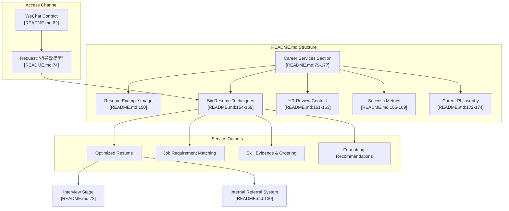
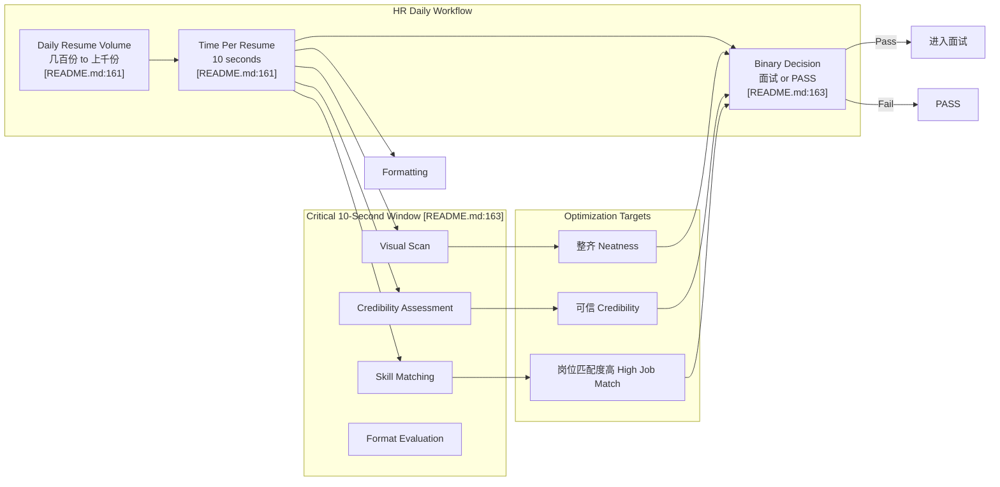
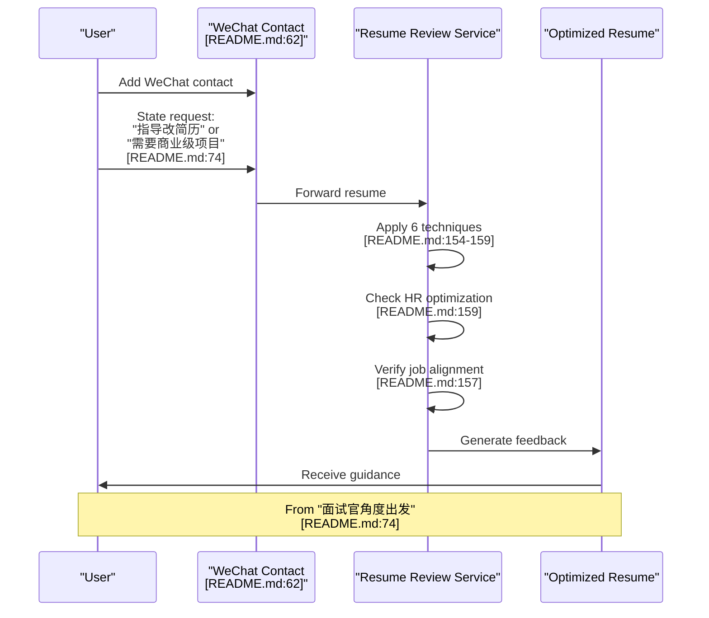
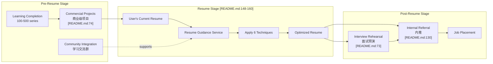
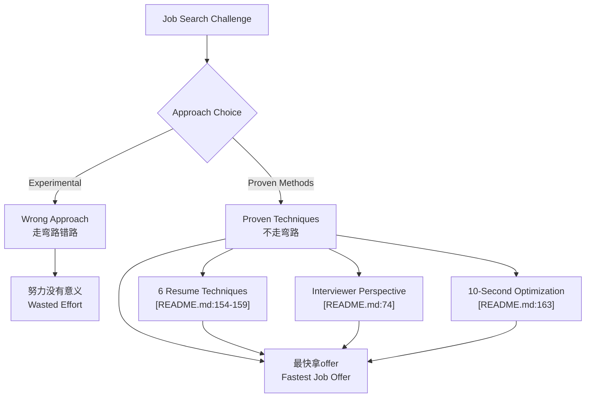
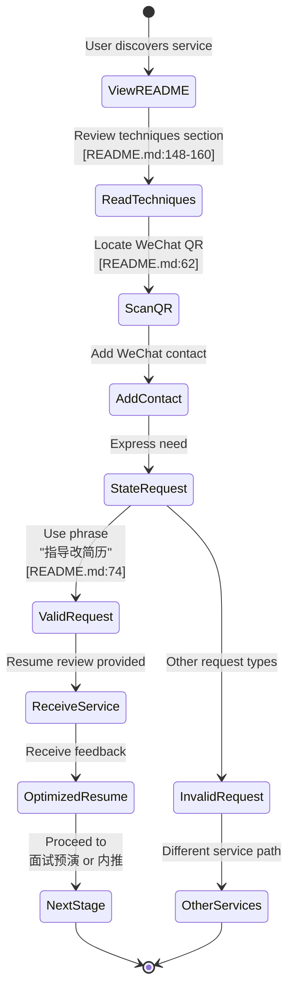
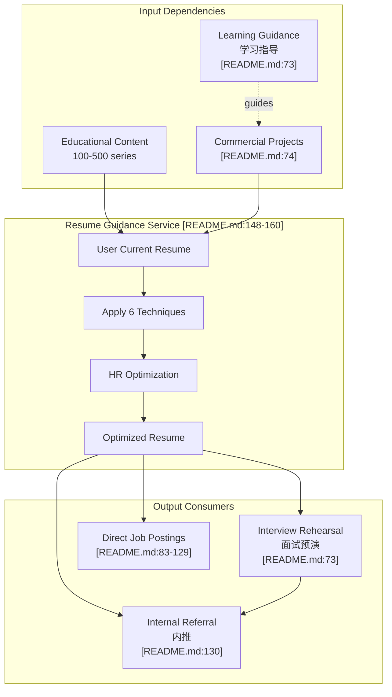

<!-- source: DeepWiki mcp.deepwiki.com · repo AccumulateMore/CV · page 5.1 Resume Guidance (简历指导) · fetched 2026-10-29 -->

# Resume Guidance (简历指导)

<details>
<summary>Relevant source files</summary>

The following files were used as context for generating this wiki page:

- [README.md](README.md)

</details>


## Purpose and Scope

This document describes the resume guidance service provided through the CV repository platform. The service offers structured resume review and optimization specifically for deep learning and AI algorithm positions, based on proven techniques from the maintainer's 2021 job search experience. The guidance focuses on skill presentation, evidence-based claims, job requirement alignment, and formatting strategies that pass initial HR screening.

For information about interview preparation after resume optimization, see [Interview Preparation](#5.2). For the broader career development pipeline, see [Career Services and Job Placement](#5).

**Sources:** [README.md:148-175]()

---

## Service Architecture

The resume guidance service is embedded within the Career Services pillar of the platform, operating through direct WeChat contact. The service provides personalized resume reviews from a former hiring manager perspective.

### Resume Guidance in Platform Structure



**Sources:** [README.md:62-177]()

---

## Core Resume Techniques

The platform documents six specific techniques developed from the maintainer's 2021 job search experience, claiming these represent "10%" of their resume strategy. These techniques are designed to optimize for the critical 10-second HR review window.

### Technique Specification

| Technique ID | Technique Description | Implementation Details | Line Reference |
|--------------|----------------------|------------------------|----------------|
| **Technique 1** | Only list mastered skills | Write only skills that are truly mastered (掌握了XX); omit unmastered skills. Order by proficiency: most proficient skills first, less proficient but still mastered skills last. | [README.md:154]() |
| **Technique 2** | Provide evidence for claims | When stating skill mastery, provide supporting evidence through relevant experience (提供相关经历). This facilitates interviewer question entry points. | [README.md:155]() |
| **Technique 3** | Align with algorithm positions | Structure skills around algorithm position requirements: programming languages → deep learning frameworks → image processing algorithms → server/database/storage systems. | [README.md:156]() |
| **Technique 4** | Write only required skills | Include only job-relevant skills. Exclude hardware knowledge, organizational abilities, or other non-essential items to maximize algorithm position matching (让简历更高匹配算法岗). | [README.md:157]() |
| **Technique 5** | Single-line per skill category | Each skill category occupies exactly one line for visual consistency. Avoid mixing one-line and two-line entries. | [README.md:158]() |
| **Technique 6** | Optimize for perceived quality | Create impression of neatness (整齐), credibility (可信), and high job match rate through visual formatting and content selection. | [README.md:159]() |

**Sources:** [README.md:148-160]()

### Visual Reference

The platform includes a visual example of these techniques in practice from the maintainer's 2021 resume:

```
Resume Image Reference: [README.md:150]()
Image Asset: 7dd76d41-4cbd-4c1f-b26c-23d67305cf6e
Dimensions: 819×474 pixels
```

**Sources:** [README.md:150]()

---

## HR Screening Context

The resume guidance is designed around the operational constraints of high-volume HR departments. Understanding this context informs the optimization strategy.

### HR Review Process Model



**Sources:** [README.md:161-163]()

### Volume Metrics

The platform explicitly states the screening challenge:

- **Daily volume per HR**: Several hundred (几百份) to over one thousand (上千份) resumes
- **Decision time**: 10 seconds per resume
- **Critical decision point**: The 10-second window (关键的10秒) determines interview progression or rejection

This context explains why Techniques 5 and 6 (visual consistency and perceived quality) are given equal importance to technical content accuracy.

**Sources:** [README.md:161-163]()

---

## Service Access and Workflow

Resume guidance is accessed through the WeChat contact channel with specific request identification.

### Access Process



**Sources:** [README.md:62-74]()

### Request Syntax

The platform specifies exact request phrasing in the contact table:

```
Valid Request Strings:
- "指导改简历" (guide resume revision) [README.md:74]
- Context: "从面试官角度出发" (from interviewer perspective) [README.md:74]
```

The service explicitly positions itself as providing "interviewer perspective" guidance, distinguishing it from generic resume services.

**Sources:** [README.md:74]()

---

## Integration with Career Pipeline

Resume guidance serves as a preparation stage within the broader career services pipeline, connecting learning completion to job placement.

### Pipeline Position



**Sources:** [README.md:73-74, 130, 148-160]()

### Complementary Services

The resume guidance explicitly references and prepares users for subsequent services:

- **Interview rehearsal (面试预演)**: Addresses "简历拷打问题" (resume grilling questions) that may emerge from the optimized resume [README.md:73]()
- **Internal referral system (内推)**: Optimized resumes are submitted through the referral network [README.md:130]()
- **Commercial project guidance (商业级项目)**: Can be added to resume before optimization to strengthen competitiveness [README.md:74]()

**Sources:** [README.md:73-74, 130]()

---

## Success Metrics and Validation

The platform documents measurable outcomes from the resume guidance service as validation of technique effectiveness.

### Documented Outcomes

**Placement Volume:**
```
Metric: "上千位同学" (thousands of students)
Context: Guided to successful employment
Period: Cumulative through 2024
Source: [README.md:165]()
```

**Market Performance:**
```
Achievement: "2024届年度 内推第一名"
Translation: 2024 academic year top internal referral provider
Evidence: Three screenshot images [README.md:167-170]()
Visual proof location: GitHub user-attachments assets
Context note: "即使市场大环境不好" (even in poor market conditions)
Source: [README.md:165-169]()
```

**Sources:** [README.md:165-170]()

### Effectiveness Evidence

The platform provides visual evidence of successful placements with specific formatting:

| Evidence Type | Content | Location |
|--------------|---------|----------|
| Success screenshots | Three images showing placement confirmations | [README.md:169]() |
| Motivational text | "一起沾沾喜气，好运是可以传染的" (share the good fortune, luck is contagious) | [README.md:170]() |
| Market context | Employment success despite "市场大环境不好" (poor overall market) | [README.md:165]() |

**Sources:** [README.md:165-170]()

---

## Philosophical Foundation

The resume guidance service operates within a broader career development philosophy that shapes its approach and positioning.

### Core Principles

**Primary Philosophy:**
```
Statement: "拿offer最快的方式，就是不走弯路，不走错路"
Translation: "The fastest way to get an offer is to avoid detours and wrong paths"
Implication: "方向错了，努力没有意义" (wrong direction makes effort meaningless)
Source: [README.md:172]()
```

This principle directly informs the resume guidance service's focus on proven techniques rather than experimental approaches.

**Supporting Philosophy:**
```
Statement: "看人之短，无一可交之人。看人之长，天下皆是吾师"
Translation: "Focus on shortcomings, no one is worth befriending. Focus on strengths, everyone is a teacher"
Context: Community values statement
Source: [README.md:66]()
```

**Platform Mission:**
```
Statement: "我们读书是为了成为提灯人去照亮黑暗"
Translation: "We study to become lamp bearers illuminating darkness"
Context: Not for self-satisfaction but to help others
Source: [README.md:179]()
```

**Sources:** [README.md:66, 172, 179]()

### Decision Framework



**Sources:** [README.md:66, 74, 154-163, 172, 179]()

---

## Technical Implementation Details

While the resume guidance service operates through manual review, it is documented within the repository structure with specific content organization.

### Content Location Map

| Content Element | Line Range | Description |
|----------------|------------|-------------|
| Service introduction | [README.md:79-81]() | Employment assistance context |
| Resume example heading | [README.md:148]() | Section header with year context (2021) |
| Visual example | [README.md:150]() | Embedded image reference |
| Technique list | [README.md:152-159]() | Six numbered techniques with explanations |
| HR context explanation | [README.md:161-163]() | Volume and timing constraints |
| Success metrics | [README.md:165-170]() | Quantitative outcomes and evidence |
| Philosophy statement | [README.md:172-174]() | Career approach rationale |

**Sources:** [README.md:79-174]()

### Contact Flow Specification



**Sources:** [README.md:62, 74, 148-160]()

---

## Relationship to Other Services

Resume guidance is one component of an integrated career services offering, with dependencies and connections to other platform features.

### Service Dependencies



**Sources:** [README.md:73-74, 83-160]()

### Value Exchange Model

The resume guidance service participates in the platform's win-win (双赢) value exchange:

**For Students:**
- Free resume optimization service
- Access to proven techniques from 2021 experience
- Interviewer perspective feedback
- Preparation for internal referrals

**For Platform:**
- Higher candidate quality for referrals
- Increased referral success rate
- Referral bonuses from companies (内推奖金)
- Community growth and reputation

**For Companies:**
- Pre-optimized candidate resumes
- Higher job requirement matching
- Reduced initial screening time
- Access to trained candidates

**Sources:** [README.md:130, 148-165]()

---

## Summary

The Resume Guidance service provides structured resume optimization for deep learning and AI algorithm positions through six documented techniques developed from the maintainer's 2021 job search experience. The service operates via WeChat contact using the request phrase "指导改简历" and optimizes resumes for the critical 10-second HR review window. With documented success guiding thousands of students to employment, the service functions as a key stage in the platform's learning-to-employment pipeline, preparing candidates for interview rehearsal and internal referral systems.

**Sources:** [README.md:62, 74, 148-175]()

---

