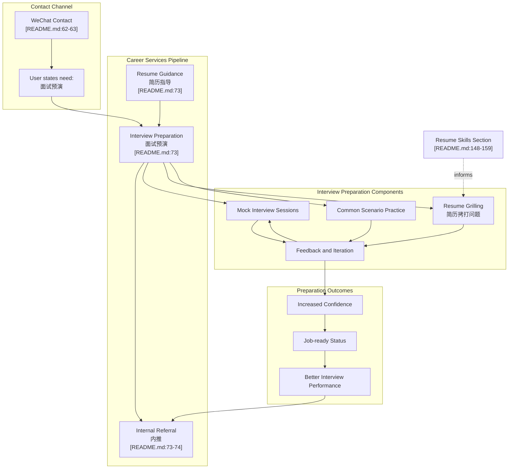
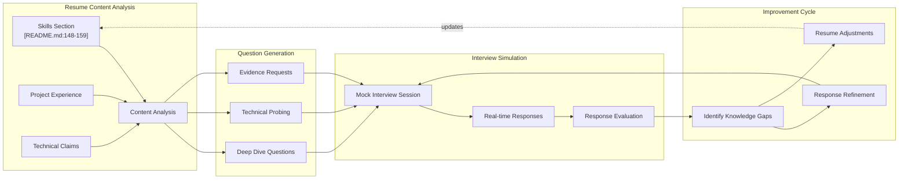
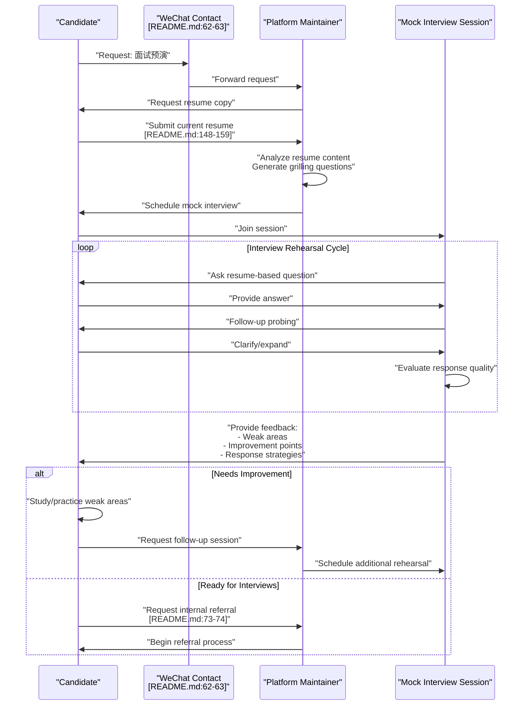
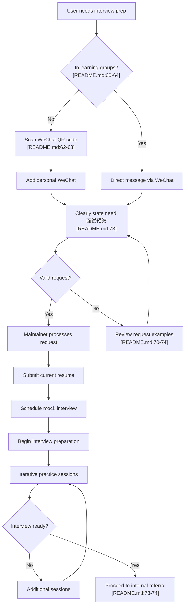
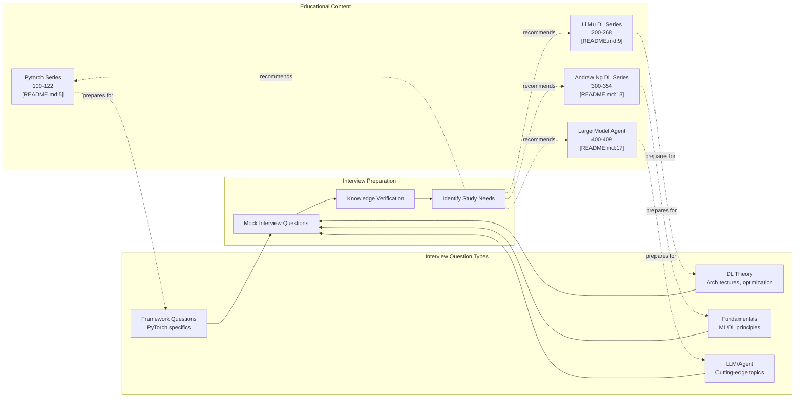

<!-- source: DeepWiki mcp.deepwiki.com · repo AccumulateMore/CV · page 5.2 Interview Preparation · fetched 2026-10-29 -->

# Interview Preparation

Relevant source files

The following files were used as context for generating this wiki page:

- [README.md](README.md)

## Purpose and Scope

This document explains the interview preparation service (面试预演) offered by the platform, which helps candidates rehearse for job interviews through mock interviews and resume grilling questions. This service prepares users for actual interviews at target companies before proceeding to the internal referral stage. For resume optimization before interview preparation, see [Resume Guidance](#5.1). For the subsequent job placement process, see [Internal Referral System](#5.4).

Sources: [README.md:73]()

---

## Service Overview

The interview preparation service is explicitly mentioned in the platform's support offerings as "面试预演（简历拷打问题）" which translates to "interview rehearsal (resume grilling questions)". This service is positioned as a critical step in the career development pipeline, occurring after resume guidance and before candidates enter the formal internal referral process.

### Service Characteristics

| Characteristic | Description |
|---------------|-------------|
| **Service Name** | 面试预演 (Interview Rehearsal) |
| **Access Method** | WeChat direct contact |
| **Primary Focus** | Resume grilling questions (简历拷打问题) |
| **Position in Pipeline** | Between resume guidance and internal referrals |
| **Delivery Format** | One-on-one mock interviews |
| **Prerequisites** | Completed resume guidance recommended |

The service is accessible through the same WeChat contact channel used for other career services, with users expected to clearly state their need for interview rehearsal when initiating contact.

Sources: [README.md:73]()

---

## Interview Preparation Architecture

The following diagram illustrates how interview preparation fits into the overall career services architecture:

**Diagram: Interview Preparation Service Architecture**

This diagram maps the interview preparation service within the career pipeline, showing its position between resume guidance and internal referrals, its core components, and how feedback loops enable iterative improvement.

Sources: [README.md:73](), [README.md:148-159]()

---

## Resume Grilling Process (简历拷打问题)

The interview preparation service emphasizes "resume grilling questions" (简历拷打问题), which involves intensive questioning about items listed on the candidate's resume. This process is informed by the resume guidance principles outlined in the platform.

### Resume-Based Interview Preparation

**Diagram: Resume Grilling Question Flow**

The process systematically examines every claim on the resume, generates probing questions, simulates interview conditions, and identifies areas for improvement through iterative practice.

Sources: [README.md:148-159]()

---

## Resume Guidance Principles Applied to Interview Prep

The platform's resume guidance principles directly inform the interview preparation strategy. These principles, documented from the maintainer's 2021 master's graduation experience, create a foundation for interview readiness:

### Key Principles from Resume Writing

Based on [README.md:148-159](), the platform teaches these resume principles, which are then tested during interview preparation:

| Principle | Resume Application | Interview Implication |
|-----------|-------------------|----------------------|
| **Only list mastered skills** | "技能只写掌握了XX，没掌握不要写" | Must demonstrate mastery when questioned |
| **Provide evidence** | "提供相关经历，方便面试官切入询问" | Be ready to discuss supporting experiences |
| **Job-relevant content** | "只写岗位需要的技能" | All resume items are fair game for questions |
| **Organized presentation** | "只占一行，不要有的两行" | Interviewers focus on clean, clear claims |
| **Skill ordering** | "掌握且更熟练的放前面" | Expect deeper questions on front-listed items |
| **Proof of claims** | "后面要论证自己真的掌握了" | Must provide concrete examples and details |

During interview rehearsal, the mock interviewer tests whether candidates can substantiate every claim made in their resume, following the exact logic that real interviewers use when reviewing the document.

Sources: [README.md:148-159]()

---

## Mock Interview Process Flow

**Diagram: Mock Interview Session Sequence**

This sequence shows the complete flow from initial request through iterative mock interviews to either further practice or readiness for actual internal referrals.

Sources: [README.md:62-63](), [README.md:73-74](), [README.md:148-159]()

---

## Common Interview Scenarios Covered

The interview preparation service covers scenarios commonly encountered in AI/deep learning job interviews, aligned with the companies in the internal referral network:

### Technical Interview Categories

```mermaid
graph TB
    subgraph "Algorithm Knowledge"
        DeepLearning["Deep Learning Fundamentals<br/>[README.md:200-268, 300-354]"]
        Pytorch["PyTorch Implementation<br/>[README.md:100-122]"]
        LLM["Large Model/Agent<br/>[README.md:400-409]"]
        
        DeepLearning --> Questions1["Architecture questions<br/>Training techniques<br/>Optimization methods"]
        Pytorch --> Questions2["Code implementation<br/>Debugging scenarios<br/>Model deployment"]
        LLM --> Questions3["LLM concepts<br/>Agent design<br/>Prompt engineering"]
    end
    
    subgraph "Project Experience"
        CommercialProjects["Commercial Projects<br/>商业级项目<br/>[README.md:74]"]
        ResearchWork["Research Experience"]
        
        CommercialProjects --> Questions4["Project scale<br/>Your role<br/>Technical challenges<br/>Results achieved"]
        ResearchWork --> Questions5["Research focus<br/>Publications<br/>Novel contributions"]
    end
    
    subgraph "Coding Skills"
        Python["Python Programming<br/>[README.md:154]"]
        CPP["C++ Skills<br/>[README.md:97-99]"]
        Frameworks["DL Frameworks<br/>[README.md:154]"]
        
        Python --> Questions6["Live coding<br/>Algorithm implementation<br/>Data structure usage"]
        CPP --> Questions7["Performance optimization<br/>Memory management"]
        Frameworks --> Questions8["Framework comparisons<br/>Best practices<br/>Deployment experience"]
    end
    
    subgraph "Domain Specific"
        CV["Computer Vision<br/>[README.md:89-99]"]
        NLP["NLP/LLM<br/>[README.md:112-128]"]
        Medical["Medical Imaging<br/>[README.md:89-99]"]
        
        CV --> Questions9["Image processing<br/>3D reconstruction<br/>Detection/segmentation"]
        NLP --> Questions10["ASR/TTS<br/>LLM fine-tuning<br/>Text processing"]
        Medical --> Questions11["Medical image analysis<br/>Regulatory knowledge<br/>Clinical applications"]
    end
    
    InterviewPrep["Interview Preparation<br/>面试预演"]
    
    InterviewPrep --> DeepLearning
    InterviewPrep --> Pytorch
    InterviewPrep --> LLM
    InterviewPrep --> CommercialProjects
    InterviewPrep --> ResearchWork
    InterviewPrep --> Python
    InterviewPrep --> CPP
    InterviewPrep --> Frameworks
    InterviewPrep --> CV
    InterviewPrep --> NLP
    InterviewPrep --> Medical
```

**Diagram: Interview Scenario Coverage Map**

This diagram maps the curriculum content to interview question categories, showing how the platform's educational materials prepare students for specific technical interview areas.

Sources: [README.md:89-128](), [README.md:100-409](), [README.md:154]()

---

## Integration with Career Pipeline

The interview preparation service is strategically positioned in the career pipeline to maximize candidate success:

### Career Pipeline Integration

| Stage | Service | Line Reference | Purpose |
|-------|---------|---------------|---------|
| **Stage 1** | Resume Guidance (简历指导) | [README.md:73]() | Optimize resume content and presentation |
| **Stage 2** | Interview Preparation (面试预演) | [README.md:73]() | Practice defending resume claims |
| **Stage 3** | Internal Referral (内推) | [README.md:73-74]() | Submit to companies via internal channels |
| **Stage 4** | Job Interview | [README.md:132-143]() | Real interviews at target companies |

The interview preparation service acts as a critical bridge, ensuring candidates are fully prepared before entering the high-stakes internal referral process. This sequencing reduces interview failure rates and improves candidate confidence.

Sources: [README.md:73-74](), [README.md:132-143]()

---

## Access and Contact Procedure

### Initiating Interview Preparation

To access interview preparation services, users follow the standardized WeChat contact procedure:

**Diagram: Interview Preparation Access Flow**

This flowchart shows the complete process from initial contact through iterative preparation to readiness for internal referrals.

Sources: [README.md:60-74]()

---

## Success Metrics and Track Record

The platform's interview preparation service contributes to measurable career outcomes:

### Documented Success

From [README.md:165-170](), the platform documents significant success metrics:

| Metric | Value | Context |
|--------|-------|---------|
| **Students Placed** | 上千位同学 (Thousands of students) | Total successful placements across all companies |
| **2024 Ranking** | 2024年度内推第一名 | Ranked #1 internal referral provider for 2024 |
| **Success Philosophy** | 不走弯路错路 (No detours, no wrong paths) | Efficient path to offers through proper preparation |

The maintainer's experience is documented: "我已经指导过上千位同学，即使市场大环境不好，很多同学都入职各家公司成功了" (I have already guided thousands of students, even in difficult market conditions, many students have successfully joined various companies).

### Value Proposition

The platform emphasizes: "拿offer最快的方式，就是不走弯路，不走错路。方向错了，努力没有意义" (The fastest way to get an offer is to avoid detours and wrong paths. If the direction is wrong, effort is meaningless).

This philosophy directly informs the interview preparation approach: preventing candidates from entering interviews unprepared, thereby avoiding wasted opportunities and repeated failures.

Sources: [README.md:165-175]()

---

## Connection to Target Companies

Interview preparation is customized based on the specific companies candidates target through the internal referral network:

### Company Network Alignment

```mermaid
graph TB
    subgraph "Major Tech Companies"
        Ali["阿里巴巴<br/>[README.md:134]"]
        Tencent["腾讯<br/>[README.md:134]"]
        Huawei["华为<br/>[README.md:134]"]
        ByteDance["字节跳动<br/>[README.md:134]"]
    end
    
    subgraph "Medical/Healthcare"
        UnitedImaging["联影医疗<br/>[README.md:83-129]"]
        GE["GE医疗<br/>[README.md:143]"]
        Siemens["西门子医疗<br/>[README.md:143]"]
    end
    
    subgraph "Automotive"
        NIO["蔚来汽车<br/>[README.md:136]"]
        LI["理想汽车<br/>[README.md:136]"]
        XPeng["小鹏汽车<br/>[README.md:136]"]
    end
    
    subgraph "Other Sectors"
        Banks["Banks/Finance<br/>[README.md:140-141]"]
        Telecom["Telecom/5G<br/>[README.md:137]"]
        AI["AI Companies<br/>[README.md:135-136]"]
    end
    
    InterviewPrep["Interview Preparation<br/>面试预演<br/>[README.md:73]"]
    
    InterviewPrep -->|Customize for| Ali
    InterviewPrep -->|Customize for| Tencent
    InterviewPrep -->|Customize for| Huawei
    InterviewPrep -->|Customize for| ByteDance
    InterviewPrep -->|Customize for| UnitedImaging
    InterviewPrep -->|Customize for| GE
    InterviewPrep -->|Customize for| Siemens
    InterviewPrep -->|Customize for| NIO
    InterviewPrep -->|Customize for| LI
    InterviewPrep -->|Customize for| XPeng
    InterviewPrep -->|Customize for| Banks
    InterviewPrep -->|Customize for| Telecom
    InterviewPrep -->|Customize for| AI
    
    CompanySpecific["Company-Specific Preparation:<br/>- Interview style<br/>- Common questions<br/>- Technical focus<br/>- Culture fit"]
    
    Ali --> CompanySpecific
    Tencent --> CompanySpecific
    Huawei --> CompanySpecific
    UnitedImaging --> CompanySpecific
```

**Diagram: Target Company Interview Customization**

The interview preparation service can be customized based on the candidate's target companies within the internal referral network, ensuring preparation aligns with specific company interview styles and expectations.

Sources: [README.md:83-143]()

---

## Interview Preparation for United Imaging Medical (联影医疗)

As a specific example, candidates targeting United Imaging Medical receive specialized interview preparation aligned with the posted job requirements:

### United Imaging Medical Interview Focus

For the three main directions at 联影医疗 [README.md:89-128]():

**Image Direction (图像方向)**
- Interview topics: 3D reconstruction, SLAM, medical image processing algorithms
- Technical depth: Segmentation, detection, classification, registration algorithms
- Coding questions: Python, C++, PyTorch implementations
- Domain knowledge: Medical imaging modalities (MR/CT/RT/MI/US)

**Voice Direction (语音方向)**
- Interview topics: ASR/TTS, audio signal processing, echo cancellation
- Technical depth: Deep learning for audio, neural networks
- Coding questions: Matlab, C/C++ for signal processing
- Domain knowledge: Microphone arrays, blind source separation

**Large Model Direction (大模型方向)**
- Interview topics: LLM architecture, fine-tuning, prompt engineering
- Technical depth: Training algorithms, hyperparameter optimization, medical text datasets
- Research discussion: Publications in top conferences (ICML, NeurIPS, ICLR, etc.)
- Domain knowledge: Medical domain applications, clinical workflows

Mock interviews for 联影医疗 candidates simulate questions based on these specific job requirements, ensuring candidates can articulate their experience and skills in company-relevant terms.

Sources: [README.md:89-128]()

---

## Best Practices and Recommendations

Based on the platform's philosophy and documented success, these best practices guide the interview preparation process:

### Preparation Best Practices

1. **Complete Resume Guidance First**: Ensure resume is optimized using principles from [README.md:148-159]() before interview rehearsal
2. **Be Honest About Skills**: Only practice defending skills you genuinely possess; the mock interview will expose gaps
3. **Multiple Practice Sessions**: Iterative practice is more effective than single-session preparation
4. **Record Weak Areas**: Document knowledge gaps identified during mock interviews for targeted study
5. **Company Research**: Before company-specific preparation, research target company's technical focus
6. **Real-Time Conditions**: Simulate actual interview pressure and time constraints
7. **Follow-Up Study**: Between sessions, address identified weaknesses through targeted learning

### What NOT to Do

- Do not request interview preparation without first completing resume guidance
- Do not overstate skills during preparation; mock interviews expose inflated claims
- Do not skip iterative practice sessions; single rehearsals are insufficient
- Do not request preparation without a specific target company in mind
- Do not ignore feedback; repeated mistakes indicate unaddressed gaps

Sources: [README.md:148-175]()

---

## Integration with Learning Materials

The interview preparation service leverages the platform's educational content to ensure candidates can demonstrate knowledge gained from the curriculum:

### Curriculum-to-Interview Mapping

**Diagram: Learning Content to Interview Preparation Mapping**

This diagram shows how the platform's curriculum series directly prepare students for interview questions, and how gaps identified during mock interviews feed back into targeted learning recommendations.

Sources: [README.md:5-17]()

---

## Timeline and Readiness Criteria

### Typical Interview Preparation Timeline

| Phase | Duration | Activities | Readiness Check |
|-------|----------|-----------|----------------|
| **Initial Session** | 1-2 hours | Resume walk-through, basic technical questions | Identify major gaps |
| **Gap Closing** | 1-2 weeks | Targeted study of weak areas identified | Self-assessment |
| **Follow-up Session** | 1-2 hours | Re-test previously weak areas, new scenarios | Improved performance? |
| **Company-Specific Prep** | 1 week | Research target company, practice relevant questions | Company alignment |
| **Final Rehearsal** | 1-2 hours | Full mock interview simulating real conditions | Pass threshold? |
| **Referral Readiness** | - | Green light for internal referral submission | Ready for real interviews |

### Readiness Criteria

Candidates are considered ready for internal referral when they can:
- Confidently explain every item on their resume with concrete evidence
- Answer technical questions aligned with their stated skill level
- Discuss projects with specific details about their contributions
- Articulate why they're a good fit for the target role and company
- Handle follow-up probing without contradicting earlier statements
- Demonstrate appropriate technical depth for their experience level

Only after meeting these criteria do candidates proceed to the internal referral stage [README.md:73-74]().

Sources: [README.md:73-74]()

---

## Summary

The interview preparation service (面试预演) operates as a critical quality gate in the career pipeline, ensuring candidates are fully prepared before entering the internal referral process. By focusing on "resume grilling questions" (简历拷打问题), the service systematically tests every claim made in the resume, identifies knowledge gaps, and provides iterative practice until candidates achieve interview readiness. This approach, combined with the platform's track record of placing thousands of students (上千位同学) and achieving 2024年度内推第一名 (2024 top referral ranking), demonstrates the effectiveness of structured interview preparation in securing job offers without detours or wasted opportunities.

Sources: [README.md:73-74](), [README.md:165-175]()

---

