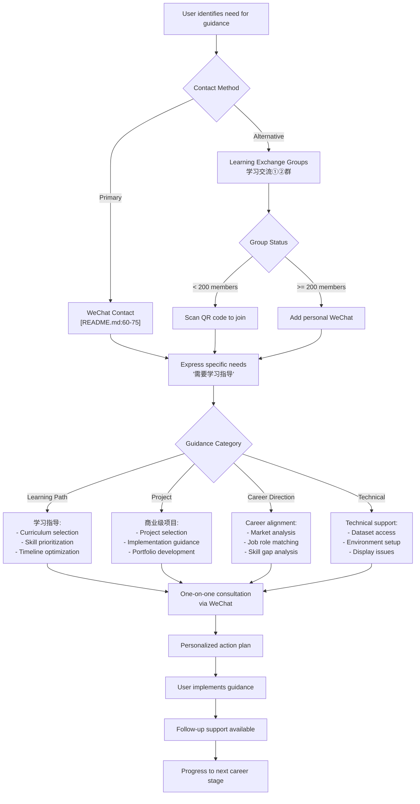
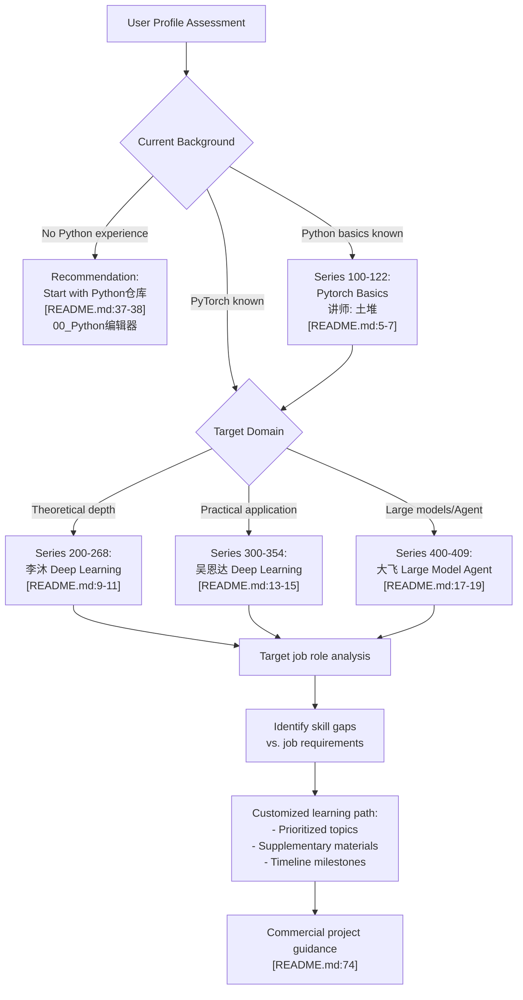
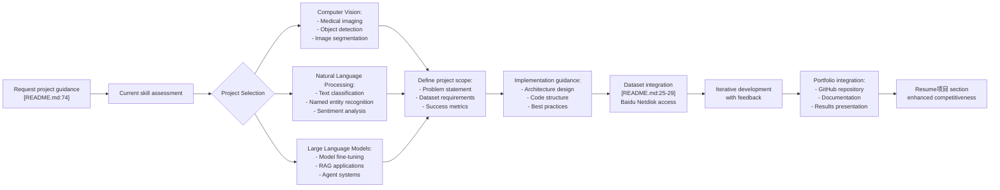
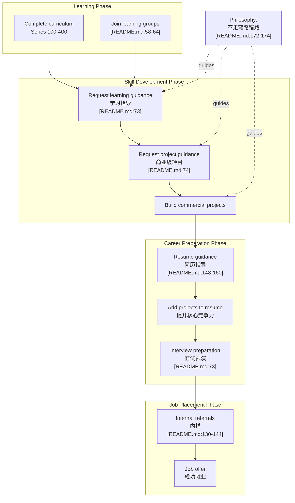
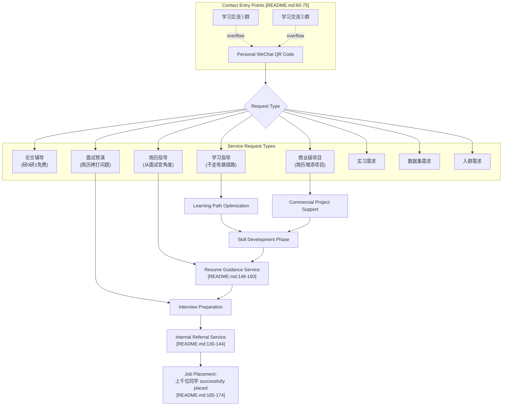
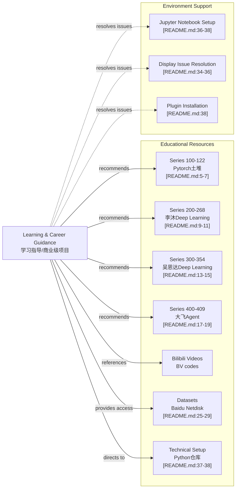

<!-- source: DeepWiki mcp.deepwiki.com · repo AccumulateMore/CV · page 5.3 Learning and Career Guidance · fetched 2026-10-29 -->

# Learning and Career Guidance

Relevant source files

The following files were used as context for generating this wiki page:

- [README.md](README.md)

## Purpose and Scope

This document describes the personalized learning and career guidance services (学习指导) provided through the platform's WeChat contact system. These services help users optimize their learning paths, develop commercial-grade projects, and avoid common detours that delay career outcomes. This guidance bridges the gap between completing educational content and achieving job-ready status.

For resume-specific guidance, see [Resume Guidance](#5.1). For interview preparation, see [Interview Preparation](#5.2). For job placement through internal referrals, see [Internal Referral System](#5.4).

Sources: [README.md:1-180]()

---

## Service Overview

The learning and career guidance service provides one-on-one consultation to help users navigate their deep learning career journey efficiently. The service is designed around a core principle: "拿offer最快的方式，就是不走弯路，不走错路。方向错了，努力没有意义" (The fastest way to get offers is to avoid detours and wrong paths. When direction is wrong, effort is meaningless).

### Core Service Components

| Service Type | Description | Primary Goal |
|-------------|-------------|--------------|
| **Learning Path Optimization** (学习指导) | Personalized curriculum guidance based on target job roles | Efficient skill acquisition |
| **Commercial Project Guidance** (商业级项目) | Hands-on project development for portfolio building | Enhanced competitive advantage |
| **Career Direction Planning** | Alignment of learning with market demands | Targeted job preparation |
| **Technical Troubleshooting** | Support for educational content access issues | Continuous learning progress |

Sources: [README.md:73-74](), [README.md:172-174]()

---

## Access Mechanism and Request Process

### Guidance Request Workflow

**Diagram: Guidance Request and Delivery Workflow**

The system routes guidance requests through the WeChat contact mechanism specified in [README.md:60-75](). Users must explicitly state their needs when making contact due to high volume of requests ("因为好友申请太多了，添加好友后，直接表达你的需求").

Sources: [README.md:68-75](), [README.md:60-64]()

---

## Learning Path Optimization (学习指导)

### Curriculum Selection Strategy

The platform provides guidance on navigating the multi-series curriculum structure to optimize learning efficiency based on user background and career goals.

**Diagram: Learning Path Optimization Decision Tree**

The guidance service maps users from their current skill level through the appropriate curriculum series (100→200→300→400) to their target job roles, ensuring efficient progression without unnecessary detours.

Sources: [README.md:5-23](), [README.md:37-38](), [README.md:73-74]()

### Avoiding Common Learning Detours

The guidance explicitly addresses the philosophy stated in [README.md:172-174](): "拿offer最快的方式，就是不走弯路，不走错路。方向错了，努力没有意义。"

| Common Detour | Guidance Provided | Expected Outcome |
|--------------|-------------------|------------------|
| **Learning irrelevant skills** | Job market analysis; focus only on required skills for target role | Faster job readiness |
| **Wrong course sequence** | Assessment of prerequisites; optimal series ordering (100→200→300→400) | Reduced confusion and wasted time |
| **Incomplete skill mastery** | Depth vs. breadth guidance; practice recommendations | Higher interview success rate |
| **No practical projects** | Commercial project guidance for portfolio | Competitive differentiation |
| **Isolated learning struggles** | Community group integration; peer learning | Faster problem resolution |

Sources: [README.md:172-174]()

---

## Commercial Project Guidance (商业级项目)

### Project Development Support

The service provides "商业级项目" (commercial-grade project) guidance to help users build portfolio projects that demonstrate job-ready capabilities.

**Diagram: Commercial Project Guidance Workflow**

Project guidance aligns with the datasets provided via Baidu Netdisk [README.md:25-29]() and supports the resume building strategy detailed in [README.md:148-160]().

Sources: [README.md:74](), [README.md:25-29](), [README.md:148-160]()

### Project-to-Employment Pipeline

Commercial project guidance serves as a bridge component in the larger career pipeline:

**Diagram: Project Guidance Integration in Career Pipeline**

Sources: [README.md:58-74](), [README.md:130-180]()

---

## Guidance Philosophy and Principles

### Core Philosophical Framework

The guidance service operates on several philosophical principles explicitly stated in the README:

#### 1. Efficiency Through Direction (不走弯路错路)

Stated in [README.md:172-174]():
- **Principle**: "拿offer最快的方式，就是不走弯路，不走错路。方向错了，努力没有意义。"
- **Translation**: The fastest way to get offers is avoiding detours and wrong paths. When direction is wrong, effort is meaningless.
- **Implementation**: Personalized guidance ensures users focus on market-relevant skills and avoid spending time on non-essential topics.

#### 2. Community Learning Philosophy (看人之长)

Stated in [README.md:66-67]():
- **Principle**: "看人之短，无一可交之人。看人之长，天下皆是吾师。"
- **Translation**: If you focus on people's shortcomings, you'll find no one worth befriending. If you focus on people's strengths, everyone becomes your teacher.
- **Implementation**: Guidance emphasizes learning from multiple sources and peer collaboration rather than isolated study.

#### 3. Illumination Philosophy (提灯人)

Stated in [README.md:179]():
- **Principle**: "我们读书是为了成为提灯人去照亮黑暗，而不是为了自己有灯而沾沾自喜还要去吹灭别人的蜡烛"
- **Translation**: We study to become lamp bearers who illuminate darkness for others, not to be smug about having light while extinguishing others' candles.
- **Implementation**: Guidance is provided freely to help others avoid struggles the maintainer experienced.

Sources: [README.md:66-67](), [README.md:172-174](), [README.md:179]()

---

## Integration with Career Services Pipeline

### Contact System Architecture

The learning guidance service shares the same contact infrastructure with other career services:

**Diagram: Contact System and Service Integration Architecture**

The learning guidance service is one of multiple services accessible through the same WeChat contact system defined in [README.md:68-75](). Users explicitly state their needs when contacting to route to the appropriate service.

Sources: [README.md:68-75](), [README.md:130-180]()

---

## Success Outcomes and Validation

### Measurable Results

The guidance service contributes to the platform's documented success metrics:

| Metric | Value | Source |
|--------|-------|--------|
| **Students Placed** | 上千位同学 (thousands) | [README.md:165]() |
| **2024 Referral Ranking** | 年度内推第一名 (Top referral provider) | [README.md:167-170]() |
| **Service Philosophy** | 双赢 (Win-win for companies and candidates) | [README.md:130]() |

### Success Validation Evidence

Visual evidence of successful placements is provided in [README.md:167-170](), demonstrating the effectiveness of the guidance pipeline.

The guidance service's impact statement in [README.md:165](): "我已经指导过上千位同学，即使市场大环境不好，很多同学都入职各家公司成功了。" (I have guided thousands of students, and even when the market environment is poor, many students have successfully joined various companies.)

Sources: [README.md:165-174]()

---

## Guidance Service Features Summary

### Feature Matrix

| Feature | Description | Access Method | Related Files |
|---------|-------------|---------------|---------------|
| **Learning Path Planning** | Curriculum optimization based on job goals | WeChat contact with "需要学习指导" | [README.md:73]() |
| **Direction Correction** | Identifying and correcting inefficient learning paths | One-on-one consultation | [README.md:172-174]() |
| **Commercial Projects** | Portfolio-building project guidance | WeChat contact with "需要商业级项目" | [README.md:74]() |
| **Skill Prioritization** | Focus on job-relevant skills only | Personalized assessment | [README.md:154-159]() |
| **Timeline Optimization** | Fastest path to job-ready status | Strategic planning | [README.md:172]() |
| **Market Alignment** | Skills matched to current hiring demands | Market analysis | [README.md:81-129]() |
| **Research Guidance** | 论文辅导 for graduate students (研0研1免费) | WeChat contact | [README.md:72]() |

### Service Accessibility

- **Cost**: Free (无偿) for supported users
- **Availability**: Through WeChat contact system [README.md:60-64]()
- **Response**: Direct communication after expressing specific needs [README.md:68]()
- **Language**: Chinese (primary), technical English supported
- **Support Level**: One-on-one personalized consultation

Sources: [README.md:68-75](), [README.md:172-174]()

---

## Technical Implementation Context

### Content References in Guidance

The guidance service leverages all platform educational resources:

**Diagram: Guidance Service Resource Integration**

The guidance service has full knowledge of all educational resources and technical infrastructure documented in README.md, enabling comprehensive support across the learning journey.

Sources: [README.md:5-39]()

---

## Related Services Cross-Reference

The learning and career guidance service is part of a larger career development ecosystem:

- **[Resume Guidance](#5.1)**: Technical writing strategies for algorithm engineer positions, including the specific techniques from [README.md:148-160]()
- **[Interview Preparation](#5.2)**: Mock interviews and interview question preparation (面试预演)
- **[Internal Referral System](#5.4)**: Job placement through enterprise network after skill development
- **[uCloudlink Opportunities](#5.5)**: Specific job postings requiring guided skill development
- **[Enterprise Referral Network](#5.6)**: Target companies for career planning

The guidance service prepares users for these subsequent career services by ensuring they develop the correct skills in the correct order, avoiding detours that would delay job readiness.

Sources: [README.md:68-180]()

---

