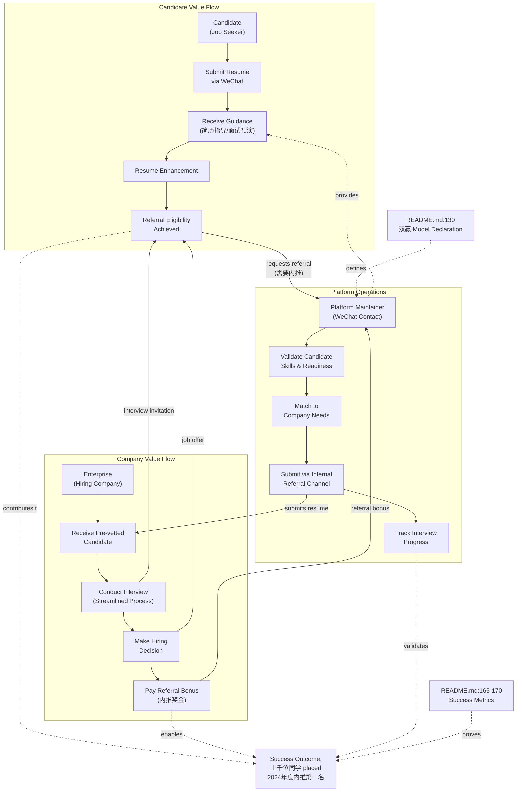
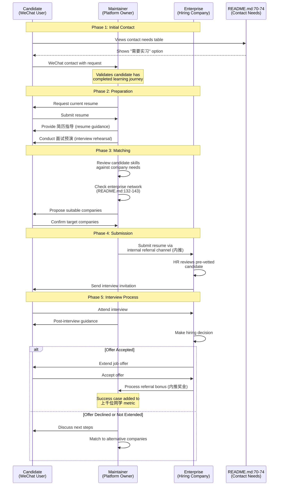
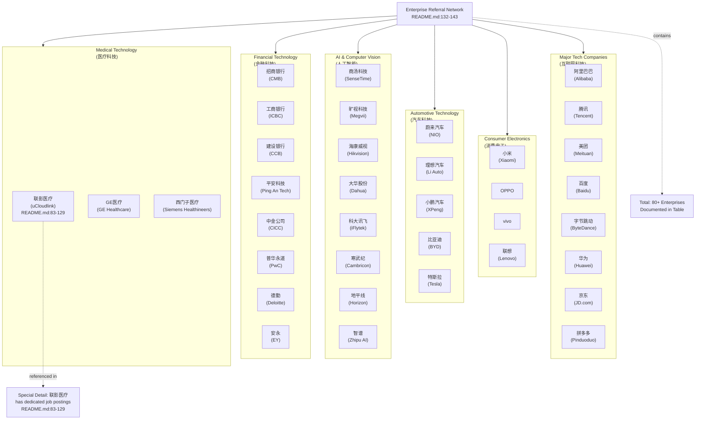
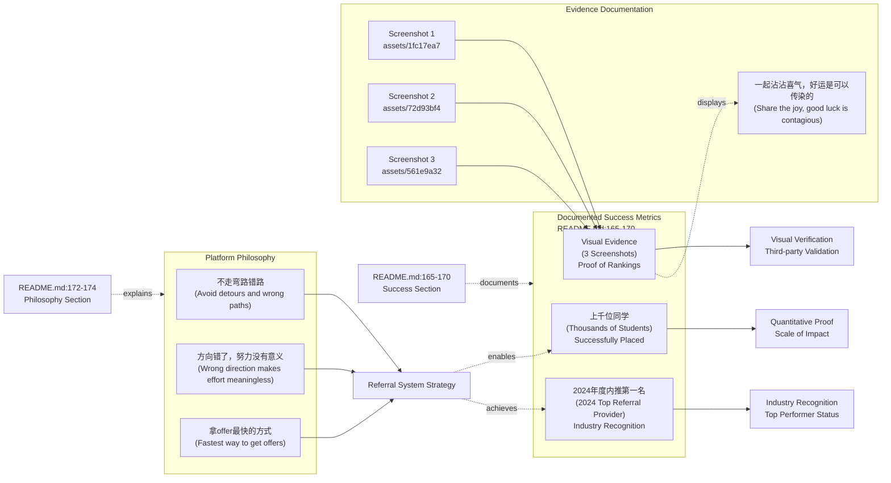
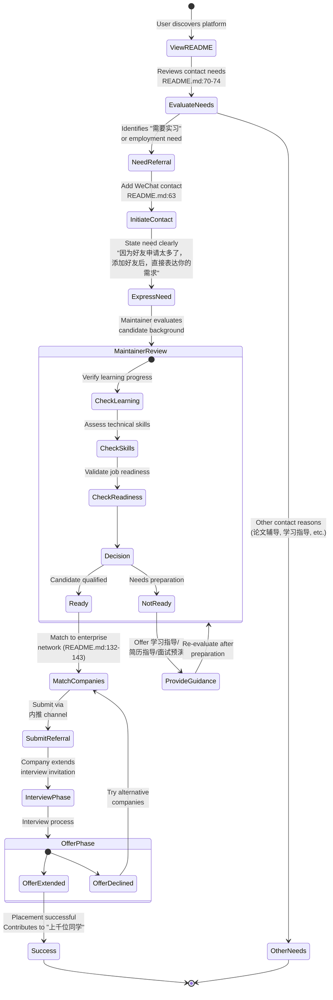
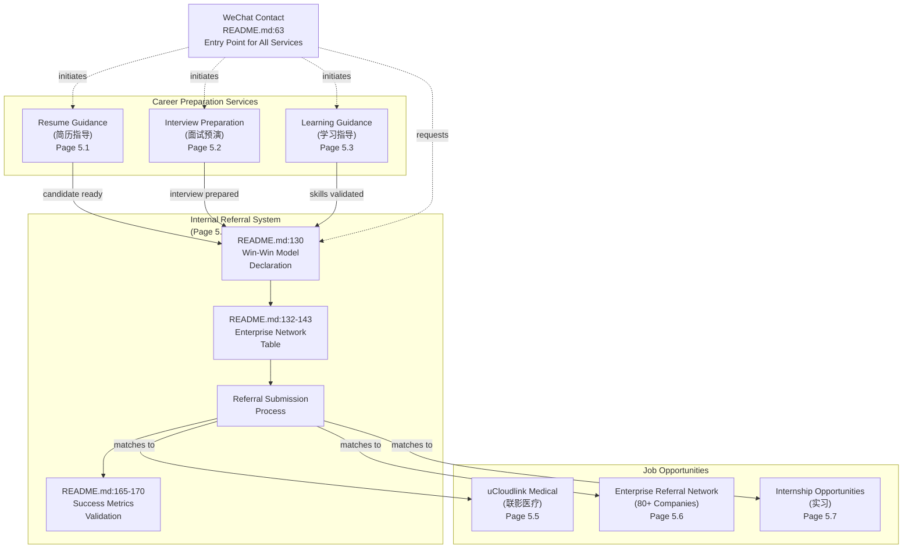

<!-- source: DeepWiki mcp.deepwiki.com · repo AccumulateMore/CV · page 5.4 Internal Referral System (内推) · fetched 2026-10-29 -->

# Internal Referral System (内推)

Relevant source files

The following files were used as context for generating this wiki page:

- [README.md](README.md)

## Purpose and Scope

This document describes the internal referral system (内推, nèi tuī) that connects qualified candidates with employment opportunities through the platform maintainer's enterprise network. The system operates as a three-party value exchange where candidates receive streamlined interview access, companies receive pre-vetted candidates, and the maintainer receives referral bonuses (内推奖金). This creates a win-win (双赢) outcome for all participants.

For information about career preparation services that lead to referral eligibility, see [Resume Guidance](#5.1), [Interview Preparation](#5.2), and [Learning and Career Guidance](#5.3). For specific job opportunities, see [uCloudlink Medical Opportunities](#5.5) and [Enterprise Referral Network](#5.6).

## Internal Referral Concept

Internal referral (内推) is a recruitment mechanism where current employees or authorized partners submit candidate resumes directly to a company's hiring system, bypassing the standard application process. In this platform, the maintainer acts as an authorized referral partner for multiple enterprises.

### Key Characteristics

| Aspect | Standard Application | Internal Referral (内推) |
|--------|---------------------|------------------------|
| **Application Path** | Public job board → HR screening | Direct submission → Hiring manager |
| **Resume Review Priority** | Low (100s-1000s of applicants) | High (pre-vetted by referrer) |
| **Interview Timeline** | 2-4 weeks typical | 1-2 weeks typical |
| **Screening Filters** | Automated keyword matching | Human validation by referrer |
| **Company Incentive** | None | Referral bonus (内推奖金) |
| **Candidate Support** | None | Ongoing guidance from referrer |

The internal referral system described in [README.md:130]() explicitly states the dual benefit model: "你收公司内推奖金、ta们就业，双赢" (you receive company referral bonuses, they get employment, win-win).

**Sources:** [README.md:79-130]()

## Win-Win Business Model Architecture

**Diagram:** Three-party value exchange in the internal referral system showing candidate preparation, platform validation, and company hiring with corresponding value flows.

The system operates on a sustainable business model where all three parties derive value:

1. **Candidates** receive career guidance, faster interview access, and higher success rates
2. **Companies** receive candidates who have been validated by the platform's track record
3. **Platform** receives referral bonuses (内推奖金) from companies for successful placements

This is explicitly documented in [README.md:130]() where the maintainer invites companies to participate: "能内推简历的，也可以联系我，把岗位职责、任职要求发给我【你收公司内推奖金、ta们就业，双赢】" (If you can accept internal referrals, contact me with job responsibilities and requirements [you receive company referral bonuses, they get employment, win-win]).

**Sources:** [README.md:130](), [README.md:165-170]()

## Referral Process Workflow

**Diagram:** Sequence diagram showing the complete referral process from initial contact through job offer, with explicit references to README.md content locations.

### Process Entry Points

Candidates access the referral system through the contact needs mechanism documented in [README.md:70-74](). The table includes "需要实习" (need internships) as a valid contact reason, indicating that both full-time positions and internships are supported.

### Validation Requirements

The maintainer validates candidates before referral submission. This is evident from the documented guidance services (简历指导, 面试预演) that occur prior to referral, as shown in [README.md:73-74](). Candidates must demonstrate:

- Completion of relevant learning materials from the curriculum
- Technical skills matching job requirements
- Professionalism in resume presentation
- Interview readiness validated through 面试预演 (interview rehearsal)

**Sources:** [README.md:70-74](), [README.md:79-81]()

## Enterprise Referral Network

The platform maintains an extensive network of companies accepting internal referrals, documented in [README.md:132-143](). This table represents the complete set of enterprises where the maintainer has established referral relationships.

**Diagram:** Taxonomy of the enterprise referral network organized by industry sector, showing the breadth of the platform's company relationships documented in README.md.

### Network Coverage Analysis

| Industry Sector | Companies Listed | Key Players |
|----------------|------------------|-------------|
| **Major Tech (互联网科技)** | 8 | 阿里巴巴, 腾讯, 美团, 百度, 字节跳动, 华为 |
| **Consumer Electronics (消费电子)** | 4 | 小米, OPPO, vivo, 联想 |
| **Automotive Technology (汽车科技)** | 5 | 蔚来, 理想, 小鹏, 比亚迪, 特斯拉 |
| **AI & Computer Vision (人工智能)** | 12 | 商汤, 旷视, 海康, 科大讯飞, 寒武纪, 地平线 |
| **Telecom (通信)** | 4 | 中国移动, 中国联通, 中国电信, 中兴通讯 |
| **Financial Services (金融)** | 12 | 招商银行, 平安科技, 中金公司, 四大会计所 |
| **Medical Technology (医疗)** | 3 | 联影医疗, GE医疗, 西门子医疗 |
| **Enterprise Software (企业软件)** | 3 | 浪潮集团, 用友网络, 金山办公 |
| **E-commerce (电商物流)** | 3 | 京东, 拼多多, 顺丰科技 |
| **Content Platform (内容平台)** | 8 | 网易, 快手, 哔哩哔哩, 知乎, 小红书 |
| **State Enterprises (国有企业)** | 8 | 商飞, 航天科技, 中航工业, 国家电网, 南方电网 |
| **Energy & Battery (能源电池)** | 3 | 宁德时代, 中创新航, 比克电池 |

The complete list is documented in the table at [README.md:132-143](), representing over 80 distinct enterprise relationships.

### Special Case: 联影医疗 (uCloudlink Medical)

One enterprise, 联影医疗, receives detailed coverage in [README.md:83-129]() with complete job descriptions for three directions:
- Image Direction AI Algorithm Engineer (图像方向)
- Voice Direction AI Algorithm Engineer (语音方向)
- Large Model Direction AI Algorithm Engineer (大模型方向)

This indicates that 联影医疗 is a strategic referral partner with multiple open positions actively seeking candidates through the platform.

**Sources:** [README.md:132-143](), [README.md:83-129]()

## Success Metrics and Track Record

**Diagram:** Success metrics documentation structure showing quantitative achievements, visual evidence, and the strategic philosophy that enables high placement rates.

### Quantitative Success Indicators

The platform documents two primary success metrics:

1. **Scale Metric**: "上千位同学" (thousands of students) successfully placed through the referral system ([README.md:165]())
2. **Recognition Metric**: "2024年度内推第一名" (2024 top internal referral provider) indicating the maintainer achieved the highest number of successful referrals in 2024 ([README.md:167]())

### Visual Evidence

Three screenshots are provided in [README.md:167-169]() to validate the "2024年度内推第一名" claim. These images are accompanied by the caption "一起沾沾喜气，好运是可以传染的" (share the joy, good luck is contagious), suggesting that the visual evidence shows ranking or achievement notifications.

The images reference GitHub assets:
- `assets/1fc17ea7-23a5-47a9-9bfe-0f15390bc6a7`
- `assets/72d93bf4-5f3c-435e-9f87-e80851b5ef1e`
- `assets/561e9a32-d188-457e-a7f9-6398c85591c5`

### Strategic Philosophy

The success is attributed to the platform's core strategy documented in [README.md:172](): "拿offer最快的方式，就是不走弯路，不走错路。方向错了，努力没有意义。" (The fastest way to get offers is to avoid detours and wrong paths. When the direction is wrong, effort is meaningless.)

This philosophy directly informs the referral system's approach:
- Pre-vetting candidates through learning guidance
- Validating skills before referral submission
- Matching candidates to appropriate companies
- Providing ongoing support throughout the interview process

**Sources:** [README.md:165-170](), [README.md:172-174]()

## Candidate Access Protocol

**Diagram:** State diagram showing the candidate access protocol and decision flow through the internal referral system, mapping directly to README.md content locations.

### Contact Protocol

The README establishes a specific contact protocol in [README.md:68-74]():

1. **High Volume Disclaimer**: "因为好友申请太多了，添加好友后，直接表达你的需求。" (Because there are too many friend requests, after adding as a friend, directly express your need.)

2. **Valid Contact Needs**: The table at [README.md:70-74]() lists acceptable reasons for contact, including:
   - 需要论文辅导 (Need thesis guidance)
   - 要进学习交流群 (Want to join learning groups)
   - 要数据集 (Need datasets)
   - 需要学习指导 (Need learning guidance)
   - 面试预演 (Interview rehearsal)
   - 需要实习 (Need internships)
   - 需要商业级项目 (Need commercial-level projects)
   - 指导改简历 (Resume guidance)

### Eligibility Requirements

While not explicitly documented as a checklist, the referral system implicitly requires:

1. **Learning Foundation**: Completion of relevant course series (100-400 series) from the educational content system
2. **Skill Validation**: Technical competency in areas matching job requirements
3. **Professional Readiness**: Resume quality and interview preparedness validated through guidance services
4. **Clear Communication**: Ability to articulate career goals and target companies

The system design assumes candidates have progressed through the learning journey documented in the Educational Content System (see [Curriculum Structure](#2.1)) before requesting referrals.

**Sources:** [README.md:68-74](), [README.md:70-74]()

## Company Participation Model

Companies can also participate in the referral network by contacting the maintainer. This is documented in [README.md:130](): "能内推简历的，也可以联系我，把岗位职责、任职要求发给我【你收公司内推奖金、ta们就业，双赢】" (If you can accept internal referrals, contact me with job responsibilities and requirements [you receive company referral bonuses, they get employment, win-win]).

### Company Onboarding Process

For companies to join the referral network:

1. **Initial Contact**: Company representatives contact the maintainer via WeChat
2. **Information Submission**: Provide job responsibilities (岗位职责) and requirements (任职要求)
3. **Network Addition**: Company added to the enterprise referral network table
4. **Candidate Matching**: Maintainer matches qualified candidates from the learning platform
5. **Referral Bonus Agreement**: Company agrees to pay referral bonuses (内推奖金) for successful placements

### Company Benefits

Companies participating in the internal referral network receive:

- **Pre-vetted Candidates**: All referred candidates have completed relevant deep learning training
- **Skill Validation**: Candidates validated through learning materials spanning CV, NLP, and large models
- **Higher Success Rate**: Candidates receive interview preparation, increasing hiring success
- **Cost Efficiency**: Referral bonuses only paid upon successful placement
- **Quality Pipeline**: Access to candidates motivated enough to complete extensive self-study curriculum

### Reference Implementation: 联影医疗

The 联影医疗 (uCloudlink Medical) section ([README.md:83-129]()) serves as the reference implementation for company participation, providing:

- Detailed company introduction: "上市千亿公司" (listed company worth hundreds of billions)
- Multiple job directions with complete specifications
- Specific岗位职责 (job responsibilities) for each role
- Detailed 任职要求 (job requirements) for candidate matching
- Geographic flexibility: "地点(可选)：上海、北京、深圳、武汉、广州、成都、西安、沈阳、三亚等"

This level of detail enables precise candidate-to-role matching, increasing placement success rates.

**Sources:** [README.md:130](), [README.md:83-129]()

## System Integration with Career Services

The internal referral system is the final stage in a comprehensive career services pipeline. It integrates with preceding services documented in related pages:

**Diagram:** Integration of the internal referral system with upstream career preparation services and downstream job opportunities, showing how all services are accessed through the WeChat contact point documented in README.md.

### Pre-Referral Services

Before candidates are eligible for internal referrals, they typically receive:

1. **Resume Guidance** ([Page 5.1](#5.1)): Documented in [README.md:148-160]() with specific techniques from the maintainer's 2021 experience
2. **Interview Preparation** ([Page 5.2](#5.2)): 面试预演 service mentioned in [README.md:73]()
3. **Learning Guidance** ([Page 5.3](#5.3)): 学习指导 service for skill optimization documented in [README.md:73]()

### Post-Referral Support

After referral submission, the maintainer continues to provide:

- Interview process guidance
- Post-interview debriefing
- Alternative company matching if initial attempts are unsuccessful
- Negotiation support (implicitly, as part of the success service)

This comprehensive support system contributes to the high success rate documented in [README.md:165-170]().

**Sources:** [README.md:68-74](), [README.md:130](), [README.md:132-143](), [README.md:148-170]()

## Technical Implementation Notes

The internal referral system is implemented entirely through human-mediated processes rather than automated systems. The technical infrastructure consists of:

| Component | Implementation | Location |
|-----------|---------------|----------|
| **Candidate Interface** | WeChat contact | [README.md:63]() |
| **Company Database** | Markdown table | [README.md:132-143]() |
| **Job Descriptions** | Markdown text blocks | [README.md:83-129]() |
| **Success Metrics** | Markdown text + images | [README.md:165-170]() |
| **Business Model** | Inline documentation | [README.md:130]() |
| **Process Workflow** | Implicit in contact needs table | [README.md:70-74]() |

### No Automated Systems

Unlike modern applicant tracking systems (ATS), this referral system operates without:
- No database backend for candidate profiles
- No automated matching algorithms
- No online application forms
- No tracking dashboards

Instead, the maintainer manually:
- Reviews candidate qualifications through WeChat conversations
- Matches candidates to companies based on personal knowledge
- Submits referrals through company-specific channels
- Tracks outcomes informally

This human-centric approach allows for:
- Flexible evaluation of non-traditional candidates
- Personalized guidance throughout the process
- Deep understanding of both candidate capabilities and company needs
- Relationship-based trust with hiring companies

The simplicity of the technical implementation (README.md documentation + WeChat communication) enables the maintainer to focus on the human aspects of career guidance and candidate-company matching that drive the documented success metrics.

**Sources:** [README.md:63](), [README.md:70-74](), [README.md:130](), [README.md:132-143](), [README.md:165-170]()

---

