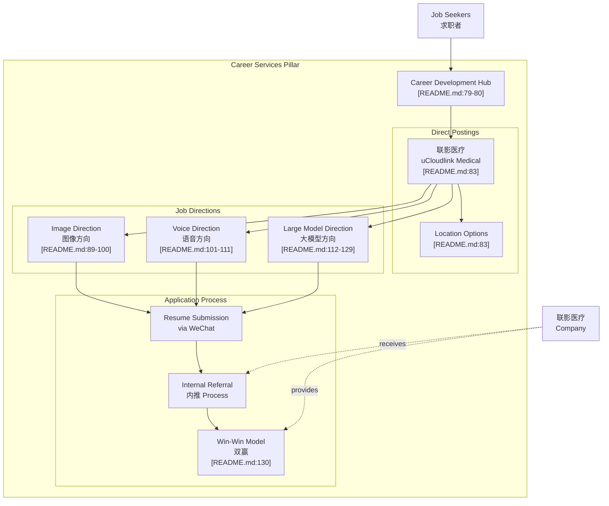
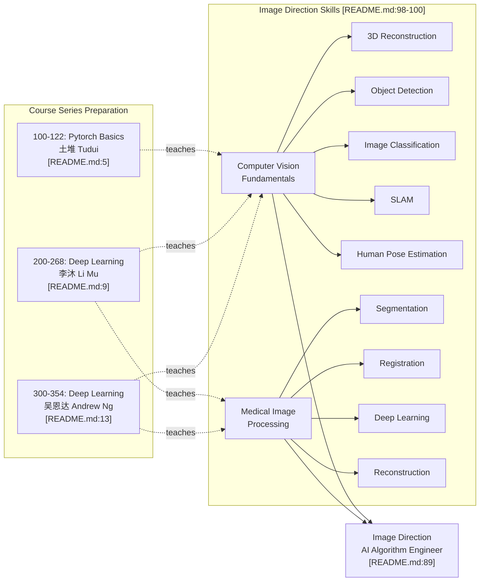
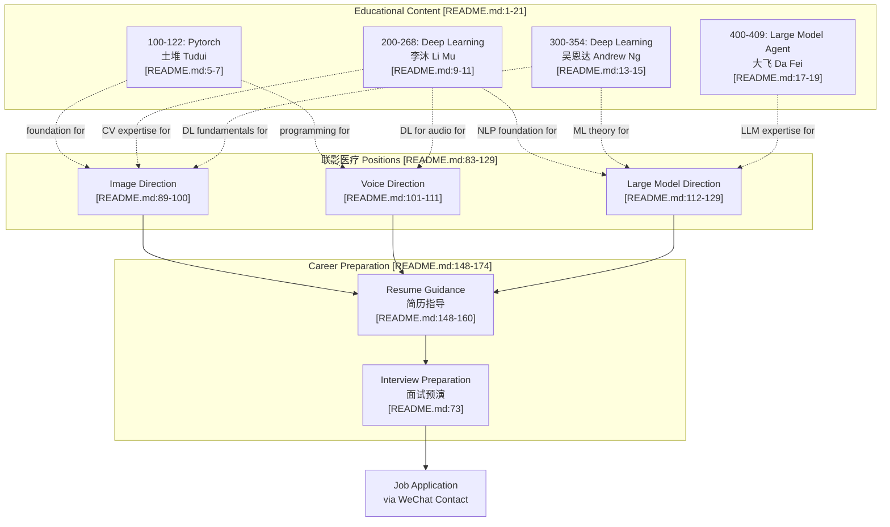
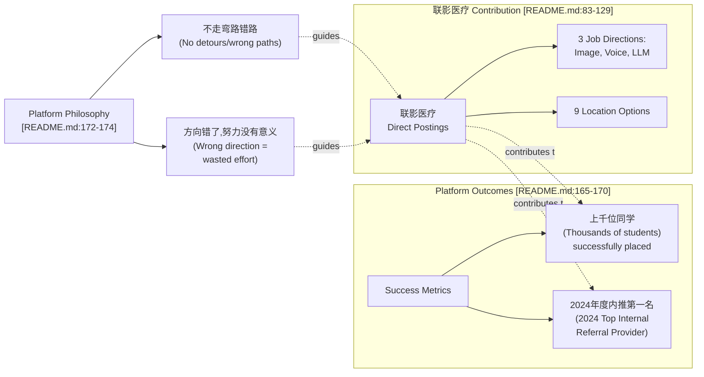

<!-- source: DeepWiki mcp.deepwiki.com · repo AccumulateMore/CV · page 5.5 uCloudlink Medical (联影医疗) Opportunities · fetched 2026-10-29 -->

# uCloudlink Medical (联影医疗) Opportunities

Relevant source files

The following files were used as context for generating this wiki page:

- [README.md](README.md)

## Purpose and Scope

This document details the specific job opportunities at 联影医疗 (uCloudlink Medical) that are directly posted in the platform's career services system. It provides comprehensive documentation of three AI algorithm engineer positions across Image, Voice, and Large Model directions, including detailed job responsibilities (岗位职责) and requirements (任职要求).

For general information about the internal referral system and how to apply, see [5.4 Internal Referral System](#5.4). For the broader network of companies accepting referrals, see [5.6 Enterprise Referral Network](#5.6). For specific details on each job direction, see subsections [5.5.1](#5.5.1), [5.5.2](#5.5.2), and [5.5.3](#5.5.3).

Sources: [README.md:79-144]()

---

## Company Overview

联影医疗 (uCloudlink Medical) is presented as a strategic employment opportunity within the career services pillar. The company profile is documented with specific attributes that make it attractive to job seekers in the deep learning field.

### Company Profile

| Attribute | Value |
|-----------|-------|
| Company Status | 上市千亿公司 (Listed company, billion-yuan valuation) |
| Strategic Context | 国家号召自主研发高端医疗器械 (National initiative for self-developed high-end medical equipment) |
| Development Prospect | 十分广阔 (Very promising) |
| Available Locations | Shanghai, Beijing, Shenzhen, Wuhan, Guangzhou, Chengdu, Xi'an, Shenyang, Sanya |
| Job Categories | Image AI, Voice AI, Large Model AI |

Sources: [README.md:83-87]()

### Strategic Positioning in Career Services

**Diagram: Strategic Positioning of 联影医疗 in Career Services Pipeline**

This diagram illustrates how 联影医疗 opportunities are positioned within the career services system, mapping directly to specific line ranges in the README.md file. The company represents a direct posting opportunity with three distinct technical directions.

Sources: [README.md:79-130]()

---

## Three Job Directions Overview

The 联影医疗 opportunities are organized into three distinct AI algorithm engineer positions, each with specialized responsibilities and requirements. The structure is documented as a hierarchical system within the README.

### Direction Comparison Matrix

| Direction | Primary Focus | Key Technologies | Line Range |
|-----------|---------------|------------------|------------|
| Image (图像方向) | Medical image processing and 3D rendering | Computer vision, medical imaging algorithms, PyTorch | [README.md:89-100]() |
| Voice (语音方向) | Audio signal processing and recognition | ASR/TTS, signal processing, noise reduction | [README.md:101-111]() |
| Large Model (大模型方向) | Large language model development and optimization | LLM training, medical text processing, NLP | [README.md:112-129]() |

Sources: [README.md:89-129]()

### Job Direction Architecture

```mermaid
graph TB
    subgraph "联影医疗 Job Opportunities"
        Company["联影医疗<br/>uCloudlink Medical<br/>[README.md:83]"]
        
        subgraph "Image Direction [README.md:89-100]"
            ImageTitle["图像方向 AI Algorithm Engineer"]
            
            ImageResp["Job Responsibilities<br/>岗位职责"]
            ImageResp1["AI algorithm development<br/>for medical products"]
            ImageResp2["3D rendering algorithms<br/>and applications"]
            
            ImageReq["Requirements<br/>任职要求"]
            ImageReq1["Machine vision expertise:<br/>3D reconstruction, SLAM,<br/>object detection"]
            ImageReq2["Medical image algorithms:<br/>segmentation, registration,<br/>deep learning"]
            
            ImageTitle --> ImageResp
            ImageResp --> ImageResp1
            ImageResp --> ImageResp2
            ImageTitle --> ImageReq
            ImageReq --> ImageReq1
            ImageReq --> ImageReq2
        end
        
        subgraph "Voice Direction [README.md:101-111]"
            VoiceTitle["语音方向 AI Algorithm Engineer"]
            
            VoiceResp["Job Responsibilities<br/>岗位职责"]
            VoiceResp1["Audio signal processing:<br/>echo cancellation,<br/>microphone arrays"]
            VoiceResp2["Deep learning for<br/>audio AI algorithms"]
            
            VoiceReq["Requirements<br/>任职要求"]
            VoiceReq1["Signal processing foundation:<br/>Matlab, C/C++"]
            VoiceReq2["Experience: speech processing,<br/>neural networks, ASR"]
            
            VoiceTitle --> VoiceResp
            VoiceResp --> VoiceResp1
            VoiceResp --> VoiceResp2
            VoiceTitle --> VoiceReq
            VoiceReq --> VoiceReq1
            VoiceReq --> VoiceReq2
        end
        
        subgraph "Large Model Direction [README.md:112-129]"
            LLMTitle["大模型方向 AI Algorithm Engineer"]
            
            LLMResp["Job Responsibilities<br/>岗位职责"]
            LLMResp1["LLM algorithm development,<br/>optimization, deployment"]
            LLMResp2["Training process optimization:<br/>hyperparameters,<br/>computational resources"]
            LLMResp3["Medical text dataset<br/>construction and management"]
            LLMResp4["Model evaluation and<br/>performance analysis"]
            
            LLMReq["Requirements<br/>任职要求"]
            LLMReq1["Background: ML, NLP,<br/>medical imaging analysis"]
            LLMReq2["Experience: pre-trained LLM,<br/>GPT models"]
            LLMReq3["Publications: top conferences<br/>(CVPR, NeurIPS, ACL, etc.)"]
            LLMReq4["Education: Master+ in AI<br/>related fields"]
            LLMReq5["Language: proficient English"]
            
            LLMTitle --> LLMResp
            LLMResp --> LLMResp1
            LLMResp --> LLMResp2
            LLMResp --> LLMResp3
            LLMResp --> LLMResp4
            LLMTitle --> LLMReq
            LLMReq --> LLMReq1
            LLMReq --> LLMReq2
            LLMReq --> LLMReq3
            LLMReq --> LLMReq4
            LLMReq --> LLMReq5
        end
        
        Company --> ImageTitle
        Company --> VoiceTitle
        Company --> LLMTitle
    end
    
    Curriculum["Deep Learning Curriculum<br/>100-500 Series"] -.prepares for.-> ImageTitle
    Curriculum -.prepares for.-> VoiceTitle
    Curriculum -.prepares for.-> LLMTitle
```

**Diagram: Three-Direction Job Architecture with README.md Line References**

This diagram maps the three job directions to specific line ranges in the README.md file, showing the hierarchical structure of responsibilities and requirements for each position.

Sources: [README.md:89-129]()

---

## Image Direction AI Algorithm Engineer

The Image Direction position focuses on medical image processing and computer vision applications within 联影集团's product ecosystem.

### Job Responsibilities (岗位职责)

The role involves participation in AI algorithm development for 联影集团 products, with two primary responsibility areas:

1. **Product-Level Algorithm Solutions** [README.md:91-94]()
   - 联影通用软件平台 (uCloudlink Universal Software Platform)
   - 联影高级应用后处理工作站 (uCloudlink Advanced Application Post-processing Workstation)
   - 联影智能uAI平台 (uCloudlink Intelligent uAI Platform)
   - 联影机器人手术规划与导航 (uCloudlink Robotic Surgery Planning and Navigation)
   - MR/CT/RT/MI/US事业部算法需求 (Algorithm requirements for MR/CT/RT/MI/US business units)
   - Scientific research collaboration with research institutes and hospitals
   - Participation in innovative technology productization

2. **3D Rendering and Image Processing** [README.md:95]()
   - Medical image 3D rendering algorithm maintenance and development
   - Application of image processing and AI technology in medical imaging

### Requirements (任职要求)

| Requirement Category | Specific Requirements | Line Reference |
|---------------------|----------------------|----------------|
| Machine Vision Expertise | Familiarity with at least one: 3D reconstruction, stereo vision, SLAM, image/video classification, object detection, human pose estimation | [README.md:98]() |
| Medical Image Algorithms | Familiarity with at least one: graphics algorithms, reconstruction, segmentation, detection, classification, registration, deep learning, fluid mechanics, perfusion, texture analysis | [README.md:99-100]() |

### Technical Skills Alignment with Curriculum

**Diagram: Curriculum Preparation for Image Direction Position**

This diagram shows how the platform's educational content (series 100-300) prepares candidates for the technical requirements of the Image Direction position.

Sources: [README.md:5-13, 89-100]()

---

## Voice Direction AI Algorithm Engineer

The Voice Direction position focuses on audio signal processing and speech recognition technologies for medical applications.

### Job Responsibilities (岗位职责)

The position has two core responsibility areas documented in [README.md:101-105]():

1. **Audio Signal Processing Research and Implementation** [README.md:103]()
   - Echo cancellation (回声消除)
   - Microphone arrays (麦克风阵列)
   - Blind source separation (盲源分离)
   - Other audio signal processing techniques

2. **AI Audio Algorithm Research** [README.md:104]()
   - Deep learning applications
   - Neural network implementations for audio processing

### Requirements (任职要求)

The position specifies three primary requirement categories:

| Requirement | Description | Line Reference |
|-------------|-------------|----------------|
| Mathematical Foundation | Solid mathematical theory and digital signal processing foundation; mastery of Matlab and C/C++ programming | [README.md:108]() |
| Speech Processing Experience | Experience with speech/audio signal processing (noise reduction, echo cancellation, microphone arrays, audio effects) | [README.md:109]() |
| Deep Learning Research | Research in deep learning, neural networks, intelligent speech recognition | [README.md:110]() |

### Technical Stack Specification

```mermaid
graph TB
    subgraph "Voice Direction Requirements [README.md:106-111]"
        Foundation["Mathematical & Signal<br/>Processing Foundation"]
        
        Math["Mathematical Theory"]
        DSP["Digital Signal Processing"]
        
        Foundation --> Math
        Foundation --> DSP
        
        Programming["Programming Languages"]
        
        Matlab["Matlab<br/>(Required)"]
        CPP["C/C++<br/>(Required)"]
        
        Programming --> Matlab
        Programming --> CPP
        
        Experience["Audio Processing<br/>Experience"]
        
        Exp1["Speech/Audio Signal<br/>Processing"]
        Exp2["Noise Reduction<br/>降噪"]
        Exp3["Echo Cancellation<br/>回声消除"]
        Exp4["Microphone Arrays<br/>麦阵"]
        Exp5["Audio Effects<br/>音效"]
        
        Experience --> Exp1
        Experience --> Exp2
        Experience --> Exp3
        Experience --> Exp4
        Experience --> Exp5
        
        Research["AI Research<br/>Experience"]
        
        DL["Deep Learning"]
        NN["Neural Networks"]
        ASR["Intelligent Speech<br/>Recognition"]
        
        Research --> DL
        Research --> NN
        Research --> ASR
    end
    
    Foundation --> VoicePosition["Voice Direction<br/>AI Algorithm Engineer<br/>[README.md:101]"]
    Programming --> VoicePosition
    Experience --> VoicePosition
    Research --> VoicePosition
```

**Diagram: Voice Direction Technical Requirements Structure**

This diagram maps the four requirement categories (foundation, programming, experience, research) to specific line numbers in README.md, showing the complete technical stack needed for the Voice Direction position.

Sources: [README.md:101-111]()

---

## Large Model Direction AI Algorithm Engineer

The Large Model Direction represents the most comprehensive position, focusing on large language model development, optimization, and deployment in medical contexts.

### Job Responsibilities (岗位职责)

The position encompasses seven distinct responsibility areas documented in [README.md:112-121]():

1. **Algorithm Development and Optimization** [README.md:114]()
   - Large language model algorithm development
   - Model optimization
   - Application deployment (应用落地)

2. **Solution Design** [README.md:115]()
   - AI solution design
   - Key technology R&D participation
   - Technical difficulty resolution

3. **Algorithm and Model Implementation** [README.md:116]()
   - Design and implement LLM-related algorithms
   - Research and design new algorithms
   - Solve LLM application problems

4. **Training Process Development** [README.md:117]()
   - Design and implement LLM training algorithms and strategies
   - Configure and optimize hyperparameters
   - Manage computational resources
   - Ensure training effectiveness and efficiency

5. **Medical Dataset Construction** [README.md:118]()
   - Build and manage large-scale medical text datasets
   - Support model pre-training and fine-tuning
   - Complete downstream tasks in various scenarios

6. **Model Evaluation and Validation** [README.md:119]()
   - Design evaluation metrics and experiments
   - Perform performance evaluation and analysis
   - Identify weaknesses and improvement opportunities
   - Propose improvement strategies

7. **Research Collaboration** [README.md:120]()
   - Participate in collaborations with universities, research institutes, medical institutions
   - Assist in scientific achievement transformation and implementation

### Requirements (任职要求)

The Large Model Direction has the most comprehensive requirement set:

| Requirement Category | Specific Details | Line Reference |
|---------------------|------------------|----------------|
| Academic Background | Learning and research in machine learning, NLP, medical imaging analysis, or related fields | [README.md:124]() |
| LLM Experience | Experience with pre-trained LLMs or GPT model research and development | [README.md:125]() |
| Publications | Papers published at top conferences (ICML, NeurIPS, ICLR, CVPR, ICCV, ECCV, ACL, EMNLP, MICCAI, IPMI) or top journals (IEEE T-PAMI, IEEE TMI, Medical Image Analysis) | [README.md:126]() |
| Education | Master's degree or above in AI-related fields (computer vision, machine learning, medical image analysis) | [README.md:127]() |
| Language | Proficient English skills | [README.md:128]() |

### Large Model Direction Responsibility Flow

```mermaid
graph TD
    subgraph "Large Model Direction Workflow [README.md:112-121]"
        Start["LLM Algorithm<br/>Development Start"]
        
        Phase1["Algorithm Development<br/>& Optimization<br/>[README.md:114]"]
        Phase2["Solution Design<br/>[README.md:115]"]
        Phase3["Algorithm & Model<br/>Implementation<br/>[README.md:116]"]
        
        Start --> Phase1
        Phase1 --> Phase2
        Phase2 --> Phase3
        
        TrainingPhase["Training Process<br/>Development<br/>[README.md:117]"]
        
        Train1["Design training<br/>algorithms"]
        Train2["Configure<br/>hyperparameters"]
        Train3["Optimize computational<br/>resources"]
        
        Phase3 --> TrainingPhase
        TrainingPhase --> Train1
        TrainingPhase --> Train2
        TrainingPhase --> Train3
        
        DataPhase["Medical Dataset<br/>Construction<br/>[README.md:118]"]
        
        Data1["Build large-scale<br/>medical text datasets"]
        Data2["Pre-training &<br/>fine-tuning"]
        Data3["Downstream task<br/>completion"]
        
        Train3 --> DataPhase
        DataPhase --> Data1
        DataPhase --> Data2
        DataPhase --> Data3
        
        EvalPhase["Model Evaluation<br/>& Validation<br/>[README.md:119]"]
        
        Eval1["Design evaluation<br/>metrics"]
        Eval2["Performance analysis"]
        Eval3["Identify improvements"]
        
        Data3 --> EvalPhase
        EvalPhase --> Eval1
        EvalPhase --> Eval2
        EvalPhase --> Eval3
        
        CollabPhase["Research Collaboration<br/>[README.md:120]"]
        
        Collab1["University/institute<br/>partnerships"]
        Collab2["Scientific achievement<br/>transformation"]
        
        Eval3 --> CollabPhase
        CollabPhase --> Collab1
        CollabPhase --> Collab2
        
        Collab2 --> Deployment["Application<br/>Deployment"]
    end
```

**Diagram: Large Model Direction Workflow from Development to Deployment**

This diagram illustrates the comprehensive workflow for the Large Model Direction, mapping each phase to specific line numbers in README.md where the responsibilities are documented.

Sources: [README.md:112-121]()

### Publication Requirements Breakdown

The Large Model Direction has explicit publication requirements at top-tier venues. The specification is documented in [README.md:126]():

**Machine Learning Conferences:**
- ICML (International Conference on Machine Learning)
- NeurIPS (Neural Information Processing Systems)
- ICLR (International Conference on Learning Representations)

**Computer Vision Conferences:**
- CVPR (Conference on Computer Vision and Pattern Recognition)
- ICCV (International Conference on Computer Vision)
- ECCV (European Conference on Computer Vision)

**Natural Language Processing Conferences:**
- ACL (Association for Computational Linguistics)
- EMNLP (Empirical Methods in Natural Language Processing)

**Medical Imaging Conferences:**
- MICCAI (Medical Image Computing and Computer Assisted Intervention)
- IPMI (Information Processing in Medical Imaging)

**Top-tier Journals:**
- IEEE T-PAMI (IEEE Transactions on Pattern Analysis and Machine Intelligence)
- IEEE TMI (IEEE Transactions on Medical Imaging)
- Medical Image Analysis

Sources: [README.md:126]()

---

## Curriculum-to-Career Mapping

The platform's educational content directly prepares candidates for these positions. The mapping between course series and job requirements is structured as follows:

### Educational Foundation for 联影医疗 Positions

**Diagram: Complete Pipeline from Educational Content to 联影医疗 Employment**

This diagram shows how the platform's four course series (100-400) prepare candidates for specific job directions at 联影医疗, followed by career preparation services leading to application submission.

Sources: [README.md:1-174]()

---

## Application Process

### Resume Submission Protocol

The application process for 联影医疗 positions follows the platform's general career services workflow:

1. **Contact Initiation**: Connect via WeChat [README.md:62-68]()
2. **Express Intent**: Clearly state the desired position direction (Image/Voice/Large Model)
3. **Resume Review**: Receive resume guidance (简历指导) [README.md:73, 148-160]()
4. **Interview Preparation**: Participate in interview rehearsal (面试预演) [README.md:73]()
5. **Internal Referral**: Submit through internal referral channel (内推) [README.md:130]()

### Win-Win Model (双赢)

The referral system creates mutual benefit, documented in [README.md:130]():

| Stakeholder | Benefit |
|-------------|---------|
| Company (联影医疗) | Receives qualified candidates; provides referral bonuses (内推奖金) |
| Candidate | Streamlined interview access; higher success rate |
| Platform Maintainer | Referral rewards; placement success metrics |

Sources: [README.md:62-74, 130, 148-174]()

---

## Location Options and Flexibility

联影医疗 offers extensive geographic flexibility with nine location options documented in [README.md:83]():

### Available Cities

| Region | Cities |
|--------|--------|
| East China | Shanghai (上海) |
| North China | Beijing (北京) |
| South China | Shenzhen (深圳), Guangzhou (广州) |
| Central China | Wuhan (武汉) |
| Southwest China | Chengdu (成都) |
| Northwest China | Xi'an (西安) |
| Northeast China | Shenyang (沈阳) |
| Special Location | Sanya (三亚) |

The location flexibility (可选) allows candidates to choose based on personal preference, making these positions accessible to candidates across China.

Sources: [README.md:83]()

---

## Integration with Career Services Ecosystem

### Positioning within Platform Success Metrics

The 联影医疗 opportunities contribute to the platform's documented success metrics in [README.md:165-170]():

**Diagram: 联影医疗 Integration with Platform Success Metrics**

This diagram shows how 联影医疗 opportunities integrate with the platform's overall success metrics and philosophical approach to career guidance.

Sources: [README.md:83-129, 165-174]()

---

## Additional Referral Opportunity

Beyond applying for 联影医疗 positions, the platform also accepts referrals from those who can provide internal recommendations. This reciprocal system is documented in [README.md:130]():

**Referral Provider Opportunity:**
- Contact the platform maintainer with job postings (岗位职责, 任职要求)
- Receive company internal referral bonuses (内推奖金) when candidates are successfully placed
- Contribute to candidate employment success (就业)
- Create win-win outcomes (双赢)

This creates a multi-directional value flow where:
1. Job seekers gain employment
2. Companies gain qualified candidates
3. Referral providers receive bonuses
4. The platform builds its success metrics

Sources: [README.md:130]()

---

## Comparison with Enterprise Referral Network

While 联影医疗 represents a direct posting with detailed specifications, it exists within a larger enterprise referral network documented in [README.md:132-143](). The distinction is:

| Feature | 联影医疗 Direct Postings | Enterprise Referral Network |
|---------|--------------------------|------------------------------|
| Documentation Detail | Full job responsibilities and requirements provided | Company names only, details obtained through contact |
| Application Process | Direct submission with known requirements | Inquiry-based, matching process |
| Position Specificity | Three specific AI algorithm directions | General referral across multiple companies |
| Geographic Options | 9 cities explicitly listed | Varies by company |
| Line Reference | [README.md:83-129]() | [README.md:132-143]() |

The 联影医疗 postings provide complete transparency, allowing candidates to self-assess fit before initiating contact, while the enterprise network requires engagement to obtain specific details.

Sources: [README.md:83-143]()

---

## Summary

The 联影医疗 opportunities represent a strategic direct posting within the platform's career services pillar, offering three distinct AI algorithm engineer positions across Image, Voice, and Large Model directions. The documentation provides complete transparency with:

- Detailed job responsibilities (岗位职责) for each direction
- Explicit requirements (任职要求) including technical skills, education, and publications
- Nine location options across China
- Integration with the platform's career preparation services (resume guidance, interview preparation)
- Participation in the win-win referral model (双赢)

These positions demonstrate how the platform's educational content (series 100-400) directly prepares candidates for specific industry opportunities, with the Large Model Direction being particularly well-aligned with the series 400 content on Large Model Agents.

Sources: [README.md:83-129]()

---

