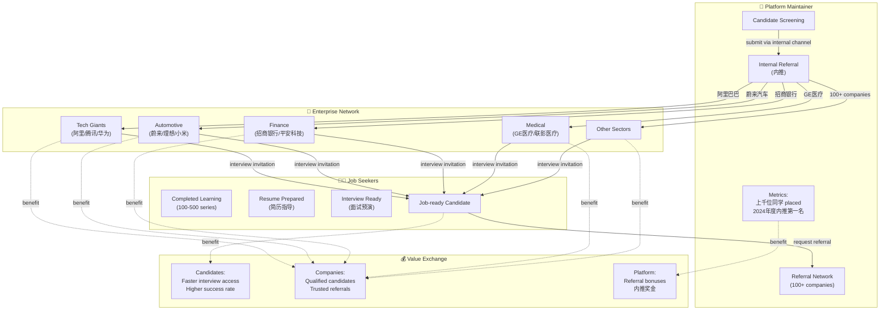
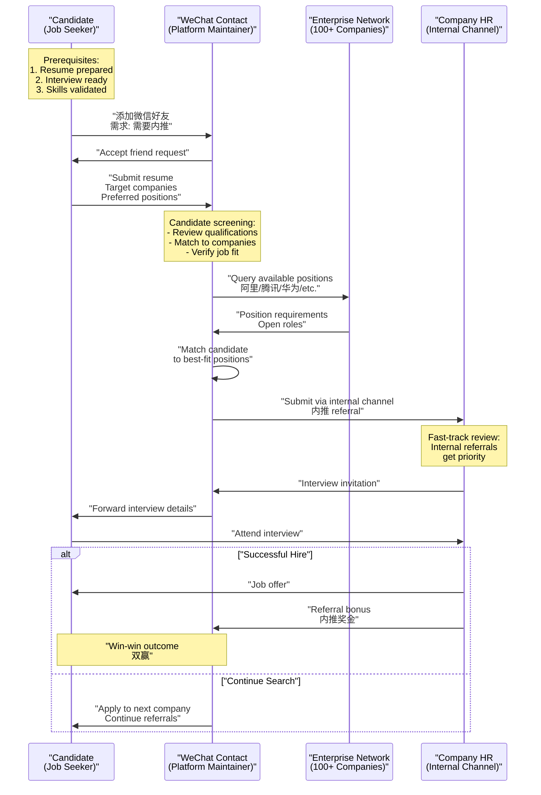
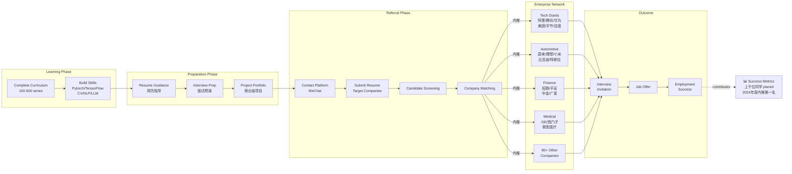
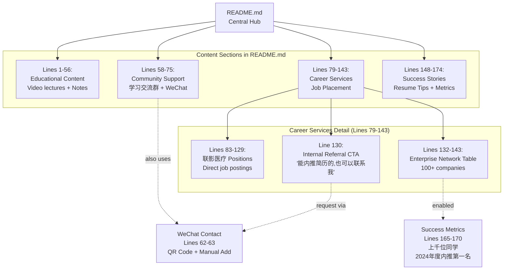
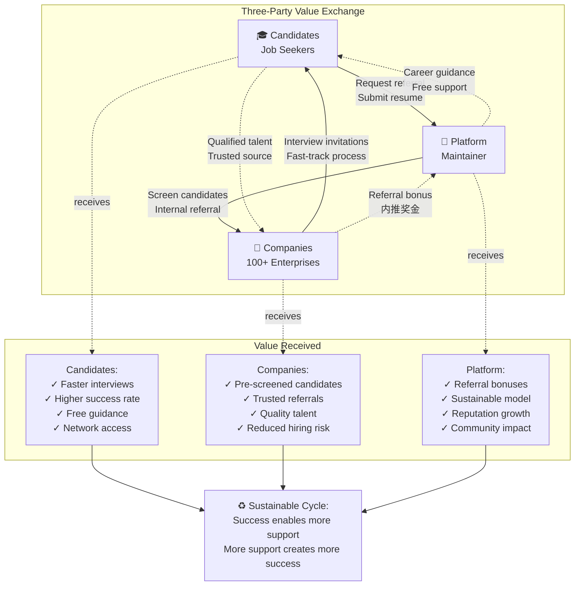
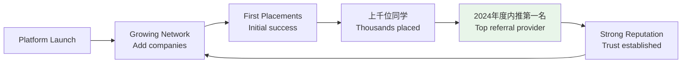
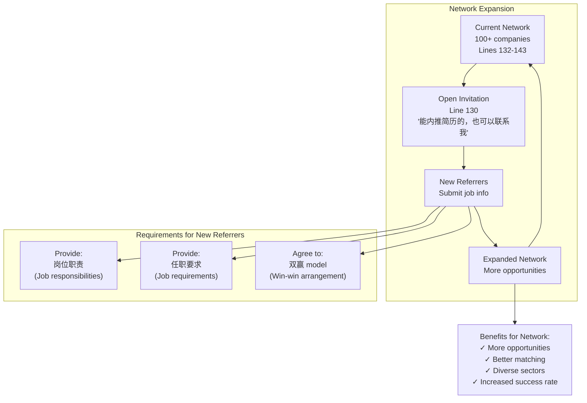
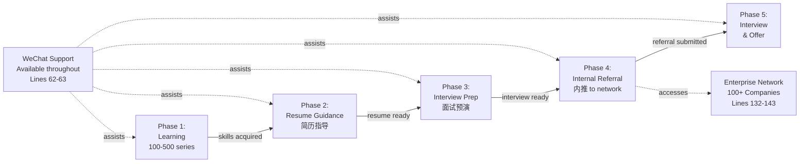

<!-- source: DeepWiki mcp.deepwiki.com · repo AccumulateMore/CV · page 5.6 Enterprise Referral Network · fetched 2026-10-29 -->

# Enterprise Referral Network

Relevant source files

The following files were used as context for generating this wiki page:

- [README.md](README.md)

## Purpose and Scope

This page documents the extensive network of companies that accept internal referrals (内推) through the platform's career services system. The Enterprise Referral Network encompasses over 100 major companies across technology, automotive, finance, medical, and other sectors in China. This network serves as the final stage of the career pipeline, connecting job-ready candidates with employment opportunities through internal referral channels that provide faster interview access and higher success rates.

For information about preparing for referrals through resume guidance and interview preparation, see [Resume Guidance](#5.1) and [Interview Preparation](#5.2). For details on the internal referral process itself, see [Internal Referral System](#5.4). For specific job postings, see [uCloudlink Medical Opportunities](#5.5).

**Sources:** [README.md:79-143]()

---

## Network Overview

The Enterprise Referral Network operates on a win-win model (双赢) where companies receive qualified candidates through trusted internal channels, candidates gain streamlined access to interviews, and the platform maintainer receives referral bonuses (内推奖金) for successful placements. This creates a sustainable ecosystem that has successfully placed thousands of students (上千位同学), with the platform achieving the rank of "#1 internal referral provider for 2024" (2024届年度 内推第一名).

### Win-Win Value Exchange Model

**Sources:** [README.md:130-143](), [README.md:165-170]()

---

## Company Network Taxonomy

The Enterprise Referral Network comprises over 100 companies organized into distinct sectors. This taxonomy reflects the platform's reach across major employment markets in China.

### Technology Giants (科技巨头)

The core of the referral network consists of major Chinese technology companies, including the traditional BAT (Baidu, Alibaba, Tencent) group and emerging leaders.

| Company Name | Chinese Name | Sector Focus |
|--------------|--------------|--------------|
| Alibaba | 阿里巴巴 | E-commerce, Cloud, AI |
| Tencent | 腾讯 | Social Media, Gaming, Cloud |
| Baidu | 百度 | Search, AI, Autonomous Driving |
| ByteDance | 字节跳动 | Content Platform, AI |
| Huawei | 华为 | Telecommunications, Consumer Electronics |
| Meituan | 美团 | Local Services, Delivery |
| JD.com | 京东 | E-commerce, Logistics |
| Pinduoduo | 拼多多 | E-commerce, Agriculture |

**Sources:** [README.md:132-134]()

### Hardware and Electronics

| Company Name | Chinese Name | Sector Focus |
|--------------|--------------|--------------|
| Xiaomi | 小米 | Consumer Electronics, IoT |
| OPPO | OPPO | Mobile Devices |
| Vivo | vivo | Mobile Devices |
| Lenovo | 联想 | Personal Computing, Enterprise |
| Inspur Group | 浪潮集团 | Enterprise Computing, Cloud |
| Yonyou | 用友网络 | Enterprise Software |
| BOE Technology | 京东方 | Display Technology |

**Sources:** [README.md:135](), [README.md:139]()

### AI and Computer Vision

| Company Name | Chinese Name | Sector Focus |
|--------------|--------------|--------------|
| SenseTime | 商汤科技 | AI, Computer Vision |
| Megvii | 旷视科技 | AI, Facial Recognition |
| Cambricon | 寒武纪 | AI Chips |
| Horizon Robotics | 地平线 | Automotive AI |
| Yitu Technology | 依图科技 | AI, Smart City |
| CloudWalk | 云从科技 | AI, Facial Recognition |

**Sources:** [README.md:135](), [README.md:141]()

### Telecommunications

| Company Name | Chinese Name | Sector Focus |
|--------------|--------------|--------------|
| ZTE | 中兴通讯 | Telecommunications Equipment |
| Hikvision | 海康威视 | Video Surveillance, AI |
| Dahua Technology | 大华股份 | Video Surveillance |
| iFLYTEK | 科大讯飞 | Speech Recognition, AI |
| China Mobile | 中国移动 | Mobile Telecommunications |
| China Unicom | 中国联通 | Telecommunications |
| China Telecom | 中国电信 | Telecommunications |

**Sources:** [README.md:136-137]()

### Automotive and New Energy

The automotive sector represents a growing segment of AI job opportunities, particularly in autonomous driving and smart vehicle systems.

| Company Name | Chinese Name | Sector Focus |
|--------------|--------------|--------------|
| NIO | 蔚来汽车 | Electric Vehicles, Autonomous Driving |
| Li Auto | 理想汽车 | Electric Vehicles, Smart Systems |
| XPeng Motors | 小鹏汽车 | Electric Vehicles, Autonomous Driving |
| BYD | 比亚迪 | Electric Vehicles, Batteries |
| Pony.ai | 小马智行 | Autonomous Driving |
| WeRide | 文远知行 | Autonomous Driving |
| Tesla China | 特斯拉 | Electric Vehicles, Autonomous Driving |
| CATL | 宁德时代 | Battery Technology |
| CALB | 中创新航 | Battery Technology |
| BAK Battery | 比克电池 | Battery Technology |

**Sources:** [README.md:136](), [README.md:142-143]()

### Internet Services and Content

| Company Name | Chinese Name | Sector Focus |
|--------------|--------------|--------------|
| NetEase | 网易 | Gaming, Content, Email |
| Kuaishou | 快手 | Short Video Platform |
| Ctrip | 携程 | Travel Services |
| Tongcheng Travel | 同程旅行 | Travel Services |
| Dewu | 得物 | E-commerce, Sneakers |
| Bilibili | 哔哩哔哩 | Video Platform, Community |
| Huya Live | 虎牙直播 | Live Streaming |
| Douyu | 斗鱼 | Live Streaming |
| Ximalaya | 喜马拉雅 | Audio Content |
| Didi | 滴滴 | Ride Hailing |
| Amap | 高德地图 | Maps, Navigation |
| Kingsoft Cloud | 金山云 | Cloud Services |
| Zhihu | 知乎 | Q&A Community |
| Xiaohongshu | 小红书 | Social Commerce |

**Sources:** [README.md:137-139](), [README.md:141]()

### Financial Services

| Company Name | Chinese Name | Sector Focus |
|--------------|--------------|--------------|
| China Merchants Bank | 招商银行 | Retail Banking |
| ICBC | 工商银行 | Commercial Banking |
| CCB | 建设银行 | Commercial Banking |
| ABC | 农业银行 | Commercial Banking |
| Bank of Communications | 交通银行 | Commercial Banking |
| Ping An Technology | 平安科技 | FinTech |
| Zhaolian Consumer Finance | 招联科技 | Consumer Finance |
| CICC | 中金公司 | Investment Banking |
| GF Securities | 广发证券 | Securities |

**Sources:** [README.md:140]()

### Professional Services

| Company Name | Chinese Name | Sector Focus |
|--------------|--------------|--------------|
| PwC | 普华永道 | Audit, Consulting |
| Deloitte | 德勤 | Audit, Consulting |
| EY | 安永 | Audit, Consulting |
| Zhipu AI | 智谱 | Large Language Models |

**Sources:** [README.md:139-140]()

### Education Technology

| Company Name | Chinese Name | Sector Focus |
|--------------|--------------|--------------|
| Kingsoft Office | 金山办公 | Productivity Software |
| Yuanfudao | 猿辅导 | Online Education |
| Zuoyebang | 作业帮 | Online Education |

**Sources:** [README.md:139]()

### Logistics and Delivery

| Company Name | Chinese Name | Sector Focus |
|--------------|--------------|--------------|
| SF Technology | 顺丰科技 | Logistics, Supply Chain |
| Shentou | 深信服 | Network Security |

**Sources:** [README.md:137](), [README.md:139]()

### Medical and Healthcare

| Company Name | Chinese Name | Sector Focus |
|--------------|--------------|--------------|
| GE Healthcare | GE医疗 | Medical Imaging, Diagnostics |
| Siemens Healthineers | 西门子医疗 | Medical Technology |

For detailed opportunities at 联影医疗 (uCloudlink Medical), including specific job descriptions for Image AI, Voice AI, and Large Model AI positions, see [uCloudlink Medical Opportunities](#5.5).

**Sources:** [README.md:143]()

### Aerospace and Heavy Industry

| Company Name | Chinese Name | Sector Focus |
|--------------|--------------|--------------|
| COMAC | 商飞 | Commercial Aircraft |
| DJI | 大疆 | Drones, Imaging |
| CASC | 航天科技 | Aerospace Technology |
| AVIC | 中航工业 | Aviation Industry |
| CRRC | 中车集团 | Rail Transportation |
| SGCC | 国家电网 | Power Grid |
| CSG | 南方电网 | Power Grid |
| Sany Heavy Industry | 三一重工 | Construction Equipment |

**Sources:** [README.md:142-143]()

---

## Referral Access Process

### Requesting a Referral

The referral process begins after candidates have completed the preparation phases documented in earlier sections of the career services pipeline.

**Sources:** [README.md:68-74](), [README.md:130-143]()

### Contact Requirements

When contacting the platform maintainer for referral services, candidates should clearly state their needs. The system processes multiple types of requests, with internal referrals (内推) being a primary service.

Valid request examples from [README.md:70-74]():

| Request Type | Chinese Term | Description |
|--------------|--------------|-------------|
| Internal referral | 需要内推 | Request job referral to enterprise network |
| Internship placement | 需要实习 | Request internship opportunities |
| Resume guidance | 指导改简历 | Get resume reviewed from interviewer perspective |
| Interview rehearsal | 面试预演 | Practice mock interviews and problem-solving |

**Sources:** [README.md:68-74]()

---

## Referral System Architecture

### Data Flow from Learning to Employment

**Sources:** [README.md:79-143](), [README.md:165-170]()

### Integration with README.md Structure

The enterprise referral network is documented in the central README.md file and integrates with other career services components:

**Sources:** [README.md:1-180]()

---

## Win-Win Referral Model (双赢)

The platform explicitly promotes a win-win model documented at [README.md:130](): "能内推简历的，也可以联系我，把岗位职责、任职要求发给我【你收公司内推奖金、ta们就业，双赢】" (Those who can provide internal referrals can also contact me with job responsibilities and requirements [you receive the company referral bonus, they get employment, win-win]).

### Value Distribution

**Sources:** [README.md:130]()

### Revenue Flow for Platform Sustainability

The referral bonus system (内推奖金) enables the platform to provide free educational content and career services. Companies pay referral bonuses for successful hires made through internal channels, which funds:

1. **Free educational content curation** - Maintaining notes for video lectures
2. **Community support** - Operating WeChat groups and providing guidance
3. **Career services** - Resume review, interview preparation, learning guidance
4. **Dataset hosting** - Providing access to training datasets

This model aligns incentives: the platform only receives compensation when candidates successfully secure employment, ensuring quality screening and genuine support.

**Sources:** [README.md:130](), [README.md:165-174]()

---

## Success Metrics and Validation

### Platform Performance

The Enterprise Referral Network has demonstrated measurable success:

| Metric | Value | Source |
|--------|-------|--------|
| Students placed | 上千位同学 (Thousands of students) | Lines 165, 167 |
| Annual ranking | 2024年度内推第一名 (2024 #1 internal referral provider) | Line 167 |
| Network size | 100+ companies across 8+ sectors | Lines 132-143 |
| Success rate | High (inferred from top ranking) | Line 167 |

**Sources:** [README.md:165-170]()

### Evidence of Success

The platform documents its success through screenshots showing the "#1 Internal Referral Provider for 2024" recognition, displayed at [README.md:167-170](). These images serve as social proof and validation of the network's effectiveness.

**Sources:** [README.md:167-170]()

---

## Expanding the Network

The platform actively seeks to expand its referral network. At [README.md:130](), the system invites others who have internal referral capabilities to join: "能内推简历的，也可以联系我，把岗位职责、任职要求发给我" (Those who can provide internal referrals can contact me with job responsibilities and requirements).

### Network Growth Model

**Sources:** [README.md:130]()

---

## Integration with Other Career Services

The Enterprise Referral Network represents the final stage in the career pipeline. It depends on and integrates with other services:

### Prerequisites for Referral

Before accessing the referral network, candidates typically complete:

1. **Learning phase** - Complete curriculum (100-500 series) documented in [Educational Content System](#2)
2. **Resume preparation** - Receive guidance as documented in [Resume Guidance](#5.1)
3. **Interview readiness** - Practice through services in [Interview Preparation](#5.2)
4. **Skills validation** - Demonstrate capabilities through projects and learning

### Career Pipeline Integration

**Sources:** [README.md:68-74](), [README.md:132-143]()

---

## Geographic and Sector Distribution

### Geographic Coverage

While most companies in the network have multiple locations, the platform explicitly mentions geographic flexibility for certain positions. For example, the 联影医疗 positions at [README.md:83]() are available in: "上海、北京、深圳、武汉、广州、成都、西安、沈阳、三亚等" (Shanghai, Beijing, Shenzhen, Wuhan, Guangzhou, Chengdu, Xi'an, Shenyang, Sanya, etc.).

### Sector Diversity

The network's 100+ companies span 8 major sectors:

1. **Technology & Internet** (~40 companies) - AI, cloud, e-commerce, content platforms
2. **Hardware & Electronics** (~10 companies) - Consumer electronics, enterprise computing
3. **Automotive & New Energy** (~12 companies) - EVs, autonomous driving, batteries
4. **Telecommunications** (~7 companies) - Network equipment, carriers
5. **Financial Services** (~11 companies) - Banks, insurance, securities
6. **Medical & Healthcare** (~3 companies) - Medical imaging, diagnostics
7. **Aerospace & Heavy Industry** (~8 companies) - Aircraft, rail, power grid
8. **Other Services** (~9 companies) - Education, consulting, logistics

This diversity allows candidates to find positions matching their specific skills and interests within the deep learning and AI domain.

**Sources:** [README.md:83](), [README.md:132-143]()

---

## Contact Process for Referrals

To access the Enterprise Referral Network:

1. **Add WeChat contact** using QR code at [README.md:62-63]()
2. **State your need clearly** - Example: "需要内推" (need internal referral)
3. **Provide materials**:
   - Current resume
   - Target companies (from the network table)
   - Preferred positions
   - Location preferences
4. **Wait for screening** - Platform reviews qualifications and matches to companies
5. **Receive referral** - Platform submits via internal channels (内推)
6. **Attend interviews** - Companies contact directly for fast-track interviews

### Response Time and Expectations

The platform maintainer notes at [README.md:68](): "因为好友申请太多了，添加好友后，直接表达你的需求" (Because there are many friend requests, express your needs directly after adding as friend). This indicates high demand for services and the need for clear, direct communication.

**Sources:** [README.md:62-63](), [README.md:68-74]()

---

## Platform Philosophy Applied to Referrals

The referral network embodies the platform's core philosophy stated at [README.md:66](): "看人之短，无一可交之人。看人之长，天下皆是吾师" (See others' shortcomings, and no one is worth befriending. See others' strengths, and everyone is a teacher).

This philosophy translates to the referral approach:
- Focus on candidate strengths when matching to positions
- Build on what candidates have learned and mastered
- Connect them to opportunities where they can succeed
- Create win-win outcomes rather than zero-sum competition

The "lamp bearer" (提灯人) concept from [README.md:179]() also applies: "我们读书是为了成为提灯人去照亮黑暗，而不是为了自己有灯而沾沾自喜还要去吹灭别人的蜡烛" (We study to become lamp bearers who illuminate the darkness, not to be smug about having a light ourselves and blow out others' candles).

The referral network extends this metaphor - successful placement of thousands of students illuminates career paths for others, rather than hoarding opportunities.

**Sources:** [README.md:66](), [README.md:179]()

---

