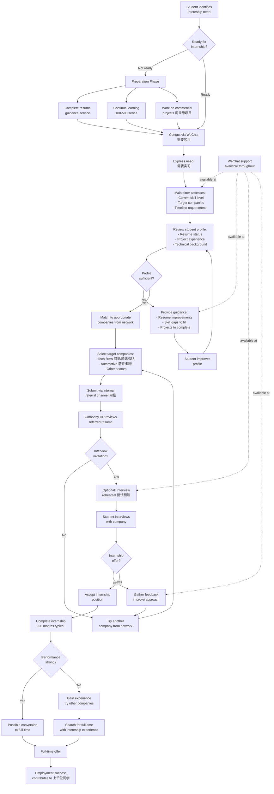
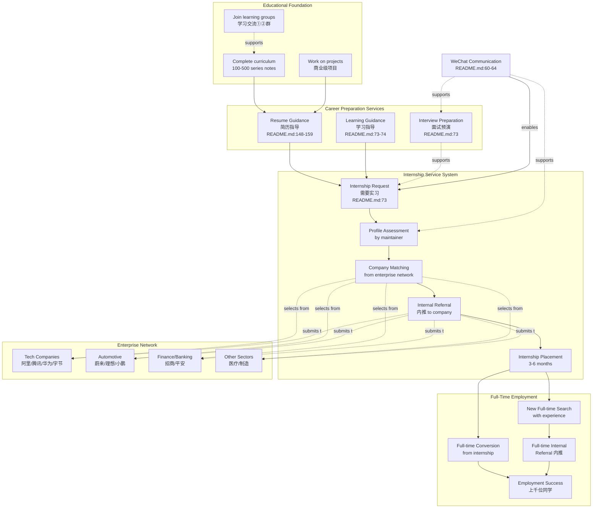
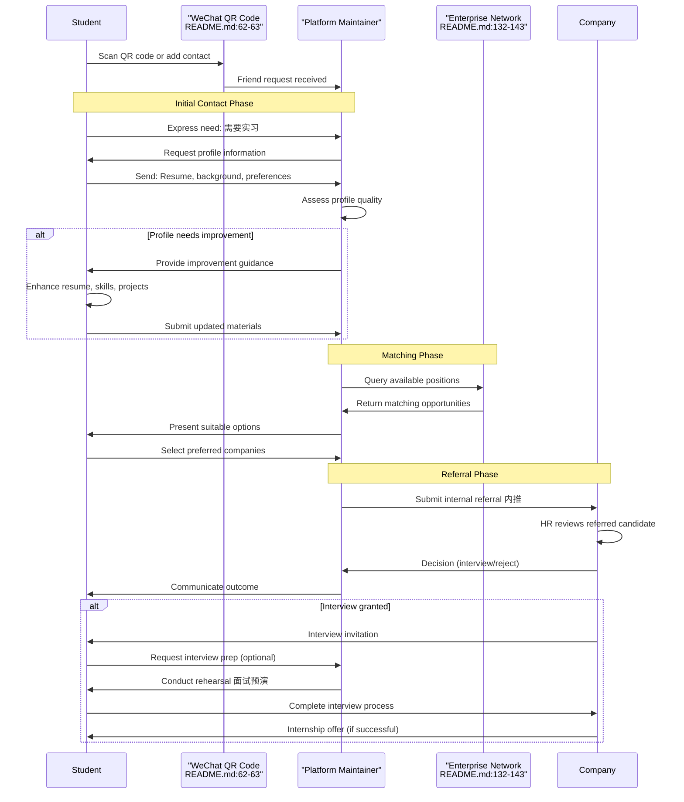
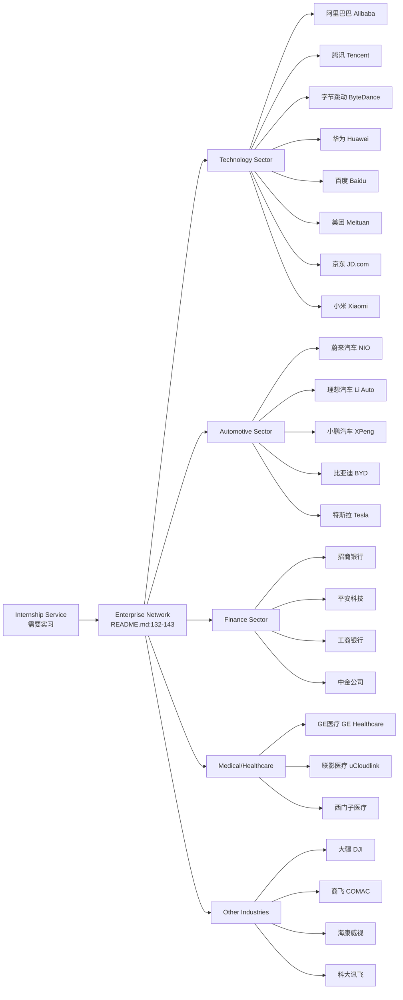
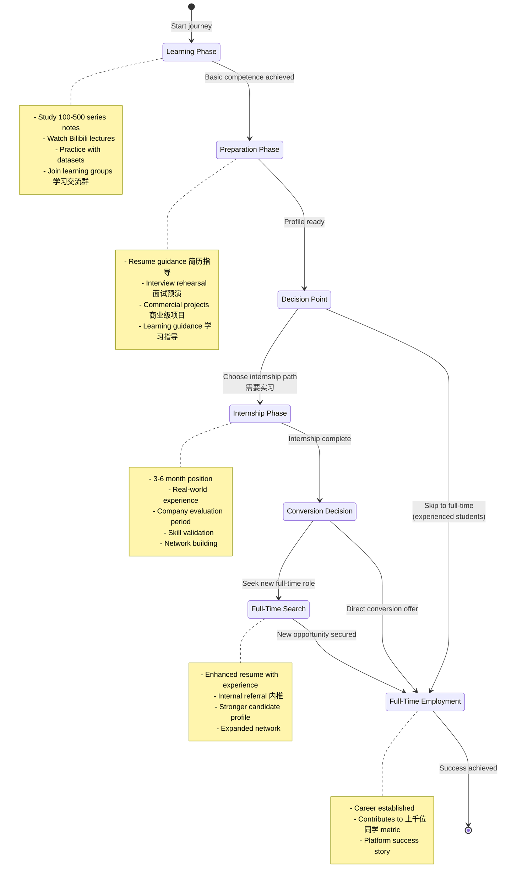
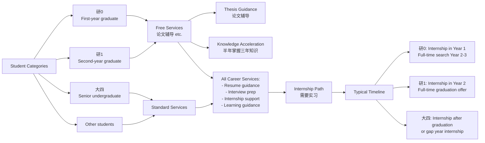
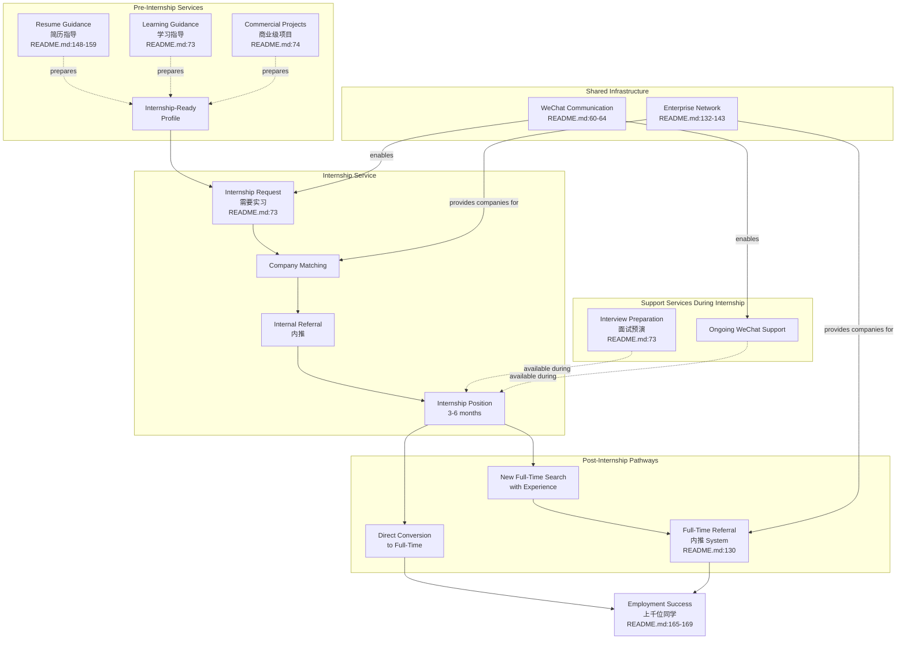
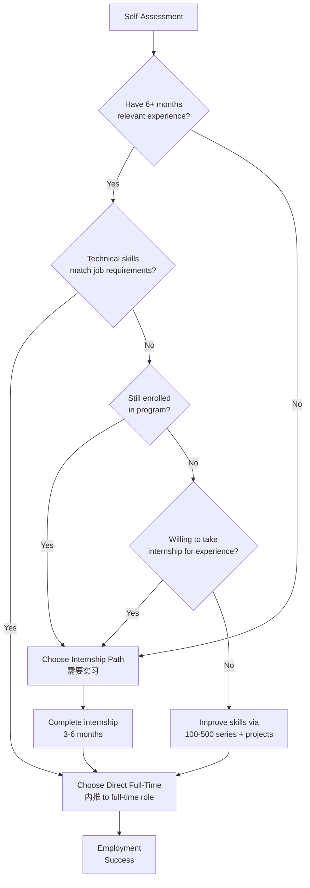

<!-- source: DeepWiki mcp.deepwiki.com · repo AccumulateMore/CV · page 5.7 Internship Opportunities · fetched 2026-10-29 -->

# Internship Opportunities

Relevant source files

The following files were used as context for generating this wiki page:

- [README.md](README.md)

## Purpose and Scope

This document describes the internship support service offered through the platform's career services infrastructure. The system enables students to request and secure internship positions as a critical stepping stone toward full-time employment. Internships serve as a bridge between academic learning and professional work, providing practical experience that strengthens candidates' profiles for subsequent full-time roles.

For information about full-time job placement through internal referrals, see [Internal Referral System](#5.4). For details about specific company opportunities, see [uCloudlink Medical Opportunities](#5.5) and [Enterprise Referral Network](#5.6). For preparation services before seeking internships, see [Resume Guidance](#5.1), [Interview Preparation](#5.2), and [Learning and Career Guidance](#5.3).

**Sources:** [README.md:73](), [README.md:58-75]()

---

## Internship Service Overview

The platform provides dedicated internship placement support accessible through the WeChat communication channel. Students can request internship assistance by contacting the maintainer directly, with "需要实习" (need internship) listed as one of the explicitly supported service categories.

### Service Characteristics

| Aspect | Description |
|--------|-------------|
| **Access Method** | WeChat contact with explicit need statement |
| **Target Users** | Current students (研0研1), undergraduates, early career seekers |
| **Service Type** | Placement assistance, company matching, referral support |
| **Integration** | Connects to enterprise referral network (5.6) |
| **Progression Path** | Internship → Full-time conversion or new full-time role |

The internship service leverages the same enterprise network documented in the referral system, providing access to companies across multiple sectors including technology, automotive, finance, and healthcare.

**Sources:** [README.md:70-74](), [README.md:132-143]()

---

## Internship Request Workflow

The following diagram illustrates the complete process for requesting and securing an internship through the platform's career services system.

### Diagram: Internship Request and Placement Process

**Sources:** [README.md:70-74](), [README.md:165-169]()

---

## Integration with Career Services Pipeline

Internship opportunities are integrated into the broader career development system, working in conjunction with other support services to maximize student success.

### Diagram: Internship Position in Career Services Architecture

**Sources:** [README.md:70-74](), [README.md:132-143](), [README.md:165-169]()

---

## Access Method and Communication Protocol

### Contacting for Internship Support

The internship service is accessed through the WeChat communication system. Students should follow the documented contact protocol to ensure efficient processing of their requests.

#### Contact Steps

### Valid Contact Reasons

The platform explicitly lists acceptable reasons for WeChat contact, with "需要实习" as a supported service request:

| Request Category | Chinese | Purpose |
|------------------|---------|---------|
| Internship Need | 需要实习 | Request assistance securing internship positions |
| Resume Guidance | 指导改简历 | Resume review and improvement suggestions |
| Interview Rehearsal | 面试预演 | Mock interview practice and feedback |
| Learning Guidance | 需要学习指导 | Career path and skill development direction |
| Dataset Access | 要数据集 | Access to training datasets when links fail |
| Group Joining | 要进学习交流群 | Join WeChat learning exchange groups |
| Commercial Projects | 需要商业级项目 | Guidance on industry-level projects |
| Thesis Guidance | 需要论文辅导 | Academic research support (研0研1 free) |

Students should clearly state their need as "需要实习" in the initial message to ensure proper routing to the internship placement service.

**Sources:** [README.md:68-74](), [README.md:60-64]()

---

## Enterprise Network for Internships

The internship service leverages the same extensive enterprise network used for full-time referrals. The network spans multiple industries and includes both large corporations and specialized firms.

### Available Company Categories

### Company Network Statistics

The platform maintains referral relationships with a broad network of employers:

| Category | Example Companies | Notes |
|----------|-------------------|-------|
| **Internet/Tech** | 阿里/腾讯/字节跳动/美团/京东/百度/华为/小米 | Largest referral volume |
| **Automotive** | 蔚来/理想/小鹏/比亚迪/特斯拉/宁德时代 | Growing sector for AI/ML roles |
| **AI Companies** | 商汤/旷视/智谱/寒武纪/地平线/依图/云从 | Specialized deep learning positions |
| **Financial** | 招商银行/平安科技/工商银行/中金公司 | Algorithm and data science roles |
| **Medical** | GE医疗/联影医疗/西门子医疗 | Medical imaging and AI |
| **Consumer Electronics** | OPPO/vivo/小米/京东方 | Hardware + AI integration |
| **Telecommunications** | 中国移动/联通/电信/中兴通讯 | Network and AI infrastructure |
| **Other** | 大疆/商飞/海康威视/科大讯飞 | Diverse technical domains |

**Sources:** [README.md:132-143]()

---

## Internship as Career Progression Stage

Internships serve as a critical stage in the career development pipeline, bridging the gap between academic learning and full-time employment.

### Career Stage Progression Model

### Internship Strategic Value

| Benefit | Description | Impact on Full-Time Search |
|---------|-------------|----------------------------|
| **Experience Validation** | Demonstrates ability to work in production environments | Significantly strengthens resume |
| **Company Evaluation** | Allows both parties to assess fit before full commitment | Reduces hiring risk for employers |
| **Skill Application** | Applies academic learning to real-world problems | Provides concrete examples for interviews |
| **Network Expansion** | Builds professional connections within industry | Opens additional referral opportunities |
| **Conversion Possibility** | Strong performance may lead to direct full-time offer | Fastest path to employment |
| **Resume Enhancement** | Adds professional experience section | Differentiates from purely academic candidates |

**Sources:** [README.md:165-175]()

---

## Special Provisions for Students

The platform provides special support for early-stage students, particularly those in their first years of graduate programs (研0研1).

### Student Support Model

### Timeline Recommendations

| Student Status | Recommended Action | Expected Outcome |
|----------------|-------------------|------------------|
| **研0 (First-year graduate)** | Request internship early in program | Gain experience, potentially convert to full-time by graduation |
| **研1 (Second-year graduate)** | Internship in second year | Maximize chance of graduation offer |
| **大四 (Senior undergraduate)** | Internship after graduation or during gap period | Build experience before full-time search |
| **Experienced learners** | May skip directly to full-time referral | Leverage existing background |

**Sources:** [README.md:70-74]()

---

## Success Metrics and Outcomes

The internship service contributes to the platform's overall success in placing students into employment positions.

### Documented Success Metrics

| Metric | Value | Significance |
|--------|-------|--------------|
| **Total Students Placed** | 上千位同学 (Thousands of students) | Demonstrates scale and proven track record |
| **2024 Referral Ranking** | 年度内推第一名 (Top referral provider of the year) | Validates effectiveness of referral network |
| **Employment Success Rate** | High (inferred from metrics) | Students successfully transition from learning to employment |
| **Company Network Size** | 100+ major enterprises | Provides diverse internship opportunities |

### Success Factor Analysis

The platform achieves high internship-to-employment conversion through several mechanisms:

1. **Preparation Integration**: Internship support builds on resume guidance and interview preparation
2. **Network Leverage**: Access to internal referral channels (内推) across major companies
3. **Continuous Support**: WeChat-based guidance throughout the internship period
4. **Quality Matching**: Maintainer assesses fit between student profiles and company needs
5. **Experience Building**: Internships provide resume material for subsequent opportunities

**Sources:** [README.md:165-169]()

---

## Relationship to Other Career Services

The internship service operates as part of the comprehensive career services ecosystem rather than as an isolated offering.

### Service Interdependencies

**Sources:** [README.md:68-74](), [README.md:130](), [README.md:132-143](), [README.md:165-169]()

---

## Practical Workflow Example

### Typical Internship Request Scenario

A concrete example of how a student would use the internship service:

1. **Initial Contact** (via [README.md:62-63]())
   - Student scans WeChat QR code from README
   - Adds platform maintainer as contact
   - Initial message: "需要实习" (need internship)

2. **Profile Submission**
   - Student provides current resume
   - Specifies preferred industry (e.g., computer vision, NLP, large models)
   - Indicates geographical preferences (Shanghai, Beijing, Shenzhen, etc.)
   - Shares timeline requirements (when internship should start)

3. **Assessment Phase**
   - Maintainer reviews technical background from resume
   - Evaluates completed course series (100-500 notes)
   - Assesses project experience
   - Identifies any gaps requiring improvement

4. **Guidance Phase** (if needed)
   - Recommendations for resume improvements (see [README.md:148-159]())
   - Suggestions for skill development
   - Advice on commercial project participation
   - Timeline for resubmission

5. **Matching Phase**
   - Maintainer identifies suitable companies from network (see [README.md:132-143]())
   - Presents 3-5 potential opportunities
   - Student selects preferred targets
   - Maintainer confirms company requirements alignment

6. **Referral Submission**
   - Resume submitted through internal referral channels (内推)
   - Maintainer provides context to company HR
   - Follows up on application status

7. **Interview Phase**
   - Student receives interview invitation
   - Optional: Request interview rehearsal (面试预演)
   - Conducts company interview
   - Receives feedback and outcome

8. **Placement and Follow-Up**
   - Internship offer accepted
   - Ongoing support via WeChat during internship
   - Guidance on conversion strategy
   - Support for full-time search if needed

**Sources:** [README.md:68-74](), [README.md:130](), [README.md:148-159]()

---

## Key Differences from Full-Time Referrals

While the internship service shares infrastructure with the full-time referral system, there are important distinctions:

| Aspect | Internship Service (需要实习) | Full-Time Referral (内推) |
|--------|-------------------------------|---------------------------|
| **Target Users** | Current students, early career | Job-ready candidates |
| **Position Duration** | 3-6 months (temporary) | Permanent employment |
| **Requirements** | Lower experience bar, potential for learning | Higher skill requirements, immediate productivity |
| **Conversion Potential** | May lead to full-time offer | Already full-time position |
| **Strategic Purpose** | Build experience, validate skills | Direct employment placement |
| **Timeline Flexibility** | Can align with academic schedule | Typically immediate start |
| **Evaluation Period** | Built into internship structure | Standard probation period |
| **Resume Impact** | Adds professional experience | Adds permanent role |

### When to Choose Internship vs. Direct Full-Time

**Sources:** [README.md:73](), [README.md:130]()

---

## Summary

The internship support service provides a structured pathway for students to enter the professional workforce through temporary positions that can lead to full-time employment. Key characteristics include:

- **Access via WeChat** with explicit "需要实习" request
- **Integration with career preparation services** (resume guidance, interview prep)
- **Leverages enterprise referral network** of 100+ major companies
- **Supports student progression** from learning to professional experience
- **Contributes to platform success metrics** (上千位同学 placed)
- **Serves as stepping stone** to full-time employment opportunities

The service fills a critical gap in the career development pipeline, enabling students without prior professional experience to gain the credentials needed for competitive full-time positions.

**Sources:** [README.md:68-74](), [README.md:132-143](), [README.md:165-169]()

---

