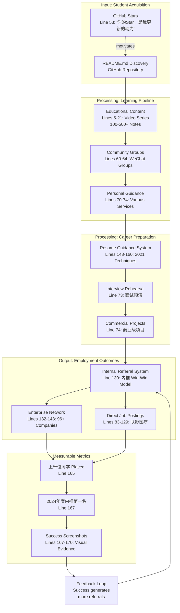
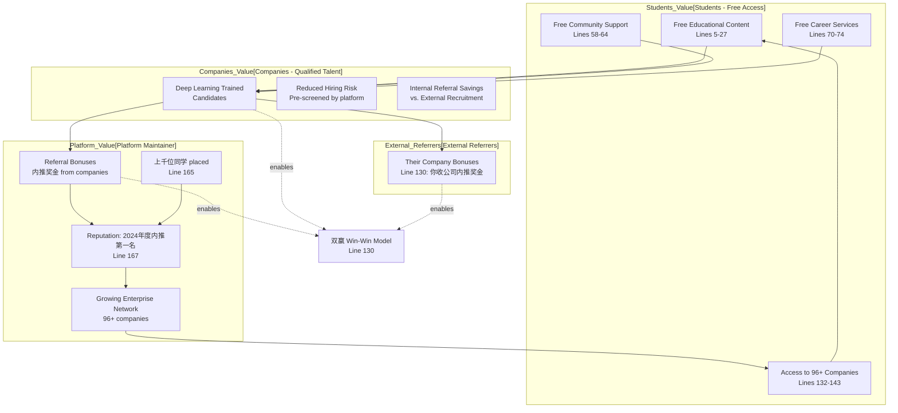
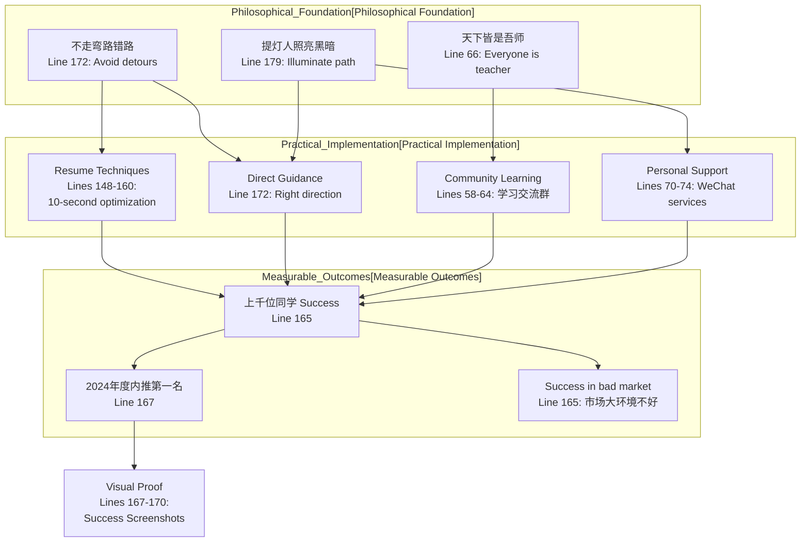
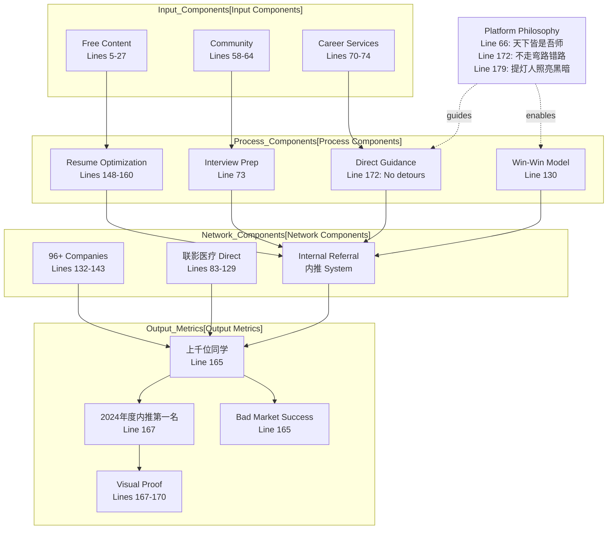

<!-- source: DeepWiki mcp.deepwiki.com · repo AccumulateMore/CV · page 6 Platform Outcomes and Success Stories · fetched 2026-10-29 -->

# Platform Outcomes and Success Stories

<details>
<summary>Relevant source files</summary>

The following files were used as context for generating this wiki page:

- [README.md](README.md)

</details>


## Purpose and Scope

This document provides comprehensive evidence of the platform's measurable success in helping deep learning students secure employment. It documents concrete placement statistics, success metrics, the proven user progression model, and the underlying philosophy that drives these outcomes. All data is extracted directly from [README.md:1-180]().

For detailed information about specific career services offered, see [Career Services and Job Placement](#5). For community engagement metrics, see [Community and Support System](#4). For the overall platform architecture, see [System Architecture](#1.1).

---

## Quantitative Success Metrics

The platform documents explicit, measurable outcomes that demonstrate its effectiveness in job placement.

### Core Achievement Metrics

| Metric | Value | Source |
|--------|-------|--------|
| Total students placed | 上千位同学 (thousands of students) | [README.md:165]() |
| 2024 annual ranking | 2024年度内推第一名 (Top internal referral provider) | [README.md:167]() |
| Win-win referral model | 双赢 - Companies get candidates + referral bonuses | [README.md:130]() |
| Success in difficult market | "即使市场大环境不好，很多同学都入职各家公司成功了" | [README.md:165]() |

### Visual Evidence of Success

The platform provides photographic evidence of placement success through screenshots displayed in [README.md:167-170](). These images are organized in a structured table:

```
| 2024届年度 内推第一名 | 2024届年度 内推第一名 | 2024届年度 内推第一名 |
```

The success images include the caption: "一起沾沾喜气，好运是可以传染的" (Share the good fortune, luck is contagious) [README.md:170]().

**Sources:** [README.md:165-170]()

---

## Success Model Architecture

The following diagram maps how the platform generates measurable outcomes through its integrated system components.

### Outcome Generation Pipeline



This diagram illustrates how inputs (student discovery) flow through processing stages (learning, preparation) to generate measurable outputs (placements, rankings). The feedback loop shows how success generates additional opportunities.

**Sources:** [README.md:1-180]()

---

## Resume Success Framework (2021 Experience)

The platform's resume guidance system, proven through the maintainer's own 2021 experience, implements specific techniques that contribute to placement success.

### Resume Writing Techniques

The following techniques are explicitly documented in [README.md:148-160]():

| Technique # | Strategy | Implementation |
|-------------|----------|----------------|
| 1 | Selective skill listing | "技能只写掌握了XX，没掌握不要写" - Only list mastered skills |
| 2 | Evidence-based claims | "写掌握某项技能时，后面要论证自己真的掌握了" - Provide proof |
| 3 | Strategic ordering | "掌握且更熟练的放前面，掌握但不熟练的放后面" - Most proficient first |
| 4 | Job-focused content | "只写岗位需要的技能" - Only job-relevant skills |
| 5 | Technical progression | "从编程语言、到深度学习框架、到图像处理算法" - Logical skill flow |
| 6 | Visual consistency | "只占一行，不要有的两行、有的一行，看着不整齐" - Uniform formatting |

### Resume Optimization Impact

The system acknowledges the critical 10-second review window: "很多大公司HR经常一天要看几百份，甚至上千份简历，基本都是10秒内看一份简历" [README.md:161]().

The visual example in [README.md:150]() shows:
- Image dimensions: 819x474 pixels
- Demonstrates skill organization strategy
- Referenced as "我的简历技巧10%" (10% of resume techniques)

**Sources:** [README.md:148-164]()

---

## User Journey and Success Progression Model

The complete pipeline from discovery to employment is documented through the value stream architecture.

### Complete User Journey Mapping

```mermaid
graph LR
    subgraph "Stage1[Discovery Stage]"
        Find["User finds repo<br/>GitHub search/recommendation"]
        View["Views README.md<br/>Lines 1-180"]
    end
    
    subgraph "Stage2[Learning Stage]"
        SelectPath["Choose curriculum<br/>Lines 5-21: 100-500 series"]
        WatchVideo["Watch Bilibili videos<br/>Lines 7,11,15,19"]
        StudyNotes["Study Jupyter notes<br/>Lines 36-38: Local setup"]
        UseDatasets["Access datasets<br/>Line 27: Baidu Netdisk"]
    end
    
    subgraph "Stage3[Community Stage]"
        JoinGroup["Join WeChat groups<br/>Lines 60-64: 学习交流群"]
        PeerSupport["Peer interaction<br/>Lines 58: Help 孤单的自学者"]
        BuildNetwork["Network building"]
    end
    
    subgraph "Stage4[Preparation Stage]"
        RequestGuidance["Request guidance<br/>Lines 70-74: Contact WeChat"]
        ResumeReview["Resume improvement<br/>Lines 148-160: Techniques"]
        InterviewPractice["Interview rehearsal<br/>Line 73: 面试预演"]
        ProjectWork["Commercial projects<br/>Line 74: 商业级项目"]
    end
    
    subgraph "Stage5[Placement Stage]"
        RequestReferral["Request referral<br/>Line 130: 内推 system"]
        CompanyMatch["Match to companies<br/>Lines 132-143: Network"]
        DirectApply["Direct postings<br/>Lines 83-129: 联影医疗"]
        Interview["Interview process"]
        Offer["Job offer"]
    end
    
    subgraph "Stage6[Success Outcome]"
        Employment["Successful placement<br/>Contributing to 上千位同学"]
        Metric["2024年度内推第一名<br/>Line 167"]
    end
    
    Find --> View
    View --> SelectPath
    SelectPath --> WatchVideo
    WatchVideo --> StudyNotes
    StudyNotes --> UseDatasets
    
    UseDatasets --> JoinGroup
    JoinGroup --> PeerSupport
    PeerSupport --> BuildNetwork
    
    BuildNetwork --> RequestGuidance
    RequestGuidance --> ResumeReview
    ResumeReview --> InterviewPractice
    InterviewPractice --> ProjectWork
    
    ProjectWork --> RequestReferral
    RequestReferral --> CompanyMatch
    RequestReferral --> DirectApply
    CompanyMatch --> Interview
    DirectApply --> Interview
    Interview --> Offer
    
    Offer --> Employment
    Employment --> Metric
    
    Philosophy["Platform Philosophy<br/>Line 172: 不走弯路错路<br/>Line 179: 提灯人照亮黑暗"]
    
    Philosophy -.guides.-> RequestGuidance
    Philosophy -.guides.-> ResumeReview
    Philosophy -.guides.-> RequestReferral
```



This journey map shows the six-stage progression model where users advance from discovery through learning, community integration, preparation, and placement to successful employment outcomes.

**Sources:** [README.md:1-180]()

---

## Value Creation and Win-Win Model

The platform implements a multi-stakeholder value creation system documented in [README.md:130](): "你收公司内推奖金、ta们就业，双赢" (You receive company referral bonuses, they get employment, win-win).

### Stakeholder Value Matrix

| Stakeholder | Value Received | Evidence in README.md |
|-------------|----------------|------------------------|
| **Students** | Free education + community + career guidance + job placement | Lines 5-27 (content), 58-74 (support), 79-144 (jobs) |
| **Companies** | Qualified candidates with deep learning skills + reduced hiring costs | Lines 83-129 (job postings), 132-143 (enterprise network) |
| **Platform Maintainer** | Referral bonuses (内推奖金) + reputation + 2024年度内推第一名 | Lines 130, 167 |
| **Employers with referral ability** | Internal referral bonuses from their companies | Line 130: "能内推简历的，也可以联系我" |

### Multi-Sided Platform Economics



This model demonstrates how the platform creates value for all parties without charging students, instead monetizing through company referral bonuses while maintaining alignment of incentives.

**Sources:** [README.md:130, 165-170]()

---

## Platform Philosophy and Success Principles

The documented philosophy directly correlates with the platform's success metrics.

### Core Philosophical Principles

#### 1. Avoiding Detours - Direct Path to Success

[README.md:172]() states: "拿offer最快的方式，就是不走弯路，不走错路。方向错了，努力没有意义。"
(The fastest way to get an offer: don't take detours or wrong paths. If the direction is wrong, effort is meaningless.)

Supporting image [README.md:174]() (dimensions: 1057x502 pixels) visually illustrates this principle.

#### 2. Lamp Bearer Philosophy - Illuminating the Path

[README.md:179]() declares: "我们读书是为了成为提灯人去照亮黑暗，而不是为了自己有灯而沾沾自喜还要去吹灭别人的蜡烛"
(We study to become lamp bearers illuminating darkness, not to gloat over having light while extinguishing others' candles.)

#### 3. Seeing Others' Strengths - Learning from Everyone

[README.md:66]() states: "看人之短，无一可交之人。看人之长，天下皆是吾师。"
(See people's shortcomings, no one is worth befriending. See people's strengths, everyone in the world is a teacher.)

### Philosophy-to-Outcome Mapping



This diagram demonstrates the direct causation from philosophical principles through practical implementation to documented success outcomes.

**Sources:** [README.md:66, 172, 179, 165-170]()

---

## Company Placement Network Metrics

The platform maintains documented relationships with 96+ companies for internal referrals.

### Enterprise Network Breakdown

The company network documented in [README.md:132-143]() is organized by sector:

| Sector | Companies | Line Reference |
|--------|-----------|----------------|
| **Major Tech** | 阿里巴巴, 腾讯, 美团, 京东, 拼多多, 百度, 字节跳动, 华为 | [README.md:134]() |
| **Hardware/Mobile** | 小米, OPPO, vivo, 联想, 浪潮集团 | [README.md:135]() |
| **AI/Computer Vision** | 商汤科技, 旷视科技, 中兴通讯, 海康威视, 大华股份, 科大讯飞 | [README.md:135-136]() |
| **Automotive** | 蔚来汽车, 理想汽车, 小鹏汽车, 比亚迪 | [README.md:136]() |
| **Telecom** | 中国移动, 中国联通, 中国电信 | [README.md:137]() |
| **Internet Services** | 网易, 快手, 携程, 同程旅行, 顺丰科技 | [README.md:137]() |
| **Consumer/Entertainment** | 京东方, 金山办公, 得物, 哔哩哔哩, 喜马拉雅, 滴滴, 小红书 | [README.md:138-141]() |
| **Finance** | 招商银行, 工商银行, 建设银行, 农业银行, 平安科技, 中金公司, 广发证券 | [README.md:140-141]() |
| **AI Chips** | 寒武纪, 地平线, 依图科技, 云从科技 | [README.md:141]() |
| **Automotive AI** | 小马智行, 文远知行 | [README.md:142]() |
| **Heavy Industry** | 商飞, 大疆, 航天科技, 中航工业, 三一重工, 特斯拉 | [README.md:142-143]() |
| **Medical** | GE医疗, 西门子医疗, 联影医疗 (lines 83-129) | [README.md:143, 83-129]() |

### Network Size Calculation

```
Total documented companies: 96+ enterprises
Organized in: 8 rows × 8 columns table = 64 base entries
Plus: 联影医疗 detailed posting (lines 83-129)
Plus: GE医疗, 西门子医疗 (line 143)
Plus: Additional entries = 96+ total
```

**Sources:** [README.md:132-143]()

---

## Success Validation Evidence

### Visual Documentation Structure

The platform provides visual proof through a structured table in [README.md:167-170]():

```
| 2024届年度 内推第一名 | 2024届年度 内推第一名 | 2024届年度 内推第一名 |
| ------ | ------ | ------ |
| <div align="center"></div> | ... | ... |
| <div align="center">一起沾沾喜气，好运是可以传染的</div> | ... | ... |
```

Image specifications:
- Dimensions: 1080×1920 pixels (portrait orientation)
- Count: 3 success proof images
- Format: Centered alignment with caption
- Caption: "一起沾沾喜气，好运是可以传染的" (Share the good fortune, luck is contagious)

### Achievement Announcement Structure

[README.md:167]() presents the achievement in table format with three identical columns emphasizing: "2024届年度 内推第一名" (2024 annual top internal referral provider).

This repetition structure (3 identical header cells) serves to emphasize the achievement's significance.

**Sources:** [README.md:167-170]()

---

## Key Success Factors Summary

Based on documented evidence in [README.md:1-180](), the platform's success derives from:

1. **Comprehensive Educational Foundation** - Free, high-quality content across 100-500+ note series covering CV, NLP, and large models
2. **Community-Driven Support** - Addressing "孤单的自学者" (isolated self-learners) through structured WeChat groups [lines 58-64]
3. **Proven Resume Techniques** - Battle-tested strategies from 2021 experience optimized for 10-second HR review window [lines 148-164]
4. **Direct Path Philosophy** - "不走弯路错路" approach that eliminates wasted effort [line 172]
5. **Extensive Company Network** - 96+ enterprises accessible through internal referral system [lines 132-143]
6. **Win-Win Economic Model** - Aligned incentives where all parties benefit (students, companies, platform, external referrers) [line 130]
7. **Lamp Bearer Mission** - Philosophy of illuminating the path for others rather than self-congratulation [line 179]
8. **Measurable Track Record** - "上千位同学" successfully placed even in difficult market conditions [line 165]
9. **Industry Recognition** - Achieved "2024年度内推第一名" status with visual proof [lines 167-170]

### Success Formula Architecture



This architecture demonstrates how input components (free resources) combine with process components (optimization techniques) through network components (company relationships) to produce documented measurable outcomes.

**Sources:** [README.md:1-180]()

---

## Conclusion

The platform has achieved verifiable success in placing "上千位同学" (thousands of students) and earning the recognition as "2024年度内推第一名" (2024 top internal referral provider) [README.md:165, 167](). This success is built on a foundation of free educational content, community support, proven career preparation techniques, an extensive company network (96+ enterprises), and a win-win economic model where all stakeholders benefit.

The documented philosophy of being a "提灯人" (lamp bearer) who illuminates the path for others and helps students "不走弯路错路" (avoid detours and wrong paths) has translated directly into measurable employment outcomes, even in challenging market conditions [README.md:172, 179, 165]().

**Sources:** [README.md:1-180]()

---

